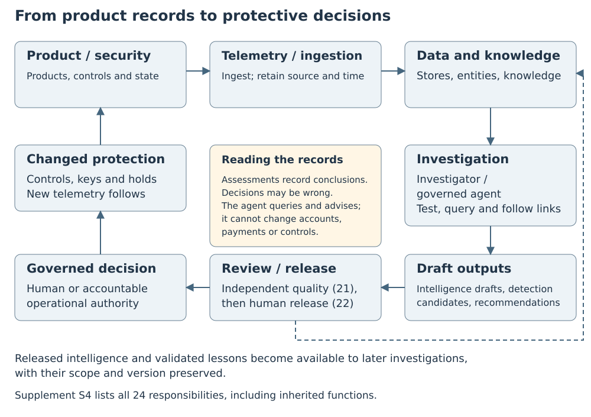
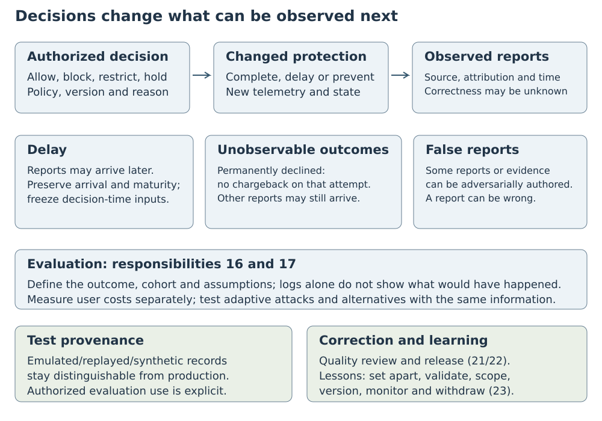
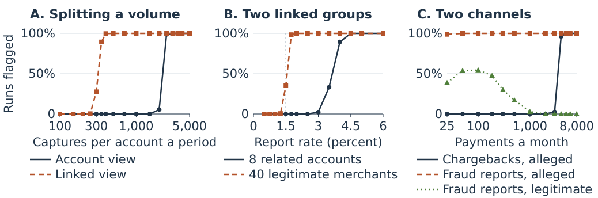

# Threat Analytics Across Payment Products: Evidence Requirements for Agent Investigations

Jonathan Matkowsky

New York, New York. Correspondence: Jonathan@matkowsky.com

25 November 2026 · Accepted working draft for version 1.1 · Not published · Not peer reviewed

## Abstract

Abuse of a payment platform can cross products and accounts, and the platform's own protective decisions change which outcomes can later be observed. A blocked payment cannot produce a chargeback; an incomplete search cannot establish absence; a reused conclusion cannot corroborate itself. This paper specifies the records an AI agent needs to investigate such cases under human authority, in three requirements. First, each outcome record links to the control decision that may have shaped it, with separate fields for reporting delay, outcomes the decision made unobservable, and false reports. Second, a gateway outside the agent records what each query actually covered, and every fact keeps when it happened and when the system learned it. Third, a person must release a conclusion before it enters organizational memory for reuse; a released conclusion serves only as a hypothesis or context, and any record an agent output informed links back to that output.

Draft schemas, 29 cross-record rules and two reference checkers make the requirements testable; frozen rules rejected two of 12 adversarial histories from a second model and, after revision, 11 of 13 from a third. A model-coded count across 14 FTC complaints shows how often each tactic is alleged. Three court records state most of those tactics as fact and mark a limit: in each, a processor had the information or ran the conduct. Synthetic replays of two complaints show what the records expose and miss. In two hypothetical investigations, AI models given written versions made more counted errors with records modeled on providers' documentation than with the specified records in 4 of 32 planned comparisons, and fewer in 2. Public sources supply the premises, and Stripe's documentation an illustrative product scope. The specification is a synthesis of established methods and recent agent-governance designs, not a new method. The architecture has not been built, no private platform data were used, its only experiments use synthetic records, one simulation and written cases answered by AI models, and no practitioner has reviewed it. The supplement provides the schemas, checkers and a closed-case audit kit for field studies.

**Keywords:** payment fraud, abuse investigation, threat intelligence, selective labels, agent memory, provenance, human oversight

## 1. Introduction

An investigation asks whether a card payment attempt drew a fraud chargeback. An AI agent queries the platform's feed of outcome reports for the attempt's reporting window, 4 February to 4 June 2026. The query covers the whole window and returns nothing. The agent drafts the conclusion that no fraud chargeback arrived, citing the query and a reading of the chargeback channel that shows its window closed with no report. A person releases it into the platform's memory, where later investigations can read it. Table 1 removes one group of records at a time from this synthetic case.

**Table 1. One conclusion with each group of records removed.** Each row is a pair of synthetic histories that the remaining records cannot tell apart (Supplement S4.4): the first two on this claim, the third on an earlier conclusion in the same history.

| Records removed | What the rest appear to support | What the removed records can show |
|---|---|---|
| The control decision on the attempt and the state of its chargeback channel (C1) | No chargeback arrived, so the absence counts against fraud | The platform blocked the attempt, so no chargeback could arrive |
| The query's coverage (C2) | The query returned nothing, so no chargeback arrived by the end of the window | The report feed was loaded only to 20 May, so the query did not cover the end of the window |
| The release decision (C3) | The conclusion is in memory, so a later investigation may use it | No person released it, so it may not be reused |

Each possibility calls for a different conclusion and a different next step. The case rests on a short list of records: the control decision on the attempt, the state of its chargeback channel and a dated reading of that channel (C1); the query run with its coverage (C2); and the draft, the release decision and the released item (C3). The broader inventory of 71 signals and architecture of 24 responsibilities, which connect the requirements to the evidence an investigator checks and to who checks it, are reference material in Supplement S3 and S4.

Connecting more data is not enough: the connections must preserve what each record can establish. A payment log records activity. A risk score records a model's assessment. A control decision records what the platform allowed, blocked or restricted. An outcome label records a reported result, which may arrive late or be wrong. When these distinctions disappear, an investigation can mistake a decision for proof, an unobservable outcome for a benign one, or repeated analysis for corroboration.

Each failure has its own research literature. Selective-labels and counterfactual-evaluation methods address outcomes hidden by decisions. Temporal and incomplete-database research addresses when a fact became known and whether a query answer is complete. Provenance standards and agent-memory designs address the status of derived conclusions. These bodies of work mostly treat the failures one at a time. Some recent agent-memory and decision-record designs address two or three of them in part, and they differ on who may authorize reuse of a conclusion and what a reused conclusion can establish (Section 2). An investigation that spans payment products can meet all three failures in one case, so its records must keep all three visible together.

This paper specifies records for threat analytics: investigation that connects product activity to intelligence, proposed detections and control recommendations, then learns from later outcomes. The setting is a payment platform offering several products to businesses and their end customers. The investigator is an AI agent: software that uses a language model to choose queries and interpret their results. It works within human-assigned tasks and enforced access limits. It can investigate and recommend; authorized people or accountable operational systems decide what happens to accounts, payments and controls.

The design addresses three research questions:

**RQ1:** What records and analytical capabilities support investigation across payment products while preserving the meaning of observations and outcomes?

**RQ2:** How can an agent test explanations and prepare useful outputs while people retain review, release and operational authority?

**RQ3:** How can later outcomes and reusable lessons inform investigation without concealing the effects of controls or recycling conclusions as evidence?

The contribution is three requirements on the investigation's records:

**C1** links outcomes to decisions. An outcome channel is a route, such as a chargeback, by which an outcome can be reported. Each outcome record links to the control decision that may have shaped it, and to the status of each channel that the decision closed, delayed or changed. Late reports, outcomes that a control made unobservable, and false reports occupy separate fields. An evaluation can then state the joint assumptions it needs about delay, observability and report truth, each of which may depend on the decision (Section 7).

**C2** records query coverage and learned time. Query coverage is what a query actually covered: the data and period it examined, and whether its result was complete. Learned time is when a fact became available to the system's queries. Every query passes through a gateway, a checkpoint outside the agent, which records its coverage. Every fact keeps both when it happened and when the system learned it (Sections 5.1, 5.3 and 6.2).

**C3** requires human release before promotion into organizational memory. No agent output enters the evidence plane, which stores observations, as evidence of the activity under investigation (Sections 4.2 and 5.3); the agent's own outputs are recorded only as observations of what the agent did (Supplement S4.1). A person releases a conclusion into organizational memory, where it serves only as a hypothesis or context. Any record that an agent output informed links back to that output and counts as dependent, not as independent corroboration; a record written while an agent output is open to its writer counts as informed (Sections 4.2, 6.4 and 7.3).

The requirements work together. C1 identifies which outcomes the platform's decisions left observable. C2 establishes what an investigation examined and could have known. C3 prevents the resulting interpretation from returning as independent support for itself. A record can satisfy one requirement and still mislead an investigation through a failure of another (Section 8.3).

Draft schemas, 29 cross-record rules and two checkers make the requirements testable, and every rule has a failing case (Supplement S4). Fifteen histories written by a second model to test the rules exposed eight gaps, and the rules were revised on them. Against those revised and frozen rules, 10 of its next 12 histories meant to break a requirement passed, seven through new gaps. Revised again and frozen, the rules rejected 11 of 13 such histories from a third model; one passed under a stated limit, and one exposed a fault in a checker, since fixed. The testers differ, so this gain cannot be credited to the revision alone (Supplement S4.4). Two hypothetical investigations show which conclusions survive when particular records are missing, replays of two FTC complaints on synthetic records show what the records expose and miss, and a count across 14 such complaints shows how often each tactic is alleged. Three court records state most of those tactics as fact and mark a limit (Section 8).

The intended readers design, audit or evaluate investigation systems. Stripe's public product pages and documentation supply an illustrative product scope, not a description of its internal systems. The paper reports no implementation of the architecture and no measurement on platform data; its only experiments use synthetic records (Sections 8.4 and 8.5), one simulation of an interval method (Supplement S7.1) and written cases answered by AI models (Section 8.6). Sections 2 and 3 give the prior work and the derivation. Sections 4 and 5 answer RQ1, with Section 6.3 and Supplement Table S4.2 adding the agent's analytical capabilities; Section 6 answers RQ2 and Section 7 RQ3. Section 8 applies the design to hypothetical and public cases, and Section 9 states how its value would be tested.

## 2. Relationship to prior work

The three requirements combine established ideas in a specific setting. This section names each requirement's closest precedents and what the specification adds. Supplement S9 and its Table S9.1 give the extended comparison; S1 gives source passages, publication status and a 50-source requirements matrix.

### 2.1 Decisions shape the outcomes used to judge them

When a decision determines which cases receive outcome labels, evaluation faces the selective labels problem [@Lakkaraju2017Selective; @Kilbertus2020Fair]. Counterfactual analysis of logged decisions is most direct when the decisions were randomized with known probabilities. Each logged sample is then reweighted to reflect its probability under another decision rule, so that average outcomes under that rule can be estimated [@Bottou2013Counterfactual]. All these methods require assumptions about which comparisons the data support [@HernanRobins2020].

Payment research addresses delayed, missing and false fraud reports, and how alert-driven review biases training data [@Cao2019TitAnt; @DalPozzolo2017Fraud; @Tax2021Fraud; @Dhama2026Causal; @Dhama2026Limits; @HeLoh2026Grab]; Chapelle's advertising model treats a click with no conversion yet as unlabeled rather than negative [@Chapelle2014Delayed]. Two recent design preprints come closest to C1's record. One, the Decision Event Schema, seals each decision record once its hash is computed. Facts learned later, such as the arrival of ground truth, are appended as linked records that reference the decision, and links between decisions carry a type [@Solozobov2026DecisionTrace]. The other, an execution-coverage model, links records to decisions and distinguishes refused execution branches from late reports [@Wu2026EvidenceCoverage].

C1 applies these ideas to several outcome channels at once. It records what each decision closed, delayed or changed, separately for each channel and read time. A blocked card payment cannot produce a chargeback on that attempt, but an incident finding remains possible. C1 keeps the decision as the unit of record, as the Decision Event Schema does. Each outcome report is a separate appended record, linked to every decision that may have shaped it, with that decision's role. The schema has no field for outcome channels, but C1's fields could extend it rather than replace it (Section 7.1; Supplement S4.2). The proposed records expose the assumptions needed to interpret such outcomes; they do not supply a validated estimator. Section 7 develops this distinction.

### 2.2 Evidence depends on coverage, time and origin

Temporal databases distinguish when a fact held from when it was stored [@Snodgrass1986Temporal], and agent-memory designs retain the same two kinds of time [@Wang2026TOKI; @Rasmussen2025Zep; @Dan2026Anamnesis]. Research on incomplete databases relates the completeness of a query answer to which data are known to be complete [@Razniewski2011Completeness]. These precedents matter whenever a query returns no matching records or a relationship becomes known after its effective date.

C2 combines explicit query coverage with learned time. The execution-coverage model asks whether the records an execution owes had arrived by a cutoff. C2 records what each investigative query examined. A gateway outside the agent records the requested and examined data, access limits and known gaps. Each fact's learned time is when it became available to queries. A relationship learned today cannot appear in yesterday's reconstructed decision merely because it was in effect then, although later outcomes may still evaluate that fixed decision under a stated outcome window.

The W3C PROV data model expresses the derivation of one entity from another [@W3C2013PROVDM], and decision provenance records the data flows surrounding decisions [@Singh2019DecisionProvenance]. STIX separates observed data from intelligence assertions and opinions [@OASIS2021STIX], and US intelligence analytic standards ask analytic products to distinguish underlying information from assumptions and judgments [@ODNI2015ICD203]. For agent investigations, those distinctions must survive retrieval and reuse. The agent's own account of its work cannot establish what its tools actually examined; independently written run records are the relevant precedent [@Dai2026Hearsay].

### 2.3 Released conclusions remain conclusions

Truth-maintenance research records the support for conclusions and revises them when that support changes [@Doyle1979TMS; @Malheiro1994BeliefRevision]. A conceptual framework for language agents separates working, episodic, semantic and procedural memory [@Sumers2024CoALA], and a survey argues that agent memory should keep raw observations, extracted facts and inferred items apart, with derivation links [@Wang2026AgentTraces]. Together these establish substantial precedent for C3.

The closest designs differ in who authorizes reuse and what a reused item can establish. Anamnesis needs a separately recorded grant, not necessarily from a human, before a model-derived claim gains authority [@Dan2026Anamnesis]; GovMem permits automatic promotion or human review [@Qi2026GovMem]; and Quipu's write gate requires human approval only under some policies [@Brown2026Quipu]. A data-governance preprint is closer on authorization: no agent-proposed metadata decision is committed before a steward reviews it, and only verified records are admitted as precedent, but it does not say who authorizes promotion or what a retrieved precedent may establish [@Akhtar2026Contestable]. In Stripe's agent-assisted fraud modeling, the agents received earlier results for one attack, and the account does not say whether those were approved for reuse [@Drapeau2026ScalingRadar]. A threat-detection design drops its own compiled detections at ingest but leaves as a residual risk an analyst who copies one into a report that is later ingested [@Evron2026AdversaryBrains]. Supplement S9.4 describes these designs in full.

C3 adopts human release for every conclusion entering organizational memory. A released conclusion is reused only as context or a hypothesis, a limit the data-governance design does not state for its precedents; release does not turn it into an observation. Records informed by an agent output retain their dependence on it, including labels, detections and control decisions. Because the interfaces that write these records add the links, they also cover a person who writes a record while an agent output is open in the case, part of the relay the threat-detection design leaves open; a missing link still does not establish independence (Section 4.2). This is a design choice whose benefit and cost require testing, particularly through the agent-benefit and release-gate evaluations (E5 and E8, Section 9.1); it is not a claim that human approval guarantees truth.

### 2.4 What the combined specification contributes

Industrial payment systems supply examples of fast decisions and relationships between accounts [@Cao2019TitAnt; @Liu2018GEM]. Payment providers' public documentation already exposes parts of the first two requirements. One provider's risk dashboard shows whether transactions its risk engine allowed later resulted in a chargeback, and lists separately those it blocked [@Adyen2026RiskMonitoring]. Stripe's dispute analytics warns that rates by payment date can look lower for recent payments because customers can wait weeks to dispute [@Stripe2026DisputeAnalytics], and each scheduled query run records the as-of time of the data snapshot it queried [@Stripe2026SigmaRun]. The specification states what such joins, labels and timestamps must preserve for an investigation: which outcomes each decision closed, delayed or changed, and which reports are late or false. A governance synthesis for fraud risk decision systems combines decision traces, measures of evidence sufficiency under delayed labels and monitoring without labels, and extends them analytically to multi-agent systems [@Solozobov2026Synthesis]. It rates architectures by how many decision-record properties they fill by construction; it specifies no outcome channels, query coverage record or release rule for reuse. Supplement Table S1.1 locates these capabilities across research families.

Financial-sector and audit documents on AI agents address adjacent questions: a handbook from Project MindForge, an industry initiative led by the Monetary Authority of Singapore, a white paper on runtime safeguards for agentic finance and guidelines from India's computer emergency response team for auditing AI systems [@MindForge2026Operationalisation; @MAS2026SAFR; @CERTIn2026AIAudit]. Their provisions partly parallel C2, C3 and E8 (Supplement S9.3), but none asks for outcome records by channel (C1), separates when a fact held from when it became available to queries (C2), or requires human release before a conclusion is reused from memory (C3).

Two runtime-governance designs for financial agents bar context from authorizing actions and limit what counts as evidence; neither requires human release before reuse [@Tang2026SAGEFin; @Szpruch2026RuntimeGovernance].

Two payment-agent preprints show why specification and operational benefit must be kept apart. SR-Fraud separates scoring from reflection and tests proposed rules before reuse. On one replay benchmark it reports better detection than its scoring agent alone [@Tan2026SRFraud]; Supplement S9.2 gives its comparisons with classifiers. On 60 balanced synthetic cases that its classifier scored between 0.2 and 0.8, Sharma's agent was correct in 65.0 percent, below the 71.7 percent from thresholding the same classifier score at 0.5. Six of its eight overrides turned a correct decision into an error [@Sharma2026AuditableFraud]. Neither result establishes general agent performance: one rests on a single non-public replay benchmark, and the other on a small, balanced synthetic sample. Together they motivate comparing an agent with simpler alternatives given the same information.

This paper connects decision-shaped outcomes, query coverage and controlled reuse in one payment-investigation specification. The focused comparison does not establish uniqueness or exhaustive coverage, and operational value depends on the evaluations in Section 9.

## 3. Deriving the specification from public evidence

The design starts from documented product capabilities and asks how an adversary could misuse each one. For each abuse mechanism, a way abuse can occur, it then identifies the records needed to distinguish the malicious explanation from plausible alternatives. Stripe's public product catalog, roadmap and documentation define the illustrative scope; research, engineering accounts, incident reports and guidance supply the design premises.

The scope, read on 27 September 2026, contains 88 product and feature entries. A retained mechanism must target a documented capability, serve a plausible adversary goal and have supporting public evidence. Stripe's public job postings for abuse, risk and machine-learning roles helped prioritize topics as a statement of its current priorities, not as evidence of incidents [@Stripe2026; @StripeARE2026]. Supplement S2 records the 99 candidate mechanisms, how postings set priorities, the nine search paths and each candidate's final disposition; every mapped mechanism also has supporting sources beyond postings.

The resulting inventory, 71 signals in 12 families linked to 61 of the 99 candidate mechanisms, is in Supplement S3; S2 gives the disposition of the other 38. A crosswalk to MITRE's Fight Fraud Framework, whose technique list does not come from Stripe, checks the candidates for gaps (Section 9.2).

Three published schemas describe the platform's application programming interface (API), the interface through which software requests operations and receives data. Supplement S5 supplies the object, field or event supporting each match.

Supplement S1 records the version, relevant passages and use of each of the 134 works cited in the manuscript and supplement, and compares 50 sources against the three requirements. Supplement S3 lists the 61 design sources and the depth of each read. These records let readers inspect the synthesis; their counts do not measure evidence quality.

The synthesis distinguishes sourced findings, design choices and hypotheses (Supplement S2.1). One author, assisted by AI models, made the mappings and coverage judgments; agreement between independent human coders has not been measured. A model that took no part in the mapping, given a linking rule written afterward, made 49 of 52 sampled links and 70 that the paper lacks. The links are therefore a sourced subset, not a complete map (Supplement S3). Section 9.2 explains the limits this focused selection places on coverage and transfer.

The author used Anthropic Claude and OpenAI ChatGPT/Codex in the research. Where a result rests on models' answers, the supplement names each model and its session conditions (S3, S4.4, S8 and S10.1). The models searched for and read the sources, proposed the mappings and comparison codes, ran the prior-work search, wrote the scripts, synthetic data and figures, and reviewed drafts. Every cited work was read in full, or, for a book or standard, the cited chapters; Supplement S1 records the version and passages for each and names the few parts not read, such as reference pages. The author read each cited work to the same depth, and the manuscript and supplement in full, more than once before this version was released. A check script recomputes the counts, lineage and arithmetic on every proposed change. The author decided what entered the paper. Model review is not independent human peer review.

## 4. From product activity to protective decisions

This section identifies the parties whose activity the records describe, the path from records to protective decisions along which meaning must be preserved, and the responsibilities that path requires. It begins the answer to RQ1, which Section 5 continues and Section 6.3 completes.

### 4.1 The platform and its participants

The proposed payment platform serves businesses, which serve end customers. A business holds a platform account, or a connected account under another business that has integrated the platform into its product. A merchant is a business accepting payments through either account type. People act for businesses through operator accounts. Software agents may use delegated credentials for a business or end customer; these are distinct from the investigating agent.

These roles determine whose activity a record describes. An end customer's action is not automatically an action by the business or its operator.

### 4.2 The path from records to action

Data pipelines collect telemetry and state records, map them to shared entity and field definitions, and preserve their origins. Storage and correlation services make them searchable by time and entity. Investigators use them to prepare intelligence (assessments intended to inform decisions), proposed detections and recommendations. Authorized people or accountable operational systems decide whether to change controls, and those changes affect what later records can show (Figure 1).

Three feedback loops connect this work. **Investigative feedback** changes the next hypothesis or test within a case. **Organizational-learning feedback** makes released intelligence or tested procedures available to later cases as context. **Protective feedback** changes the platform through an authorized control or product decision. Their outputs require different authority and support different inferences.

The architecture separates three logical layers, called planes. They need not use separate databases:

- The **evidence plane** holds observations with their source, time and entities. Scores and control decisions belong here as observations of what a model concluded or a control did. Derived features belong here too, as values recomputable from recorded inputs; a feature computed over a cluster cites the cluster version it used, and the cluster itself remains a threat-knowledge item. A feature computed over a cluster that an agent proposed, or that depends on an agent output or released item, links back to that output or item and counts as dependent on it.
- The **structured threat-knowledge plane** holds revisable inferences, such as relationships between entities, groups of activity and conclusions with confidence and provenance.
- The **organizational-memory plane** holds released intelligence and tested lessons about procedure. These guide later work as hypotheses or context.

**Figure 1. From product records to protective decisions.** Investigation produces drafts. In the normal path, shown here, independent quality review precedes human release. Under Section 6.4, an authorized human may also decide urgent containment before review, without releasing the draft into organizational memory. Each resulting control decision records what the platform did, not whether the suspected abuse occurred.

For example, two accounts using the same device is an observation. Common control is an inference. A released report retaining that qualified inference becomes organizational memory; retrieving it creates no new observation. An investigator may follow its lineage to cite the original observations at their original times and sources. A threat-intelligence reference model traces each intelligence product's creator and modifiers [@Sakellariou2022CTIReferenceModel].

Dependence must also survive indirect reuse. A human label, assessment, control decision, detection or threat-knowledge item informed by an agent output links back to that output. Labeling, assessment, control, detection and threat-knowledge interfaces automatically attach every agent output and every released organizational-memory item open in the writer's case or session. Only a person with release authority may remove a link, and removal is logged. Intelligence sent outside the platform carries an identifier. When content bearing that identifier returns through an external feed, the external-knowledge record links to the released item and counts as dependent on it.

These records remain dependent on the agent output that informed them. They cannot independently corroborate the agent's findings, a detection derived from its work, or the same hypothesis. The links capture only exposure observed by the interfaces: an unlinked record may still reflect something its writer read elsewhere. A missing link therefore does not establish independence. Detections that rely on agent-dependent labels are validated on external outcome channels or on cases worked by staff without access to agent outputs.

This separation cannot repair missing source data. An agent cannot retrieve telemetry never collected, reconstruct timing discarded by a pipeline, or establish an entity link without suitable identifiers.

### 4.3 Responsibilities and authority

Supplement S4 defines 24 responsibilities for the investigation system. They are functions, not proposed teams or a required number of agents.

Payment authorization, payouts and account-review systems produce C1's decision records; their operational owners sit outside the investigation responsibilities.

Human tasking and release stay with people, and quality review remains independent of the work checked. Other functions may use one agent with tools, separate model sessions, several agents, fixed rules or a combination. Additional separation must justify its cost through narrower authority, access or failure scope.

The investigating agent may query permitted records and prepare intelligence, hunting and detection candidates, recommendations and proposed lessons. It cannot change accounts, payments or controls, certify its own output, or release conclusions into organizational memory.

## 5. Records an investigator can reason from

This section answers the records part of RQ1 in four steps: record classes that state what each record can establish (5.1), the abuse mechanisms that motivate particular records (5.2), the properties each store must preserve (5.3), and what public schemas supply and privacy obligations permit (5.4 and 5.5). Section 6.3 adds the capabilities.

### 5.1 Separate observations from conclusions

A payment log, risk score and fraud report may concern the same transaction but establish different facts. The log records activity, the score a model's assessment, and the report what someone alleged. Copies of one report are not independent confirmations. The record's class makes these limits explicit.

The same principle applies to relationships. A shared payout destination is observed; common control is inferred. Attribution, identifying a particular actor behind the activity, is a stronger claim requiring further support. An earlier attribution remains historical context when retrieved in a new case.

The specification uses seven record classes (Supplement Figure S3.1):

- **Source observations** record events or reports at their source.
- **Normalized observations** map source records to common entity and field definitions while retaining provenance.
- **Derived features** compute values from recorded inputs for specified entities and time windows.
- **Model or risk outputs** record assessments and the identity and version of the model.
- **Control outcomes** record decisions, whether or not they were correct.
- **Analytical inferences** state conclusions drawn from evidence.
- **Finished intelligence**, also called released intelligence, is analysis approved for reuse.

External knowledge is identified separately by source and type. It may be an observation, such as an exposed API key, an assessment, or a published catalog of abuse techniques. It supports what that source observed or described, not by itself a claim that abuse occurred inside the platform.

A class describes meaning, not reliability. A derived feature is only as reliable as its inputs and computation. An outcome label records who reported what and when; any separately established finding remains distinct.

Each normalized observation preserves its source and event identifiers, schema version, entities and lineage. It records event time and learned time, plus actor and request identifiers where available. Its environment distinguishes production from tests, synthetic data, replay or emulation. Its *tenant scope* identifies the business or other boundary within which the data may be accessed and used. Delivery identifiers prevent repeated delivery from counting or acting on one event twice.

Supplement Table S3.1 organizes the signals by family and class, and S3 defines each signal and the inputs of every derived feature.

### 5.2 How abuse mechanisms motivate the records

Each group of abuse mechanisms motivates particular records; Supplement S3.1 gives the public evidence for each and its limits. This section keeps the records for outcome labels, on which C1 depends.

#### Labels need their reporting path

An outcome label can be missing because its report is late or because a control prevented the outcome. It can also be present and false. Payment-specific theoretical work distinguishes these problems and proposes estimation methods under assumptions [@Dhama2026Causal]. The specification uses those distinctions to define records, without assuming that an estimator recovers hidden platform outcomes.

Each report keeps its type, source and attributed transaction or entity, with three times: when the outcome occurred, when it was reported and when it arrived. Its channel supplies a reporting window and clock-start event; the evaluation records separately its maturity period, how long it waits before reading a missing report as a negative. Every decision that may have shaped the report stays linked with its role, and each later status is a new record, so what the platform believed at each time can be reconstructed (Supplement S11.1).

An estimate that a report is false belongs to the assessment store, linked to the report with the responsible model or reviewer and version. This matters when supporting material itself may be fabricated, as participants describe for refund fraud involving generative AI [@Zhang2026Refund]. A report may be both late and false, so one status cannot replace the other.

### 5.3 Preserve meaning across stores, time and relationships

The investigation must be able to retrieve an observation, its interpretation and the decision it informed separately. Supplement Table S4.1 lists the properties each store must preserve.

**Write authority follows the record's meaning.** Ingestion appends to the evidence plane. Correlation software and the agent may propose threat-knowledge items; a person or accountable process accepts them. Agent proposals remain marked context and cannot support current-conduct claims without their underlying observations. Only a person releasing a reviewed draft or a tested, reviewed lesson adds or changes a claim in organizational memory. Later status records for a released item, such as monitoring findings, expiry and withdrawal, add no claim and record who or what wrote them. Rule checkers and quality reviewers write their findings on each draft version to the agent-and-approval ledger.

**Event time and learned time answer different questions.** A relationship added today with an earlier effective date was unavailable to yesterday's decision. Revisions, external facts, graph membership and feature definitions therefore retain the versions used. A derived fact's learned time is when that result became available to queries, not merely the latest availability of its inputs. It cannot precede any input's learned time.

A decision's reproducible snapshot need not copy the entire store. The system logs the inputs used and retains versions from which other then-available inputs can be reconstructed. This supports checking both what the decider used and what could have been known.

**Evaluation time differs from decision time.** Later outcomes may evaluate an earlier prediction whose features remain fixed. The evaluation declares its outcome window and maturity period. Training and model selection use a separate cutoff: labels unavailable then cannot enter them. Applying the decision-time cutoff to evaluation labels would wrongly exclude the late outcomes being measured.

**Channel state differs from report presence and access.** For each affected item, channel and read time, the records distinguish an open channel, a temporary delay, a permanent closure and unknown state. A missing report counts as a negative only after a defined window that remained open and was fully covered, and only under the channel's original meaning. Even then it is provisional, because network and bank rules can reopen a window. Inaccessible records do not erase a known channel state (Supplement S11.1).

**An entity link is not a claim of common control.** A verified identifier from the same namespace and relevant interval supports a stronger, or hard, link. A weaker, or soft, link may have several explanations: benign accounts can share a proxy IP address [@Liu2018GEM]. Both retain source and confounders (plausible alternative explanations). Account-age records address aged accounts sold for abuse [@Thomas2013]. Where crypto products are in scope, wallet-to-spender links record permissions motivated by phishing that induces harmful transactions [@Chen2025Phishing]. Supplement S4 defines each relationship's fields.

### 5.4 What public schemas reveal

This comparison shows how much of a required record a published interface already supplies and where the specification goes beyond it. It asks whether a proposed observation has at least a partial counterpart in a published object, field or event. Where the question applies, most signals have a partial counterpart, and a keyword search of the three published schemas found none for the rest.

Supplement S3 records the classification and its counts; S5 provides schema pins, hashes, event extracts and exact field locations. These findings describe the inspected schemas, not Stripe's private telemetry or every possible public interface.

### 5.5 Privacy and operating constraints

Privacy and operating obligations constrain the specification; Supplement S4.1 states them in full. A deployment must specify retention and deletion for each record class before collecting it. Append-only logs must still permit required deletion. The agent-and-approval ledger uses references to regulated data, not copies. Cross-business linking requires a stated purpose and authorization for each identifier type. This paper does not determine which legal basis applies in a particular deployment.

## 6. How the agent investigates

This section answers RQ2. It follows one investigation from its assignment to the release of its outputs, then addresses the inputs that could subvert it. Section 6.3 and Supplement Table S4.2 also complete the answer to RQ1 by listing the agent's analytical capabilities with the limit on what each can establish.

### 6.1 Set the question and scope

A human assigns an investigative question or approves a standing task template. The assignment defines permitted data, entities, period, current period and outputs. Each run records the assignment, or the template and its version, that authorized it, and duplicate alerts are merged into cases before tasking.

The agent applies the record-class limits while reasoning. A score can direct attention without establishing abuse. A control outcome records a decision of potentially unknown correctness. A feature retains its inputs, computation period and data freshness. A label must be read with its reporting path and the decisions that shaped it.

Earlier intelligence may suggest a hypothesis or a useful first query. Retrieval returns its publication date, relevance period, underlying sources, confidence, restrictions and corrections where recorded. Several reports repeating one observation remain one source of evidence. Claims about current conduct require observations from the current period.

### 6.2 Test explanations and interpret the query that ran

An investigation asks which observation would distinguish plausible explanations. The agent converts that question into a permitted query, such as reconstructing a timeline or following an entity link. It first establishes what the available schemas and services mean.

The loop is **context → hypothesis → permitted test → observation → interpretation → revised hypothesis or conclusion**. It may stop at an inconclusive assessment when the observations cannot separate the remaining explanations.

A complete result with no rows establishes only that no accessible rows matched. It counts against a hypothesis when the suspected activity should have produced that observation and the records cover where it would appear. Other results require different interpretations:

- A partial result supports no conclusion about the uncovered data or period.
- A truncated result may contain useful matches but cannot establish a population total.
- A denied query records an authorization decision.
- An unavailable dataset means the intended test did not occur.

The gateway that enforces the agent's scope (Section 6.5) also attaches the coverage record, independently of the agent. It records what the query requested and evaluated, the as-of cutoff that limits it to facts already learned, and, for each source, how far event time and loading had progressed, known gaps, the retention horizon and any sampling, filtering or limits reached (Supplement S11.2).

Fixed rules derive complete, partial, truncated, denied or unavailable status from that record; several statuses may apply. The agent can interpret results but cannot alter coverage fields. An unrecorded gap can still make a result appear complete, so recorded completeness is not knowledge of every possible loss.

The rule checker (Section 6.4) and the quality reviewer read the full coverage record. The agent sees only information allowed by its scope, including counts only when disclosure is authorized. A scope-limited flag identifies when authorized scope is narrower than the task's named entities, without disclosing outside records. The checker restricts absence claims accordingly. An unassessable hypothesis differs from a query's status.

### 6.3 Capabilities and their boundaries

Supplement Table S4.2 lists the agent's permitted capabilities. Every use is scoped, limited and logged; none grants operational authority.

Entity links and labels require particular care. The agent retrieves each cluster's membership rule and version and tests benign explanations, including shared proxies [@Liu2018GEM].

Likewise, no chargebacks may mean no abusive completed payments, blocked attempts, immature reporting or reports attributed elsewhere. Resolving a pre-dispute alert, an issuer notice that can be addressed before a chargeback, may also avert one. The agent examines decision gates, report times and transaction links before interpreting the absence.

A detection candidate states the behavior to detect, its inputs and an evaluation plan. That plan covers label provenance and how an adversary might adapt.

### 6.4 Check the claims, then authorize their use

A draft separates material claims from context; a claim is material when its falsity would change a recommendation, detection candidate or released statement about named entities. Each material claim cites supporting records with their classes, event intervals and root observations (the source observations they derive from), and lists retrieved records that count against it. The checker flags returned records that the draft neither cites nor lists against a claim. A claim of absence also cites the query runs whose coverage supports it and, for an outcome that was not reported, each relevant channel's state at the read time. A claim about current conduct needs, for each named entity, a current-period observation without a link to an agent output or released item; a score or control decision alone does not qualify (Supplement S11.2).

A checker outside the agent enforces these rules before quality review. It rejects substitution of organizational memory for observations. It counts repeated records of one root observation once. That count is a lower bound: several extractions from one root can add information, but no more than the root holds [@Bara2026EpistemicSybil]. Each supporting record names the process or person that produced it. A record without a producer, or without inputs unless it is a source observation, counts as dependent and adds no root. Distinct roots are not automatically independent: shared sources, producers and common causes still need review. Supplement S4 lists the required fields.

Independent quality review examines the cited records directly, weighs contradicting evidence and alternative explanations, and checks attribution and fit to the intended reader. It verifies claims of detection validation against engineering evidence; detection development and threat-model integration (responsibilities 16 and 17 in Supplement S4) still perform that validation. Reviewers and checkers are subject to the same untrusted-content safeguards as the agent.

When realistic volume forces reviewers to sample the cited records, sampling is tiered by materiality. Claims about named entities are checked in full, and every draft still requires human release. E8 tests this policy.

Independence is a hypothesis, not a property guaranteed by a model name. E6 and E8 measure whether review catches attacks and planted errors. E8 plants errors taken from the agent's own earlier runs alongside independently written errors and reports the catch rate for each. Separate sessions may share errors through common weights [@Bara2026EpistemicSybil], and different models may share training data. A distinct method and organizational role can provide separation, but the reviewer must still examine the evidence.

Normal release follows quality review. The release decision records the person, exact version hash, claims with the confidence stated for each, scope, expiry and reviewer findings. The releaser sees supporting and contradicting records beside each material claim. Release preserves the assessment's uncertainty. Human release is itself exposed to automation bias, in which people follow an automated aid's incorrect advice or miss problems it fails to flag, and to the fall in detection when errors are rare [@ParasuramanManzey2010; @Wolfe2005Rare].

Urgent containment has a narrower route. An authorized on-call human may approve a reversible action, such as a payout pause or API-key restriction, within minutes; quality review follows, and the draft does not enter organizational memory this way. Reversible actions can still interrupt service, so outage-class actions require notification and a restoration path (Supplement S11.2).

Human review also creates a capacity limit. At an assumed 30 minutes per draft, review alone requires 10 hours daily at 20 drafts and 100 hours at 200, and half or twice that at 15 or 60 minutes. The system monitors release volume, returned drafts and the oldest queued draft. Urgent containment takes priority when the queue is saturated; expired drafts are discarded, not released automatically. E5 measures whether the agent's contribution justifies this work.

### 6.5 Protect the investigation from its inputs

Businesses, customers and outside sources can supply content the agent reads: storefront pages, descriptions, refund evidence, retrieved documents and tool results. Indirect prompt injection uses such content to introduce instructions. Research demonstrates these attacks through external content and tool outputs [@Greshake2023; @Debenedetti2024].

The architecture treats this material as data with no authority over instructions or tools. The gateway enforces task and tenant scope, least privilege, the allowed tools, query limits and outbound-traffic restrictions. These boundaries constrain access and action even if hostile input influences reasoning.

**Approvals, memory and outbound traffic have separate controls.** Approval binds to the exact operation reviewed and never grants authority over accounts, payments or controls [@Kumar2026; @InvariantLabs2025]. Proposed lessons stay outside organizational memory until testing, quality review and human release, and outbound traffic is restricted, because memory-poisoning routes are documented and injected instructions have passed user data to attackers [@Dash2026; @Greshake2023]. Testing includes adaptive attackers [@Nasr2025]; Supplement S11.3 gives the details.

The threat model includes four attacker positions: an external abuser controlling retrieved content; a merchant also supplying decisions and refund evidence; a compromised operator; and an insider with approval or release authority. Each plane's write rules must be evaluated against all four. No control in this design stops the fourth position from releasing a false claim or removing an agent-output or released-item link, because its authority permits both. Against that position the safeguards are the release record, the logged link removal, expiry and re-testing of exonerating items, and correction (Section 7.3). They can detect and limit such actions but do not prevent them.

One consequential attack produces a plausible but false benign explanation. Human release alone does not defeat it.

Released benign assessments and exonerating lessons therefore expire on a fixed date, or earlier when their evidence or cluster membership changes. They are re-tested against independent counterexamples from closed cases or reviewers who did not write the lesson. Labels, assessments and decisions informed by them retain links so they can be revisited after expiry or retraction.

## 7. Interpreting feedback after protective decisions

This section answers RQ3. Of the three feedback loops in Section 4.2, it concerns the two that leave the case: protective feedback, which changes the platform and so the evidence available afterwards (Sections 7.1 and 7.2), and organizational-learning feedback, which carries conclusions and procedures into later cases (Section 7.3).

### 7.1 Separate delay, observability and report truth

A control changes both activity and the evidence later available about it. Blocking a payment prevents that attempt from completing; holding a payout may delay it. The absence of a later outcome therefore cannot be interpreted without the decision that shaped its channel.

C1 keeps three questions separate (Figure 2): **Could a report still arrive? Could this outcome occur under the decision taken? Is the report true?** Their answers can depend on one another. A report may be late and false, while a control may close one channel and leave another open.

**Figure 2. How decisions shape later evidence.** Delay concerns report arrival; unobservability concerns outcomes a decision prevents; false reports concern truth. Separate fields preserve these distinctions, while evaluation must justify their joint assumptions. Corrected intelligence and tested lessons return through review and release.

#### Delay: a report has not arrived yet

A deployed payment-fraud system trains on user fraud reports, which arrive after the transaction [@Cao2019TitAnt]. The relevant reporting window depends on the channel. A delay model can distinguish a pending outcome from a negative after sufficient time, as in Chapelle's conversion model [@Chapelle2014Delayed]. Reading immature negatives as final can reverse a comparison: Stripe's engineers report a fraud model trained on far more payments that looked better at first, until, as more fraud reports arrived, its measured performance fell below the earlier model's and it was rolled back [@Drapeau2026ScalingRadar]. A channel without a defined reporting window, such as a victim report, supplies no such maturity bound.

The records preserve arrival time, channel clocks and the evaluation's maturity choice. A late report may evaluate an earlier fixed prediction. It must not enter that prediction's features or a training run whose cutoff preceded its availability.

#### Observability: the decision changed the possible outcome

A payment permanently declined before completion cannot generate a chargeback on that attempt. It may still produce a complaint or incident finding. A payout hold changes when funds move, not when a dispute can arrive.

Network and bank rules set each channel's window, its clock-start event and whether it adjudicates a report's truth. Stripe's guides describe dispute windows that start at payment or at a later event, capture that gates possible-fraud reporting, refunds processed as reversals that can prevent a report, and authentication that can shift liability while an early fraud warning may still arrive [@Stripe2026Disputes; @Stripe2026MonitoringPrograms; @Stripe2026ThreeDS]. On bank-debit rails, a dispute inside the no-questions window is honored without adjudication, so any won or lost status says nothing about its truth [@Stripe2026SEPADebit; @Stripe2026ACHTerms]. Each channel record therefore names its rail, its clock-start event and whether it adjudicates truth, and records the decision's effect on it: closed, delayed, changed in meaning, none or unknown (Supplement S11.4).

#### Truth: the report may be wrong

Bad-faith disputes and fabricated refund evidence can make the adversary a source of outcome labels [@Dhama2026Causal; @Zhang2026Refund]. One evaluation interface accepts the business's decision on each evaluation (allowed, restricted or blocked) and says these reports train its models [@Stripe2026CAE]. Such reports may also carry that business's errors. Models trained on these labels predict reported outcomes unless the reports' relationship to truth is separately established.

Report type and source therefore remain attached to the label. Any judgment that it is false is a separate assessment with its own provenance. This preserves both the report and the uncertainty about its truth.

#### What the records permit an evaluation to estimate

Selective-label methods and causal analysis require more than the outcome field [@Lakkaraju2017Selective; @Kilbertus2020Fair; @HernanRobins2020].

An observational evaluation must define its target population, the decisions it compares and the outcome, then justify the assumptions linking observed decisions to alternatives: consistency, conditional exchangeability, overlap and no interference [@HernanRobins2020]. The records support examining assumptions; they do not validate an estimator or the bounds in theoretical payment models [@Dhama2026Causal; @Dhama2026Limits]. Supplement S7 defines the four assumptions and illustrates the distinction with three target quantities.

Outcomes hidden by deterministic blocks support ranges, not a recovered comparison. With true resolved labels and no interference, if *m* of *n* attempts were blocked, and *k* allowed attempts are known fraud and *u* are unresolved, the share of these *n* that would be fraud if allowed lies between *k*/*n* and (*k* + *m* + *u*)/*n*.

Interference matters most when blocked actors move to sibling accounts or other merchants. Links from each report to every decision that may have shaped it make these dependencies visible; they do not remove them.

Delay and false reports add assumptions of their own (Supplement S7).

These assumptions are joint. Allowed payments may receive chargebacks while blocked items receive investigator labels or complaints, with different delays and clocks. Separate fields make these differences visible; they do not make the observation processes independent.

Obtaining missing comparisons through prospective exploration would mean allowing some attempts the existing policy would block. That requires separate ethical, human and operational authorization. It is neither performed nor authorized here.

#### Attribution and resolution change measured ratios

FTC complaints allege pooling or spreading activity across accounts to evade monitoring, sales inflated with stored-value card purchases, processing continued through a linked account after closure, and refunds on pre-dispute alerts to keep chargebacks from being recorded [@FTC2020FirstData; @FTC2019Allied; @FTC2025Paddle]. Stripe's dispute guide says a refund on an early fraud warning can prevent a dispute [@Stripe2026Disputes]. The records therefore link each report to its transactions, keep payments the business or platform funds out of a ratio's denominator, measure a closure across linked accounts and keep each alert, its resolution and any later chargeback. Account and cluster ratios are comparable only with the same outcome definition, cohort and window (Section 8.2). A lower chargeback ratio after alert resolution does not establish less abuse (Supplement S11.4 and Table S7.1).

### 7.2 Measure control errors and user costs separately

A known control decision can have unknown correctness. A study of five commercial identity-verification products reported false negative rates of 10.5 to 53.1 percent, the share of genuine participants' verification attempts that were rejected [@Fatima2024]. It did not report fraud-detection results. Those cohort results cannot become probabilities that an individual platform decision is wrong.

Denominators matter as much as percentages: Supplement S1 works through one login-challenge study's rates [@Doerfler2019].

The specification links a control decision to a correctness review where available and separately to applicable population error estimates. Each estimate retains its version, cohort, outcome window, denominator, uncertainty and scope. Evaluation weighs detection gain against legitimate-user cost. Unknown, not-assessed and failed-open states (a check that failed and let the activity proceed) remain distinct from low risk [@Stripe2026PAYG].

Controls also need retesting as adversaries adapt. Published examples include changed card-testing methods, aged accounts, banks changed after payment disruption, and filtering of recognizable test transactions [@Meltzer2025; @Thomas2013; @Tian2018]. Responsibilities 16 and 17 (Supplement S4) own this evaluation.

Test, replay and emulation records are marked when created and excluded from production labels, intelligence and lessons unless their evaluation use is explicitly authorized. The mark remains internal so it does not help adversaries identify test traffic.

### 7.3 Correct conclusions and test lessons before reuse

New evidence may require correcting or retracting released intelligence. The correction links to the original, retains the new evidence's provenance, repeats applicable review and release, and notifies downstream users where warranted.

A reusable procedure follows a different path. A productive query, a useful move between related entities, or a recurring benign explanation becomes a proposed lesson. It enters a queue for prioritization and independent tests against counterexamples. Lessons that exonerate expire and are re-tested.

After testing, quality review and human release, a lesson may be reused within a defined scope and version. It remains monitored and can be withdrawn. This is controlled learning (responsibility 23 in Supplement S4).

Memory-poisoning and experience-reuse studies show how planted or mistaken entries can steer later work [@Dash2026; @Xiong2026MemoryManagement]. A validated lesson therefore guides procedure; it is never evidence that the suspected activity occurred in the current case.

## 8. Hypothetical investigations and public cases

Two traces apply the specification to fixed hypothetical observations. Each asks what happened, which explanations remain plausible, and what further test would distinguish them. Table 2 gives what the recorded context changes. Supplement S6 gives each trace's reasoning and outputs, the synthetic transaction records and reproducible arithmetic.

### 8.1 Trace A: an exposed key and a changed payout destination

A repository scan finds a publicly visible API key, and a human asks whether it enabled account compromise and payout redirection.

**Observations.** Nineteen minutes after publication, requests arrive through a residential proxy range with a different client fingerprint. The same burst creates a webhook endpoint, changes the payout destination and accelerates the payout schedule; the trace assumes the key permits these changes. The next day, delayed records show that the same verified destination identifier was attached to two other accounts before exposure.

### 8.2 Trace B: linked storefronts and dispute activity

A risk assessment and a rejected application identify similar storefronts, and a human asks whether newly onboarded merchant accounts form an operation structured to evade dispute monitoring.

**Observations.** The hypothetical investigation links eleven storefronts that share two templates and a descriptor pattern and settle through four merchant accounts. A principal also appears on a closed account and the rejected application. In a synthetic cohort of 100 completed transactions per account, every account has a chargeback ratio of 2 percent once reports are linked to transactions. A separate chargeback-or-alert-resolution measure, counting each transaction once, is 5 percent pooled: 8 percent at A and B and 2 percent at C and D.

### 8.3 What retaining the context changes

**Table 2. Five conclusions that depend on recorded context.** Both columns use the stipulated observations. The comparison is logical, not a measured baseline. Supplement S4.4 gives four C2 and C3 dependencies as pairs of record histories that permit different conclusions but are identical once one group of fields is removed.

| Question and fixed observations | If context is omitted | If context is retained |
|---|---|---|
| Did misuse begin after exposure? A seven-day query returns two hours of earlier history; changed requests appear at +19 minutes. | The lack of an earlier returned match does not distinguish absent activity from missing history. | The baseline is partial. The change is observed, but the onset of misuse remains inconclusive. |
| Could the first assessment use destination reuse? The link was effective before exposure, learned at +1 day; the assessment was frozen at +30 minutes. | Effective-date ordering can introduce information unavailable at the decision. | Learned time excludes the link from that assessment. It may inform a later investigation; later labels may still evaluate the fixed assessment. |
| Can a blocked payout receive a negative outcome label? The transfer never completes. | The absence of a return or victim report can be mistaken for a benign outcome. | The return-or-recall channel is closed, not negative. Victim-report and incident-finding channels remain open. The blocked case remains in any target cohort covering all attempts. |
| Which transactions do reports concern? Four cohorts contain 400 transactions, eight with chargebacks; D001 and D002 are recorded at account-X. Two of fourteen alert resolutions overlap. | Recording-account counts show D at 0/100. Adding report flags gives 22/400 and changes the outcome definition. | Transaction links restore D to 2/100 and remove double counting. Chargebacks are 8/400 = 2%; the broader measure is 20/400 = 5%, with A and B at 8/100 and C and D at 2/100. Neither establishes fraud. |
| Does an earlier released assessment corroborate the cluster finding? It concerns the same descriptor pattern. | The conclusion can become apparent independent support for itself. | The assessment supplies a hypothesis or context. It adds no root observation and no independent corroboration. |

Each row of Table 2 isolates one requirement. The first two rows of Table 1 are pairs of histories in which two requirements hold and only the third shows whether an absence is a negative (Supplement S4.4).

Two rows of Table 2 add hypothetical conditions: Trace A's payout is permanently blocked, and Trace B retrieves an earlier assessment of the same descriptor pattern. Omission does not force an error; it removes information needed to rule the error out.

That context costs storage, query work, controlled cross-account access and investigator time. E1 tests the context in the first two rows of Table 2, E9 the channel states in the third, E3 the report linkage in the fourth, and E5 the human work the agent creates. E8's planted drafts that rest a material claim only on a released item test the rule in the fifth row. Section 8.4 estimates the records' storage and query work on synthetic data.

### 8.4 Where to start and what it costs

A platform that already logs decisions, payments and disputes can start with the records behind Table 2: each decision's effect on each outcome channel and each channel's state for each payment (C1), a gateway record of what each query covered and when each fact became known (C2), and a release step before an agent conclusion enters reusable memory (C3). Stripe already exposes parts of the first two (Section 2.4). Engineers can run Supplement S4's schemas, rules and checkers on a platform's records mapped to the schemas.

To estimate C1's cost, one million synthetic payments with two outcome channels each were built from the schema's valid conformance case (Supplement S4.3). Each payment needed about four records; its decision and attribution records may already exist, and its two channel-state records are new. The records took 1.7 GB per million payments as JSON and 2.6 GB in a single-file SQLite store, and reading one payment's fraud-chargeback state and counting its reports took a median of 17 microseconds. A query run's coverage record took about 900 bytes, and checking an absence claim against its runs took 38 microseconds (Supplement S4.4). These figures describe one synthetic file on one machine, not a platform's cost. Reviewer time is not measured.

### 8.5 Public cases: two replays, 14 complaints and three court records

Two FTC complaints were rebuilt as synthetic outcome records from the patterns and rates they allege, with illustrative monitoring rules and assumed volumes and delays (Supplement S10) [@FTC2020FirstData; @FTC2019Allied]. Complaint content is allegation; the replays test record design, not detection, and whether a view flags follows from the chosen parameters. The records have limits: padded sales look like clean payments, a record rewritten in place passes every rule, so the store must prevent edits, and accounts with no recorded shared attribute cannot be linked. Network programs compute monthly ratios by the month a report is received, apply minimum counts, and in one program count early fraud warnings and exclude disputes resolved through pre-dispute products [@Stripe2026MonitoringPrograms]; Supplement S6 gives the rules as read and where Visa's own overview differs [@Visa2025VAMP].

**Figure 3. Where each view stops flagging.** The share of 500 synthetic runs in which a view flags at least once. (A, B) First Data replay: eight related accounts, at a 4 percent report rate in A and 350 captures each in B, and 40 merchants assumed legitimate, at 300 each; the dotted line is the 1.5 percent ratio. Any flag of the legitimate merchants is false by assumption. (C) Allied Wallet replay: one account drawing fraud reports at 3.14 percent, the mean of the complaint's monthly fraud ratios, or at 0.3 percent.

In the first replay, the account view flags only when each account alone reaches the floor, at about 2,500 captures a period; a view over recorded links flags the group from about 350 (Figure 3A). The linked view also flags legitimate groups, in at least 98 percent of runs at report rates of 1.75 to 3 percent (Figure 3B), so it belongs beside the account view, not in its place. In the second replay, one account reaches the chargeback rule's 100 chargebacks a month only at about 4,000 payments a month, if a fifth of reported payments are refunded before a dispute; the modeled accounts had 185 (Figure 3C). The rule the complaint attributes to Visa, fraud reports at $75,000 a month or 1 percent of sales by value [@FTC2019Allied], flags in at least 98 percent of runs at every volume swept; it needs the separate fraud-report channel and each report's amount. With no count floor it also flags an account at an assumed legitimate rate of 0.3 percent in 39 to 54 percent of runs below 200 payments a month.

Three searches found 14 FTC pleadings, filed 1 January 2019 to 16 November 2026, that first charge a payment provider over processing for other sellers; each was coded against a sheet of seven tactics fixed beforehand (Supplement S10.1). Two language models coded them separately and gave the same mark in 78 of 98 cells (pooled kappa 0.60). Three further models ruled on the differences; a ruling stands only where all three agreed, and the other marks are disputed, so some counts are ranges. No human coded a complaint or ruled on a difference, and agreed marks were not rechecked.

As alleged, several sellers' sales ran through one merchant account in 12 to 13 of the 14 complaints. Accounts were opened under shells or straw owners, or with false statements about who the seller was, in 10 to 12. A descriptor, name or account was changed so that history would not follow the seller in 7 to 12. One seller's sales were split across accounts to stay under a threshold in 6 to 8, and refunds or alerts were used so that chargebacks would not be recorded in 5. These are the five tactics the specified records could expose if the needed data were recorded; an allegation does not show that a record would have exposed the conduct. Of the 10 to 12 alleging split volume or front accounts, 9 to 12 tie a shared attribute, such as an owner, address or website, to them.

Two results cut the other way. Padding with small or sham sales, which the records cannot expose, is alleged in 4 complaints. And all 14 allege that a defendant saw chargeback or fraud-report levels, program notices, complaints or warnings about a seller and kept processing. On those allegations the evidence was not missing, and no record makes a processor act. Enforced cases are selected, and the count cannot show how far that explains the 14. The sheet was written after three of the 14 had been read; Supplement S10.1 gives every count without them.

Three court records were then read against the specification (Supplement S10.2 to S10.4): an appeals opinion with a processor's draft internal report and, under a protocol that fixed in advance what would count against the records, two receivers' reports. From the operations' own files and staff, they state four of the five tactics as fact. One seller sold through 57 nominee companies, which its receiver ties to volume caps and chargeback limits, and refunded alert-flagged orders daily; its U.K. books record refunds of 12.7 percent of sales beside chargebacks of 14.6. A processor's draft report describes losses unseen for 17 months in a reserve that accounting did not reconcile. They also bound the claim: in each case a processor had the information or ran the conduct, one offering new accounts after sending the seller its fraud figures, and account closures stopped neither receivership's operation. Three records, read once by one model, show neither frequency nor that a record would have changed an outcome.

### 8.6 What AI models conclude from the two traces

Eight AI models from two vendors answered written versions of Traces A and B in two runs of 30 sessions per model and condition (Supplement S8; two models were added to the first after six had been scored). Given the cases alone, every model judged account D's chargeback rate lower than the others' in at least 25 sessions; given the C1 to C3 records, none did. That answer is correct on the counts the case lists. In the second run, fixed in advance, records modeled on what providers already document (Section 2.4) removed it as fully, so this question does not show what the specification adds. That run set such current-practice records against the C1 to C3 records in 32 planned comparisons: each model on two coverage questions, channel state and learned time. After correction for multiple tests, counted errors were more frequent with current-practice records in 4, less frequent in 2, both on learned time, and not shown to differ in 26. The models are not investigators, and the cases do not show how often such errors occur.

## 9. Evaluating the specification

### 9.1 Questions, comparisons and failure criteria

The specification is worthwhile only if its added records and safeguards improve investigation enough to justify their cost. The evaluation plan separates the records from the agent: C1 and C2 do not need one, E1, E3 and E9 test them without it, and E5 tests the agent's benefit. A platform can start within a quarter with E9(a) and an audit of closed cases (Supplement S7.1).

Supplement S7.1 gives each hypothesis, design, primary measure and proposed failure criteria. E1, E3, E8 and E9 are confirmatory; the others are exploratory. Passing them would not establish the value of each field on its own: no confirmatory test isolates the field for false reports, E3 can pass on clustering alone, and no evaluation tests the urgent-containment route (Supplement S7).

- **E1, coverage and learned time** (confirmatory): do these records reduce unsupported conclusions without losing correct ones?
- **E2, unobserved outcomes:** which assumptions needed to estimate unobserved outcomes are defensible, and how sensitive are estimates to late or false reports?
- **E3, report linkage and cluster monitoring** (confirmatory): does the network's monthly rule applied to linked clusters flag evasion earlier than account-level monitoring?
- **E4, user harm:** can the records support a rate and interval for harm to legitimate users after a control change?
- **E5, agent benefit:** with the same information, does the agent with human review match or improve on well-equipped investigators' confirmed findings per reviewer hour, without materially more errors than they or simple decision rules make?
- **E6, safeguards:** how well do they hold against adaptive attackers, and how much do they reduce investigations completed?
- **E7, learning:** how do testing, scoped promotion and withdrawal affect useful reuse, negative transfer (a reused lesson degrading later work) and poisoning (attackers causing false lessons)?
- **E8, release gate** (confirmatory): does it catch planted wrong drafts, including drafts resting only on released items, at realistic volume and error prevalence, with reviewers unaware which are planted, and at what reviewer time?
- **E9, channel states** (confirmatory): do they reduce the absolute error of evaluation results against a mature holdout reference (the selected metric on matured reports, after a sampled review of their truth), compared with the best reading without them: each rail's standard window, blocked attempts excluded?

Four rules apply to every evaluation: an as-of cutoff on the information each method may use, outcomes decided blind under rules set in advance, a stated treatment of labels shaped by control decisions, and marking of test records. No test measures the storage, query work or cross-account access that the added records require, so passing would not show that they justify their cost. E1, E5 and E8 study identifiable staff on real case records, and E8 requires a deception protocol; each needs ethics and privacy review before it starts. Supplement S7 states each question in full.

### 9.2 What the evidence can support

**Table 3. Each claim, its evidence and what that evidence does not show.** Supplement S9.6 gives further limits.

| Claim | Evidence | Not shown |
|---|---|---|
| Each field group changes what a history supports | Necessity pairs (true by construction); failing cases (S4.2, S4.4) | That the records improve investigations |
| No two requirements replace the third | Two cross-requirement pairs (8.3, S4.4) | That they cover every interaction |
| Reference checkers apply the rules | Two checkers; 46 adversarial histories in three rounds (S4.4) | Resistance to evasion: 10 of 12 attempts passed in round 2, and round 3's tester differed |
| Record costs on one synthetic file | Synthetic measurement (8.4) | The cost of producing them on a platform |
| Missing context changes conclusions | Two traces; eight AI models on written versions (8.1 to 8.3, 8.6, S8) | How often; investigators' conclusions; use of learned time |
| The records expose two alleged patterns | Synthetic replays and sweeps (8.5, S10) | Detection on real data |
| Each of the five tactics the records could expose is alleged in 5 to 13 of 14 FTC complaints | Count by two model coders and three model adjudicators (8.5, S10.1) | How often the tactics occur; that a record would have exposed them; any human coding |
| Court records state tactics as fact | One model's reading (8.5, S10.2 to S10.4) | Frequency; that a record would have helped |
| The signals and responsibilities cover the mechanisms | The author's mapping; a model as second rater; an F3 crosswalk (3, S2.2, S3) | Completeness; agreement between human coders |
| No source states C1 to C3 together | Two searches (2, S9.6) | That none exists |
| C1's channel fields reflect network rules | Stripe's descriptions (7.1) | The networks' own rules; other rails reviewed less fully |

A crosswalk to MITRE's Fight Fraud Framework finds that 21 of its 110 in-scope techniques have no retained mechanism; fourteen of them are covered only by candidates outside the signal map (Supplement S2.2) [@MITRE2026F3]. The prior-work comparison supports the specified distinctions, not priority for their individual components.

Evidence strength varies by premise. Several of the closest precedents in Section 2 are 2026 preprints, and Dhama's payment models are theoretical preprints [@Dhama2026Causal; @Dhama2026Limits]. The general selective-label problem has broader support [@Lakkaraju2017Selective; @Kilbertus2020Fair], and the specification does not depend on those preprints' estimators or bounds being correct. Estimating a decision's effect still requires identifying assumptions [@HernanRobins2020]. Enforcement complaints motivate alleged mechanisms; vendor accounts support attributed observations within their stated settings.

**Rigor.** For internal validity, rules and checkers were frozen before the second and third adversarial rounds, and the second model run was fixed in advance. The complaint sheet was fixed before coding, after three complaints had been read. The first receiver's protocol was fixed before the full reading, after keyword searches of the report, and the note for the second was fixed before its filings were read. External validity is the main limit: synthetic records, model respondents and enforcement-selected cases. For containment, no payment system, account or private data was touched. For transparency, the supplement links the packets, plans, run records, rulings and scripts behind each model result, and results against the specification are reported.

## 10. Conclusion

An investigation across payment products needs more than joined records. It must preserve why an outcome could be observed, what a query could see and whether apparent support comes from an earlier conclusion.

This paper combines those requirements in one specification grounded in public evidence. For RQ1, records keep their meaning across products through the seven record classes, the store contract and C2's coverage and learned-time records, which bound what an investigation could have established; each analytical capability carries the limit on what its results can show. For RQ2, the agent tests explanations without operational authority: its queries pass a gateway whose coverage records it cannot alter, and its drafts pass a checker, independent quality review and the human release of C3. A released conclusion stays context and keeps its dependence on earlier agent outputs. For RQ3, feedback rests on C1's decision-linked outcome channels, which keep missing reports from silently becoming negatives, and on lessons that are tested, reviewed and released for a defined scope before reuse, monitored during it and, when they exonerate, re-tested at expiry.

The next test is operational value: whether these records improve conclusions, whether the release gate works under realistic demand, and whether the agent saves more work than review consumes. That needs data this paper lacks. A platform or bank can audit a sample of its closed cases for the three failures and share counts only, with the kit of Supplement S7.1, and anyone can read a further court record under the protocol of Supplement S10.3. Results against the records are as useful as results for them.

## Author and publication declarations

**Acknowledgments.** Thanks to Humza Akhtar (Section 2.3), Marc Bara (Section 6.4), Jiahong Dai (Sections 2.2 and 6.2), Brian Freeman (Section 2.3), Oleg Solozobov (Sections 2.1, 2.4, 5.2, 5.3 and 7.1) and Xuwei Tan (Sections 2.4 and 9.1) for feedback.

**Use of generative AI.** The author used Anthropic Claude and OpenAI ChatGPT/Codex in the research, as Section 3 describes, and for drafting and revision. The author takes responsibility for the content.

**Data and code availability.** The accompanying supplement provides the signal inventory, mappings, entity and interface records, source locators, schema pins and synthetic worked-example data. Reproduction scripts check the included counts, lineage and arithmetic and rebuild the documents. No private platform data, implementation of the proposed architecture or empirical system-evaluation code is supplied. External source texts remain with their publishers or authors. Version 1.0 of these files is published with the preprint (https://doi.org/10.5281/zenodo.23772006); the working draft, with the files added since, and the review record are at https://github.com/matkowsky/payment-fraud.

**Funding.** This work received no funding.

**License.** Creative Commons Attribution 4.0 International (CC BY 4.0) applies to the author's text, figures and supplement tables. The Stripe schema-derived components of two supplement tables remain under the MIT License, as THIRD_PARTY_NOTICES.md states.

**Ethics and confidentiality.** No human participants were involved. The paper uses only public sources, and no confidential information from any current or former employer was used.

**Competing interests.** The author previously worked for Microsoft and is seeking employment in security, fraud prevention, and trust and safety. The author has no current employment or consulting relationship. No company has received a draft of this work. The STIX 2.1 Errata 01 acknowledgments list the author, then at Microsoft, among participants of the OASIS Cyber Threat Intelligence Technical Committee; the paper cites the 2021 STIX 2.1 standard.

**Release status.** This is the working draft for version 1.1. It is not a published version and has not been peer reviewed. Version 1.0 is dated 29 October 2026.
