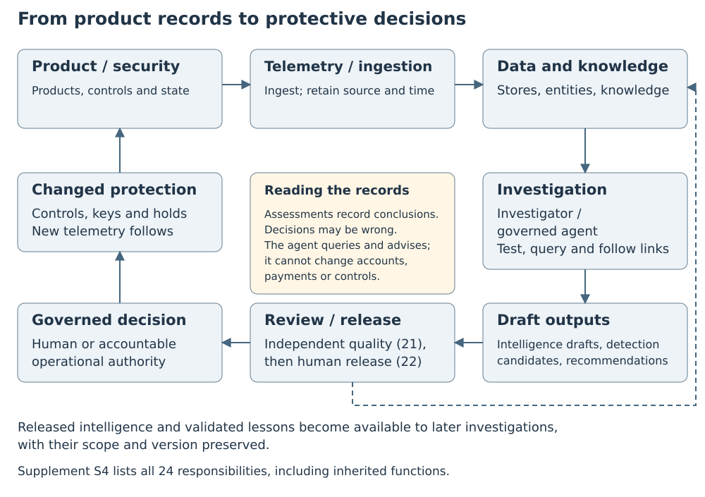
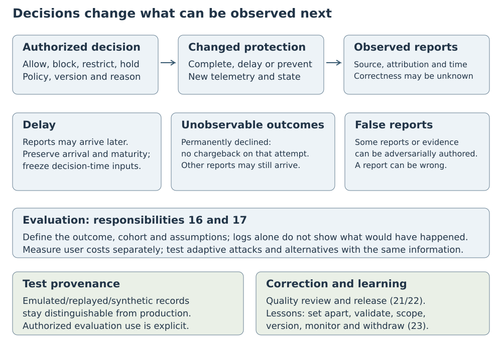

# Threat Analytics Across Payment Products: Evidence Requirements for Agent Investigations

Jonathan Matkowsky

New York, New York. Correspondence: Jonathan@matkowsky.com

10 November 2026 · Accepted working draft for version 1.1 · Not published · Not peer reviewed

## Abstract

Abuse of a payment platform can cross products and accounts, and the platform's own protective decisions change which outcomes can later be observed. A blocked payment cannot produce a chargeback; an incomplete search cannot establish absence; a reused conclusion cannot corroborate itself. This paper specifies the records an AI agent needs in order to investigate such cases under human authority. The specification rests on three requirements. First, each outcome record links to the control decision that may have shaped it, with separate fields for reporting delay, outcomes the decision made unobservable, and false reports. Second, a gateway outside the agent records what each query actually covered, and every fact retains both the time it happened and the time the system learned it. Third, a person must release a conclusion before it enters organizational memory for reuse by later investigations; a released conclusion serves only as a hypothesis or context, and any record that an agent output informed must link back to that output.

The specification connects these requirements to 71 signals, the kinds of records an investigator can check, and 24 responsibilities for investigation, review and reuse. Public sources supply the design premises, and Stripe's public product pages and documentation provide an illustrative product scope. Two hypothetical investigations show how missing context changes the conclusions that the same observations can support, and an evaluation plan proposes tests of evidential quality, operational cost and agent benefit. The contribution is a joint specification for investigation across payment products, built on established methods and recent agent-governance designs. It is a synthesis, not a new method. The architecture has not been built, no platform data were used, its only experiments run the record schemas on synthetic records, and no practitioner has reviewed it.

**Keywords:** payment fraud, abuse investigation, threat intelligence, selective labels, agent memory, provenance, human oversight

## 1. Introduction

Consider an investigator examining several storefronts that share payment accounts. A low chargeback count could reflect little abuse, payments blocked before completion, refunds that prevented disputes, or reports recorded under another account. Finding no earlier suspicious requests could reflect missing history rather than clean history. An earlier intelligence report could suggest where to look, yet add no independent evidence. Each possibility calls for a different conclusion and a different next step.

The difficulty is not simply connecting more data. The connections must preserve what each record can establish. A payment log records activity. A risk score records a model's assessment. A control decision records what the platform allowed, blocked or restricted. An outcome label records a reported result, which may arrive late or be wrong. When these distinctions disappear, an investigation can mistake a decision for proof, an unobservable outcome for a benign one, or repeated analysis for corroboration.

Each of these failures has its own research literature. Selective-labels and counterfactual-evaluation methods address outcomes hidden by decisions. Temporal and incomplete-database research addresses when a fact became known and whether a query answer is complete. Provenance standards and agent-memory designs address the status of derived conclusions. These bodies of work mostly treat the failures one at a time. Some recent agent-memory and decision-record designs address two or three of them in part, and they differ on who may authorize reuse of a conclusion and what a reused conclusion can establish (Section 2). An investigation that spans payment products can meet all three failures in one case, so its records must keep all three visible together.

This paper specifies records for threat analytics: investigation that connects product activity to intelligence, proposed detections and control recommendations, then learns from later outcomes. The setting is a payment platform offering several products to businesses and their end customers. The investigator of interest is an AI agent: software that uses a language model to choose queries and interpret their results. It works within human-assigned tasks and enforced access limits. It can investigate and recommend; authorized people or accountable operational systems decide what happens to accounts, payments and controls.

The design addresses three research questions:

**RQ1:** What records and analytical capabilities support investigation across payment products while preserving the meaning of observations and outcomes?

**RQ2:** How can an agent test explanations and prepare useful outputs while people retain review, release and operational authority?

**RQ3:** How can later outcomes and reusable lessons inform investigation without concealing the effects of controls or recycling conclusions as evidence?

The contribution is three requirements on the investigation's records:

**C1** links outcomes to decisions. An outcome channel is a route, such as a chargeback, by which an outcome can be reported. Each outcome record links to the control decision that may have shaped it, and to the status of each channel that the decision closed, delayed or changed. Late reports, outcomes that a control made unobservable, and false reports occupy separate fields. An evaluation can then state the joint assumptions it needs about delay, observability and report truth, each of which may depend on the decision (Section 7).

**C2** records query coverage and learned time. Query coverage is what a query actually covered: the data and period it examined, and whether its result was complete. Learned time is when a fact became available to the system's queries. Every query passes through a gateway, a checkpoint outside the agent, which records its coverage. Every fact keeps both when it happened and when the system learned it (Sections 5.1, 5.3 and 6.2).

**C3** requires human release before promotion into organizational memory. No agent output enters the evidence plane, which stores observations, as evidence of the activity under investigation (Sections 4.2 and 5.3); the agent's own outputs are recorded only as observations of what the agent did (Section 6.5). A person releases a conclusion into organizational memory, where it serves only as a hypothesis or context. Any record that an agent output informed links back to that output and counts as dependent, not as independent corroboration (Sections 4.2, 6.4 and 7.3).

The requirements work together. C1 identifies which outcomes the platform's decisions left observable. C2 establishes what information an investigation actually examined and could have known. C3 prevents the resulting interpretation from returning as independent support for itself. A record can satisfy one requirement and still mislead an investigation through a failure of another.

Two artifacts make the specification inspectable: an inventory of 71 signals and an architecture of 24 responsibilities. Sixty-eight signals map to abuse mechanisms, meaning ways abuse can occur; three apply across mechanisms. The responsibilities cover investigation, review, release, tested reuse of lessons and security of the investigation system. Two hypothetical investigations then show which conclusions survive when particular records are missing.

The intended readers design, audit or evaluate investigation systems. Stripe's public product pages and documentation supply an illustrative product scope, not a description of its internal systems. The paper synthesizes public evidence and proposes a design. It reports no implementation of the architecture and no measurement on platform data; its only experiments run the record schemas on synthetic records (Sections 8.4 and 8.5). Section 2 establishes its relationship to prior work and Section 3 explains how it was derived. Sections 4 and 5 answer RQ1, with Table 1 in Section 6.3 adding the agent's analytical capabilities; Section 6 answers RQ2 and Section 7 answers RQ3. Section 8 shows the consequences of the design in two hypothetical investigations, and Section 9 states how its value would be tested.

## 2. Relationship to prior work

The three requirements combine established ideas in a specific setting. This section identifies the closest precedents for each requirement and the choices the specification adds. Supplement S9 gives the extended comparison, with the nearest precedents for each requirement summarized in Table S9.1; S1 provides source passages, publication status and a 50-source requirements matrix.

### 2.1 Decisions shape the outcomes used to judge them

When a decision determines which cases receive outcome labels, evaluation faces the selective labels problem [@Lakkaraju2017Selective; @Kilbertus2020Fair]. Counterfactual analysis of logged decisions is most direct when the decisions were randomized with known probabilities. Each logged sample is then reweighted to reflect its probability under another decision rule, so that average outcomes under that rule can be estimated [@Bottou2013Counterfactual]. All of these methods require assumptions about which comparisons the data support [@HernanRobins2020].

Payment research makes the reporting problem concrete. TitAnt trains on delayed user fraud reports [@Cao2019TitAnt]. Dal Pozzolo and colleagues distinguish prompt investigator feedback from later labels and show how alert-driven review biases training data [@DalPozzolo2017Fraud]. An e-commerce research agenda likewise separates suspicion on blocked transactions from outcome labels [@Tax2021Fraud]. A theoretical payments preprint models authorization, whether fraud is reported, whether the report has arrived by training time, and label corruption, for one reporting channel [@Dhama2026Causal]. Related preprints examine delayed, incomplete or incorrect feedback [@Dhama2026Limits; @HeLoh2026Grab]. Chapelle's advertising model supplies a precedent for treating a click with no conversion yet as unlabeled rather than negative [@Chapelle2014Delayed]. Two recent design preprints come closest to C1's record. One, the Decision Event Schema, seals each decision record once its hash is computed. Facts learned later, such as the arrival of ground truth, are appended as linked records that reference the decision, and links between decisions carry a type [@Solozobov2026DecisionTrace]. The other, an execution-coverage model, links records to decisions and distinguishes refused execution branches from late reports [@Wu2026EvidenceCoverage].

C1 applies these ideas to several outcome channels at once. It records what each decision closed, delayed or changed, separately for each channel and read time. A blocked card payment cannot produce a chargeback on that attempt, but an incident finding remains possible. C1 keeps the decision as the unit of record, as the Decision Event Schema does. Each outcome report is a separate appended record. It links to every decision that may have shaped it, and each link states that decision's role. The schema has no field for outcome channels, but C1's fields could extend it rather than replace it (Section 5.2). The proposed records expose the assumptions needed to interpret such outcomes; they do not supply a validated estimator. Section 7 develops this distinction.

### 2.2 Evidence depends on coverage, time and origin

Temporal databases distinguish when a fact held from when it was stored [@Snodgrass1986Temporal], and agent-memory designs retain the same two kinds of time [@Wang2026TOKI; @Rasmussen2025Zep; @Dan2026Anamnesis]. The execution-coverage model of Section 2.1 also separates event time from verifier receipt time, and it judges whether a verifier's evidence was complete at a stated cutoff from the records then due [@Wu2026EvidenceCoverage]. Research on incomplete databases relates the completeness of a query answer to which data are known to be complete [@Razniewski2011Completeness]. These precedents matter whenever a query returns no matching records or a relationship becomes known after its effective date.

C2 combines explicit query coverage with learned time. The execution-coverage model asks whether the records an execution owes had arrived by a cutoff. C2 records what each investigative query examined. A gateway outside the agent records the requested and examined data, access limits and known gaps. Each fact's learned time is when it became available to queries. A relationship learned today cannot appear in yesterday's reconstructed decision merely because it was in effect then, although later outcomes may still evaluate that fixed decision under a stated outcome window.

The W3C PROV data model expresses the derivation of one entity from another [@W3C2013PROVDM], and decision provenance records the data flows surrounding decisions [@Singh2019DecisionProvenance]. STIX separates observed data from intelligence assertions and opinions [@OASIS2021STIX], and US intelligence analytic standards ask analytic products to distinguish underlying information from assumptions and judgments [@ODNI2015ICD203]. For agent investigations, those distinctions must survive retrieval and reuse. The agent's own account of its work cannot establish what its tools actually examined; independently written run records are the relevant precedent [@Dai2026Hearsay].

### 2.3 Released conclusions remain conclusions

Truth-maintenance research records the support for conclusions and revises them when that support changes [@Doyle1979TMS; @Malheiro1994BeliefRevision]. A conceptual framework for language agents separates working, episodic, semantic and procedural memory [@Sumers2024CoALA], and a survey argues that agent memory should keep raw observations, extracted facts and inferred items apart, with derivation links [@Wang2026AgentTraces]. Together these establish substantial precedent for C3.

The closest designs differ in who authorizes reuse and what a reused item can establish. Anamnesis starts model-derived claims as candidates, and no memory operation can raise their authority without a separately recorded grant; the grantor need not be a human [@Dan2026Anamnesis]. GovMem groups correlated agent traces by their dependencies when assessing support and permits automatic promotion or human review [@Qi2026GovMem]. Quipu's write gate requires human approval only under some policies [@Brown2026Quipu]. A data-governance preprint is closer on authorization: no agent-proposed metadata decision is committed before a steward reviews it, and a proposed gate admits only verified records as precedent, records each promotion and lets a reviewer demote a record, flagging the decisions that relied on it. It does not say who authorizes promotion or what a retrieved precedent may establish [@Akhtar2026Contestable]. In the illustrative provider's agent-assisted fraud modeling, engineers review the agents' hypotheses and results and decide what to deploy, and for one fraud attack the agents were given results from earlier experiments and investigations; the account does not describe a release step for those earlier results [@Drapeau2026ScalingRadar]. A threat-detection design comes closest on reuse as evidence. It tags each detection compiled from one of its hypotheses and drops tagged observations at ingest, so the system's own conclusions cannot re-enter as fresh evidence. It leaves as a residual risk an analyst who writes such an alert into a report that is later ingested, and its reference implementation does not yet exercise the rule [@Evron2026AdversaryBrains].

C3 adopts human release for every conclusion entering organizational memory. A released conclusion is reused only as context or a hypothesis, a limit the data-governance design does not state for its precedents; release does not turn it into an observation. Records informed by an agent output retain their dependence on it, including labels, detections and control decisions. Because the interfaces that write these records add the links, they also cover a person who writes a record while an agent output is open in the case, part of the relay the threat-detection design leaves open; a missing link still does not establish independence (Section 4.2). This is a design choice whose benefit and cost require testing, particularly through the agent-benefit and release-gate evaluations (E5 and E8, Section 9.1); it is not a claim that human approval guarantees truth.

### 2.4 What the combined specification contributes

Industrial payment systems supply examples of fast decisions and relationships between accounts [@Cao2019TitAnt; @Liu2018GEM]. Payment providers' public documentation already exposes parts of the first two requirements. The illustrative provider lets businesses query which rules affected each charge and join disputes to charges [@Stripe2026QueryDisputes]. Its dispute analytics warns that rates by payment date can look lower for recent payments because customers can wait weeks to dispute [@Stripe2026DisputeAnalytics], and each scheduled query run records the as-of time of the data snapshot it queried [@Stripe2026SigmaRun]. Another provider's risk dashboard shows whether transactions its risk engine allowed later resulted in a chargeback, and lists separately those it blocked [@Adyen2026RiskMonitoring]. The specification states what such joins, labels and timestamps must preserve for an investigation: which outcomes each decision closed, delayed or changed, and which reports are late or false. A governance synthesis for fraud risk decision systems combines decision traces, measures of evidence sufficiency under delayed labels and monitoring without labels, and extends them analytically to multi-agent systems [@Solozobov2026Synthesis]. It rates architectures by how many decision-record properties they fill by construction; it specifies no outcome channels, query coverage record or release rule for reuse. Supplement Table S1.1 locates these capabilities across research families.

Two payment-agent preprints show why specification and operational benefit must be kept apart. SR-Fraud separates scoring from reflection and tests proposed rules before reuse. On one replay benchmark it reports better detection than its scoring agent alone [@Tan2026SRFraud]; Supplement S9.2 gives its comparisons with classifiers. On 60 balanced synthetic cases that its classifier scored between 0.2 and 0.8, Sharma's agent was correct in 65.0 percent, below the 71.7 percent from thresholding the same classifier score at 0.5. Six of its eight overrides turned a correct decision into an error [@Sharma2026AuditableFraud]. Neither result establishes general agent performance: one rests on a single non-public replay benchmark, and the other on a small, balanced synthetic sample. Together they motivate comparing an agent with simpler alternatives given the same information.

This paper connects decision-shaped outcomes, query coverage and controlled reuse in one payment-investigation specification. The 71 signals identify candidate records, the 24 responsibilities assign investigation and review functions, and the interfaces preserve the meaning of what passes between them. The traces show which inferences lose support when that context is removed; they establish logical consequences within hypothetical cases, not improved detection. The focused comparison does not establish uniqueness or exhaustive coverage, and operational value depends on the evaluations in Section 9.

## 3. Deriving the specification from public evidence

The design starts from documented product capabilities and asks how an adversary could misuse each one. For each abuse mechanism it then identifies the records needed to distinguish the malicious explanation from plausible alternatives. Stripe's public product catalog, roadmap and documentation define the illustrative scope; research, engineering accounts, incident reports and guidance supply the design premises.

The scope, read on 27 September 2026, contains 88 product and feature entries. A retained mechanism must target a documented capability, serve a plausible adversary goal and have supporting public evidence. Public job postings from the illustrative provider, Stripe, for abuse, risk and machine-learning roles helped prioritize topics as a statement of its current priorities, not as evidence of incidents [@Stripe2026; @StripeARE2026]. Supplement S2 records the 99 candidate mechanisms, how postings set priorities, the nine search paths and each candidate's final disposition; every mapped mechanism also has supporting sources beyond postings.

The resulting inventory contains 71 signals in 12 families. Sixty-eight connect to 61 mechanisms through 163 links, and three apply across mechanisms. Nine links are explicitly inferential; the others use sourced premises to motivate record design without validating a detector. Each derived feature, a value computed from other records, identifies its inputs. Supplement S2 gives the disposition of the other 38 candidates.

Three published schemas describe the platform's application programming interface (API), the interface through which software requests operations and receives data. Supplement S5 supplies the object, field or event supporting each match.

Supplement S1 records the version, relevant passages and use of each of the 122 cited works, and compares 50 sources against the three requirements. Supplement S3 lists the 61 design sources and the depth of each read. These records let readers inspect the synthesis; their counts do not measure evidence quality.

The synthesis distinguishes sourced findings, design choices and hypotheses (Supplement S2.1). One author, assisted by AI models, made the mappings and coverage judgments; agreement between independent human coders has not been measured. Section 9.2 explains the limits this focused selection places on coverage and transfer.

The author used Anthropic Claude and OpenAI ChatGPT/Codex in the research. The models searched for and read the sources, proposed the mappings and comparison codes, ran the prior-work search, wrote the scripts, synthetic data and figures, and reviewed drafts. Every cited work was read in full, or, for a book or standard, the cited chapters; Supplement S1 records the version and passages for each and names the few parts not read, such as reference pages. A check script recomputes the counts, lineage and arithmetic on every proposed change. The author decided what entered the paper. Model review is not independent human peer review.

## 4. From product activity to protective decisions

This section identifies the parties whose activity the records describe, the path from records to protective decisions along which meaning must be preserved, and the responsibilities that path requires. It begins the answer to RQ1, which Section 5 continues and Table 1 in Section 6.3 completes.

### 4.1 The platform and its participants

The proposed payment platform serves businesses, which serve end customers. A business holds a platform account. It may instead hold a connected account under another business that has integrated the platform into its product. A merchant is a business accepting payments through either account type. People act for businesses through operator accounts. Software agents may use delegated credentials for a business or end customer; these are distinct from the investigating agent.

These roles determine whose activity a record describes. An end customer's action is not automatically an action by the business or its operator.

### 4.2 The path from records to action

Data pipelines collect telemetry and state records, map them to shared entity and field definitions, and preserve their origins. Storage and correlation services make them searchable by time and entity. Investigators use them to prepare intelligence, meaning assessments intended to inform decisions, together with proposed detections and recommendations. Authorized people or accountable operational systems decide whether to change controls, and those changes affect what later records can show (Figure 1).

Three feedback loops connect this work. **Investigative feedback** changes the next hypothesis or test within a case. **Organizational-learning feedback** makes released intelligence or tested procedures available to later cases as context. **Protective feedback** changes the platform through an authorized control or product decision. Their outputs require different authority and support different inferences.

The architecture separates three logical layers, called planes. They need not use separate databases:

- The **evidence plane** holds observations with their source, time and entities. Scores and control decisions belong here as observations of what a model concluded or a control did. Derived features belong here too, as values recomputable from recorded inputs; a feature computed over a cluster cites the cluster version it used, and the cluster itself remains a threat-knowledge item. A feature computed over a cluster that an agent proposed, or that depends on an agent output or released item, links back to that output or item and counts as dependent on it.
- The **structured threat-knowledge plane** holds revisable inferences, such as relationships between entities, groups of activity and conclusions with confidence and provenance.
- The **organizational-memory plane** holds released intelligence and tested lessons about procedure. These guide later work as hypotheses or context.

**Figure 1. From product records to protective decisions.** Investigation produces drafts. Independent quality review precedes human release in the normal path. An authorized human may decide urgent containment before review under Section 6.4, without releasing the draft into organizational memory. Each resulting control decision records what the platform did, not whether the suspected abuse occurred.

For example, two accounts using the same device is an observation. Common control is an inference. A released report retaining that qualified inference becomes organizational memory; retrieving it creates no new observation. An investigator may follow its lineage to cite the original observations at their original times and sources. A threat-intelligence reference model likewise traces the creator and modifiers of each intelligence product [@Sakellariou2022CTIReferenceModel].

Dependence must also survive indirect reuse. A human label, assessment, control decision, detection or threat-knowledge item informed by an agent output links back to that output. Labeling, assessment, control, detection and threat-knowledge interfaces automatically attach every agent output and every released organizational-memory item open in the writer's case or session. Only a person with release authority may remove a link, and removal is logged. Intelligence sent outside the platform carries an identifier. When content bearing that identifier returns through an external feed, the external-knowledge record links to the released item and counts as dependent on it.

These records remain dependent on the agent output that informed them. They cannot independently corroborate the agent's findings, a detection derived from its work, or the same hypothesis. The links capture only exposure observed by the interfaces: an unlinked record may still reflect something its writer read elsewhere. A missing link therefore does not establish independence. Detections that rely on agent-dependent labels are validated on external outcome channels or on cases worked by staff without access to agent outputs.

This separation cannot repair missing source data. An agent cannot retrieve telemetry never collected, reconstruct timing discarded by a pipeline, or establish an entity link without suitable identifiers.

### 4.3 Responsibilities and authority

Supplement S4 defines 24 responsibilities for the investigation system. They are functions, not proposed teams or a required number of agents.

Payment authorization, payouts and account-review systems produce C1's decision records; their operational owners sit outside the investigation responsibilities.

Human tasking and release stay with people, and quality review remains independent of the work checked. Other functions may use one agent with tools, separate model sessions, several agents, fixed rules or a combination. Additional separation must justify its cost through narrower authority, access or failure scope.

The investigating agent may query permitted records and prepare intelligence, hunting and detection candidates, recommendations and proposed lessons. It cannot change accounts, payments or controls, certify its own output, or release conclusions into organizational memory.

## 5. Records an investigator can reason from

This section answers the records part of RQ1 in four steps: record classes that state what each record can establish (5.1), the abuse mechanisms that motivate particular records (5.2), the properties each store must preserve (5.3), and what published schemas already supply and privacy obligations permit (5.4 and 5.5). Table 1 in Section 6.3 adds the capabilities.

### 5.1 Separate observations from conclusions

A payment log, risk score and fraud report may concern the same transaction but establish different facts. The log records activity, the score a model's assessment, and the report what someone alleged. Copies of one report do not provide several independent confirmations. The record's class makes these limits explicit.

The same principle applies to relationships. A shared payout destination is observed; common control is inferred. Attribution, identifying a particular actor behind the activity, is a stronger claim requiring further support. An earlier attribution remains historical context when retrieved in a new case.

The specification uses seven record classes (Supplement Figure S3.1):

- **Source observations** record events or reports at their source.
- **Normalized observations** map source records to common entity and field definitions while retaining provenance.
- **Derived features** compute values from recorded inputs for specified entities and time windows.
- **Model or risk outputs** record assessments and the identity and version of the model.
- **Control outcomes** record decisions, independently of whether those decisions were correct.
- **Analytical inferences** state conclusions drawn from evidence.
- **Finished intelligence**, also called released intelligence, is analysis approved for reuse.

External knowledge is identified separately by source and type. It may be an observation, such as an exposed API key, an assessment, or a published catalog of abuse techniques. It supports what that source observed or described, not by itself a claim that abuse occurred inside the platform.

A class describes meaning, not reliability. A derived feature is only as reliable as its inputs and computation. An outcome label records who reported what and when; any separately established finding remains distinct.

Each normalized observation preserves its source and event identifiers, schema version, entities and lineage. It records event time and learned time, plus actor and request identifiers where available. Its environment distinguishes production from tests, synthetic data, replay or emulation. Its *tenant scope* identifies the business or other boundary within which the data may be accessed and used. Delivery identifiers prevent repeated delivery from counting or acting on one event twice.

Supplement Table S3.1 organizes the signals by family and class. Supplement S3 defines each signal and the inputs of every derived feature.

### 5.2 How abuse mechanisms motivate the records

Each group of abuse mechanisms motivates particular records; Supplement S3.1 gives the public evidence for each and its limits. Credential exposure is recorded as external knowledge with its location and time, apart from validity, attacker possession and misuse, and credential use is compared before and after exposure with precise timestamps. Access keeps its authentication context, session issuance and later use, and the changes made after access; a device or browser fingerprint can connect activity but cannot alone establish common control. Payout destinations have their own identities and histories: creation, changes, first observation, validation and reuse across accounts. Storefronts, statement descriptors, account histories and verified ownership records are linked, and declared business details keep their source and time for comparison with activity. End-customer histories are recorded within a business; linking an end customer's identity across businesses requires separate authorization, a permitted purpose, privacy oversight and supporting evidence.

#### Labels need their reporting path

An outcome label can be missing because its report is late or because a control prevented the outcome. It can also be present and false. Payment-specific theoretical work distinguishes these problems and proposes estimation methods under assumptions [@Dhama2026Causal]. The specification uses those distinctions to define records, without assuming that an estimator recovers hidden platform outcomes.

Each report retains its type, source, lag and attributed transaction or entity. It keeps three times: when the reported outcome occurred, where known; when the report was made at its source; and when it arrived at the platform. Its channel supplies a reporting window and clock-start event. The evaluation separately records its chosen maturity period, how long it waits before reading a missing report as a negative. A period shorter than the channel's window, or any period for a channel without one, rests on a delay model (Section 7.1). Every decision that may have shaped the report remains linked, and there can be several. A dispute can follow a blocked attempt, a retry and an approval, and one account restriction can affect many payments. Each link therefore states the decision's role. The report's later status, such as withdrawn, reversed, won or lost, has its own history, which records whether each won or lost status followed adjudication. A status change or correction is a new record that references the earlier one, so what the platform believed at each time can be reconstructed. Some channels never adjudicate a report, yet a provider may still record it as lost: Stripe's dispute guide says disputes that network rules or local regulations make unchallengeable are closed as lost when they open [@Stripe2026Disputes] (Section 7.1).

An estimate that a report is false belongs to the assessment store, linked to the report with the responsible model or reviewer and version. This matters when supporting material itself may be fabricated, as participants describe for refund fraud involving generative AI [@Zhang2026Refund]. A report may be both late and false, so one status cannot replace the other.

### 5.3 Preserve meaning across stores, time and relationships

The investigation must be able to retrieve an observation, its interpretation and the decision it informed separately. These distinctions concern logical records; they do not require separate database products. Supplement Table S4.1 lists the properties each store must preserve.

**Write authority follows the record's meaning.** Ingestion appends to the evidence plane. Correlation software and the agent may propose threat-knowledge items; a person or accountable process accepts them. Agent proposals remain marked context and cannot support current-conduct claims without their underlying observations. Only a person releasing a reviewed draft or a tested, reviewed lesson adds or changes a claim in organizational memory. Later status records for a released item, such as monitoring findings, expiry and withdrawal, add no claim and record who or what wrote them. Rule checkers and quality reviewers write their findings on each draft version to the agent-and-approval ledger.

**Event time and learned time answer different questions.** A relationship added today with an earlier effective date was unavailable to yesterday's decision. Revisions, external facts, graph membership and feature definitions therefore retain the versions used. A derived fact's learned time is when that result became available to queries, not merely the latest availability of its inputs. It cannot precede any input's learned time.

A decision's reproducible snapshot need not copy the entire store. The system logs the inputs used and retains versions from which other then-available inputs can be reconstructed. This supports checking both what the decider used and what could have been known.

**Evaluation time differs from decision time.** Later outcomes may evaluate an earlier prediction whose features remain fixed. The evaluation declares its outcome window and maturity period. Training and model selection use a separate cutoff: labels unavailable then cannot enter them. Applying the decision-time cutoff to evaluation labels would wrongly exclude the late outcomes being measured.

**Channel state differs from report presence and access.** For each affected item, channel and read time, the records distinguish an open channel, a temporary delay, a permanent closure and unknown state. A missing report matures only after a defined window that remained open and was fully covered. If a decision changed the channel's meaning, as a liability shift after successful authentication does (Section 7.1), a matured absence is read under that changed meaning and does not by itself support a negative for the original outcome. A channel without a defined window never supports a negative by maturity alone. A matured absence is provisional, not final. Network and bank rules can reopen or extend a window after it has elapsed, as when a monitoring program lets issuers submit fraud disputes past the standard deadline [@Stripe2026MonitoringPrograms] or banks accept a late return [@Stripe2026ACHTerms]. Each such rule event is recorded as a channel-state transition with its source, rule version and learned time, although no platform decision caused it. A decision's effect on each channel is fixed when the decision is recorded; later transitions are separate records that never edit it. Inaccessible records remain unavailable without erasing a known channel state or an earlier report. Supplement S4.1 specifies the clock-start and transition fields, with further rules on program status, revised negatives and reopened reports.

**An entity link is not a claim of common control.** A verified identifier from the same namespace and relevant interval supports a stronger, or hard, link. A weaker, or soft, link may have several explanations: benign accounts can share a proxy IP address [@Liu2018GEM]. Both retain source and confounders, meaning plausible alternative explanations. Account-age records address aged accounts sold for abuse [@Thomas2013]. Where crypto products are in scope, wallet-to-spender links record permissions motivated by phishing that induces harmful transactions [@Chen2025Phishing]. Supplement S4 defines each relationship's fields.

### 5.4 What public schemas reveal

This comparison shows how much of a required record a published interface already supplies and where the specification goes beyond it. It asks whether a proposed observation has at least a partial counterpart in a published object, field or event. Of the 71 signals, 32 have partial counterparts. The question does not apply to 32: 24 derived features, seven external-knowledge signals and one provenance signal. A keyword search of the three files identified no counterpart for seven, including request context, identity-capture session context and several agent observations. That absence is bounded by the terms searched.

Supplement S3 records the classification; S5 provides schema pins, hashes, event extracts and exact field locations. These findings describe the inspected schemas, not the provider's private telemetry or every possible public interface.

### 5.5 Privacy and operating constraints

Privacy and operating obligations constrain the specification; Supplement S4.1 states them in full. A deployment must specify retention and deletion for each record class before collecting it. Append-only logs must still permit required deletion. The agent-and-approval ledger uses references to regulated data rather than copies. Cross-business linking requires a stated purpose and authorization for each identifier type. This paper does not determine which legal basis applies in a particular deployment.

## 6. How the agent investigates

This section answers RQ2. It follows one investigation from its assignment to the release of its outputs, then addresses the inputs that could subvert it. Table 1 also completes the answer to RQ1 by listing the agent's analytical capabilities with the limit on what each can establish.

### 6.1 Set the question and scope

A human assigns an investigative question or approves a standing task template. The assignment defines permitted data, entities, period, current period and outputs. Each run records the assignment, or the template and its version, that authorized it, and duplicate alerts are merged into cases before tasking.

The agent applies the record-class limits while reasoning. A score can direct attention without establishing abuse. A control outcome records a decision of potentially unknown correctness. A feature retains its inputs, computation period and data freshness. A label must be read with its reporting path and the decisions that shaped it.

Earlier intelligence may suggest a hypothesis or a useful first query. Retrieval returns its publication date, relevance period, underlying sources, confidence, restrictions and corrections where recorded. Several reports repeating one observation remain one source of evidence. Claims about current conduct require observations from the current period.

### 6.2 Test explanations and interpret the query that ran

An investigation asks which observation would distinguish plausible explanations. The agent converts that question into a permitted query, such as reconstructing a timeline or following an entity link. It first establishes what the available schemas and services mean.

The loop is **context → hypothesis → permitted test → observation → interpretation → revised hypothesis or conclusion**. Its stopping point may be an inconclusive assessment when the observations cannot separate the remaining explanations.

A complete result with no rows establishes only that no accessible rows matched. It counts against a hypothesis when the suspected activity should have produced that observation and the records cover where it would appear. Other results require different interpretations:

- A partial result supports no conclusion about the uncovered data or period.
- A truncated result may contain useful matches but cannot establish a population total.
- A denied query records an authorization decision.
- An unavailable dataset means the intended test did not occur.

The gateway that enforces the agent's scope (Section 6.5) also attaches the coverage record, independently of the agent. It records the requested and evaluated entities, with their tenant and identifier namespaces, the requested and evaluated event intervals, source and schema versions and any sampling. It also records the as-of cutoff, which limits the query to facts the system had learned by that time. For each source it records the event and ingestion watermarks, meaning how far event time and loading have progressed, known gaps and the retention horizon. A requested interval that extends past a source's event watermark, begins before its retention horizon or overlaps a known gap leaves that source's result partial, as does sampling of that source. It also records whether access filtering removed rows or row, time or cost limits were reached.

Fixed rules derive complete, partial, truncated, denied or unavailable status from that record; several statuses may apply. The agent can interpret results but cannot alter coverage fields. An unrecorded gap can still make a result appear complete, so recorded completeness is not knowledge of every possible loss.

The rule checker (Section 6.4) and the quality reviewer read the full coverage record. The agent sees only information allowed by its scope, including counts only when disclosure is authorized. A scope-limited flag identifies when authorized scope is narrower than the task's named entities, without disclosing outside records. The checker restricts absence claims accordingly. An unassessable hypothesis remains distinct from a query's status.

### 6.3 Capabilities and their boundaries

Table 1 lists the agent's permitted capabilities. Every use is scoped, limited and logged; none grants operational authority.

Entity links and labels require particular care. The agent retrieves each cluster's membership rule and version and tests benign explanations, including shared proxies [@Liu2018GEM].

Likewise, no chargebacks may mean no abusive completed payments, blocked attempts, immature reporting or reports attributed elsewhere. Resolving a pre-dispute alert, an issuer notice that can be addressed before a chargeback, may also avert one. The agent examines decision gates, report times and transaction links before interpreting the absence.

A detection candidate states the behavior to detect, its inputs and an evaluation plan. That plan covers label provenance and how an adversary might adapt.

**Table 1. Permitted capabilities and their evidential limits.** Task scope, permissions and resource limits apply throughout.

| Capability | Information used | Boundary |
|---|---|---|
| Discover sources and schemas | Signal inventory, schemas of data stores, and records of counterparts in published API schemas | Finding a source does not grant access to it |
| Run governed queries | Permitted data stores, with scope limits, query limits and logging | Conclusions cover only the data and period the query examined. A denied query is not by itself evidence about the suspected abuse |
| Match records to entities and follow their links | Links labeled by type, known benign reasons for shared identifiers, and versioned clusters (computed groups of entities) | Propose relationships for assessment. A shared identifier does not by itself show common control. A cluster is the output of a computation, not an observed relationship |
| Reconstruct timelines | Credential exposure and later use, session issuance and later use, and account changes after access | Events close together in time do not prove that one caused the other |
| Interpret outcome labels | Report provenance, decision gates and links from reports to transactions | A missing report does not show that no abuse occurred |
| Generate hypotheses from published catalogs of abuse techniques | Mappings to a fixed version of each catalog | Naming a likely technique does not show that it was used |
| Draft hunting and detection candidates | Features, observations and outcome labels | A hunting candidate is a proposed search, not a finding. Detection candidates must still be validated under detection development and threat-model integration (responsibilities 16 and 17) |
| Recommend product or control changes | What each relevant control decision means, restriction options, what happens when a check fails, and protective actions | Authorized humans or accountable operational systems decide and act |
| Draft intelligence | Evidence with traceable lineage | Drafts require independent quality review and human release |

### 6.4 Check the claims, then authorize their use

A draft separates material claims from context. A claim is material when its falsity would change a recommendation, detection candidate or released statement about named entities. Each material claim cites supporting records with their classes, event intervals and root observations, reached through lineage. It also lists the retrieved records that count against it, and quality review adds any it finds. The checker also identifies every record that the case's query runs returned within the claim's scope but that the draft neither cites nor lists against it; Supplement S4 gives how these records are shown and sampled. A claim that something is absent also cites the query runs whose coverage records support it. A claim that states or relies on an outcome that was not reported also cites, for each affected item, the state of each relevant outcome channel at the read time. The absence counts as a negative only where the channel matured with no report under its original meaning, and that negative remains provisional (Section 5.3). Claims about current conduct cite at least one source observation, normalized observation or derived feature whose event interval falls entirely within the task's current period. A score or control decision from that period does not meet this rule by itself, because it records an assessment or an action, not the conduct. A derived feature that carries an agent-output or released-item link does not meet the rule by itself either; the claim must also cite, for each named entity, a current-period observation among that feature's inputs.

A checker outside the agent enforces these rules before quality review. It rejects substitution of organizational memory for observations and deduplicates repeated records of one root observation. Distinct roots are not automatically independent: shared sources and common causes still need review. Supplement S4's draft schema gives the required fields.

Independent quality review examines the cited records directly, weighs contradicting evidence and alternative explanations, and checks attribution and fit to the intended reader. It verifies claims of detection validation against engineering evidence; responsibilities 16 and 17 still perform that validation. Reviewers and checkers are subject to the same untrusted-content safeguards as the agent.

When realistic volume forces reviewers to sample the cited records, sampling is tiered by materiality. Claims about named entities are checked in full, and every draft still requires human release. E8 tests this policy under the planned workload.

Independence is a hypothesis, not a property guaranteed by a model name. E6 and E8 measure whether review catches attacks and planted errors. E8 plants errors taken from the agent's own earlier runs alongside independently written errors and reports the catch rate for each. Separate sessions may share errors through common weights, and different models may share training data. A distinct method and organizational role can provide separation, but the reviewer must still examine the evidence.

Normal release follows quality review. The release decision records the person, exact version hash, claims with the confidence stated for each, scope, expiry and reviewer findings. The releaser sees supporting and contradicting records beside each material claim. Release preserves the assessment's uncertainty. Human release is itself exposed to automation bias, in which people follow an automated aid's incorrect advice or miss problems it fails to flag, and to the fall in detection when errors are rare [@ParasuramanManzey2010; @Wolfe2005Rare].

Urgent containment has a narrower route. A recommendation for a reversible action, such as a payout pause or API-key restriction, goes to an authorized on-call human with a decision target in minutes. Quality review follows within a set period, and an authorized human or accountable system decides whether to reverse the action. The draft does not enter organizational memory through this exception. Existing automatic controls remain in place.

Reversibility does not imply low impact. An API-key restriction may interrupt a merchant's integration. Actions are classed by impact as none, degraded service or outage; outage-class actions require notification and a restoration path.

Human review also creates a capacity limit. With assumed values of 20 drafts a day and 30 minutes per draft, review alone requires 10 hours daily. The system monitors release volume, returned drafts and the oldest queued draft. Urgent containment takes priority when the queue is saturated; expired drafts are discarded rather than released automatically. E5 measures whether the agent's contribution justifies this work, and E8 tests the gate under realistic volume and error prevalence.

### 6.5 Protect the investigation from its inputs

Businesses, customers and outside sources can supply content the agent reads: storefront pages, descriptions, refund evidence, retrieved documents and tool results. Indirect prompt injection uses such content to introduce instructions. Research demonstrates these attacks through external content and tool outputs [@Greshake2023; @Debenedetti2024].

The architecture treats this material as data with no authority over instructions or tools. The gateway enforces task and tenant scope, least privilege, the allowed tools, query limits and outbound-traffic restrictions. These boundaries constrain access and action even if hostile input influences reasoning.

**Approval binds to the operation actually reviewed.** It identifies the exact payload, target, task, tenant, tool and tool-manifest version, plus expiry and permitted reuse. At execution, the gateway checks both the match and current permission. This addresses altered operations and changed tool descriptions [@Kumar2026; @InvariantLabs2025]. Approval of an investigative operation cannot grant the agent authority over accounts, payments or controls.

**Memory and outbound traffic have separate controls.** Proposed lessons remain outside organizational memory until testing, quality review and human release. This responds to documented memory-poisoning routes [@Dash2026]. Traffic restrictions respond to demonstrated exfiltration, in which injected instructions passed user data to an attacker through search queries or links [@Greshake2023]. Testing includes adaptive attackers because fixed-test success can overstate resistance [@Nasr2025].

The threat model includes four attacker positions: an external abuser controlling retrieved content; a merchant also supplying decisions and refund evidence; a compromised operator; and an insider with approval or release authority. Each plane's write rules must be evaluated against all four. No control in this design stops the fourth position from releasing a false claim or removing an agent-output or released-item link, because its authority permits both. Against that position the safeguards are the release record, the logged link removal, expiry and re-testing of exonerating items, and correction (Section 7.3). They can detect and limit such actions, but they do not prevent them.

One consequential attack produces a plausible but false benign explanation. Human release alone does not defeat this attack.

Released benign assessments and exonerating lessons therefore expire on a fixed date, or earlier when their evidence or cluster membership changes. They are re-tested against independent counterexamples from closed cases or reviewers who did not write the lesson. Labels, assessments and decisions informed by them retain links so they can be revisited after expiry or retraction.

A second attack reaches a person investigating the agent itself, through hostile content copied into the ledger. Untrusted status must survive storage and normalization.

Ledger copies and agent outputs may suggest hypotheses, but claims cite the underlying evidence-plane records. Their promotion into organizational memory still requires independent testing and human release.

The ledger makes the agent itself investigable; Supplement S4.1 lists what it retains.

The architecture does not include live adversary emulation. Any future use would require separate ethical, human and operational authorization, enforced scope, tamper-evident logs and test-data provenance.

## 7. Interpreting feedback after protective decisions

This section answers RQ3. Section 4.2 distinguished three feedback loops. This section concerns the two that leave the case: protective feedback, which changes the platform and therefore the evidence available afterwards (Sections 7.1 and 7.2), and organizational-learning feedback, which carries conclusions and procedures into later cases (Section 7.3).

### 7.1 Separate delay, observability and report truth

A control changes both activity and the evidence later available about it. Blocking a payment prevents that attempt from completing; holding a payout may delay it. The absence of a later outcome therefore cannot be interpreted without the decision that shaped its channel.

C1 keeps three questions separate (Figure 2): **Could a report still arrive? Could this outcome occur under the decision taken? Is the report true?** Their answers can depend on one another. A report may be late and false, while a control may close one channel and leave another open.

**Figure 2. How decisions shape later evidence.** Delay concerns report arrival; unobservability concerns outcomes a decision prevents; false reports concern truth. Separate fields preserve these distinctions, while evaluation must justify their joint assumptions. Corrected intelligence and tested lessons return through review and release.

#### Delay: a report has not arrived yet

A deployed payment-fraud system trains on user fraud reports, which arrive after the transaction [@Cao2019TitAnt]. The relevant reporting window depends on the channel. A delay model can distinguish a pending outcome from a negative after sufficient time, as in Chapelle's conversion model [@Chapelle2014Delayed]. Reading immature negatives as final can reverse a comparison: the illustrative provider's engineers report a fraud model trained on far more payments that looked better at first, until, as more fraud reports arrived, its measured performance fell below the earlier model's and it was rolled back [@Drapeau2026ScalingRadar]. A channel without a defined reporting window, such as a victim report, supplies no such maturity bound.

The records preserve arrival time, channel clocks and the evaluation's maturity choice. A late report may evaluate an earlier fixed prediction. It must not enter that prediction's features or a training run whose cutoff preceded its availability.

#### Observability: the decision changed the possible outcome

A payment permanently declined before completion cannot generate a chargeback on that attempt. It may still produce a complaint or incident finding. A payout hold changes when funds move, not when a dispute can arrive.

Stripe's dispute guide says card networks typically allow cardholders to dispute within 120 days of the original payment, sometimes longer, and that for a future event or service the window generally starts on the event date [@Stripe2026Disputes]. Rules vary by network and version. The records therefore distinguish authorization, capture and processing times and use the clock-start event specified by the applicable channel rule. Missing rules or timestamps leave maturity unknown.

Capture may also gate possible-fraud reporting. Stripe's monitoring guide says issuers must report possible fraud on captured payments, even after refund, but are not required to report it on authorizations. It adds that an authorization reversed before capture is not reported [@Stripe2026MonitoringPrograms]. Stripe's dispute guide adds that a refund processed as a reversal, which usually happens within about 2 hours of capture, can also prevent a fraud report [@Stripe2026Disputes]. Capture alone therefore does not fix that channel's state. Thus a review ending in reversal can close that channel while other incident reports remain possible.

A control can change a channel's meaning without closing it. Stripe's 3-D Secure guide says liability for eligible fraud disputes can be expected to shift to the issuer after successful authentication, but is not guaranteed. It adds that an early fraud warning, a network report of suspected fraud, may still arrive [@Stripe2026ThreeDS]. Authentication result, reported liability status and each channel's state must therefore remain separate.

Payout timing is recorded against the relevant reporting windows because funds may leave before reports arrive. The effect is recorded per channel: closed, delayed, changed in meaning, none or unknown.

These channel properties come from card-network rules, and other rails differ. On the illustrative provider's bank-debit rails, a payer's dispute or return is honored without network adjudication or appeal [@Stripe2026SEPADebit; @Stripe2026ACHTerms]; Supplement S4.1 gives the windows and rules read. A report honored without question is never adjudicated, so any won or lost status recorded for it says nothing about its truth, which rests entirely on a separate assessment. Each channel record therefore names its rail, the attributes its window depends on and whether the channel adjudicates report truth.

#### Truth: the report may be wrong

Bad-faith disputes and fabricated refund evidence can make the adversary a source of outcome labels [@Dhama2026Causal; @Zhang2026Refund]. One evaluation interface accepts the business's decision on each evaluation (allowed, restricted or blocked) and says these reports train its models [@Stripe2026CAE]. Such reports may also carry that business's errors. Models trained on these labels predict reported outcomes unless the reports' relationship to truth is separately established.

Report type and source therefore remain attached to the label. Any judgment that it is false is a separate assessment with its own provenance. This preserves both the report and the uncertainty about its truth.

#### What the records permit an evaluation to estimate

Selective-label methods and causal analysis require more than the outcome field [@Lakkaraju2017Selective; @Kilbertus2020Fair; @HernanRobins2020].

If all decision inputs are logged and remaining decision variation is independent randomization, conditional exchangeability holds given those inputs. In practical terms, the logged history must account for variables influencing both decision and outcome [@HernanRobins2020]. Unlogged inputs used by a decider break that guarantee and must be identified. The records support examining assumptions; they do not validate an estimator or the bounds in theoretical payment models [@Dhama2026Causal; @Dhama2026Limits]. Supplement S7 illustrates the distinction with three target quantities.

Without further assumptions, outcomes hidden by deterministic blocks support ranges rather than a recovered comparison.

An observational evaluation must define its target population, the decisions it compares and the outcome, then justify the assumptions linking observed decisions to alternatives [@HernanRobins2020]:

- **Consistency:** each compared decision is precisely defined, and a case's observed outcome equals its outcome under the decision actually taken.
- **Conditional exchangeability:** after conditioning on logged history, cases receiving different decisions have no remaining differences that bias the comparison.
- **Overlap:** comparable cases had a nonzero chance of each relevant alternative decision.
- **No interference:** changing one attempt's decision does not change other attempts' outcomes, including retries.

Repeated decisions require the relevant conditions at each step because earlier decisions can change later inputs [@HernanRobins2020]. Interference is especially consequential when blocked actors move to sibling accounts or other merchants. Links from each report to every decision that may have shaped it make these dependencies visible; they do not remove them.

Delay and false reports add assumptions of their own (Supplement S7).

These assumptions are joint. Allowed payments may receive chargebacks while blocked items receive investigator labels or complaints, with different delays and clocks. Separate fields make these differences visible; they do not make the observation processes independent.

Obtaining missing comparisons through prospective exploration would mean allowing some attempts the existing policy would block. That requires separate ethical, human and operational authorization. It is neither performed nor authorized here.

#### Attribution and resolution change measured ratios

Account structure affects where a report is recorded and which transactions a ratio describes. FTC complaints allege pooling or spreading activity to evade monitoring [@FTC2020FirstData; @FTC2025Paddle]. These allegations motivate transaction links and cluster-level measures, without establishing erroneous attribution in a new case.

The same outcome definition, cohort and window must be retained when comparing account and cluster ratios. A pooled cohort ratio is a weighted average and cannot exceed the highest account ratio merely through pooling (Section 8.2). It can conceal a high account ratio among lower ones.

Resolution also changes what becomes a chargeback. One FTC complaint alleges refunding on pre-dispute alerts to avoid chargeback recording; the resulting order was stipulated [@FTC2025Paddle]. Stripe's dispute guide says a business can proactively refund a payment flagged by an early fraud warning to prevent a dispute, while advising against refunding every flagged payment. It adds that such a refund does not affect the fraud warning [@Stripe2026Disputes]. A lower chargeback ratio after alert resolution therefore does not establish less abuse.

The records retain each alert, its resolution and any later chargeback. Transaction links allow a defined measure to count each affected transaction once. Supplement Table S7.1 summarizes the resulting requirements.

### 7.2 Measure control errors and user costs separately

A known control decision can have unknown correctness. A study of five commercial identity-verification products reported false negative rates of 10.5 to 53.1 percent, the share of genuine participants' verification attempts that were rejected [@Fatima2024]. It did not report fraud-detection results. Those cohort results cannot become probabilities that an individual platform decision is wrong.

Denominators matter as much as percentages: Supplement S1 works through one login-challenge study's rates [@Doerfler2019].

The specification links a control decision to a correctness review where available and separately to applicable population error estimates. Each estimate retains its version, cohort, outcome window, denominator, uncertainty and scope. Evaluation weighs detection gain against legitimate-user cost. Unknown, not-assessed and failed-open states remain distinct from low risk [@Stripe2026PAYG].

Controls also need retesting as adversaries adapt. Published examples include changed card-testing methods, aged accounts, banks changed after payment disruption, and filtering of recognizable test transactions [@Meltzer2025; @Thomas2013; @Tian2018]. Responsibilities 16 and 17 own this evaluation.

Test, replay and emulation records are marked when created and excluded from production labels, intelligence and lessons unless their evaluation use is explicitly authorized. The mark remains internal so it does not help adversaries identify test traffic.

### 7.3 Correct conclusions and test lessons before reuse

New evidence may require correcting or retracting released intelligence. The correction links to the original, retains the new evidence's provenance, repeats applicable review and release, and notifies downstream users where warranted.

A reusable procedure follows a different path. A productive query, a useful move between related entities, or a recurring benign explanation becomes a proposed lesson. It enters a queue for prioritization and independent tests against counterexamples. Lessons that exonerate expire and are re-tested.

After testing, quality review and human release, a lesson may be reused within a defined scope and version. It remains monitored and can be withdrawn. This is controlled learning, responsibility 23.

Memory-poisoning and experience-reuse studies show how planted or mistaken entries can steer later work [@Dash2026; @Xiong2026MemoryManagement]. A validated lesson therefore guides procedure; it is never evidence that the suspected activity occurred in the current case.

## 8. Two hypothetical investigations

The following traces apply the specification to fixed hypothetical observations. Each asks what happened, which explanations remain plausible, and what further test would distinguish them. Their purpose is to expose the consequences of missing context. Supplement S6 supplies the synthetic transaction records and reproducible arithmetic.

### 8.1 Trace A: an exposed key and a changed payout destination

A repository scan finds a publicly visible API key, and a human asks whether it enabled account compromise and payout redirection. Supplement S6.1 gives the step-by-step narrative and its sources.

**Observations.** Nineteen minutes after publication, requests arrive through a residential proxy range with a different client fingerprint. The same burst creates a webhook endpoint, changes the payout destination and accelerates the payout schedule; the trace assumes the key permits these changes. The next day, delayed records show that the same verified destination identifier was attached to two other accounts before exposure.

**What the recorded context changes.** A requested seven-day baseline contains only two hours of earlier history, so the change at nineteen minutes cannot be called the first misuse. A detection already running on the platform froze its compromise assessment thirty minutes after publication, so the destination link, learned the next day, can inform the later investigation but cannot enter that assessment. Developer testing, an internal scanner, a legitimate business with several accounts and an intermediary receiving client funds remain possible explanations.

**Outputs.** The investigation prepares a search for similar cases, a detection candidate, an intelligence draft and recommendations for authorized action. A reversible payout pause or hold may follow the urgent path when the accelerated schedule appears. Credential rotation or revocation follows normal review. A payout is not a card payment that can produce a chargeback, and victim reports and incident findings have no defined reporting window here: those channels can supply confirmed positives but cannot reach “matured with no report.”

### 8.2 Trace B: linked storefronts and dispute activity

A risk assessment and a rejected application identify similar storefronts, and a human asks whether newly onboarded merchant accounts form an operation structured to evade dispute monitoring. Supplement S6.2 gives the step-by-step narrative and its sources.

**Observations.** The hypothetical investigation links eleven storefronts that share two templates and a descriptor pattern and settle through four merchant accounts. A principal also appears on a closed account and the rejected application. In a synthetic cohort of 100 completed transactions per account, every account has a chargeback ratio of 2 percent once reports are linked to transactions. A separate chargeback-or-alert-resolution measure, counting each transaction once, is 5 percent pooled: 8 percent at accounts A and B and 2 percent at C and D.

**What the recorded context changes.** Two chargebacks on account D's transactions are recorded at another account, so counting where reports were recorded shows D at zero; verified transaction links restore D to 2 percent without changing the denominator. A pooled ratio is a transaction-weighted average of the account ratios, so it lies between the lowest and highest. The pooled 5 percent conceals the higher values at A and B. Network programs compute monthly ratios by the month a report is received, apply minimum counts, and in one program count early fraud warnings and exclude disputes resolved through pre-dispute products [@Stripe2026MonitoringPrograms]; Supplement S6 gives the rules as read and where Visa's own overview differs [@Visa2025VAMP]. Splitting activity can also keep accounts below a count threshold even when their ratios are identical. Detecting that pattern requires cluster-level counts, not merely a pooled cohort ratio. Cohorts of 100 transactions cannot reliably separate 8 percent from 2 percent. Neither measure is a fraud rate, and a report recorded at another account can be legitimate.

**Outputs.** Shared templates and descriptors may reflect a legitimate multi-brand business or aggregator. The agent may produce a qualified cluster assessment, an inconclusive finding, a proposed account review or a detection candidate. It cannot reject or terminate accounts.

### 8.3 What retaining the context changes

**Table 2. Five conclusions that depend on recorded context.** Both columns use the stipulated observations. The comparison is logical, not a measured baseline. Supplement S4.4 gives four C2 and C3 dependencies as pairs of record histories that permit different conclusions but are identical once one group of fields is removed.

| Question and fixed observations | If context is omitted | If context is retained |
|---|---|---|
| Did misuse begin after exposure? A seven-day query returns two hours of earlier history; changed requests appear at +19 minutes. | The lack of an earlier returned match does not distinguish absent activity from missing history. | The baseline is partial. The change is observed, but the onset of misuse remains inconclusive. |
| Could the first assessment use destination reuse? The link was effective before exposure, learned at +1 day; the assessment was frozen at +30 minutes. | Effective-date ordering can introduce information unavailable at the decision. | Learned time excludes the link from that assessment. It may inform a later investigation; later labels may still evaluate the fixed assessment. |
| Can a blocked payout receive a negative outcome label? The transfer never completes. | The absence of a return or victim report can be mistaken for a benign outcome. | The return-or-recall channel is closed, not negative. Victim-report and incident-finding channels remain open. The blocked case remains in any target cohort covering all attempts. |
| Which transactions do reports concern? Four cohorts contain 400 transactions, eight with chargebacks; D001 and D002 are recorded at account-X. Two of fourteen alert resolutions overlap. | Recording-account counts show D at 0/100. Adding report flags gives 22/400 and changes the outcome definition. | Transaction links restore D to 2/100 and remove double counting. Chargebacks are 8/400 = 2%; the broader measure is 20/400 = 5%, with A and B at 8/100 and C and D at 2/100. Neither establishes fraud. |
| Does an earlier released assessment corroborate the cluster finding? It concerns the same descriptor pattern. | The conclusion can become apparent independent support for itself. | The assessment supplies a hypothesis or context. It adds no root observation and no independent corroboration. |

Two rows of Table 2 add explicit hypothetical conditions: Trace A's payout is permanently blocked, and Trace B retrieves an earlier assessment of the same descriptor pattern. Omission does not force an error; it removes information needed to rule the error out.

For the blocked payout, excluding the case is valid only for a rate explicitly restricted to completed transfers. Estimating outcomes over all attempted payouts retains it in the target population and must address its unobserved outcome.

The examples identify a starting subset of records: the eleven signals behind Table 2, their lineage inputs and the storage requirements (Supplement S6).

The first two rows need request coverage, credential exposure, destination history and learned times. The second row also needs the frozen assessment and its freeze time, which the assessment store holds; none of the eleven signals records it. The third needs the control's effect on each channel. The fourth needs verified report-to-transaction links, deduplication and versioned cluster membership, which Trace B builds from storefront-to-merchant links. The fifth needs the separation between observations and organizational memory. These examples explain the required context without claiming that each named signal is uniquely necessary.

That context costs storage, query work, controlled cross-account access and investigator time. E1 tests the context in the first two rows of Table 2, E9 the channel states in the third, E3 the report linkage in the fourth, and E5 the human work the agent creates. The exploratory E2 and E4 bear on C1's decision links, and E2 also on late and false reports (Section 9.1). E8's planted drafts that rest a material claim only on a released item test the rule in the fifth row. The traces establish what the records mean. Those evaluations test whether some of the records improve investigation; none measures the storage, query work or controlled cross-account access that collecting them requires (Section 9.1). Section 8.4 estimates the records' storage and query work on synthetic data.

### 8.4 Where to start and what it costs

A platform that already logs decisions, payments and disputes can start with the records behind Table 2: each decision's effect on each outcome channel and each channel's state for each payment (C1), a gateway record of what each query covered and when each fact became known (C2), and a release step before an agent conclusion enters reusable memory (C3). The illustrative provider already exposes parts of the first two (Section 2.4).

To estimate C1's cost, one million synthetic payments with two outcome channels each were built from the conformance case (Supplement S4.3). Each payment needed about four records. Its decision and attribution records may already exist as decision logs and ledger entries; its two channel-state records are new. The records took 1.7 GB per million payments as uncompressed JSON and 2.6 GB in a single-file SQLite store with an index for as-of reads. On a two-core virtual machine, reading one payment's channel state and reports took a median of 17 microseconds, and one day's cohort of 11,052 payments took 0.3 seconds. In the same kind of test, a query run's coverage record took about 900 bytes with one source, and checking an absence claim against its runs took 30 microseconds (Supplement S4.4). Reviewer time is not measured.

### 8.5 Two documented cases replayed

Two FTC complaints were rebuilt as synthetic outcome records from the patterns and rates they allege, with illustrative monitoring rules and assumed volumes and delays (Supplement S10) [@FTC2020FirstData; @FTC2019Allied]. Complaint content is allegation; the replays test record design, not detection. Eight related accounts, each below a chargeback count floor, were never flagged alone. A view over recorded links flagged them in 92 percent of runs, and 40 legitimate merchants sharing a call center, set just above the ratio threshold, in 77 percent; a linked view belongs beside the account view, not in its place. At the smaller merchant's alleged scale the chargeback rule never flagged an account, while fraud reports counted by value flagged each account in at least 99.8 percent of runs. A chargeback-only store reads payments refunded before a dispute as unreported. Counting only verified links between reports and payments replaced false flags near the floor with stated uncertainty. The records have limits: padded sales look like clean payments, a record rewritten in place passes every rule, so the store must prevent edits, and accounts with no recorded shared attribute cannot be linked.

## 9. Evaluating the specification

### 9.1 Questions, comparisons and failure criteria

The specification is worthwhile only if its added records and safeguards improve investigation enough to justify their cost. The evaluation plan separates the value of the records from the benefit of using an agent.

Supplement S7.1 gives each hypothesis, design, primary measure and proposed failure criteria. E1, E3, E8 and E9 are confirmatory; the others are exploratory. E3 tests the report-to-transaction links on which C1's outcome records depend, together with cluster-level monitoring. Its pass rule compares linked clusters with accounts as their reports are recorded, so a lead from clustering alone can pass it; only the third arm, which applies the rule to each account after linking, shows whether linkage contributes. E9 exercises C1's links from outcomes to control decisions, and its separation of late from unobservable outcomes, only jointly through the channel-state reading. No confirmatory evaluation tests the separate field for false reports or the decision links' other uses, such as estimating outcomes under other decisions. The exploratory E2 bears on the decision links and, through its sensitivity analysis, on late and false reports; E4 bears on the decision links. Passing E1, E3, E8 and E9 would therefore not establish the value of each of those links and fields on its own. E8 tests C3's release gate. The exploratory E6 checks that required links back to agent outputs exist. No evaluation tests the urgent-containment route in Section 6.4. The rate at which later review reverses its actions, and the service those actions interrupt, remain unmeasured. The questions below state what each evaluation is intended to resolve.

**E1. Coverage and learned time:** Do these records reduce unsupported conclusions in cases with incomplete history or links learned late, without reducing the correct, supported conclusions investigators reach in those cases or in cases with complete history?

**E2. Unobserved outcomes:** For a defined outcome and population, which identifying assumptions (the assumptions needed to estimate outcomes that could not be observed) are defensible? Where is overlap (Section 7.1) absent? How sensitive are estimates to late, mistaken or deliberately false reports?

**E3. Report linkage and cluster monitoring:** Does linking reports to transactions and applying the network's monthly rule, its ratio, its minimum count and any minimum value, to each cluster flag evasion earlier than account-level monitoring? A broader measure, such as Section 8.2's chargeback-or-alert-resolution measure, needs a separate evaluation.

**E4. Measuring user harm:** Can the records support a rate and interval for harm to legitimate users after a control change?

**E5. Agent benefit:** When all have the same information, does the agent with human review match or improve on the confirmed findings per reviewer hour of well-equipped human investigators, without materially more errors than either them or suitable decision rules that use no agent?

**E6. Safeguards:** How well do the agent's safeguards, covering prompt injection, approvals, its memory and the data it sends out, hold up against attackers who adapt to them? How much do they reduce the number of investigations completed?

**E7. Learning:** How quickly do useful lessons become available for reuse? How do testing against counterexamples, scoped promotion and withdrawal affect negative transfer (a reused lesson degrading later investigations)? How do they affect poisoning (attackers deliberately causing false lessons)?

**E8. Release gate:** Does the release gate catch planted wrong drafts under realistic volume and error prevalence, when reviewers and releasers do not know which drafts are planted, and how much reviewer time does it require? Some planted drafts rest a material claim only on a released item or on records linked to one, which tests C3's rule that such support adds no independent corroboration. Its criteria set no limit on correct drafts that the gate returns or lets expire. Passing E8 would show that the gate catches errors, not that it releases correct work at an acceptable rate; E5 bears on that cost.

**E9. Channel states:** Do C1's channel states reduce the absolute error of evaluation results against a mature holdout reference, compared with the platform's current label rule? The target is the selected metric on matured reported outcomes after a sampled review of report truth, not underlying fraud that may never be reported. Because the share of items that C1 reclassifies follows partly from its definitions and from the cohort's composition, E9 reports that share but does not count it as support; support requires a reduction in reference error exceeding the prespecified negligible improvement, with uncertainty accounted for.

Supplement S8 separately proposes practitioner review of whether the signals and responsibilities are available, useful and assigned to clear owners.

Supplement S7 gives the conditions and motivating sources for E1 to E7 and E9, and S7.1 states the tests for all nine. Four rules in S7.1 apply to every evaluation: an as-of cutoff on the information each method may use, outcomes decided blind under rules set in advance, a stated treatment of labels shaped by control decisions, and marking of test records. Of the S7.1 tests, E5 and E8 measure reviewer time, and E5 also compares cost across arms that see the same records. None measures the storage, query work or controlled cross-account access that the added records require. S7 adds collection cost for E1's broader timing study and the safeguards' effect on investigations completed for E6. Passing the S7.1 tests would therefore not show that the added records justify their collection cost. E1, E5 and E8 also measure the work of identifiable staff on real case records, and E8's undisclosed planted drafts require a deception protocol. Each needs ethics and privacy review before it starts.

### 9.2 What the evidence can support

The specification has not been implemented or evaluated on platform data. Its traces demonstrate reasoning over hypothetical records, while safeguards, costs on platform data and investigator workload remain unmeasured. The practitioner protocol would assess availability and usefulness of the proposed records; it has not been run. C1's channel fields were derived from, and checked against, the illustrative provider's descriptions of card-network rules (Section 7.1). The networks' own rules were not read; the one network document cited is Visa's overview of its acquirer monitoring program (Section 8.2). Bank debits were compared only with two of the provider's pages and one bank's return-code table (Section 7.1); of the bank-debit candidates in Supplement S2, PAY-07 was judged covered and MM-03 was not reviewed. Instant push payments and stablecoin payments, which are also in the product scope, were not reviewed rail by rail; their mechanisms MM-07 and MM-12 were reviewed, but not their reporting channels (Supplement S2).

The product scope comes from one provider's public product catalog, roadmap and documentation, including roadmap items in public preview. Other platforms may combine products differently or face other mechanisms. Public interfaces expose only part of a provider's records, so “none identified” in Supplement Table S3.1 refers only to the pinned schemas and the terms searched. Collection ownership, retention and budgets remain deployment decisions.

The focused search and author-assigned mappings do not establish exhaustive coverage or the absence of equivalent systems. Bank case-management systems, card-network risk systems, vendor architectures and non-English literature were not reviewed as complete families. A second search on 28 and 29 October 2026 started from the paper's problem statement and the three requirement statements, without the related-work section, and logged 388 searches and page reads across patents, payment and fraud vendors, agent-governance and security-investigation products, standards and regulators, code repositories, journals and recent preprints. It found no source stating the three requirements together; the two sources it added are discussed in Section 2.3. The illustrative provider's public hiring priorities influenced selection and set most of the deeper reviews (Section 3; Supplement S2). A crosswalk to MITRE's Fight Fraud Framework finds that 18 of its 92 in-scope techniques have no retained mechanism; fourteen of them are covered only by candidates outside the signal map (Supplement S2.2) [@MITRE2026F3]. At the volume assumed in Section 6.4, the confirmatory release-gate test could run for more than a year and a half before it reaches its planned size (Supplement S7.1). The comparison supports the specified distinctions, not priority for their individual components.

Evidence strength varies by premise. Dhama's payment models are theoretical preprints [@Dhama2026Causal; @Dhama2026Limits]. The general selective-label problem has broader support [@Lakkaraju2017Selective; @Kilbertus2020Fair], and the specification does not depend on those preprints' estimators or bounds being correct. Estimating a decision's effect still requires identifying assumptions [@HernanRobins2020]. Enforcement complaints motivate alleged mechanisms; vendor accounts support attributed observations within their stated settings.

Visibility also depends on where an agent runs. SIG-34, SIG-35, SIG-39 and SIG-40 require access inside the agent, its tool server or its outbound-traffic controls. A platform can obtain that for its own agent but normally sees only interface activity from buyer- or merchant-operated agents. These signals cannot be assumed available in every deployment.

## 10. Conclusion

An investigation across payment products needs more than joined records. It needs to preserve why an outcome could be observed, what information was available to a query, and whether apparent support comes from an earlier conclusion.

This paper combines those requirements in one specification grounded in public evidence. The specification answers the three research questions. For RQ1, records keep their meaning across products through the seven record classes, the store contract and C2's coverage and learned-time records, which bound what an investigation could have established. Each analytical capability carries the limit on what its results can show. For RQ2, the agent tests explanations without operational authority. It works through governed queries whose coverage it cannot alter, and its drafts pass a checker, independent quality review and the human release of C3. Release authorizes reuse of a conclusion from organizational memory, while the conclusion keeps its status as context and its dependence on earlier agent outputs. For RQ3, feedback informs later work without concealing control effects or recycling conclusions. It rests on the decision-linked outcome channels of C1, which keep missing reports from silently becoming negatives, and on lessons that are tested, reviewed and released for a defined scope before reuse, monitored during it and, when they exonerate, re-tested at expiry. Decisions about accounts, payments and controls stay with authorized humans or accountable operational systems.

For a platform that already logs decisions, queries and disputes, the specification states what those records and their joins must preserve. For designers and auditors of investigation systems, it places an agent's access, its evidential claims and its reuse of conclusions in one inspectable design.

The next test is operational value. Evaluations must determine whether these records improve conclusions, whether the release gate works under realistic demand, and whether the agent saves more work than review consumes. The specification supplies a concrete basis for those tests without presuming their result.

## Author and publication declarations

**Acknowledgments.** Thanks to Humza Akhtar (Section 2.3), Jiahong Dai (Sections 2.2 and 6.2), Brian Freeman (Section 2.3), Oleg Solozobov (Sections 2.1, 2.4, 5.2, 5.3 and 7.1) and Xuwei Tan (Sections 2.4 and 9.1) for feedback.

**Use of generative AI.** The author used Anthropic Claude and OpenAI ChatGPT/Codex in the research, as Section 3 describes, and for drafting and revision. The author takes responsibility for the content.

**Data and code availability.** The accompanying supplement provides the signal inventory, mappings, entity and interface records, source locators, schema pins and synthetic worked-example data. Reproduction scripts check the included counts, lineage and arithmetic and rebuild the documents. No private platform data, implementation of the proposed architecture or empirical system-evaluation code is supplied. External source texts remain with their publishers or authors. These files are published with this preprint (https://doi.org/10.5281/zenodo.23772005), and the working draft and review record are at https://github.com/matkowsky/payment-fraud.

**Funding.** This work received no funding.

**License.** Creative Commons Attribution 4.0 International (CC BY 4.0) applies to the author's text, figures and supplement tables. The Stripe schema-derived components of two supplement tables remain under the MIT License, as THIRD_PARTY_NOTICES.md states.

**Ethics and confidentiality.** No human participants were involved. The paper uses only public sources, and no confidential information from any current or former employer was used. The practitioner review protocol in Supplement S8 has not been run and would need the ethics review that the involved institutions require.

**Competing interests.** The author previously worked for Microsoft and is seeking employment in security, fraud prevention, and trust and safety. The author has no current employment or consulting relationship. No company has received a draft of this work. The STIX 2.1 Errata 01 acknowledgments list the author, then at Microsoft, among participants of the OASIS Cyber Threat Intelligence Technical Committee; the paper cites the 2021 STIX 2.1 standard.

**Release status.** This is preprint version 1.0, dated 29 October 2026. It has not been peer reviewed.
