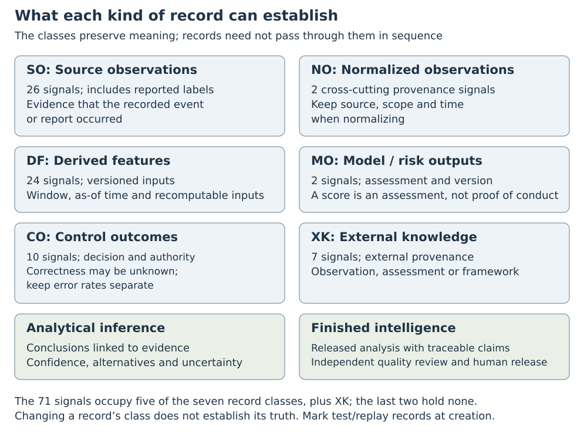
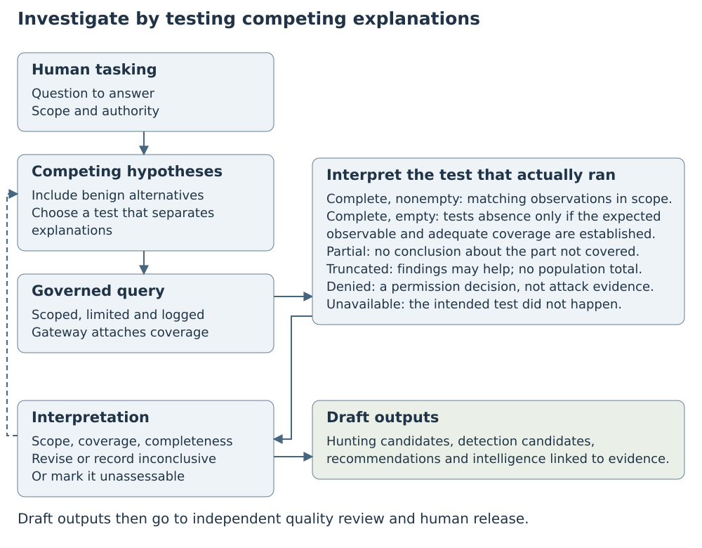

# Supplement: signals, interfaces and worked-example data

Jonathan Matkowsky

25 November 2026 · Accepted working draft for version 1.1 · Not published · Not peer reviewed

This supplement accompanies the [manuscript](../MANUSCRIPT.md). S1 and S2 explain the sources and selection. S3 to S5 specify the signals, records and interfaces. S6 supplies the hypothetical investigations and their arithmetic; S7 gives the proposed evaluations. S8 tests eight AI models on written versions of the two investigations. S9 extends the comparison with prior work. S10 replays two FTC complaints on synthetic records and counts the tactics alleged in 14. S11 gives specification detail that the manuscript summarizes. The 19 CSV files use UTF-8 encoding and stable mechanism, source and signal identifiers. Citation labels match the package's [BibLaTeX references](../REFERENCES.bib).

## S1. Sources and comparisons

[Source notes](../SUPPLEMENT/S1_CITED_SOURCE_NOTES.csv) identify the version, supporting passages, publication status and supported claim for each of the 134 cited works. The [requirements matrix](../SUPPLEMENT/S1_REQUIREMENTS_MATRIX.csv) compares 50 sources against C1 to C3. It codes two parts of C1 and C2 and three of C3: an outcome linked to its decision, and late, unobservable and false reports kept apart (C1); query coverage and learned time (C2); typed separation of observations, inferences and memory, a human principal before reuse, and links from records an agent output informed back to that output (C3). E means explicit support, P partial or adjacent support, and a dot means the cited material does not establish the requirement. The `payment_setting` column records yes for a payment or payment-fraud setting, P for a setting partly in payments or adjacent to payment fraud, and no otherwise. It marks two cyber threat intelligence sources, STIX 2.1 and Hettema's belief-revision paper, as cyber; other security and threat-intelligence sources are coded no. The source notes link to the matrix by citation key, and their inspection dates are in UTC.

[Stage coverage](../SUPPLEMENT/S1_STAGE_COVERAGE.csv) supplies the source-level codes behind Table S1.1. Source notes record bibliographic and access issues separately from claims about a method.

**Table S1.1. Stages described in the cited research.** E means explicitly described; P means partial coverage or a different scope; a dot means not established by the cited material. Each family receives the strongest source-level code in S1, so one row may combine several systems. L1: signal sources; L2: ingestion and stores; L3: entities, correlation and knowledge; L4: investigation; L5: outputs; L6: feedback; L7: governance; L8: learning and correction.

| Research family and inspected examples | L1 | L2 | L3 | L4 | L5 | L6 | L7 | L8 | Payment domain |
|---|---|---|---|---|---|---|---|---|---|
| Industrial payment and risk systems: TitAnt, GEM | P | E | P | . | P | P | . | P | yes |
| Stripe’s engineering publications, 2019 to 2025 | P | E | P | P | P | E | . | P | yes |
| Threat-intelligence and security-operations architectures: reference models, intelligence lifecycle and agent benchmarks | P | P | E | E | E | P | E | E | no |
| Preprints on agents making fraud decisions: SR-Fraud and Sharma’s auditable agent | P | P | P | E | P | E | P | E | yes |

Study populations and denominators constrain the comparisons. Sharma's balanced synthetic sample contains 60 cases drawn from transactions its classifier scored between 0.2 and 0.8: thresholding the classifier at 0.5 decides 43 correctly and the agent 39. Six of the agent's eight overrides replace a correct decision with an error. Fatima's verification rates concern genuine participants under the study's completion and exclusion rules; they do not measure fraud detection. Doerfler's 47.8 percent same-session success rate concerns challenged sign-ins. Its 97.3 percent rate of access within one week counts users, not sign-ins. Doerfler's Section 5.3 and Table 7 caption take users who failed a challenge as the denominator; its introduction takes users who saw a challenge. Its abstract treats the complement of the first rate as legitimate users failing to sign in, but its results note that hijacking activity depresses per-session success. Subtracting the first rate from 100 percent therefore does not give a clean legitimate-user failure rate. Neither Fatima's nor Doerfler's aggregate rate establishes whether an individual event was decided correctly.

FTC complaints describe allegations, and the stipulated orders do not establish them on their merits. Vendor publications support attributed descriptions of interfaces or observations, not independent evidence of industry-wide effectiveness.

## S2. Product scope and mechanism selection

[Product scope](../SUPPLEMENT/S2_SURFACE_BASELINE.csv) contains 88 public product and feature entries, read on 27 September 2026: 53 catalog items, twenty items from the Q3 2026 public roadmap (seventeen appear in a cached copy of that roadmap; the other three are confirmed as shipped in Stripe's changelog), ten separately documented capabilities and five careers-page footer items. These entries define the scope for candidate selection, not a complete or current product catalog. Each row lists candidate mechanism IDs, not validated coverage or retained signal mappings; a dot means none is listed. The entries list 85 of the 99 candidates; the other 14 appear only in the allocation table. Six retained mechanisms are not listed against any product entry: ID-14 (account farming and aged-account preparation for later abuse), PAY-04 (card testing through attacker-controlled merchant or connected accounts), MP-02 (payment-method cashing through a self-controlled merchant or connected account), MP-04 (merchant misrepresentation and transaction laundering behind a front), MP-07 (merchant-side dispute evasion) and BOT-04 (CAPTCHA and challenge defeat). S5 identifies the exact API schemas used for interface comparisons.

**Products and business-reported records (manuscript Section 4.1).** The platform's products may span onboarding, identity verification, payments, subscriptions, payouts, treasury and risk controls. Businesses may also report their customers' registrations, logins and payments. The specification identifies what investigators need from these records without assuming a provider already collects or links them.

A retained mechanism targets a documented capability, serves a plausible adversary goal and has supporting public evidence. Sources include research, incident reports, government and intergovernmental guidance, and platform documentation. Four public job postings for abuse, risk and machine-learning roles helped prioritize topics but do not establish incidents; the manuscript cites two (Section 3), and the allocation keys record the other two. The stated priority basis names a posting topic for 24 candidates. Twenty-three of them are among the 26 candidates allocated Tier 1; all 23 are mapped and carry 65 of the 163 links. The 24th, EC-06, is unmapped. Every mapped mechanism has support beyond postings in the mechanism-to-source links.

[Mechanism allocation](../SUPPLEMENT/S2_MECHANISM_ALLOCATION.csv) records all 99 candidates and their final dispositions. The signal map retains 61 mechanisms: 52 of the 53 dedicated candidates, all eight targeted candidates and the one adjacent-logged candidate, ID-18, insider access abuse by platform or partner staff. Of the other 38, nine are covered, four are record gaps, four are screened gaps and twenty are unreviewed, as the table below defines, and one reviewed candidate, PAY-12, has no signal mapping. PAY-12 concerns triangulation fraud: filling real customers' orders through another seller using stolen payment credentials. Its review record notes framework evidence only. The four record gaps are fake reviews (MP-08), e-skimming on merchant checkout pages (API-09), supply-chain compromise of commerce plugins and packages (API-10) and business stablecoin issuance abuse (MP-11). A second rater named a record each would need, and the inventory holds no such record (S3). [Allocation keys](../SUPPLEMENT/S2_ALLOCATION_KEYS.csv) decode the source abbreviations. The `Class` code, also the prefix before each key's colon, gives the source type: a for law-enforcement announcements and vendor or incident reports, including EchoLeak (a:ECHO), which is cited by its arXiv identifier; b for research papers; b* for other arXiv preprints; c for government and intergovernmental publications and the MITRE fraud framework; d for Stripe's documentation, roadmap, blog and public repositories; and e for Stripe's job postings. All four b keys name a peer-reviewed venue. In the `Verification` column, V marks a key recorded as verified, and S marks a key that rests on a summarizing retrieval whose exact passage was not retained, as the `d:S` row states. The allocation file repeats S as a suffix on its evidence keys, as in `a:SSN (S)`. Priority labels explain selection emphasis; they do not measure evidence quality.

#### Reading the selection records

The allocation file's `disposition` field states the final selection decision. Signal coverage is recorded separately in S3; a reviewed candidate need not have a signal mapping.

| Disposition | Meaning |
|---|---|
| dedicated | Reviewed as a distinct mechanism |
| targeted | Received a focused review of its implications for the design |
| covered | Judged covered by existing records, not retained as a separate mapped mechanism |
| record gap | Reviewed and first judged covered; a second-rater check found that no record in the inventory covers it |
| screened gap | Screened without identified supporting evidence and logged as a low-priority gap |
| unreviewed | Not reviewed; all twenty such candidates have low priority |
| adjacent logged | Recorded as adjacent to the core mechanisms; the one such candidate is retained in the signal map |

`Priority (basis)` and `Impact (basis)` retain the selection judgments and their stated reasons. In a priority basis, `r:` introduces a topic named in a job posting, with the posting's key in parentheses where given, and `p:` introduces platform-documentation keys. A posting key such as `(EM)` is the allocation key `e:EM` without its class prefix; platform-documentation keys keep their `d:` prefix. Impact bases use no prefixes. `Scope` distinguishes core and adjacent mechanisms. `Parent` records a stated relationship to another mechanism; a dot means none is listed. `Evidence keys` are identifiers, not evidence grades. `Maturity` is the estimate, before review, of how developed the published research was; `after_review_maturity` pairs it with the later classification where both were supplied. `Evidence` is the confidence label used to allocate effort (verified, provisional or unresolved), not a certification of each source's claims. `Depth` is the initial allocation: Tier 1 for the deeper review, Tier 2 otherwise, or a logged gap when evidence was unresolved. `recorded_status` states each review's outcome.

Searches covered nine abuse paths, coded U1 to U9: API-key takeover (U1), identity provenance at onboarding (U2), document integrity, including identity and business documents (U3), account compromise (U4), payout redirection (U5), card testing (U6), abusive merchants (U7), mule and pass-through funds (U8), and attacks on agents or operator assistants (U9). Only the entity-relationship notes cite these codes. Searches followed relevant publications, public guidance and references. This focused selection does not establish exhaustive coverage of abuse or related systems.

### S2.1 Claim types

Research can propose an untested design, while documentation can directly establish an interface. Neither publication status nor the number of sources validates the integrated specification. No claim in either document rests on author experience.

**Table S2.1. How to read the manuscript's claims.** Claim type describes what a statement establishes. Source type and publication status describe where its support comes from.

| Claim type | What it means |
|---|---|
| Fact | A description supported by evidence, including a public specification or an artifact this study produced; source and version are given where they matter |
| Peer-reviewed prior research | A finding reported in a peer-reviewed publication whose publication status was confirmed, applicable only to the setting and conditions it studied |
| Inference | A conclusion motivated by stated premises; the sources do not establish the conclusion directly |
| Design requirement | A property chosen for the proposed platform on the stated evidence and reasoning; it is not claimed as necessary for every platform or as observed in a deployment |
| Hypothesis | A proposition to test for the proposed platform, including every detection candidate in the manuscript |
| Proposed implementation | One possible way to satisfy a requirement |
| Empirically validated result | A measurement, valid for the proposition and setting actually tested; results for individual components do not validate this integrated design |

### S2.2 External coverage check

An external check compares the candidates with MITRE's Fight Fraud Framework (F3), version 1.3 [@MITRE2026F3]. Its technique list does not come from Stripe's materials; the scope judgments still follow the product scope. Mechanism selection used version 1.1 (allocation key c:F3), which lacked 38 of version 1.3's techniques. The [F3 crosswalk](../SUPPLEMENT/S2_F3_CROSSWALK.csv) maps each of its 153 techniques and sub-techniques to the candidate mechanisms that cover it, with a reason for each scope decision. Of the 110 within the product scope, a retained mechanism covers 34 fully and 55 in part. Of the other 21, fourteen are covered only by candidates outside the signal map. Two of the fourteen rest only on candidates judged covered by existing records, among them device fingerprint spoofing. Three rest only on candidates recorded as record gaps: the adversary-in-the-browser technique and two of its sub-techniques, which the candidates describe but no record in the inventory covers. Six rest only on unreviewed candidates, among them 3-D Secure bypass, and three rest on covered and unreviewed candidates together. None rests on a screened gap. Seven are covered by no candidate: DLL injection in the browser, compromise of point-of-sale systems, coercion, keylogging, abuse of accessibility features, theft from password managers and SEO poisoning. Scope and coverage are one reviewer's judgments, recorded for each row.

## S3. Signals, mappings and lineage

The [signal inventory](../SUPPLEMENT/S3_SIGNALS.csv) defines all 71 signals, with their families, classes, feature inputs, mechanism and source IDs, public counterparts, entities, uses and limits. Its `internal_representation_status` value, DR for every signal, marks a design requirement, not observed platform instrumentation. [Mechanism-to-signal mappings](../SUPPLEMENT/S3_MECHANISM_SIGNAL_PAIRS.csv) contain 163 links: 154 design mappings motivated by evidence and nine marked as inferential. These links explain why a record is proposed; they do not establish a detector's effectiveness or make its fields uniquely necessary.

The outcome-channel requirements use SIG-70 and SIG-71 to record each payment-level or account-level control decision's effect on each outcome channel, SIG-27 to separate authentication results from reported liability status, and SIG-58 for dispute reasons and payout returns. SIG-70 also keeps manual-review dispositions. Each record retains its source, version and uncertainty.

The inventory contains 26 source observations (SO), two normalized observations (NO), 24 derived features (DF), two model or risk outputs (MO) and ten control outcomes (CO). Seven signals provide external knowledge (XK). The inventory therefore covers five of the seven record classes in manuscript Section 5.1, plus external knowledge. Analytical inferences and finished intelligence are later outputs, not input signals.

**Figure S3.1. What each record class can establish.** Counts refer to the 71 signals; the two output classes hold none.

**Table S3.1. The 71 signals by family.** SO: source observation; NO: normalized observation; DF: derived feature; MO: model or risk output; CO: control outcome; XK: external knowledge. The final column counts partial public counterparts, cases where that comparison does not apply, and signals with no counterpart identified in the pinned schemas (manuscript Section 5.4). Token allowances permit another party to spend from a crypto wallet.

| Family | Signals | Classes | Partial / n/a / none identified |
|------------------------------------------|--------|--------------------|-------------------|
| Identity and onboarding | 8 | SO 3, DF 4, CO 1 | 3 / 4 / 1 |
| Authentication, session and operator administration | 10 | SO 5, DF 4, CO 1 | 6 / 4 / 0 |
| Credentials, API keys and request context | 5 | SO 3, DF 1, XK 1 | 2 / 2 / 1 |
| Funds movement and payout destinations | 11 | SO 4, DF 5, CO 2 | 6 / 5 / 0 |
| Payment attempts, authorization and payment controls | 7 | SO 2, DF 4, CO 1 | 3 / 4 / 0 |
| End-customer lifecycle and entitlement | 7 | SO 2, DF 4, CO 1 | 3 / 4 / 0 |
| Merchant storefront and business claims | 2 | DF 1, XK 1 | 0 / 2 / 0 |
| Platform outputs and labels | 4 | SO 1, MO 2, CO 1 | 4 / 0 / 0 |
| Agents, tools and approvals | 8 | SO 5, CO 3 | 4 / 0 / 4 |
| Wallet signing and token allowances | 2 | SO 1, DF 1 | 0 / 1 / 1 |
| External threat knowledge | 5 | XK 5 | 0 / 5 / 0 |
| Provenance classes | 2 | NO 2 | 1 / 1 / 0 |

SIG-44, SIG-45 and SIG-46 apply across mechanisms. They record technique-catalog mappings, minimum observation provenance and the provenance of test records, respectively. The other 68 signals map to specific mechanisms. All 61 mapped mechanisms have at least one mapping motivated by evidence; S2 explains PAY-12's exclusion.

**Second-rater check of the links (10 November 2026).** The links were made without a written linking rule. For this check a rule was written afterward ([packet](../tools/second_coder/PACKET.md)): link a mechanism to a signal when an investigator of that mechanism would need the record, and a listed source describes behaviour the record would capture. A rater that took no part in the mapping, OpenAI's GPT-6 Astra Pro in a session without memory, project files or web access, applied the rule to a seeded random sample of 20 of the 61 mapped mechanisms and 5 of the 13 then judged covered. It saw the 68 mechanism-specific signals and the recorded scope of each mechanism's sources, not the sources and not the links. Claude models had proposed the links; ChatGPT models assisted with other parts of the paper. Over the 1,360 mechanism-signal pairs for the 20 mapped mechanisms, the rater made 49 of the paper's 52 links and 70 that the paper lacks (Cohen's kappa 0.55); two mechanisms matched exactly. Of the three links it did not make, the paper marks two as inference. Thirty-two of the 70 added links attach six general-purpose signals, such as request context and funds movement, to further mechanisms. The links are therefore a sourced subset: each gives a reason for a record, and other mechanisms may need the same record. Counts of links describe this subset, not a complete map. For four of the five covered mechanisms the rater named no missing record; for fake reviews (MP-08) it named review content, reviewer identities and posting histories. A second packet on 11 November gave the same rater the other eight covered mechanisms; it named no missing record for five and a missing record for three (API-09, API-10 and MP-11). The inventory was searched for each named record and none was found, so these four are now recorded as record gaps (S2) and the other nine remain covered. The check tests whether the rule reproduces the links from recorded source scopes. It is not a human coder and does not test the sources. The [run record](../tools/second_coder/real_run/RUN_RECORD.md), answers and score are in the package.

Each input ID for the 24 derived features names another signal in the inventory. No feature depends, directly or indirectly, on itself. For example, SIG-24 uses SIG-27 to enumerate its eligible transaction cohort, including completed payments with no report. The separate chargeback-or-alert-resolution measure also uses SIG-25. Keeping these inputs explicit makes the denominator and the distinction between measures inspectable.

The [source directory](../SUPPLEMENT/S3_SOURCE_DIRECTORY.csv) identifies 61 design sources. Of these, 27 are not among the 134 cited works and have no S1 source note. Each source was read in full in October 2026. Later reads are dated in the row. For one, a vendor blog post (L112), the cited passages were read verbatim and the other paragraphs only as a close paraphrase. One FTC complaint (L127) was first read in part on 21 October; a complete copy was read on 29 October. The directory records each source's type, the depth of the read, with qualifiers such as the version read or pages not read, the access date and the scope. Where only a preprint or an author copy was read, the row says so. [Mechanism/source joins](../SUPPLEMENT/S3_MAPPING_SOURCE_JOINS.csv) supply 126 links, each with its source identifier, recorded depth and scope limit. These records preserve the premises behind the mappings, including limits on transferring evidence from another setting.

The public-counterpart classification asks whether a pinned schema contains an object, field or event that supplies part of the required observation. Of the 71 signals, 32 have partial counterparts. The question does not apply to 32: 24 derived features, seven external-knowledge signals and one provenance signal. A keyword search of the three files identified no counterpart for seven, including request context, identity-capture session context and several agent observations. That absence is bounded by the terms searched. S5 gives the exact locators and explains the limits of partial counterparts; the inventory records each signal's classification.

Identifier links establish limited relationships. A storefront-to-merchant identifier link does not show that a payment through the merchant account settled. A verified identifier from the same namespace and relevant interval can support a stronger, or *hard*, link. A descriptor or shared IP address may support only a weaker, or *soft*, link. Neither alone establishes common control or malicious intent.

The inventory preserves the manuscript's interpretation rules: onboarding-link histories are a design analogy (S3.1), and error estimates retain their cohorts and denominators (Section 7.2). Each outcome channel retains its decision context (Section 7.1), and each broader outcome measure requires its own evaluation (Sections 8.2 and 9.1).

### S3.1 How abuse mechanisms motivate the records

Manuscript Section 5.2 keeps the outcome-label records. The evidence for the other records follows.

#### Exposure and misuse require different evidence

Measurements of exposed secrets establish exposure or validity at a particular time, not unauthorized use. Meli and colleagues found a median of about 1,800 unique candidate secrets daily. Of the monitored secrets, 81 percent remained sixteen days after discovery. They did not test credentials against the services [@Meli2019]. Demir and colleagues confirmed 1,748 active credentials for 14 services, with payment services among the largest groups. Traced through nine archived crawl snapshots, the verified credentials had been publicly exposed for 12 months on average [@Demir2026]. That duration does not show continuous credential validity.

The specification therefore records exposure location and time as external knowledge, then compares credential use before and after exposure. Public visibility, validity, attacker possession and misuse remain separate propositions.

Timing can matter at minute scale. In a deliberate cloud-key exposure experiment, an actor used the key within minutes while an automatic quarantine limited its actions. Researchers later removed that restriction to observe further operations [@Gamazo2023]. Microsoft reported attackers launching follow-on payment fraud attempts as little as five minutes after stealing credentials and session cookies through phishing that relayed the victim's login [@Microsoft2022AiTM]. These observations motivate precise timestamps without establishing typical attack speed.

#### Access needs a history

A login challenge is an extra verification step at sign-in. Research examines challenges triggered by unfamiliar devices and networks [@Doerfler2019]. The design records authentication context, session issuance and later use. Applying the same lifecycle to onboarding links, which let businesses complete account setup, is a design analogy.

Changes after access can identify what an intruder attempted. In reported OAuth-application abuse, intruders used compromised accounts to create applications, grant them permissions, add credentials to new and existing applications and create inbox rules that hid messages from the user [@Microsoft2023OAuth]. The design records these changes, with links to source observations. Recording changes to authentication factors and event destinations extends the same approach.

A device or browser fingerprint can help connect activity but cannot alone establish common control. One impersonation market sells stolen user profiles with browser fingerprint data and a browser extension meant to reproduce them. The study did not buy profiles to test that software [@Campobasso2020]. The records retain that uncertainty.

#### Funds movements need destination histories

The FBI's payroll-diversion advisory describes attackers changing where funds are sent [@FBI2018]. Payout destinations therefore have their own identities and histories: creation, changes, first observation, validation and reuse across accounts. Trace A applies this analogy to a hypothetical key permitted to change a payout destination.

Regulatory guidance motivates measures of time between receipt and onward transfer, and concentration at receiving entities [@FinCEN2014]. It does not validate a per-account detector.

#### Business descriptions need corroboration

Storefronts, merchant accounts and statement descriptors, the merchant names cardholders see, need not map one-to-one. ScamMagnifier linked fraudulent storefronts through merchant identifiers, with a provider corroborating some links. Its checkouts stopped before purchase and did not observe settlement [@Bitaab2025].

Studies of abusive merchants describe misdeclared business categories and movement between banks [@McCoy2012; @Tian2018]. FTC complaints allege pooling or spreading transactions across accounts to evade monitoring, and misleading representations [@FTC2020FirstData; @FTC2025Paddle; @FTC2019Allied]. The design consequently links storefronts, descriptors, account histories and verified ownership records. It retains declared business details with their source and time for comparison with activity. These allegations and links motivate investigation; they do not establish intent or ownership in a new case.

#### End customers are not platform accounts

A legitimate business may have abusive customers. Stripe's public documentation describes multi-accounting, account sharing, free trial abuse, account farming and deliberate non-payment for accrued usage [@Stripe2026CAE; @Stripe2026Trial; @Stripe2026PAYG; @Stripe2026Farming]. The customer-evaluations page describes its reuse reasons as reuse within one business over the past seven days; the account-farming page does not specify whether its links span businesses.

The specification records end-customer registration and billing histories, reused identifiers, simultaneous use and unpaid usage within a business. Linking an end customer's identity across businesses requires separate authorization, a permitted purpose, privacy oversight and supporting evidence. This restriction does not prohibit authorized fraud-prevention aggregation on instruments, devices or credentials under a stated and logged scope.

## S4. Responsibilities, entities and interfaces

The 71 signals identify candidate records, the 24 responsibilities assign investigation and review functions, and the interfaces preserve the meaning of what passes between them. The [functional responsibilities](../SUPPLEMENT/S4_FUNCTIONS.csv) file defines them without requiring separate processes or databases. Seventeen were derived with payment-specific mechanisms or sources in view. One (23) adapts agent-security research, and six (2, 3, 4, 13, 21 and 22) come from cyber threat intelligence work. These origins describe how the responsibilities were derived, not uniqueness to payments. The file's `class` column marks these three groups DI, AGV and INH.

Responsibilities 16 and 17 cover engineering validation and adaptive testing of detections, controls and models. Responsibility 21 independently reviews all agent outputs, including intelligence drafts, hunting and detection candidates, and recommendations; responsibility 22 provides human release. Permission to investigate grants no authority over accounts, payments or controls. An authorized human may decide urgent containment before quality review (manuscript Section 6.4), without releasing the draft into organizational memory.

Responsibilities 1 to 10 scope and conduct an investigation. They include human tasking, governed tools, the evidence store, hypothesis testing and entity relationships. Responsibilities 11 to 20 represent threat knowledge and turn findings into usable outputs: actor, technique and vulnerability knowledge, the structured threat-knowledge store, hunting for undetected abuse, detection development, threat-model integration, recommendations, finished-intelligence synthesis and evidence lineage. Responsibilities 21 to 24 govern use and reuse: independent quality review, human release, controlled learning and security of the investigation system.

The [entity inventory](../SUPPLEMENT/S4_ENTITIES.csv) and [entity relationships](../SUPPLEMENT/S4_ENTITY_RELATIONS.csv) define the entities and the kinds of links between them. Each link records its source, identifier namespaces and the basis for associating each identifier with its entity. It retains its effective interval, learned time, version, confidence, confounders (other explanations for the link), and permitted purpose and scope. A shared attribute alone does not establish that one person controls both entities. When a decision makes an outcome unobservable, the record describes the channel's status; it does not invent an outcome report. [S4.1](#s41-complete-storage-requirements) gives the complete storage requirements, and [S4.2](#s42-field-level-schemas-for-outcome-records) gives field-level schemas for the outcome records.

**Figure S4.1. Investigation as a sequence of tests.** Each query tests competing explanations within authorized scope. A gateway outside the agent attaches the query's coverage, which determines which interpretations remain supported. Draft outputs follow review and release under manuscript Section 6.4.

The query interface must show what each query actually covered and what its result means:

| Part of the interface | Information or behavior required |
|---|---|
| Request | Task and question; authorized requester; tenant, purpose and data scope; entity namespaces; event interval and as-of cutoff (only data the system had learned by then); schema and query versions; row, time and cost limits; expected observation and required coverage |
| Response | Query/run ID; scope actually evaluated; source and schema versions; event and ingestion watermarks (how far event time and data loading had progressed); known gaps and retention horizon for each source; sampling and access filtering; whether the result is complete, partial, truncated, denied or unavailable, and any scope-limited flag; meaning of any count; returned rows or approved aggregate, with the identifiers of the returned records kept for the run; lineage and coverage limits |
| Interpretation | A positive observation does not establish how many cases exist in the population. An empty result counts against a hypothesis only when the abuse should have produced the queried observation and the records cover where it would appear. A denied or unavailable result does not establish adversary behavior. |
| Failure | Enforce limits outside the agent's language model. Stop or narrow the query after it exceeds a row, time or cost limit, or after an authorization error. Record incomplete tests and any abstention (a decision not to conclude). Do not treat missing or not-assessed data as low risk. |

Some permitted operations also need approval bound to the exact request payload, target, task, tenant, tool and tool-manifest version. The manifest is the declared list of the agent's tools. Each approval has an expiry and a rule governing reuse. At execution, the enforcement gateway (manuscript Section 6.5) checks that the operation matches the approval and remains permitted. The restricted agent-and-approval ledger records both approval and execution.

Control and outcome records distinguish the decision, its inputs and version, what happened next, the observable channels, actual reports and any review of correctness. Population error estimates retain their own cohort, denominator, outcome window, uncertainty and scope; they do not establish correctness for individual events. Late reports, unobservable outcomes and false reports have separate fields because they can coexist.

A hypothetical timeline illustrates the as-of cutoff. Freeze a prediction on day 0 using only information then known. A day-30 report may evaluate it within a stated outcome window, but a model trained on day 20 cannot use that report. A later training run may use it if the run's cutoff and label rules permit. Likewise, a relationship learned on day 10 cannot enter day-0 features merely because its effective date is earlier.

The [draft schema](../SUPPLEMENT/S4_DRAFT_SCHEMA.csv) supplies the fields that the rule checker, quality reviewers and the releaser use to assess an intelligence draft.

**Returned records a draft does not cite (manuscript Section 6.4).** The checker identifies every record that the case's query runs returned within a claim's scope but that the draft neither cites nor lists against it. It attaches those that a fixed rule marks as able to count against the claim, such as reports, reversals and records of the benign explanations the claim must exclude, and summarizes the rest by type and count. Reviewers and the releaser see both beside the claim. Full checks of claims about named entities examine every marked record and a recorded random sample of the rest, whose size is fixed in advance for each claim type, and E8 reports how often that sample contained a record that counted against the claim. If a share $q$ of the unmarked records count against the claim, a random sample of $m$ finds at least one with probability at least $1-(1-q)^m$: 59 records give 95 percent when $q$ is 5 percent.

**Event timing in drafts (manuscript Section 6.4).** A time asserted by a business, customer or external source retains its source and uncertainty. Recent receipt does not establish recent conduct when the event interval is unresolved. Outcome windows instead use each channel's declared clock-start event.

### S4.1 Complete storage requirements {#s41-complete-storage-requirements}

Table S4.1 summarizes this complete storage contract; S3.1 and manuscript Section 5.2 give the motivating evidence. Each block groups requirements by the information it preserves. The stores distinguish record meanings and need not be separate databases.

**Table S4.1. What each analytical store preserves.** The full contract is in S4.1. These are requirements for the proposed platform, not claims about an existing provider. The structured threat-knowledge and organizational-memory stores form their own planes, and the other stores hold evidence-plane records. Clusters in the entity-relation graph remain threat-knowledge items. External-knowledge records support only what their source observed or described, and ledger entries only what happened during the investigation itself.

| Store or shared requirement | Required properties |
|---|---|
| Observation log | Source records and revisions, identifiers, environment, tenant scope and lineage; separate event, source-recording, ingestion and query-availability times; repeated delivery does not duplicate the event |
| Entity-relation graph | Typed identifier links with source, namespace, effective interval, learned time, version, confidence, benign explanations, and permitted purpose and scope; versioned cluster membership; end customers scoped to a business |
| Feature store | Recomputable inputs and versions; decision-time features exclude later information; later labels use the evaluation's outcome window and maturity; features inherit their inputs' agent-output and released-item links |
| Label store | Report source, type and attributed entity; occurrence, report and arrival times; appended value history; typed links to every decision that may have shaped the report; links to separate truth assessments and any informing agent output or released item; report presence, channel state and query access kept apart |
| Assessment store | Model or reviewer identity and version; review selection route and probability; links to any informing agent output or released item; unknown, not-assessed and failed-open states kept distinct from low risk; failed-open means an assessment failed and activity continued |
| Control-outcome store | Decision, authority, reason and version; reproducible available inputs; alternative-decision probabilities where applicable; human assignment and what the decider was shown; links to any informing agent output or released item; effects on each outcome channel, fixed with the decision; for action before review, the urgent route, impact class and later review outcome; correctness reviews with their selection route, separate from population error estimates |
| Structured threat-knowledge store | Revisable relationships and conclusions with confidence, input and rule versions, writer and status; agent proposals marked as unreleased context; links to informing agent outputs and released items |
| Organizational-memory store | Human-released items with approved claims and their stated confidence, version, scope, expiry, reviewer findings, lineage and correction links; exonerating items have independent counterexamples, a re-test date and the evidence and cluster versions whose change expires them early; proposed lessons wait outside it with their counterexample tests, and released lessons keep monitoring and withdrawal records |
| External-knowledge store | Source, type, times observed and published, validity period, retrieval time and license; a link to the released item whose identifier the returning content bears |
| Agent-and-approval ledger | Model, instructions, inputs, tool calls; approver, binding, expiry and reuse rule of each approval; approved and executed payloads, tool-manifest version and hash at approval and at execution, memory writes, outbound-traffic decisions; rule-checker and reviewer findings per draft version; marked untrusted content and exposed agent output; logged agent-output and released-item link removals |
| Query coverage record | Gateway-written entities and intervals, requested and evaluated; as-of cutoff, schema versions, sampling, per-source watermarks, known gaps and retention horizon, access filtering and limits reached; derived result status; not writable by the agent |
| Shared time and graph requirements | Reconstruct what was available at each decision; preserve reporting clocks and delays, retention limits, account histories and report-to-transaction links |

**Observation log**

- Preserve records and revisions without overwriting earlier records. Keep source, event and delivery identifiers, schema version, entities, source lineage, and actor and request identifiers where available. A record delivered more than once takes effect only once.
- Record each observation's environment (production, test, synthetic, replay or emulation), marked when the record is created, and its tenant scope: the business or other boundary within which it may be accessed and used. Keep each record's source trust mark. Mark content that businesses, customers or outside sources supplied as untrusted. Both marks survive normalization and storage.
- For content fetched from a source the subject controls, such as a storefront or business website, record the vantage point of each fetch: network origin, region and client. A subject can serve different content to different visitors, including reviewers.
- Mark every label, assessment, control outcome, draft, proposed lesson and released item that a test, replay or emulation creates, or that derives from such a record or from synthetic data, with the same environment value when it is created. Keep these records out of production labels, intelligence and lessons. Record any authorization for their evaluation use, with who gave it, the evaluation and its scope.
- Keep event or effective time (when something happened or took effect) with its source and uncertainty bound. Record the source system's recorded time and the platform's ingestion time separately.
- For each store, retain when each record and revision became visible to queries.
- A derived record keeps its inputs' latest learned time separately from the time it first became queryable. Its own learned time is the latter and cannot precede any input's learned time.

**Entity-relation graph**

- Label each identifier link by kind and as hard (stronger) or soft (weaker). Retain its source, identifier namespaces, effective interval, learned time, version, confidence and possible benign explanations (confounders).
- Record why each identifier is believed to belong to its entity.
- Keep versions of linked-entity clusters and their membership rules. Record end customers separately for each business. Record each link's permitted purpose and scope. A link across businesses also records its authorization for that identifier type (manuscript Sections 5.2 and 5.5).

**Feature store**

- Keep inputs traceable and values recomputable, with the feature definition version, the entities and the computation window. Decision-time features use only information available at that decision.
- A feature computed over a cluster or other threat-knowledge item records that item's version, writer and status. If an agent proposed the item, or the item links to an agent output or released organizational-memory item that informed it, the feature links to that output or item and counts as dependent on it.
- Join later outcomes as evaluation labels under an explicit outcome window and maturity period. The outcome window is the period after the decision in which an outcome must occur to count.

**Label store**

- **Report history:** retain report type, source, attributed transaction or entity and lag. Keep three times: when the reported outcome occurred, where known, with its uncertainty; when the report was made at its source; and when it arrived at the platform. Preserve each value and its learned time, such as a dispute being filed, answered, then won or lost, and record whether each won or lost status followed adjudication. Append each status change, reversal or correction as a new record that references the earlier one. Never edit an earlier record, so that what the platform believed at each time can be reconstructed.
- **Truth assessment:** link any assessment that the report is mistaken or deliberately false. Keep that assessment in the assessment store with its model or reviewer identity and version, how the report was selected for review and, for a sampled review, its selection probability.
- **Dependencies:** link every decision that may have shaped the report, and any agent output or released organizational-memory item that informed the label. A report may link to several decisions, such as a blocked attempt, a retry and the approval of the paid attempt, and one decision, such as an account restriction, may link to many reports. Each link states the decision's role, such as a decision on the reported item, on an earlier related attempt, or on an account or payout that contains it, and the basis for the link. Record the writer's case or session and the agent outputs and released items open in it when the record was written.
- **Channel status:** for each affected transaction, payout or account application, keep report presence, channel state and query access separate at each read time. These statuses may be computed when read from the stored decision, report and channel records. When a draft cites a status, store that status with an identifier and its read time.
- **State history:** a channel is open, temporarily delayed or not yet opened, permanently closed by a recorded decision, reopened or extended by a recorded rule event, or unknown. Keep every transition's effective interval and the decision ID, or the rule event's source and version, that caused it.
- **No report:** an open channel remains pending before its reporting window ends. It matures with no report only if it stayed open throughout the window and the records cover that window. If a recorded decision or rule event changed the channel's meaning, the matured absence carries that decision's ID, or the rule event's source and version, and is read under the changed meaning, not as a negative for the original outcome. A channel with no defined window never supports a negative by maturity alone. A matured absence is provisional: it records the rule version under which it matured and returns to pending if a later rule event reopens the window.
- **Unavailable records:** mark inaccessible records unavailable without overwriting known channel state or earlier reports.
- **Clocks and maturity:** for a temporary delay, keep the expected and actual clock-start events when known. Store the reporting window and clock-start event with the channel, including their source and version. Each channel record also names its rail, the attributes its window depends on, such as whether the debited account is a consumer or business account or the type of claim, and whether the channel adjudicates report truth. Store the maturity used by an evaluation with that evaluation.

**Program status and reopened reports (manuscript Section 5.3).** A decision can change a channel's meaning, as a liability shift after successful authentication does (manuscript Section 7.1). A merchant's network program status can also change that meaning: under one program, a merchant loses the liability shift on domestic authenticated payments until it exits the program [@Stripe2026MonitoringPrograms]. The records keep that status as it stood at decision time, because the guide does not say whether the loss reaches payments authenticated before the merchant entered the program. A report's resolution is not always final either: in rare cases an issuer files a further dispute on the same payment after acquiring new information, or a lost dispute later becomes a late win [@Stripe2026Disputes].

**Bank-debit and other rails (manuscript Section 7.1).** A SEPA Direct Debit dispute within eight weeks of the debit is honored with no questions asked, and such disputes are final, with no process for appeal [@Stripe2026SEPADebit]. After eight weeks and up to 13 months, a customer can dispute only a debit considered unauthorized, and the customer's bank decides; the window that applies therefore depends on the claim, and an absence at eight weeks is not a negative for unauthorized-debit fraud [@Stripe2026SEPADebit]. Inside its window, an ACH return is refunded without question, and the ACH Network has no appeals process of its own [@Stripe2026ACHTerms]. A SEPA dispute honored with no questions asked is not by itself a fraud allegation. For ACH returns, Stripe's terms give 60 days for consumer accounts and 2 days for business accounts, counted from the customer's bank statement [@Stripe2026ACHTerms], while the Nacha return deadlines that banks apply run from the settlement date of the original debit [@LeadBank2026ACHReturns]; a channel record therefore names the rule from which it takes its clock start. Banks may also accept late returns outside the window [@Stripe2026ACHTerms].

**Limits of the rail review (manuscript Section 9.2).** Bank debits were compared only with two of Stripe's pages and one bank's return-code table (manuscript Section 7.1); of the bank-debit candidates in S2, PAY-07 was judged covered and MM-03 was not reviewed. Instant push payments and stablecoin payments, which are also in the product scope, were not reviewed rail by rail; their mechanisms MM-07 and MM-12 were reviewed, but not their reporting channels (S2).

**Assessment store**

- Retain the model or reviewer identity and version. Keep unknown, not-assessed and failed-open states distinct from low risk.
- Record when each assessment was made and frozen (its freeze time) and the as-of time of its inputs. For each model version, record its training and model-selection cutoff and the label rules it used. A label that became available after that cutoff cannot enter that version.
- Never store an assessment as an observation of the conduct it assesses.
- Link each assessment, whether a model, a detection or a reviewer produced it, and each detection or model version, to any agent output or released organizational-memory item that informed it. Record the writer's case or session and the agent outputs and released items open in it when the record was written.
- For each detection or model version, link the validation records of responsibilities 16 and 17, with their version, date and result.

**Control-outcome store**

- **Decision:** retain the decision, who had authority to make it, the rule or model version, and the reason.
- **Inputs and policy:** log the time of the decision and the inputs it used. Keep versions from which every other input available at that time can be reconstructed. Record the score, threshold or rule that produced the decision, and whether the policy was deterministic and, otherwise, the probability of each alternative. Identify any input that a decider, automated or human, used but that was not logged.
- **Human decisions:** retain who decided, how the case was assigned and what the decider was shown.
- **Dependencies:** link any agent output and any released organizational-memory item that informed the decision, so the decision can be revisited when that item expires or is corrected or retracted. Record the writer's case or session and the agent outputs and released items open in it when the record was written.
- **Correctness:** record reviewed correctness when available, with how the case was selected for review (for example an appeal, a complaint, a sampling rule or review of every case) and, for a sampled review, its selection probability; otherwise record unknown.
- **Error estimates:** keep separate links to each estimate, with its control version, cohort, outcome window, denominator, uncertainty and scope. The cohort is the fixed set of decisions the estimate covers.
- **Channel effects:** record the decision's effect on each outcome channel as closed, delayed, changed in meaning, none or unknown. Fix these effects when the decision is recorded. Record later state transitions, including rule events, as separate records that never edit the decision.
- **Restrictions:** distinguish allowing and blocking from restrictions, such as a hold that may later be released.
- **Urgent containment:** for an action decided before quality review (manuscript Section 6.4), record that route, the impact class (none, degraded service or outage), any notification and restoration path, the review deadline and the later review's outcome, including any reversal.

**Structured threat-knowledge store**

- For inferred relationships, clusters, technique mappings and conclusions, retain confidence and the input and rule versions that produced them.
- Record the writer as a correlation engine, agent proposal or person, and status as proposed, accepted or retracted. Record the person or accountable process that accepted or retracted the item, and when.
- Retrieve an agent-proposed item only when it is marked as an unreleased agent inference. It never counts as corroboration.
- Link an item that a person or correlation engine wrote to any agent output or released organizational-memory item that informed it. Record the writer's case or session and the agent outputs and released items open in it when the item was written. The item counts as dependent on those outputs and items.

**Organizational-memory store**

- Keep released items only, with the releaser, version hash, released claims and the confidence stated for each, scope, expiry, reviewer findings and originating draft.
- Retain supersession and retraction links, and lineage from every cited observation to its root record. Keep every later status record for a released item, such as a monitoring finding, an early expiry, a retraction or a withdrawal, with who or what wrote it and when.
- For benign or exonerating items, keep a re-test date, a source of counterexamples independent of the writer, and the versions of the cited evidence and of any cluster the item concerns. A revision of that evidence or a change in that cluster's membership expires the item early (manuscript Section 6.5). Record each re-test, with its counterexamples' sources, its result and its date.
- Read each item as context or a hypothesis, never as an observation.
- Proposed lessons remain outside organizational memory until testing, quality review and human release. For each one, record its writer, proposal time, queue state, intended scope and version. Record each test against counterexamples, with the counterexamples' sources and the result. After release, record monitoring findings and any withdrawal, each with its writer and time, and the reason for a withdrawal (manuscript Section 7.3). The requirement for responsibility 23 in the functions file calls a withdrawal rollback; the two terms name the same record.

**External-knowledge store**

- Retain source, type, version, when the source observed and published the fact, validity window, license and retrieval time. For a catalog of abuse techniques, the version is the fixed version that mappings cite.
- Keep external knowledge distinct from platform observations.
- Record the identifier attached to each released item shared outside the platform. When external content returns with that identifier, link it to that item. It counts as dependent on the item and on any agent output behind it, not as independent corroboration.

**Agent-and-approval ledger**

The ledger makes the agent itself investigable (manuscript Section 6.5).

- For each run, record the human assignment or the standing task template and version that authorized it, with its permitted data, entities, period, current period and outputs. The current period bounds claims about current conduct.
- For each tool call, preserve the provenance of inputs that reached the agent's language model.
- For each approval, keep the approver, the target, task, tenant and tool it is bound to, its expiry, its reuse rule and any token issued. Keep hashes of the approved and executed payloads, and the tool-manifest version and hash in force at approval and at execution.
- Record memory writes and decisions on outbound traffic.
- Record each agent output, such as an intelligence draft and each of its versions, a hunting or detection candidate or a recommendation, with its identifier, version hash, run and creation time. It is an observation of what the agent did, not evidence of the activity under investigation.
- Retain model identity and version, instruction version and decoding settings.
- Mark content that came from untrusted input as untrusted when it is read back. Distinguish copied untrusted content, agent output exposed to untrusted content and agent output without that exposure; exposure takes precedence. Ordinary source observations retain their own trust marks and are not assigned an agent-output category.
- Record each rule-checker result and quality-review finding with the draft's version hash, the rule version or reviewer, including the version of the rule that marks uncited returned records, and the draft's resulting status: returned, released or expired. For each quality review, record the materiality tier applied to each claim, the sampling rate, the cited records the reviewer examined and the random sample of unmarked uncited returned records it drew, whose size is fixed in advance for each claim type. Record when each draft version entered the review queue and when it would expire from it. For each review, record its start and end times.
- Record each removal of an agent-output or released-item link from a label, control decision, detection, assessment or threat-knowledge item, with the person who removed it, that person's release authority, the time, the reason and the identifier of the removed output or item.
- Store references to card data, identity documents and other regulated data, not copies (manuscript Section 5.5).

**Privacy and operating constraints (manuscript Section 5.5).** A deployment must specify retention and deletion for each record class before collecting it. Append-only logs preserve history but must still permit required deletion of personal payloads, derived data, backups and identifying lineage. Encryption-key destruction is sufficient only if recoverable keys and plaintext copies are also removed. Retained audit structure must not preserve information required to be deleted.

In the agent-and-approval ledger's references to regulated data, tokens or keyed hashes may be used only where the applicable standard permits. The ledger should not become a new sensitive-data store or widen payment-card security scope.

Use of external model providers depends on their processing terms and permitted processing locations. Drafts concerning suspicious-activity reporting remain subject to the platform's confidentiality and subject-notification rules.

Cross-business linking requires a stated purpose and authorization for each identifier type. Permission to use a payment-instrument link does not automatically authorize linking devices or verified people. These deployment obligations constrain the specification; this paper does not determine which legal basis applies in a particular deployment.

**Query coverage record**

- For each query run, retain its request: the task, run and question, the authorized requester, the tenant, purpose and data scope, the query version, the row, time and cost limits set, the expected observation and the required coverage.
- For each query run, retain the coverage record the gateway attached: requested and evaluated entities with their tenant and identifier namespaces, requested and evaluated event intervals, as-of cutoff, source and schema versions, sampling, each source's event and ingestion watermarks, known gaps and retention horizon, access filtering, and any row, time or cost limit reached.
- Keep the derived result status (complete, partial, truncated, denied or unavailable), the version of the rules that derived it and any scope-limited flag. The agent cannot write these fields.
- For each query run, keep the identifiers of the records it returned, including those behind an approved aggregate, so that the checker can find returned records that a draft neither cites nor lists against a claim (manuscript Section 6.4). Keep identifiers, not copies, under each record's retention and deletion rules (manuscript Section 5.5).
- Link each tested hypothesis and each claim of absence to the query runs behind it. Record each hypothesis's status, including inconclusive and unassessable, apart from the query results. Record each incomplete test and each abstention.

**Time semantics**

- Use timestamps precise enough to join a key's exposure to its use within minutes, with each timestamp's clock source.
- For each payment, keep authorization, capture and processing times separately, and any service or event date that a channel rule uses as its clock start. Keep the authentication result and the reported liability status separately, each with its source, rule version and learned time. Keep any network program status that removes the liability shift as it stood at decision time. Record a later program entry as a rule event, and leave the liability status of payments authenticated before it unknown. An unknown liability status remains unknown.
- Preserve label delay and what information was available as of each time.
- Retain account age, dormancy and how long funds stay before moving on.
- For each record class, keep each record until the longest applicable reporting window, counted from its channel's clock-start event, or the defined maturity period has ended, whichever ends later, plus the investigative lookback period. Follow the retention and deletion rules in manuscript Section 5.5. Record resulting gaps as coverage limits. Record each authorized hold with its scope and retention rule.

**Graph semantics**

- Link closed accounts to suspected successor accounts, and storefronts to merchants.
- Link each outcome report to the transaction, payout or account application it concerns, with the basis for the link and whether it is verified. Attribute outcomes through that link to the platform account, connected account and end customer, so that a measure counts each affected transaction once. A report's links to the decisions that may have shaped it do not change this count. Keep each transaction's acquiring bank and the static part of its statement descriptor, so that a network's monitored unit can be reconstructed.
- Link each wallet to every party it has allowed to spend its funds.

### S4.2 Field-level schemas for outcome records {#s42-field-level-schemas-for-outcome-records}

The [outcome-record schema](../SUPPLEMENT/S4_OUTCOME_RECORDS/outcome_records.schema.json) defines, in JSON Schema, the fields of the records the first requirement needs. It covers eight record types:

| Record | What it holds |
|---|---|
| OutcomeChannel | A route for reporting outcomes: its rail, clock-start event, reporting window with source and rule version, the attributes the window depends on, and whether the channel adjudicates report truth |
| ControlAction | A decision's targets, time, authority and version, and its effect on each channel: closed, delayed, changed in meaning, none or unknown |
| ChannelStateTransition | One change in a channel's state for one item, with its effective interval and the decision or rule event that caused it |
| LabelEvent | An outcome report or one revision of it, with its amount and whether the report states that amount or the platform estimated it, when the outcome occurred, when it was reported at its source, when it arrived and when it became queryable |
| LabelEventDecisionLink | A link from a report to one decision that may have shaped it, with the decision's role, the basis for the link and whether it is verified |
| ChannelStatusReading | Report presence, channel state, query access and no-report status for one item and channel at one read time, stored when a draft cites it |
| ItemAttribution | The accounts an item belongs to, and the acquiring bank and static statement descriptor from which a network's monitored unit can be rebuilt |
| EntityLink | A link between entities, such as a closed account and a suspected successor, with its basis, confidence and other possible explanations |

Every record is append-only: a correction is a new record that references the earlier one. An unknown time is recorded as unknown, with a reason, and never left out. The schema checks each record on its own. Fourteen rules check records against each other:

1. OR-01: a record identifier is used once. A record changed in place under its own identifier passes every rule, so the store must prevent edits.
2. OR-02: a correction or revision references an earlier record of the same type and, for a report, of the same report.
3. OR-03: every channel, decision and report that a record cites exists.
4. OR-04: a report's times are in order where they are known: occurred, reported, arrived, learned.
5. OR-05: a won or lost report states whether that result followed adjudication.
6. OR-06: a decision gives one effect per channel. A delay gives its expected clock start, and a change in meaning says what changed.
7. OR-07: a permanent closure cites the decision that caused it, and a reopening or extension cites the rule event. A cited decision must target the item, record the matching effect and precede the transition.
8. OR-08: no report can arrive through a channel while a closure of that channel for that item is in force; a revision counts from its report's first arrival. Such a report means the item link or the closure is wrong.
9. OR-09: a link's role fits the decision: a decision on the reported item, on an earlier related attempt, or on an account or payout that contains the item.
10. OR-10: a reading's channel state is computed only from the transitions and corrections the system had learned by the read time.
11. OR-11: a reading's report presence matches the reports learned by the read time. Presence is unavailable only when query access was denied or unavailable, and it does not overwrite channel state.
12. OR-12: a no-report status follows from the channel's state and window. An absence matures only if the window is defined and has ended, the channel was open throughout it, with no gap in its recorded state, and query access was full. A matured absence records the rule version it matured under and cites any decision that changed the channel's meaning.
13. OR-13: each reported item has exactly one live attribution to its accounts, so a measure counts it once.
14. OR-14: a link resting only on a shared attribute is neither verified nor high-confidence, and a suspected-successor link starts from an account with a recorded closure.

The [valid conformance case](../SUPPLEMENT/S4_OUTCOME_RECORDS/conformance_valid.json) builds one synthetic history: a blocked card attempt, an approved retry that draws a fraud chargeback the merchant later wins, a hold on the account that received the payment, and a payment that draws no report. An earlier account with the same principal name was closed; the new account is linked to it as a suspected successor on that name alone, and a storefront is linked to the new account by its checkout identifier. Its 27 records pass. Each of the 24 [invalid cases](../SUPPLEMENT/S4_OUTCOME_RECORDS/conformance_invalid.json) changes that history in one way and must fail exactly one check; together they exercise the schema check and all fourteen rules. `tools/outcome_conformance.py` runs the cases using only the Python standard library, and `CHECK_CANDIDATE.py` also runs it. The same tool checks any records file in this format.

Channel names, windows and rule versions in the cases are illustrative, not any network's rules. The schema follows the label-store, control-outcome-store and graph-semantics requirements in S4.1 and the relations in the entity-relationships file. A schema and passing synthetic cases do not show that the records improve investigations. [S4.4](#s44-field-level-schemas-for-query-runs-and-release) gives the schemas for query runs, which the second requirement needs, and for release records. Denominators are outside these records: which payments a measure counts, their amounts and their capture or settlement times come from the payment ledger, which this section does not specify. Whether a denominator read was complete is a query-coverage record.

### S4.3 Cost of the outcome records on synthetic data {#s43-cost-of-the-outcome-records-on-synthetic-data}

[`tools/outcome_cost.py`](../tools/outcome_cost.py) builds one million synthetic payments from the [valid conformance case](../SUPPLEMENT/S4_OUTCOME_RECORDS/conformance_valid.json), replacing identifiers and shifting times, so each record has its template's fields. Before measuring, it checks a sample of generated records against the schema and OR-01 to OR-14. [The results](../SUPPLEMENT/S4_OUTCOME_RECORDS/cost_results.json) come from one run on the machine below.

Assumptions, illustrative and not any platform's values: payments spread over 90 days; 100 payments per account; two outcome channels per payment, fraud chargeback and early fraud warning; 1 percent of payments blocked; 0.5 percent of allowed payments draw a fraud chargeback with three report events and one decision link; 1 percent of accounts held and 1 percent linked to a suspected predecessor; one cited channel reading per blocked payment.

| Record | Records | Mean size (bytes, JSON) |
|---|---:|---:|
| ChannelStateTransition | 2,000,000 | 411 |
| ControlAction | 1,000,200 | 422 |
| ItemAttribution | 1,000,000 | 397 |
| LabelEvent | 15,372 | 718 |
| ChannelStatusReading | 9,947 | 378 |
| LabelEventDecisionLink | 5,124 | 230 |
| EntityLink | 100 | 558 |
| OutcomeChannel | 2 | 361 |

Each payment needs 4.03 records. Per million payments: 1,656 MB as JSON lines; 79 MB compressed with gzip level 6; 2,559 MB in SQLite 3.53.1, storing each record's JSON with one index on item, channel, record type, learned time and effective time. On a two-core x86-64 virtual machine with Python 3.13.18: 10,000 reads of one payment's fraud-chargeback state and report count, at a cutoff 30 days after the last payment, took a median of 17 microseconds and a 99th percentile of 57; one day's cohort of 11,052 payments took 0.3 seconds. Every record was loaded, but the cutoff admits 12,929 of the 15,372 report events; the other 2,443 were learned later. Loading took 125 seconds and indexing 2.7.

Limits: template text repeats, so compression overstates what real records achieve, and field values are longer than coded production values would be. Each added outcome channel adds one channel-state record per payment. The store is one SQLite file on one machine, not a production database. Query runs (C2) and release records (C3) are measured in S4.4.

### S4.4 Field-level schemas for query runs and release {#s44-field-level-schemas-for-query-runs-and-release}

The [investigation-record schema](../SUPPLEMENT/S4_INVESTIGATION_RECORDS/investigation_records.schema.json) defines the records C2 and C3 need. It covers eight record types:

| Record | What it holds |
|---|---|
| Actor | A person, or a process at one version, that writes records: a source system, pipeline, model, rule, agent, the gateway or a checker |
| QueryRun | One query and the coverage record the gateway attached: requested and evaluated entities and intervals, the as-of cutoff, each source's watermarks, known gaps, retention horizon and sampling, filtering, limits reached, the records returned and the derived statuses |
| Observation | A stored record with its class, event interval, learned time, producer, root observations, inputs and links to any agent output that informed it |
| DraftOutput | An agent draft: its exact version, expiry, the task's current period, and each claim with its sentence, its supporting and contradicting records, query runs and context. An absence claim names its sources. A claim that states or relies on an unreported outcome lists the items and their channel readings and says which of the two it does |
| OutputExposure | A period in which a person had an agent output open about an entity |
| ReleaseDecision | A person's decision on one exact draft version: the claims released with their confidence, scope, expiry and reviewer findings |
| ReleasedItem | A released conclusion in organizational memory, usable as context only |
| MemoryRead | One read of a released item |

Fourteen rules check records against each other:

1. IR-01: a record identifier is used once.
2. IR-02: every record a record cites exists and has a type its reference allows (the reference table below). A cited query run is a query run. A producer, requester, recorder and reader are actors, a draft's writer is an agent, an exposure names a draft and a person, and a link to an agent output names a draft.
3. IR-03: a gateway that is not the requester records a query run's coverage.
4. IR-04: the evaluated entities and interval lie within those requested, and the as-of cutoff is not after the query.
5. IR-05: a run's statuses follow from its coverage fields. By Section 6.2's source rules, a run is partial when a source was sampled, has a known gap in the requested interval, or does not reach from its retention horizon to its event watermark across that interval, and truncated when a limit was reached. Three rules are added here: a narrower evaluated scope, access filtering, or a source whose loading has not reached the end of the requested interval (its ingestion watermark) also gives partial. A denied or unavailable source gives that status. A run is complete only when nothing else applies.
6. IR-06: a run returns only records about the entities it evaluated, learned by its as-of cutoff, whose event intervals overlap the evaluated interval.
7. IR-07: a derived record is learned no earlier than its inputs, and its root observations are exactly its inputs' roots. Only a source observation, score or decision can be its own root. A source observation is not learned before its event began.
8. IR-08: an absence claim names the sources it speaks for. For each named entity in each named source, the cited runs that are complete, not scope-limited and empty, and that evaluated that entity in that source, cover the claim's interval, alone or together. No cited run over a named source returned a record about those entities in that interval, and the claim lists no such record as support or against itself. A cited run over no named source, or one that does not bear on that interval, does not count for or against the claim.
9. IR-09: a claim's support and the records it lists against itself are observation records, and its support concerns the claim's entities. Its context is an observation or a released conclusion. Every record a claim cites, as support, contradiction, context or query run, exists by the time the draft was written. A supporting record is dependent, and adds no root, if it is linked to an agent output, was produced by an agent, names no producer, or lists no inputs and is not a source observation. The restriction runs through inputs: a derived record adds only the roots reachable through records that are not dependent. The claim's count of distinct roots equals the number of distinct root observations its supporting records add. A material presence or current-conduct claim cites, for each entity it names, at least one supporting observation of that entity that is not dependent and whose event interval overlaps the claim's interval. A released conclusion is never support or contradiction, and no claim cites a draft.
10. IR-10: a current-conduct claim cites, for each named entity, an observation or derived feature whose event interval falls within the current period. A score or decision does not count. A record that is linked to an agent output, was produced by an agent or names no producer counts only if its inputs include, for each named entity, a current-period observation of that entity that is none of these.
11. IR-11: a draft's version identifier is the digest of its claims, each with its sentence. A person releases the exact draft version, after the draft was written and before it expires, without raising any claim's confidence.
12. IR-12: a conclusion enters memory only after a decision that released that claim.
13. IR-13: memory is read only from a released item, between its creation and its release's expiry. A claim cites a released conclusion as context only if the draft's case holds a read of it made by the time the draft was written, and the draft is written before that release expires.
14. IR-14: a record its producer wrote while an agent output was open to that producer links to that output, whatever entity the record concerns, and a record derived from a linked record keeps the link. A linked output is a draft that existed when the record was learned, and an output is open only after it was written.

**References between records.** The table lists every reference one record makes to another and what the rules check about its target. "None" means the rules set no condition.

| Reference | Target is | Kind of actor | Entity | Time | Rule |
|---|---|---|---|---|---|
| Query run: requester | An actor | Not the gateway | None | None | IR-02, IR-03 |
| Query run: recorder | An actor | A gateway | None | None | IR-02, IR-03 |
| Query run: returned records | Observations | None | An evaluated entity | Learned by the cutoff; event overlaps the evaluated interval | IR-06 |
| Observation: producer | An actor | An agent makes the record dependent | None | None | IR-02, IR-09, IR-10 |
| Observation: inputs | Observations | None | None | Learned no later than the record | IR-07 |
| Observation: root observations | Its inputs' roots, or itself | None | None | None | IR-07 |
| Observation: links to agent outputs | Drafts | None | None | Written by the time the record was learned | IR-02, IR-14 |
| Draft: writer | An actor | An agent | None | None | IR-02 |
| Claim: support | Observations | Through each record's producer | A named entity; every named entity of a material claim | Exists by the draft; inside the claim's interval for a material claim | IR-09 |
| Claim: records against it | Observations | None | None | Exists by the draft | IR-09; IR-08 for an absence claim |
| Claim: query runs | Query runs | None | For an absence claim, the named entities and sources | Exists by the draft | IR-02, IR-08, IR-09 |
| Claim: context | Observations or released conclusions | None | None | Exists by the draft; a released conclusion was read in the case first and has not expired | IR-09, IR-13 |
| Claim: channel readings | Channel readings in the outcome store | None | A listed item | Taken by the draft | XR-01 |
| Exposure: output | A draft | None | None | Opened after the draft was written | IR-02, IR-14 |
| Exposure: viewer | An actor | A person | None | None | IR-02 |
| Release decision: draft | A draft, at the named version | None | None | Decided between its writing and its expiry | IR-11 |
| Release decision: releaser | An actor | A person | None | None | IR-11 |
| Released item: release decision | A decision that released that claim of that draft | None | None | Created no earlier than the decision | IR-12 |
| Released item: draft | The release decision's draft | None | None | None | IR-12 |
| Memory read: reader | An actor | None | None | None | IR-02 |
| Memory read: item | A released item | None | None | Between its creation and the release's expiry | IR-13 |

The checker generates a test from this table. In the joint history described below, it points each reference at a record of every type the table does not allow and at a record that does not exist, and each reference that requires a kind of actor at an actor of every other kind. All 29 rules run on each history. They reject all 514 histories of the first sort, all 74 of the second and all 82 of the third. Named invalid cases test the entity and time columns.

The [valid conformance case](../SUPPLEMENT/S4_INVESTIGATION_RECORDS/conformance_valid.json) builds one synthetic history: an investigation with three query runs, a draft with a current-conduct claim and an absence claim, a note written while the draft was open, a release by a second person, and a later case that reads the released conclusion as context and cites a new observation. Its 25 records pass. Each of the 60 [invalid cases](../SUPPLEMENT/S4_INVESTIGATION_RECORDS/conformance_invalid.json) changes that history in one way and fails exactly one check; together they exercise the schema and all fourteen rules. Three [further cases](../SUPPLEMENT/S4_INVESTIGATION_RECORDS/conformance_accept.json) change it in ways the requirements allow and still pass: a linked note that names no producer, two runs that cover an absence interval together, and an absence claim that also cites an unavailable run over a source it does not name. Where a case changes a draft's claims, the draft is first given its new digest, so that only the intended check fails. Run [`tools/investigation_conformance.py`](../tools/investigation_conformance.py) to repeat the checks.

The same script checks four necessity pairs. Each pair is two histories that permit different conclusions but are identical once one group of fields, or one record and its link, is removed. For coverage and learned time, the script compares two versions of one record in a fixed context. Both roots-and-inputs histories pass the rules. In the release pair, the rules reject the history with no release decision.

| Removed | The two histories | What differs |
|---|---|---|
| Query coverage (C2) | The same empty result, from a complete run and from a run reaching past its source's event watermark | Whether absence is supported |
| Learned time (C2) | The same observation, learned before a run's cutoff and after it | Whether the fact was known at the cutoff |
| Roots and inputs (C3) | A second supporting record derived from a different observation, and one derived from the first | Two root observations or one |
| Release decision and its link from the stored conclusion (C3) | The same stored conclusion, with a person's release decision and with none | Whether reuse is permitted |

Removing the release decision and its link from the stored conclusion leaves the two release histories identical. A reviewer with only the remaining records cannot determine whether a person released the conclusion for reuse. Each pair shows what information is needed to distinguish its two histories. The pairs do not show that the records are sufficient or that they improve investigations. The rules do not check released-item links on records written after a memory read, or whether a returned record bears on a claim. They compare a source's ingestion watermark with the requested interval, not with the run's cutoff. Three further gaps need fields the schema lacks. A query run does not record what was asked, so the rules cannot tell whether a complete run returned every matching record. Release scope is free text, so the rules cannot hold a release or a later read to it. A release names a person but carries no authenticated approval tied to the draft. No record rule can show that the person read the draft, and the schema has no class for a fact recorded ahead of its effective date. An observation does not name its source, so IR-08 counts against an absence claim any such record of a named entity in the interval, whatever its source. Runs joined to cover an interval may have different cutoffs, and the absence then holds only as of the earliest. No rule compares a claim's sentence with its structured fields. The schema records no session, so IR-14 treats every agent output open to a person at a given time as open in that person's session, whatever case it belongs to. Identifiers, dates and versions in the cases are illustrative. The schema has no record for a later retraction, early expiry or withdrawal (S4.1), so IR-13 tests only a release's original expiry.

**Requirements together.** One further rule checks a claim against the outcome records of S4.2:

- XR-01: a claim that states or relies on an item's outcome not being reported lists the item, says which of the two it does, and cites a channel reading of the item taken by the time of the draft. Every cited reading of the item was made with full access and shows that no report had arrived. Where the claim reads the absence as a negative, every cited reading also shows a matured absence, and a cited run that is complete and not scope-limited evaluated the item from its clock start to the end of its reporting window and returned nothing about it.

With OR-01 to OR-14 (S4.2) and IR-01 to IR-14 (above), XR-01 makes the 29 cross-record rules that the manuscript counts.

The [joint case](../SUPPLEMENT/S4_INVESTIGATION_RECORDS/joint_case.json) adds a later investigation to the valid histories of S4.2 and this section. A person releases a claim that card attempt PA-3 drew no fraud chargeback, which reads the absence as a negative. The claim rests on a complete, empty run over the attempt's reporting window and on the reading that shows the window matured. Its four records pass, and each of six invalid cases fails XR-01 alone. Two pairs of histories show that each requirement is needed when the other two hold:

| Requirements that hold | The two histories | What differs |
|---|---|---|
| C2 and C3 | The same complete, empty run and released claim about one attempt, which the platform approved in one history and blocked in the other | Whether the absence is a negative |
| C1 and C3 | The same matured reading and released claim, with a complete run and with a run over a label feed loaded only to 20 May | Whether the absence is a negative |

In the first pair every investigation record is the same, and both stores pass their own rules; only the channel records differ, and XR-01 rejects the blocked attempt. In the second, IR-08 and XR-01 reject the stalled read. A fourth passing case blocks the attempt and changes the claim to one that only states that no report had arrived by the reading. XR-01 accepts it: the statement is true of a blocked attempt, and only its use as a negative is barred (manuscript Section 6.4). Until 22 November 2026 no claim field told the two apart, and XR-01 rejected both. Since that date each claim also holds its sentence (`claim_text`, as the [draft schema](../SUPPLEMENT/S4_DRAFT_SCHEMA.csv) requires), and a draft's version identifier is a digest of its claims with their sentences, so a release names the sentence the releaser read. The rules cannot tell whether a claim relies on an unreported outcome it does not list, or which channels it should cite. They cannot read the sentence either: a claim marked as a status whose sentence draws a negative passes, and a reviewer has to catch it.

**Adversarial test (10 and 11 November 2026).** Claude wrote under supervision both the rules and the invalid conformance cases. To test the rules from outside, a tester received the two requirements as the manuscript states them, the fourteen rules, the record fields and the valid history, and not the checker ([packet](../tools/adversarial_cases/PACKET_ROUND1.md)). The tester was OpenAI's GPT-6 Astra Pro in a session without memory, project files or web access. It wrote 15 histories: 13 meant to break a requirement and still pass, and two meant to be legitimate and still be rejected. Against the rules as they then stood, 10 of the 13 passed and both legitimate histories were rejected. A separate session of the same model checked the ruling on each case and corrected three ([rulings](../tools/adversarial_cases/round1/ADJUDICATION.md)). Of the 10 that passed, eight were gaps in the rules and two fell under limits this section already stated. The most serious gaps: a material presence claim that cited no evidence passed, and a note linked to an agent output counted as an independent root. Of the two rejections, one was intended, because the design links any record written while an agent output is open, and one was a false rejection by IR-08. The rules above include the changes that followed, to IR-05, IR-07, IR-08, IR-09 and IR-11, and a correction to the wording of IR-10. Under them, nine of the 13 histories are rejected and the false rejection is gone. The four that still pass are the limits stated above: a draft that drops its link to a released item it read, a complete run that omitted a matching record, a release whose scope excludes its own claim, and a release that names a person who did not review. The rules were revised on these same histories; the held-out round that followed is reported below. The test assumes a fully compromised agent or record writer. No live model was attacked, so it says nothing about how often an agent is subverted. Claude wrote the rules and the first rulings. The tester and the reviewer of the rulings were separate sessions of the same model, and ChatGPT models also assisted with other parts of the paper.

**Held-out round (14 and 15 November 2026).** A second round tested the revised rules on new histories, with the rules and the checker frozen beforehand ([plan](../tools/adversarial_cases/round2/PLAN.md)). The tester was the same model, in three sessions without memory, project files or web access. It received the revised rules and every limit this section stated when the rules were frozen, and not the round 1 histories ([packet](../tools/adversarial_cases/PACKET_ROUND2.md)). It wrote 15 histories: 12 meant to break a requirement and still pass, and three meant to be legitimate and still be rejected. The frozen rules rejected two of the 12, and all three legitimate histories. At first exposure the round 1 rules had rejected three of 13, so one round of revision bought no measurable gain against new histories.

Claude ruled on the 13 disputed histories first. A separate session of the tester's model then ruled on each without seeing those rulings, and the two agreed on seven. The author confirmed a ruling on every case ([rulings](../tools/adversarial_cases/round2/ADJUDICATION.md)). Of the 10 histories that passed, seven are new failures of the rules, one does not break a requirement, and two are unresolved because the paper's text does not settle them. None falls under a limit stated before the round. By the outside session's rulings alone, five are new failures; by Claude's first rulings, all 10. Of the three rejections, two are false and one is intended, because release preserves the assessment's uncertainty (manuscript Section 6.4).

At that round the fourteen rules did not check:

- the kind of actor that produced an observation, so one that the agent produced counts as an independent root;
- that the records a run returned concern the entities it evaluated;
- a claim's outcome readings, which only XR-01 checks;
- a note about another entity written while an agent output was open to its writer, because IR-14 then matched by entity where manuscript Section 4.2 matches by the writer's case or session;
- that a linked agent output existed when the record was learned;
- support for each entity a claim names;
- an observation that contradicts an absence claim and was learned before the draft, unless a cited run returned it.

One rule was changed after round 2, because a review had raised the point before the round (19 November 2026). IR-10 now counts a linked record only if its inputs include an unlinked current-period observation of each named entity, as manuscript Section 6.4 states. Invalid case D40 tests the change; no outside tester has. It changes no outcome in either round.

Two rules rejected legitimate histories. IR-08 asked for one run that covers a whole absence interval, where several complete runs can cover it together. IR-14 rejected a linked note that names no producer, which manuscript Section 6.4 would count as dependent. The text left two questions open: whether a released conclusion may be listed against a claim, and whether an unavailable run on another source defeats an absence claim that a complete run supports. A claim recorded no sources.

Six of the seven failures share a form. One record refers to another, and no rule checked the kind of actor behind the other record, its type, its entity or its time. The seventh, the note about another entity, was a rule that matched two records more narrowly than the manuscript does. This reading is an inference from the cases, not a tested result.

Round 2's 15 histories came from three sessions, where the plan fixed one, because each session closed before the next request; each later session was given the earlier histories ([run record](../tools/adversarial_cases/round2/RUN_RECORD.md)). The model and its settings rest on the author's statements. The tester and the reviewer of the rulings are the same model, and the two first sets of rulings agreed on only seven of 13 cases. The histories are not a sample from a defined population, and the tester read the rules and aimed at their gaps. The counts therefore describe these histories, not a rate at which the rules catch misuse, and no interval is given. Both rounds' histories are kept as regression tests, and the package check reruns them.

**Revision after the held-out round (22 November 2026).** The rules above are revised from a table of every reference and those four attributes (the reference table above), not case by case. The revision closes the seven failures and the two false rejections. It also adds checks no tester had prompted, among them the type of a draft's writer, of an exposure's output and viewer and of a link's target, the time an exposure opens, and an unexpired release and a read behind every released conclusion cited as context. Three fields are new. A claim holds its sentence, an absence claim names its sources, and a claim that lists outcome items says whether it states their status or reads a negative. Two decisions settle the questions the text left open. A released conclusion is cited as context only, never against a claim, because C3 gives it the role of a hypothesis or context. An absence claim speaks for the sources it names, so an unavailable run over another source does not bear on it.

Under the revised rules, 11 of the 12 round 2 histories meant to break a requirement are rejected, and the twelfth is the one ruled not a breach. Both false rejections are gone, and the intended rejection stands. Round 1 is unchanged at nine of 13. These counts are measured on the histories the rules were revised on, as round 1's nine of 13 was. They show that the revision does what it was written to do, and nothing about new histories. The round 1 and 2 histories were written before the three fields existed. To rerun them, each claim that lacks them is given a placeholder sentence, the sources of every run it cites and the negative reading ([runner](../tools/adversarial_cases/run_cases.py)); the saved histories are not changed. Two of the 11 rejections depend on how the rerun is done. The history with the unavailable run is rejected because its claim is given both sources. The history that cites a later observation as an outcome reading is rejected by XR-01, which the rerun applies and the round 2 command did not.

**Third round (22 November 2026).** A third round tested the rules as revised above, frozen beforehand with both checkers ([plan](../tools/adversarial_cases/round3/PLAN.md)). The tester was Meta's Llama 4 Maverick, from outside the two model families that wrote the rules and the earlier histories, in one temporary chat with web search off. Its [packet](../tools/adversarial_cases/PACKET_ROUND3.md) covers the joint case and XR-01, which the first two rounds did not. It wrote 16 histories where the plan asked for 15, and all are scored: 13 meant to break a requirement and still pass, and three meant to be legitimate and still be rejected.

The frozen checkers rejected 11 of the 13. The investigation rules or XR-01 rejected seven. The schema rejected two, each of which gives a draft a link field that drafts do not have, so neither reached a rule. Outcome rules alone rejected two, and this round did not test those rules. One history passed. It marks a claim as a status while its sentence says the attempt drew a chargeback, and no rule reads the sentence, a limit the packet stated. One history stopped the checker with an error. In it a query run lists a draft among the records it returned. IR-06 as stated rejects that, and the fourteen rules run alone report it, but the code for XR-01 read the entity of every returned record and failed on the draft before anything was reported. The runner reported the error as a malformed case, which the plan does not count as a test; it is counted here as a fault in the checker. Of the three histories meant to be legitimate, one passed and two were rejected. One of the two cites a released conclusion as support. The other makes its claim about an item that no cited run or reading covers.

Claude ruled first on the four histories that needed a ruling, and a reviewer then ruled on each from a packet that held no ruling. The reviewer was GPT-6 Astra Pro, which comes from a developer other than the rule writer's and this tester's but wrote the histories of the first two rounds. The two agreed on all four, and the author confirmed them ([rulings](../tools/adversarial_cases/round3/ADJUDICATION.md)). The pass falls under the stated limit. Both rejections stand: C3 gives a released conclusion the role of a hypothesis or context, and C2 and manuscript Section 6.4 tie an absence claim to the items its runs and readings cover. The rules as stated reject the history that stopped the checker. Under either set of rulings, the round found no new failure of the rules and no false rejection, and it found one fault in the checker's code.

The fault is fixed. The code for XR-01 now reads an entity only from a returned observation. The generated reference test had run the fourteen rules without XR-01, which is why it missed the fault; it now runs every history through all 29 rules and adds references that name no record. Under the fixed checker the history is rejected by IR-06 and IR-08, and no other outcome in any round changes. The 16 histories are kept as regression tests with the earlier rounds'.

This is weak support for the revised rules. Round 2's tester got 10 of 12 histories past the rules of its day and this tester got one of 13 past the revised rules, but the two testers are different models, so the gain cannot be credited to the revision alone. Thirteen of the 16 histories change one record, and the other three add one and change one. Only one changes a claim's reading from negative to status. In both rejected histories that the tester marked legitimate, its own reason describes a fault in the history. The model and its settings rest on the author's statements, which were recorded after the replies were read, where the plan asked for them before ([run record](../tools/adversarial_cases/round3/RUN_RECORD.md)). As before, the histories are not a sample from a defined population, so no rate and no interval is given.

After round 3, the live IR-10 checker was aligned with Section 6.4: a multi-entity claim needs current-period support for every named entity. The conformance check accepts a matched positive control and rejects a copy in which one observation falls outside the period. The saved rounds and their rulings are unchanged; rerunning all three sets with this change produced the same results. This is a conformance check, not a new held-out test.

**Cost.** [`tools/investigation_cost.py`](../tools/investigation_cost.py) copies the valid case 100,000 times, each copy with its own analyst, four query runs, seven stored records, two drafts, one exposure, one release decision, one released item and one memory read, and checks a sample against the rules. Per copy, the records take 8.9 KB as JSON: 3.5 KB for query runs, about 900 bytes each, and 2.9 KB for drafts, release and memory records. A thousand copies take 0.31 MB compressed and 13.6 MB in SQLite; repeated text makes the compressed figure a best case. The SQLite figure was 9.8 MB before each claim held its sentence: the longer of the two drafts, about 1,200 bytes, now exceeds what this table stores inline, about 1,000 bytes, and takes an overflow page. On the two-core machine of S4.3, checking that an absence claim's runs are complete and cover it took a median of 59 microseconds (99th percentile 144), and checking that a memory read used a released, unexpired item took 33 (79). [The results](../SUPPLEMENT/S4_INVESTIGATION_RECORDS/cost_results.json) come from one run. Real coverage records list more sources per run, and reviewer time is not measured.

### S4.5 Further safeguards for the investigation system

**Table S4.2. The agent's permitted capabilities and their evidential limits (manuscript Section 6.3).** Task scope, permissions and resource limits apply throughout.

| Capability | Information used | Boundary |
|---|---|---|
| Discover sources and schemas | Signal inventory, schemas of data stores, and records of counterparts in published API schemas | Finding a source does not grant access to it |
| Run governed queries | Permitted data stores, with scope limits, query limits and logging | Conclusions cover only the data and period the query examined. A denied query is not by itself evidence about the suspected abuse |
| Match records to entities and follow their links | Links labeled by type, known benign reasons for shared identifiers, and versioned clusters (computed groups of entities) | Propose relationships for assessment. A shared identifier does not by itself show common control. A cluster is the output of a computation, not an observed relationship |
| Reconstruct timelines | Credential exposure and later use, session issuance and later use, and account changes after access | Events close together in time do not prove that one caused the other |
| Interpret outcome labels | Report provenance, decision gates and links from reports to transactions | A missing report does not show that no abuse occurred |
| Generate hypotheses from published catalogs of abuse techniques | Mappings to a fixed version of each catalog | Naming a likely technique does not show that it was used |
| Draft hunting and detection candidates | Features, observations and outcome labels | A hunting candidate is a proposed search, not a finding. Detection candidates must still be validated under detection development and threat-model integration (responsibilities 16 and 17) |
| Recommend product or control changes | What each relevant control decision means, restriction options, what happens when a check fails, and protective actions | Authorized humans or accountable operational systems decide and act |
| Draft intelligence | Evidence with traceable lineage | Drafts require independent quality review and human release |

Hostile content copied into the ledger can attack a person investigating the agent itself. Untrusted status must survive storage and normalization.

Ledger copies and agent outputs may suggest hypotheses, but claims cite the underlying evidence-plane records. Their promotion into organizational memory still requires independent testing and human release.

The architecture does not include live adversary emulation. Any future use would require separate ethical, human and operational authorization, enforced scope, tamper-evident logs and test-data provenance.

## S5. Pinned public schemas

[Schema versions](../SUPPLEMENT/S5_SCHEMA_VERSIONS.csv) records the filenames, hashes, versions and counts at repository commit `18fa2cc768024b47789dc6fa243acd48478acac2`, dated 25 September 2026. All three files come from the public `stripe/openapi` repository. The commit message reads "Update OpenAPI for 2026-09-30.endive": the version strings name the API release the files describe, which postdates the commit. The `private_preview` in file C's name does not indicate access to private systems. Stripe publishes these files under the MIT License. That license governs the schema-derived identifiers and locators in the event-type and signal-locator files; the package's third-party notice reproduces it.

The pinned public schemas supply event identifiers, creation time and mode, but omit learned time and some actor, scope and lineage fields [@StripeOpenAPI2026]. Stripe's canonical-logging account describes one summary record per request in each service, with identifiers and outcomes [@Leach2019]. These are partial precedents; the specification does not require vendor field names.

A partial match can leave much of the required record unspecified. An onramp-session object, for buying crypto, and an event-destination configuration, which sets event delivery, both record current state without a complete matching lifecycle event stream. The crypto documentation describes an onramp webhook, a notification sent to another system, for status changes after creation and none at creation [@Stripe2026CryptoOnramp]. Neither the event types that the pinned schemas declare nor their lists of webhook-endpoint events name a crypto or onramp event [@StripeOpenAPI2026]. A request ID likewise supplies neither full request context nor the history of an onboarding link's use.

File A is `latest/openapi.spec3.sdk.json`; B is `preview/openapi.spec3.sdk.json`; C is `preview/openapi.private_preview.spec3.sdk.json`. Paths are endpoint addresses. Resource schemas are component schemas with an `x-resourceId`; they describe kinds of objects. Some resource schemas in file C share an ID.

| SDK file | Version | Paths | Resource schemas / distinct IDs | Event types |
|---|---|---:|---:|---:|
| A | 2026-09-30.endive | 421 | 175 / 175 | 508 |
| B | 2026-09-30.preview | 574 | 237 / 237 | 618 |
| C | 2026-09-30.preview | 800 | 329 / 327 | 781 |

[Event types](../SUPPLEMENT/S5_EVENT_TYPES.csv) lists the types declared under `x-stripeEvent` in each file. Each count includes 216 thin-event declarations whose names add `v1.` to a snapshot type in the same file. The counts exclude the older `event.type` list. [Signal locators](../SUPPLEMENT/S5_SIGNAL_LOCATORS.csv) identifies each counterpart's file and location using slash-separated field names and list positions. Slashes within endpoint names and media types, such as `application/json`, remain unchanged, so adjacent slashes can occur, as in `/paths//v1/webhook_endpoints`. The file's `locator` column therefore does not hold standard JSON Pointers, which would write each such slash as `~1`.

The signal-locator file lists only the 32 signals with partial counterparts. For the seven with none identified, the classification rests on a keyword search of all three files, so a counterpart under other terms is not ruled out. That search covered eight signals: SIG-03, SIG-34, SIG-35, SIG-38, SIG-39, SIG-40, SIG-56 and SIG-68. Its terms were `camera`, `emulator`, `inject`, `liveness`, `selfie`, `capture_session`, `device`, `tamper`, `manipulat`, `spoof`, `presentation`, `jailbreak`, `rooted`, `virtual`, `agent`, `tool_call`, `tool`, `mcp`, `llm`, `prompt`, `model_context`, `manifest`, `tool_version`, `hash`, `signature`, `signed_request`, `web_bot`, `bot`, `verified_agent`, `attestation`, `memory`, `skill`, `egress`, `allowlist`, `proxy`, `outbound_request`, `request_log`, `user_agent`, `ip_address`, `tls`, `ja3`, `fingerprint`, `http_status`, `api_error`, `request_id`, `api_request`, `allowance`, `spender`, `permit`, `signing`, `erc20`, `smart_contract`, `token_approval`, `approve` and `unlimited`. It searched event types, schema names, paths, keys, enum values and descriptions. For SIG-03, identity-verification outcomes such as `selfie_manipulated` and the `require_live_capture` setting record no device, camera, emulator or injection context. For SIG-34, the `agent_details` fields name the agent behind a payment or token and file C has MCP keys for claimable sandboxes, but neither records a tool call or its input provenance. For SIG-40, an API key's `ip_allowlist` controls inbound use of the key, not egress. For SIG-56, the event envelope's request ID and idempotency key, an API error's `request_log_url` and aggregate API-error health alerts give no per-request context. For SIG-38, the search found the `agent_details` fields, which the signal-locator file records as its partial counterpart.

Every listed counterpart is partial. An event envelope (the wrapper around an event) supplies only some required provenance, and a score does not establish the behavior it scores.

## S6. Hypothetical investigations and reproducible arithmetic

**Table S6.1. The two investigations at a glance.** Every observation is hypothetical. S6.1 and S6.2 identify the supporting research and how far its findings transfer to this setting.

| Element | Trace A: exposure and possible payout redirection | Trace B: storefront links and possible dispute evasion |
|---|---|---|
| Trigger | An external observation of an exposed key | A platform risk assessment and a rejected application |
| First questions | Did use change after exposure? What requests and account changes followed? | Which storefronts share templates, descriptors or merchant identifiers? |
| Main analysis | Join events by time; examine the history and reuse of payout destinations | Examine hard and soft links, and outcomes linked to each transaction, across accounts |
| Benign alternatives | Developer testing from a new network or an internal scanner; a business with several legitimate accounts, or an intermediary receiving funds for several clients | A legitimate multi-brand business, shared template vendor or aggregator |
| Evidence limit | Payout redirection is reasoned about by analogy with payroll diversion; timing premises come from Microsoft's report of follow-on business email compromise payment fraud soon after session theft and a deliberate key-exposure experiment | Complaint allegations are not findings; resolving pre-dispute alerts can change chargeback ratios |
| What limited evidence cannot show | A partial baseline cannot show that there was no earlier misuse | Neither soft links nor a hard link from a verified identifier by itself establishes common control, intent or who is behind the activity |
| Proposed outputs | Hunting candidate; detection candidate with an evaluation plan; recommendations to consider rotating or revoking the credential and a payout pause or hold; intelligence draft | Cluster intelligence assessment; recommendation to review the newly onboarded merchant accounts linked to the storefronts; detection candidate built on hard links between storefronts and accounts |
| Who acts | Authorized humans or accountable operational systems decide. The urgent exception covers a reversible payout pause or hold; rotation or revocation follows normal review | Authorized humans or accountable operational systems decide whether to reject or terminate accounts; the agent does not |

The [synthetic cohort](../SUPPLEMENT/S6_SYNTHETIC_COHORT.csv) contains 400 completed transactions, 100 in each of four non-overlapping account cohorts. Each cohort fixes one account's transactions using the same definition and outcome window. These synthetic rows make the counting rules reproducible. They contain no report-arrival dates, so the ratios assume that every report on the four cohorts has arrived and cannot show reporting delay.

### S6.1 Trace A: narrative

A repository scan finds a publicly visible API key. A human asks whether it enabled account compromise and payout redirection. The trace concerns a key not yet revoked, or activity before revocation; existing automatic revocation is outside this workflow.

Exposure alone shows neither that a secret is still usable [@Meli2019] nor misuse. The agent therefore compares earlier requests with those after publication. A hypothetical repository record supplies publication time, separately from the later scan-detection time. Available earlier requests share a cloud-provider region and stable client fingerprint.

Nineteen minutes after publication, requests arrive through a residential proxy range, using a different fingerprint. They access account-profile and configuration endpoints. The deliberate exposure experiment motivates minute-scale investigation [@Gamazo2023], but developer testing or an internal scanner remains a possible explanation.

The same burst creates a webhook endpoint, changes the payout destination and accelerates the payout schedule. A webhook receives the platform's event notifications. This trace assumes the key permits these changes. If destination changes instead require a dashboard session and additional authentication, the investigation would need evidence of session takeover. The payroll-diversion advisory motivates the destination-change mechanism by analogy [@FBI2018].

The next day, delayed records show that the same verified destination identifier was attached to two other accounts before exposure. The matching namespace and interval support destination reuse, not common ownership or malicious intent. The agent checks account histories and ownership records for alternatives such as a legitimate business with several accounts or an intermediary receiving client funds.

Two limits change the conclusion. First, a requested seven-day baseline contains only two hours of earlier history. The change at nineteen minutes cannot be called the first misuse. Second, a detection already running on the platform froze its compromise assessment thirty minutes after publication, before the destination link was learned the next day. The link can inform the later investigation but cannot enter that earlier assessment.

The investigation prepares four outputs: a search for similar cases, a detection candidate linking exposure to use and destination changes, an intelligence draft, and recommendations for authorized action. A reversible payout pause or hold may follow the urgent path when the accelerated schedule appears. Credential rotation or revocation follows normal review.

Stripe's public risk guide describes pausing, delaying or holding connected-account payouts and extending payout schedules [@Stripe2026Connect]. It does not define a pause-versus-hold distinction, so the specification treats both as reversible restrictions while recording which was applied. A deployment must confirm from its own permission model which credentials can change payout destinations and schedules, and what revocation would interrupt.

The detection candidate needs an appropriate outcome. A payout moves an account's balance to its payout destination, which here may be controlled by an attacker. It is not a card payment that can produce a chargeback. Possible outcomes include victim reports, returned or recalled transfers and confirmed incident findings. A permanent block prevents outcomes requiring completion; a hold may only delay them.

Victim reports and incident findings have no defined reporting window here. Those channels can supply confirmed positives but cannot reach “matured with no report.” Evaluation must either justify a delay model, as conversion research does in its setting [@Chapelle2014Delayed], or leave negatives unconfirmed. The recorded decision and channel states determine which interpretation is available.

**The blocked payout in manuscript Table 2 (manuscript Section 8.3).** Excluding the case is valid only for a rate explicitly restricted to completed transfers. Estimating outcomes over all attempted payouts retains it in the target population and must address its unobserved outcome.

### S6.2 Trace B: narrative

A risk assessment and a rejected application identify similar storefronts. A human asks whether newly onboarded merchant accounts form an operation structured to evade dispute monitoring. The assessment selects a lead; the investigation must establish the underlying relationships.

Following the merchant-identifier approach used in storefront research [@Bitaab2025], the hypothetical investigation links eleven storefronts sharing two templates and a descriptor pattern. They settle through four merchant accounts. A principal, a person who owns or controls a business, also appears on a closed account and the rejected application. Research and enforcement allegations motivate examining such returns after closure [@McCoy2012; @FTC2019Allied]. Settlement relationships are stipulated here, not inferred from the cited study's uncompleted checkouts.

The next question is which transactions the outcome reports concern. For disjoint cohorts with the same outcome definition and window, the pooled ratio is a transaction-weighted average of the account ratios, so it lies between the lowest and highest (S6.3).

The synthetic example gives accounts A to D 100 completed transactions each. After linking reports to transactions, every account has two chargebacked transactions: `2/100 = 2%`. The pooled chargeback ratio is `8/400 = 2%`.

Fourteen transactions also carry pre-dispute alert-resolution flags. Two overlap with the eight chargebacked transactions. A separate chargeback-or-alert-resolution measure therefore counts `8 + 14 − 2 = 20` transactions, or `20/400 = 5%`. Adding flags without deduplication gives the incorrect `22/400 = 5.5%`.

On that broader measure, A and B each have `8/100 = 8%`; C and D each have `2/100 = 2%`. The pooled 5 percent conceals the higher values at A and B. On the chargeback measure, all accounts remain at 2 percent, so pooling hides no higher rate. Neither measure is a fraud rate, and the example assumes no monitoring threshold.

**Attribution changes which account appears affected.** The chargebacks on D001 and D002 are recorded at account-X, outside the four cohorts. Counting where reports were recorded shows D at `0/100`. Verified transaction links restore D to `2/100` without changing the 400-transaction denominator or counting either report twice.

Such a mismatch can be legitimate. In Stripe's Connect documentation, a dispute on a direct charge debits the connected account's balance. A dispute on a destination charge or on separate charges and transfers debits the platform's balance, even when the connected account is the business of record, and the platform can try to recover funds by reversing the transfer [@Stripe2026ConnectCharges]. Merchant-of-record and payment-facilitator arrangements can therefore explain a report appearing elsewhere. A missing transaction link leaves the affected measure incomplete, rather than justifying an assumed attribution. Reports concerning transactions outside the four cohorts are excluded.

**Network program rules as read.** Stripe's monitoring guide describes Mastercard's Excessive Chargeback Program as dividing one month's chargebacks by the previous month's captured payments and applying a minimum monthly chargeback count. It describes Visa's Acquirer Monitoring Program differently: each month, Visa divides the previous month's disputes plus early fraud warnings by captured payments in that same month, and it also sets thresholds on the count of those reports and, in one region, on their total value. The guide says both networks assign a report to the month in which they receive it, not the month of the original payment. For that Visa program, a transaction that appears in both the dispute report and the fraud report counts twice, and disputes resolved through pre-dispute products are excluded. Visa identifies a monitored account by the static part of its statement descriptor and its acquiring bank [@Stripe2026MonitoringPrograms]. The guide describes itself as a general guide, not a comprehensive reference, so E3 applies each program as the network's own documentation states it (S7.1). Visa's program overview defines the ratio over card-not-present VisaNet transactions, with settled transactions as the denominator, while the guide speaks of captured payments; E3 follows the network's definition [@Visa2025VAMP].

Thus resolving alerts can lower the program ratio, and growing volume can lower a period ratio while reports are still arriving. Splitting activity can also keep accounts below a count threshold even when their ratios are identical. Detecting that pattern requires cluster-level counts, not merely a pooled cohort ratio.

**Small cohorts leave substantial uncertainty.** Cohorts of 100 transactions cannot reliably separate 8 percent from 2 percent: S6.3 gives exact intervals and a test. Repeated customers or a shared operator may correlate transactions, making those intervals and the test overstate precision.

The linked storefronts still require an explanation. Shared templates and descriptors may reflect a legitimate multi-brand business or aggregator. Verified identifiers support specific relationships without establishing intent or common control. The agent may produce a qualified cluster assessment, an inconclusive finding, a proposed account review or a detection candidate. It cannot reject or terminate accounts.

The enforcement sources remain allegations [@FTC2019Allied; @FTC2020FirstData; @FTC2025Paddle], and storefront content remains untrusted input.

### S6.3 Reproducible arithmetic

Consider non-overlapping cohorts with the same outcome definition and outcome window. Let $T_i > 0$ be account $i$'s transaction count and $D_i$ its count of distinct transactions with chargebacks. Then

$$
r = \frac{\sum_i D_i}{\sum_i T_i} = \sum_i w_i r_i,
\qquad r_i = \frac{D_i}{T_i},
\qquad w_i = \frac{T_i}{\sum_j T_j}.
$$

The weights are nonnegative and sum to one, so the pooled ratio lies between the smallest and largest account ratios.

Any change to report links or outcome definitions must be stated. If it applies alike to every cohort, the weighted-average formula still holds. Under independent trials with a common rate, exact (Clopper-Pearson) 95 percent intervals are 0.24 to 7.04 percent for 2/100, 0 to 3.62 percent for 0/100, and 0.87 to 3.90 percent for 8/400. For 8/100, the interval is 3.52 to 15.16 percent. Fisher's two-sided test comparing 8/100 with 2/100 gives p = 0.10.

[CHECK_CANDIDATE.py](../CHECK_CANDIDATE.py) checks these calculations and excludes the +1-day destination-reuse link from the +30-minute assessment. It also checks identifiers, counts, feature lineage, citation-reference agreement and links between files. [REPRODUCE.md](../REPRODUCE.md) gives build and verification instructions. These are checks of the supplied artifacts and arithmetic, not an evaluation of the proposed system.

Manuscript Table 2 uses eleven signals: SIG-04, SIG-15, SIG-16, SIG-18, SIG-20, SIG-24, SIG-25, SIG-32, SIG-56, SIG-58 and SIG-71. Their complete lineage inputs and the storage requirements are also needed. These examples explain the required context without claiming that each named signal is uniquely necessary. The denominator requires the eligible completed-transaction cohort from SIG-27, including transactions without reports.

**Context each row of manuscript Table 2 needs (manuscript Section 8.3).** The first two rows need request coverage, credential exposure, destination history and learned times. The second row also needs the frozen assessment and its freeze time, which the assessment store holds; none of the eleven signals records it. The third needs the control's effect on each channel. The fourth needs verified report-to-transaction links, deduplication and versioned cluster membership, which Trace B builds from storefront-to-merchant links. The fifth needs the separation between observations and organizational memory.

## S7. Evaluation conditions

These conditions explain the scope and comparisons behind the tests in S7.1. E8's release-gate test appears there alongside the other eight.

**The nine questions as stated (manuscript Section 9.1).**

S7.1 gives each hypothesis, design, primary measure and proposed failure criteria. E1, E3, E8 and E9 are confirmatory; the others are exploratory. None tests the signal inventory or the responsibilities as a whole, which would need a platform that collects every signal and assigns every role. The closed-case audit checks only whether cases needed records the inventory lacks. E3 tests the report-to-transaction links on which C1's outcome records depend, together with cluster-level monitoring. Its pass rule compares linked clusters with accounts as their reports are recorded, so a lead from clustering alone can pass it; only the third arm, which applies the rule to each account after linking, shows whether linkage contributes. E9 exercises C1's links from outcomes to control decisions, and its separation of late from unobservable outcomes, only jointly through the channel-state reading. No confirmatory evaluation tests the separate field for false reports or the decision links' other uses, such as estimating outcomes under other decisions. The exploratory E2 bears on the decision links and, through its sensitivity analysis, on late and false reports; E4 bears on the decision links. Passing E1, E3, E8 and E9 would therefore not establish the value of each of those links and fields on its own. E8 tests C3's release gate. The exploratory E6 checks that required links back to agent outputs exist. No evaluation tests the urgent-containment route in Section 6.4, so its reversal rate and the service it interrupts remain unmeasured.

**Common rules (manuscript Section 9.1).** This section gives the conditions and motivating sources for E1 to E7 and E9. Four rules in S7.1 apply to every evaluation: an as-of cutoff on the information each method may use, outcomes decided blind under rules set in advance, a stated treatment of labels shaped by control decisions, and marking of test records. Of the S7.1 tests, E5 and E8 measure reviewer time, and E5 also compares cost across arms that see the same records. None measures the storage, query work or controlled cross-account access that the added records require. Passing the S7.1 tests would therefore not show that the added records justify their collection cost. E1, E5 and E8 also measure the work of identifiable staff on real case records, and E8's undisclosed planted drafts require a deception protocol. Each needs ethics and privacy review before it starts.

**E1. Coverage and learned time:** Do these records reduce unsupported conclusions in cases with incomplete history or links learned late, without reducing the correct, supported conclusions investigators reach in those cases or in cases with complete history?

**E2. Unobserved outcomes:** For a defined outcome and population, which identifying assumptions (the assumptions needed to estimate outcomes that could not be observed) are defensible? Where is overlap (manuscript Section 7.1) absent? How sensitive are estimates to late, mistaken or deliberately false reports?

**E3. Report linkage and cluster monitoring:** Does linking reports to transactions and applying the network's monthly rule, its ratio, its minimum count and any minimum value, to each cluster flag evasion earlier than account-level monitoring? A broader measure, such as Section 8.2's, needs a separate evaluation.

**E4. Measuring user harm:** Can the records support a rate and interval for harm to legitimate users after a control change?

**E5. Agent benefit:** When all have the same information, does the agent with human review match or improve on the confirmed findings per reviewer hour of well-equipped human investigators, without materially more errors than those investigators or suitable decision rules that use no agent?

**E6. Safeguards:** How well do the agent's safeguards, covering prompt injection, approvals, its memory and the data it sends out, hold up against adaptive attackers? How much do they reduce investigations completed?

**E7. Learning:** How quickly do useful lessons become available for reuse? How do testing against counterexamples, scoped promotion and withdrawal affect negative transfer (a reused lesson degrading later investigations)? How do they affect poisoning (attackers deliberately causing false lessons)?

**E8. Release gate:** Does the release gate catch planted wrong drafts under realistic volume and error prevalence, when reviewers and releasers do not know which drafts are planted, and how much reviewer time does it require? Some planted drafts rest a material claim only on a released item or on records linked to one, which tests C3's rule that such support adds no independent corroboration. Its criteria set no limit on correct drafts that the gate returns or lets expire. Passing E8 would show that the gate catches errors, not that it releases correct work at an acceptable rate; E5 bears on that cost. At 20 drafts every calendar day, one site would need about 21 months, so in practice E8 pools sites or runs as exploratory (S7.1).

**E9. Channel states:** Do C1's channel states reduce the absolute error of evaluation results against a mature holdout reference, compared with the best reading without them (each rail's standard window, blocked attempts excluded)? The target is the selected metric on matured reported outcomes after a sampled review of report truth, not underlying fraud that may never be reported. E9 reports the share of items that C1 reclassifies but does not count it as support, because that share follows partly from C1's definitions and the cohort; support requires a reduction in reference error above the prespecified negligible improvement.

**Table S7.1. Requirements for interpreting feedback.**

| \# | Problem | Evidence basis | Required response |
|---|---|---|---|
| 1 | A decision can close or delay an outcome channel, or change its meaning. Effects differ by channel; payout holds do not delay disputes. | Platform documentation that capture gates fraud reporting and that authentication can shift dispute liability; a theoretical payments preprint; established principles for inferring outcomes under a different decision | Record the decision and its effect on named outcome channels; state the assumptions needed to estimate unobserved outcomes |
| 2 | Reports can arrive late; this paper does not establish maturity periods | Theory and deployed-system evidence of delay | Preserve reporting clocks and arrival times. Reconstruct decision inputs as of the decision. Apply the evaluation's separate outcome window and maturity period to later labels. |
| 3 | Some reports or their supporting evidence may be fabricated | Theory and interview research | Keep report type and source with the label; keep any estimate that the report is mistaken or deliberately false as a linked assessment, not a field of the report |
| 4 | Controls can wrongly restrict or block legitimate users | Peer-reviewed evaluations | Keep decisions, reviews of their correctness and population-level error estimates separate; weigh detection gain against the cost to legitimate users |
| 5 | Adversaries can adapt to controls and testing | Platform publication, peer-reviewed measurement and preprint | Test adaptively within responsibilities 16 and 17; keep test traffic hard for adversaries to recognize but identifiable within the system |
| 6 | Decisions a business reports to the platform may carry the business’s errors into platform labels | Platform documentation of business-reported decisions (manuscript Section 7.1); inference that they may carry errors | Keep decisions and outcomes reported by businesses distinct from platform labels |
| 7 | Account structures can hide which transactions and entities a report concerns | Enforcement allegations | Keep the links from each report to its transaction and entities; compute defined metrics for each cluster of related accounts; measure a closure's effect across the cluster |
| 8 | Payments a business or platform funds itself can inflate a ratio's denominator | Enforcement allegations | Exclude them from the denominator; count them separately |
| 9 | Resolving a pre-dispute alert may avert a later chargeback | Platform documentation that a refund can prevent a dispute; enforcement allegations for the misuse | Record alert resolutions separately; do not read a lower chargeback ratio, by itself, as less abuse |
| 10 | A risk assessment may return a not-assessed result or fail open (let the activity proceed) | Platform documentation | Keep unknown and failure states distinct; do not convert either into low risk |

**E1. Do coverage and learned-time records reduce unsupported conclusions?** The confirmatory test in S7.1 concerns cases with incomplete history or links learned late, with a stratum of cases with complete history for its non-inferiority measure. A broader timing study would compare minute-level joins with coarser timing across a realistic incident population. It would measure exposure-to-use and session-issuance-to-use intervals, detection or triage gains, collection costs and false alarms from benign changes. Microsoft's report of payment fraud attempts soon after session theft and the deliberate key-exposure experiment motivate precise timing; neither establishes its typical benefit.

**E2. When can missing outcomes be estimated?** Define the outcome channel, population and assumptions before selecting an estimator. Simulation can test behavior under known assumptions, including cases without overlap, where no comparable cases received another decision. It cannot verify those assumptions or recover unknown real outcomes. Later observational comparisons must separate populations with supported overlap from those whose outcomes cannot be estimated. Test sensitivity to late, mistaken and deliberately false reports. Allowing attempts that a policy would otherwise block requires separate ethical, human and operational authorization. The motivating theoretical preprint proposes methods; this paper claims no recovery of missing outcomes on platform data [@Dhama2026Causal].

**The four assumptions (manuscript Section 7.1).** An observational evaluation justifies four assumptions linking observed decisions to alternatives [@HernanRobins2020]:

- **Consistency:** each compared decision is precisely defined, and a case's observed outcome equals its outcome under the decision actually taken.
- **Conditional exchangeability:** after conditioning on logged history, cases receiving different decisions have no remaining differences that bias the comparison.
- **Overlap:** comparable cases had a nonzero chance of each relevant alternative decision.
- **No interference:** changing one attempt's decision does not change other attempts' outcomes, including retries.

If all decision inputs are logged and remaining decision variation is independent randomization, conditional exchangeability holds given those inputs. In practical terms, the logged history must account for variables influencing both decision and outcome [@HernanRobins2020]. Unlogged inputs used by a decider break that guarantee and must be identified. Repeated decisions require the relevant conditions at each step because earlier decisions can change later inputs [@HernanRobins2020]. Fraud attempts can respond to earlier outcomes. In one payment provider's validation data, a rule for retries at a fixed amount after failed attempts, switching cards at least twice, then the same at an amount at least 20 percent lower, matched 35 of 885 eligible fraud-target trajectories and 4 of 1,604 eligible legitimate-target ones [@He2026PaySeqGen].

**Examining assumptions is not validating an estimator (manuscript Section 7.1).** Three target quantities illustrate the distinction:

- **Candidate-policy value:** the average outcome a proposed decline policy would produce on a stated measure. Estimation from another policy's logs needs decision inputs, probabilities and overlap for the decisions the candidate would take.
- **The chargeback rate if all cases were allowed:** this needs comparable cases with some chance of being allowed. A class always blocked supplies no allowed comparison.
- **A control's error rate:** this needs a defined cohort, outcome window and denominator, with correctness reviewed for every case or a random sample with recorded selection probabilities. Appeals alone do not establish a cohort rate.

**Decision records and added assumptions (manuscript Section 7.1).** For each decision, the specification records available inputs, the score, threshold or rule, policy version and alternative-decision probabilities where the policy is not deterministic. Human decisions also record the decider, case assignment and information shown. Comparing human deciders of different leniency also requires random case assignment for the cited evaluation approach [@Lakkaraju2017Selective]. For delay, an evaluation specifies a distribution and period of stability. It assumes that, given recorded case attributes and channel, reading time is unrelated to when the report would arrive. For false reports, a noise model specifies error rates by decision, channel and reporter where relevant. Rates come from a random sample reviewed for truth or are stated as bounds.

**E3. Do report linkage and cluster monitoring reveal evasion earlier?** Compare the network's monthly rule, its ratio, its minimum count and any minimum value, applied to each account as reports are recorded, with the same rule applied to each cluster after linking reports to transactions. In S7.1, each mention of the network's ratio for E3 means this complete rule, including its minimum count and any minimum value. When every account has captured payments in the denominator period, a pooled ratio cannot exceed the highest account ratio, so a lead from clustering can come only from a condition on totals, such as the minimum count or, where the network sets one, a minimum value. An account with no captured payments in the rule's denominator period has no defined ratio when it receives reports, and the cluster ratio can then exceed every defined account ratio. Report separately any cluster flag that depends on reports received by an account with no captured payments in that period, such as a closed account or, where the denominator is the previous month's captured payments, an account in its first month. Keep the eligible transactions, outcome definition and reporting periods consistent. Apply the account arms to platform and connected accounts and, where a network monitors a different unit, such as Visa's static statement descriptor and acquiring bank, also to that unit. Evaluate broader measures, including chargeback-or-alert-resolution, separately. Apply each program's exclusions as the network's documentation states them, such as VAMP's exclusion of fraud reports that qualify for Compelling Evidence 3.0. State whose report view each arm uses: the programs also count disputes that Stripe handles on a business's behalf and that do not appear in that business's data [@Stripe2026MonitoringPrograms]. Report the share of reports linked to transactions, the share whose link is unverified and how duplicate reports were removed. Report erroneous links between unrelated accounts sharing IP addresses, such as through a common proxy, as a secondary measure; S7.1's failure criteria do not include it [@Liu2018GEM].

**E4. Can the records measure harm to legitimate users?** The feasibility test in S7.1 asks whether control changes have computable harm rates and intervals. It precedes E1 to E3 and E9. A broader evaluation would compare detection gains with failed attempts and other costs to legitimate users. The identity-verification and login-challenge studies report user outcomes under their own procedures [@Fatima2024; @Doerfler2019]. Their rates cannot determine whether a proposed payment control is worthwhile and require justification before transfer to this platform.

**E5. Does the agent improve the investigation?** Compare the governed agent with well-equipped human investigators and suitable decision rules, including simple thresholds where appropriate. Sharma's agent underperformed its underlying classifier's threshold on 60 synthetic cases [@Sharma2026AuditableFraud]. That limited result motivates testing the agent's added value. Give each approach the same information, set escalation rules in advance and include adaptive adversaries. The storage contract holds reviewer times only for work recorded in the agent-and-approval ledger.

**E6. Do the agent's safeguards hold under adaptive attack?** Test prompt injection, approval rebinding (reusing approval for an altered operation), memory poisoning and limits on outbound data. Measure security failures and the effect of safeguards on investigations completed. Prior adaptive attacks motivate this test but do not establish that these safeguards work [@Nasr2025]. One proposed defense separates control flow, the steps an agent chooses, from untrusted data [@Debenedetti2025CaMeL]. It is a candidate for evaluation under its stated assumptions. Adopting it would change the single hypothesis loop in Figure S4.1, which currently makes no such separation.

**E7. Can lessons be reused without spreading mistakes?** Measure time to useful reuse, negative transfer (a lesson degrading later investigations) and poisoning. Vary validation strictness, release scope and withdrawal conditions. General-purpose agent research supplies methods and evidence of failures, not payment-platform results [@Dash2026; @Xiong2026MemoryManagement]. Poisoned evidence might suggest a legitimate merchant-of-record arrangement, where one business sells on behalf of others. An honest agent could then propose a lesson steering later investigations away from that infrastructure.

**E9. Do channel states reduce error against a mature holdout reference?** S7.1 gives the design: labels built under three readings on decisions the platform already logs, and each reading's error against a holdout reference. The motivating theoretical preprint models reporting and maturity for one channel [@Dhama2026Causal]; E9 asks whether recording several channels' states matters on platform data.

Record the provenance of synthetic, replayed and emulated data when created. Agent-driven adversary emulation would also require the authorization and safeguards in manuscript Section 6.5; this paper performs and authorizes none.

### S7.1 Pre-specified hypotheses and criteria

For each question in manuscript Section 9.1, this section proposes a hypothesis, data design, primary measure and result that would count against the specification. E2's interval settings remain deployment-specific choices, to be fixed before any data are examined. Where a question in Section 9.1 is broader, the test below addresses the part that bears on the three record requirements or, for E5, on the agent's added value. Thresholds and sample sizes are proposed defaults. E1's non-inferiority margin, E3's false-flag margin and E8's tolerable and assumed release rates are named parameters that a platform fixes and records before data collection, and E9's negligible reduction in reference error is one that it fixes before any data are examined; this section does not set them. A platform may change them before it starts, if it records the change before examining any data. No data have been collected, and whoever runs the plan can register it with a time stamp.

C1 and C2 do not need the agent: E1, E3 and E9 test them without one, and E9(a) needs only records a platform already holds.

**A first study within a quarter.** Before or beside E9(a), a platform can audit a random sample of closed cases for the three failures the requirements target: an absence claim resting on a query that was partial, truncated or limited in scope; a missing report read as a negative on a channel a decision had closed or whose window had not ended; and corroboration whose supporting records trace to one root observation or to an earlier conclusion. Two auditors code each case independently from the records the case cited and from what the source systems held at the time, and record whether the failure would change the conclusion. They also record whether the conclusion needed a record that the signal inventory lacks, a check on the inventory's completeness, not on its value. A case the records cannot settle is coded as such, and that share is itself a result. For each failure the audit reports three counts: cases in which it occurred, cases in which it did not, and cases the records cannot settle. The share of cases in which it occurred, and the share in which it changed the conclusion, are taken over the settled cases, with 95 percent intervals. The audit also gives the range each share could take over all sampled cases, counting the unsettled ones first as occurrences and then as none, and it reports agreement between auditors. With 200 settled cases, an exact 95 percent interval on any share is at most 14.3 points wide; with 160, at most 16.0. The audit measures how often the targeted failures occur; it does not test whether the records prevent them. It reviews identifiable staff's work on real case records, so it needs the same ethics and privacy review as E1. A [kit](../tools/closed_case_audit/README.md) holds the coding sheet, a results form that carries counts only, a script for the shares, intervals and ranges, and the terms on which an organization may share its form, named or not.

Four rules apply to all nine evaluations. First, each evaluation freezes the information each method may use at an as-of cutoff and separates development from test data. Second, it states how true outcomes are decided, by whom, and blind to which method produced each finding. Its error and abstention rules are set in advance, and it states base rates. Third, where ground truth comes from labels shaped by control decisions, it says how that bias is avoided. Otherwise it reports relative performance among detected cases only. Fourth, records from tests, replays and emulations are marked when created and kept out of production labels and lessons.

Each evaluation is judged separately, without correction for multiple tests, because support in a setting requires every confirmatory evaluation to pass its complete rule. Each confirmatory evaluation targets 93 percent power: the chance of passing its complete rule under stated effect assumptions. If each reaches that target, all four pass with probability at least 72 percent by the union bound, $1-4\times0.07$, or about 75 percent if their results are independent. Sizing must account for every pass criterion and case or reviewer clustering. The minimum counts below are not power calculations; the sizing assumptions must be recorded before main-study data are collected. E1, E3, E8 and E9 are confirmatory and the rest are exploratory. Each criterion has three possible results. Support: its pass rule is met. Evidence against: a bound at the same confidence level, taken from the other side, lies on the failing side of its threshold; for example, E3 shows excess false flags if the lower one-sided 95 percent bound on the increase is at or above the margin. Inconclusive: neither holds, or the target cannot be identified from the data. A failure criterion below means only that support was not established; the interval and the identification limits decide which of the other two results applies. No result by itself shows that the underlying idea is wrong. Investigators cannot be blind to the added records, so the raters, not the investigators, are blind. A lower or upper 95 percent bound is an end of a two-sided 95 percent interval unless it is marked one-sided.

#### E1 (tests the second requirement; confirmatory).

**Hypothesis:** coverage and learned-time records reduce the share of unsupported conclusions on cases with partial history or with links learned late, without reducing the correct, supported conclusions reached per case.

**Data and design:** closed real cases of that kind, each worked by different investigators with and without those records, and rated by two blind raters. Investigators are assigned to the two conditions at random, balanced so that each works cases in both conditions and none works the same case twice. Raters score conclusions as single propositions under a rubric fixed in advance: they split compound conclusions into their propositions and merge restatements of one proposition, so that each distinct proposition is scored once however it is phrased or grouped. A stratum of closed cases with complete history is worked and rated the same way. Who investigates is fixed before the study starts: people, the agent, or both as separate arms, each analyzed on its own. If both arms are run, E1 fails if either arm meets a failure criterion, and the power target applies to both arms together. Conclusions reach the raters in a common format without coverage or learned-time field names. Each rater records which arm they believe produced each conclusion, so that blinding can be checked. Raters judge each conclusion against the case's complete record as of the time it was written, the same record for both arms. Agreement is reported as Cohen's kappa, and a third rater settles disagreements. A 30-case pilot, excluded from the main study, estimates the level without the records for sizing. The main study will be sized for 93 percent power for its complete pass rule, assuming the share truly falls by half and correct, supported conclusions per case do not fall. Intervals allow for several conclusions per case.

**Primary measures:** the share of conclusions rated unsupported by the evidence then available and, co-primary, the number of correct, supported conclusions per case, rated by the same blind raters against the closed case's resolution. Because the records can lower the share of unsupported conclusions simply by leading investigators to abstain, abstentions per case are reported for each arm and stratum.

**Failure criteria:** Fails if, in the cases with partial history or links learned late, the share falls by less than a third of the level without the records, or the 95 percent interval on the paired difference includes zero. It also fails if, in those cases or in the complete-history stratum, the lower 95 percent bound on the difference in correct, supported conclusions per case (with the records minus without) is at or below minus the non-inferiority margin.

#### E2 (tests the first requirement; exploratory).

**Hypothesis:** the control-decision record is complete enough to estimate outcomes under other decisions (manuscript Section 7.1).

**Data and design:** a simulation with known effects first, then the last quarter of decisions where the platform already randomizes traffic under its own authorization. Record that quarter's start and end dates before examining the data. The target is matured reported outcomes: holdout rates count the reports received once each channel's window has closed, and report truth is reviewed on a random sample. A usable probability is one logged with the feature values and model version that produced it. The deployment chooses the intended coverage defined under the primary measures; it must be at least 95 percent.

**Primary measures:** the share of randomized decisions logged with a usable probability, feature values and model version. Also, the share of overlap populations whose holdout rates fall outside the predicted interval. Each interval predicts the observed outcome rate in a held-out population, including its sampling variation. Before examining any data, specify the estimator, interval construction, intended coverage and overlap populations, and state why those populations can be treated as independent. If they share records, shocks or a fitted model, calibrate the test under the joint design instead. Intended coverage is the planned share of repeated holdout rates the intervals contain. These deployment-specific settings are not selected here.

**Failure criteria:** Fails if fewer than 95 percent of randomized decisions carry a usable probability, or if the prespecified one-sided calibration test rejects the intended coverage at the 0.05 level. Use the binomial test only when the miss indicators are justified as independent and have the same prespecified null miss probability. Otherwise use the prespecified jointly calibrated rule. If no jointly calibrated rule can be specified, observed coverage is reported descriptively and E2 claims no calibrated pass.

#### E3 (tests report linkage, which the first requirement depends on, together with cluster monitoring; confirmatory).

**Hypothesis:** linking each report to its transaction, and computing the network's monthly ratio for each linked cluster, flags evasion earlier than the network's ratio for each account.

**Data and design:** at least 30 linked-account clusters with later confirmed outcomes, channels kept apart, and at least 100 legitimate multi-brand businesses from onboarding. The pass rule is judged only on clusters selected by a confirmation route documented as independent of either monitoring rule; clusters from other routes are reported separately. Adjudicators blind to both rules' outputs fix the onset of evasion for each cluster from case evidence. Each program is applied as the network's own documentation states it, with Stripe's guide used only as a secondary summary. Time to flag is analyzed as paired, right-censored time-to-event data: a cluster that a method has not flagged by the end of follow-up is censored there for that method. A third arm computes the network's ratio for each account after linking. It separates the effect of linking from that of pooling accounts into a cluster. The cluster and third arms count only reports with verified links, such as a match on the network's transaction identifier. Flags that need reports linked otherwise, such as by card number and amount alone, are reported separately. The failing result applies to the stated contrast, and the third arm attributes any lead. Estimate the difference in false-flag probabilities using the same legitimate businesses under both rules, preserving business-level pairing and any additional clustering. Prespecify the interval method and size the study for the complete lead-time and false-flag pass rule at the 93 percent power target, given the expected share of verified report links.

**Primary measures:** days from the adjudicated onset of evasion to the flag, and false flags. A flag before the onset may be unrelated to the evasion, so time to flag is computed twice: counting a flag on or before the onset as day 0, and counting only flags on or after the onset. The lead time is the difference in restricted mean time to flag, account arm minus cluster arm, up to a horizon fixed before any data are examined.

**Failure criteria:** Fails if, under either count, the lower bound of the 95 percent interval on the lead time, estimated from the paired censored analysis, is zero or less. It also fails unless the one-sided 95 percent upper confidence bound on the increase in the probability that a legitimate multi-brand business is flagged, cluster arm minus account arm, is below the false-flag margin, proposed as 5 percentage points. An interval that crosses the margin is inconclusive about this guardrail; an observed difference below the margin alone does not establish support.

#### E4 (tests the first requirement; exploratory).

**Hypothesis:** for each control change (a new rule, a threshold move or a model version), the records support a rate of harm to legitimate users with a defined denominator.

**Data and design:** a sample of control changes, run before E1 to E3 and E9 as a feasibility check.

**Primary measure:** the share of sampled changes with a computable rate and interval.

**Failure criteria:** Fails if fewer than 80 percent of sampled changes have one.

#### E5 (tests the agent's added value; exploratory).

**Hypothesis:** the agent with human review matches or improves confirmed findings per reviewer hour compared with a person using tools. Case error rates are no more than 2 percentage points higher than either comparator arm's.

**Data and design:** at least 700 frozen cases and three arms: threshold rules, a person with tools, and a person with the agent. Errors are counted per case. Both human arms see the same records. In E5, reviewer time covers human investigation, tool or agent operation, checking, release and rework. Measure these activities on the same basis in both human arms. Include work on cases that produce no correct finding. A random share of cases, fixed in advance, is worked without agent access; it also supplies the independent labels that manuscript Section 4.2 requires for validating detections. As a supplementary analysis, set the threshold-rules arm to act on as many cases as the person-with-agent arm, reporting its results by depth of prior history and for fraud bursts defined in advance.

**Primary measures:** correct findings, errors, abstentions, reviewer minutes per correct finding, cost and latency, and the share of labels that carry an agent-output link.

**Failure criteria:** Fails if, for either comparator arm, the upper 95 percent bound on the paired difference in error rates, agent arm minus that arm, is 2 percentage points or more. At a 10 percent error rate, 700 cases in each of two independent arms would give a half-width of about 3.1 points, so the pairing must remove much of that variance, or E5 needs more cases; it is sized by simulation before it starts. E5 also fails if reviewer minutes per correct finding are higher than in the person-with-tools arm: the 95 percent interval on the agent arm's ratio to that arm lies wholly above one. Avoiding a failure criterion does not by itself establish equal error rates or improved efficiency.

#### E6 (tests the third requirement; exploratory).

**Hypothesis:** the safeguards prevent attacker-influenced content from gaining unauthorized control over tool calls, outbound traffic, released claims and the evidentiary status of records.

**Data and design:** a red team that adapts to the defenses from the four attacker positions in manuscript Section 6.5, each with its attempts, budget and model access stated. Content is planted in every input the agent reads, and every field the agent can write is checked for it. Planted content includes attempts to make the agent omit retrieved records that count against a claim and attempts to steer it away from queries that would return such records.

**Primary measures, per position:** attempts that cause an unauthorized tool call, transfer or memory write; released material claims that a blind adjudicator judges false; and missing links back to agent outputs.

**Failure criteria:** Fails if any write to released organizational memory occurs without human release or any required link back is missing. It also fails if a false claim about a named entity is released, either clearing it or stating that activity is absent. Success for each position is reported with its budget, without a pass mark.

For these criteria, a write is one that adds or changes a released claim; monitoring, expiry and withdrawal records are status records. Against the insider position, a release or link removal by that insider is an authorized action. E6 reports whether the release record, the logged link removal, expiry and correction detect and limit it, and the failure criteria apply to releases and removals that position did not make.

#### E7 (tests the third requirement; exploratory).

**Hypothesis:** re-testing, scoped release and withdrawal keep a reused lesson from degrading later investigations without delaying useful lessons.

**Data and design:** lessons released under varied strictness, planted poisoned lessons, and an expiry schedule disclosed to the red team.

**Primary measures:** the rate of degraded later investigations, the time to reuse, and the planted lessons released and still active. Time to reuse runs from a lesson's proposal to its release for reuse. The median is taken over genuine lessons that pass testing and review; one not yet released when the study ends counts as longer than every observed time.

**Failure criteria:** Fails if a planted poisoned lesson is released and still active after its expiry or re-test date. It also fails if the median time to reuse exceeds 14 days.

#### E8 (tests the third requirement; confirmatory).

**Hypothesis:** reviewers and releasers catch planted wrong drafts when cited records are checked at the rate and materiality tiers planned for deployment and they do not know which drafts are planted. Claims about named entities are checked in full, and a person releases every draft.

**Data and design:** planted drafts, interleaved with production drafts at realistic volume and at a stated prevalence close to the expected production error rate, spread across reviewers, with intervals that allow for clustering by reviewer. The realistic-prevalence arm must reach the required numbers of planted drafts and planted false exonerations by itself, because both failure criteria apply to it. A higher-prevalence arm may be added only for secondary estimates by error type; it does not count toward the failure criteria, and both arms are reported. In a laboratory search task, observers missed 7 percent of targets when targets appeared on half the trials and 30 percent when they appeared on 1 percent [@Wolfe2005Rare]. A test that plants errors often could therefore overstate how many the gate catches, so E8 plants errors at a realistic rate without telling reviewers or releasers which drafts are planted. Planted drafts concern synthetic entities or closed cases whose cited records are test-marked and whose named entities have no account action pending. They carry the test environment mark when created; reviewer-facing views hide it, while the stores enforce their exclusion from production labels, intelligence and lessons. The gateway refuses any control request or urgent-containment routing that originates from a test-marked draft, and it tells the decider that the draft is planted before any action. Released planted drafts are withdrawn after scoring. Planted errors include false exonerations, drafts that wrongly clear a named entity; omissions of retrieved records that count against a claim, including records that the checker's fixed rule marks and records it leaves to the sample (manuscript Section 6.4); and drafts whose only support for a material claim is a released item or a record linked to one. The mix of planted error types is fixed before the study starts. Each planted draft carries one planted error, so the checker cannot reject a draft for one error while another goes unreviewed. Some planted errors come from the agent's own earlier runs and the rest are written independently. A lower catch rate on the agent's own errors would indicate shared errors, although the two sets may also differ in difficulty. As specified, E6 does not separate errors the reviewer shares with the agent from other misses. The number of planted false exonerations is sized for 93 percent power to show a release rate below the tolerable rate, given an assumed true release rate stated in advance, and the number of planted drafts is sized so that the complete rule, with the catch-rate criterion, reaches that power. The following counts illustrate the false-exoneration endpoint under independent Bernoulli trials with a common release probability and a fixed sample size. They do not account for reviewer or case dependence or the separate catch-rate criterion; the actual study must be sized for its complete rule under the prespecified clustered design. With none released, showing a rate below 1 percent at one-sided 95 percent confidence needs at least 299, the smallest $n$ with $0.99^n<0.05$. If the true rate is 0.1 percent, 93 percent power to show a rate below 1 percent needs 628, the smallest such number. With 628, two or fewer releases show it, because at a true 1 percent rate that many occur with probability 4.98 percent; at 0.1 percent they occur with probability 97.4 percent. If planted false exonerations made up 5 percent of the drafts reaching review, 628 of them would take 12,560 drafts, about 628 days at the 20 drafts a day assumed in manuscript Section 6.4. The plan states the tolerable rate, the assumed rate, the prevalence and the implied duration together. One site at that volume would need about 21 months. Sites may pool planted drafts under one protocol, or use a group-sequential design that stops for success only at a prespecified look where both success boundaries are met in the realistic-prevalence arm; the choice is fixed before the study starts. A group-sequential design needs its repeated-look rule calibrated to keep the error over all looks at 5 percent, and is sized for the complete rule under the planned reviewer and case clustering; the fixed-sample counts above do not apply to it. A site that cannot reach the required numbers runs E8 as exploratory and reports catch rates without the pass rule.

**Primary measures:** the catch rate, overall and by error type (false exonerations, other wrong claims, omissions of retrieved contrary records, and support resting only on released items or records linked to them); the release rate of planted false exonerations; reviewer minutes per released draft; and how often the recorded random sample of unmarked uncited returned records contained a record that counted against the claim. For the catch rate by reviewers and the releaser, a planted error counts as caught only if one of them identifies it, by naming the wrong claim or the missing record; a draft returned or left to expire without that finding does not count. The checker's catch rate counts planted errors that its fixed rules reject. Catch rates are reported for the checker, reviewers and releaser, for each prevalence arm, and for errors from the agent's own runs and independently written errors.

**Failure criteria:** Fails if the lower 95 percent bound on the catch rate by reviewers and the releaser is below 80 percent, counting planted errors that the rule checker did not reject, or the one-sided 95 percent upper bound on the release rate of planted false exonerations exceeds the tolerable rate stated in advance. Both criteria apply to the realistic-prevalence arm alone.

The release gate has a cost that E8 measures. If a system produced 20 drafts a day and a person needed 30 minutes to read each draft's cited records, review would take 10 hours a day. The gate therefore moves analyst work and may not remove it. At realistic volume the reviewer may need to read a sample of each draft's cited records, tiered by materiality. Claims about named entities are always checked in full, and a person still releases every draft.

#### E9 (tests the first requirement's channel states; confirmatory).

**Hypothesis:** compared with the strongest reading available without them, channel-state and maturity records reduce the absolute error of an evaluation quantity against a mature holdout reference for the same prespecified target.

**Data and design:** two parts with two comparators, both recorded before any data are examined. The pass comparator is the strongest reading available without channel-state records: for each rail, one maturity period equal to that rail's standard window, with blocked attempts excluded. Comparing with this reading, not only with the platform's current rule, keeps a pass from merely reflecting a short maturity period. The platform's current label rule, with its existing maturity period and its treatment of blocked or reversed items, is the second comparator; it is reported but does not count. (a) Historical reclassification: a fixed cohort of payment attempts, payouts and account decisions, with the decision logs, disputes, early fraud warnings, returns and other reports the platform already holds. Labels are built under each comparator and under C1, which reads a missing report as a provisional negative only where its channel matured open under its original meaning. The cohort, channels and read times are recorded before any data are examined. (b) Error against a randomized holdout reference: decisions where the platform already randomizes traffic under its own authorization, as in E2. At operational read times, an evaluation quantity that the platform computes today, such as a detection's precision or a control's false-positive rate, is computed under each reading. Before any data are examined, the plan states how items that any reading leaves unlabeled enter the quantity, whether excluded, bounded or estimated under a stated delay model, and how channels without a defined reporting window enter the holdout comparison. $D$ is also reported under each other handling: exclusion, the stated delay model, and bounding with every unlabeled item counted first as a positive and then as a negative. The quantity, its target population and read times, and the method applied to unlabeled items are the same under every reading, so that the comparison tests the records, not a change of estimator. Where that method excludes unlabeled items, each reading divides by the items it labels: the readings share a target but not a denominator, and the plan states the assumption under which the labeled items stand for the target. In the comparison that counts, blocked attempts are outside that population for the pass comparator, for C1 and for the reference. How the reference treats items whose channel a decision closed or changed in meaning is fixed before any data are examined and uses no reading's labels. Each reading is compared with a reference for the same quantity and target population constructed from the holdout after the longest defined reporting window has closed, with report truth reviewed on a random sample. The target is the selected metric on matured reported outcomes after that sampled truth review. Prespecify how the truth-review sample contributes to the reference and its uncertainty. Checking reports does not reveal fraud that was never reported; a target of underlying fraud would require a separate ascertainment and identification design. Prespecify a joint uncertainty procedure for the two readings and the reference that preserves pairing, randomization, truth-review sampling and relevant clustering. Rule events that reopen a window during follow-up are recorded and reported. The main study will be sized for 93 percent power for part (b), which carries the pass rule, under stated effect assumptions. For each simulated study, apply the full prespecified part (b) rule: count a pass only if the lower confidence bound clears the negligible reduction and $D$ under exclusion and under the stated delay model satisfies the sign-stability criterion in that same simulated study. Prespecify how an estimate of exactly zero is classified.

**Primary measures:** (b) the reduction in absolute error against the holdout reference, with its 95 percent interval. For pass-comparator estimate $q_0$, C1 estimate $q_1$ and holdout reference $r$, the reduction is $D=|q_0-r|-|q_1-r|$; positive values favor C1. The interval includes uncertainty in both readings and in the reference under the prespecified joint procedure. Because $D$ uses absolute values, it is not smooth where $q_1=r$, which is where C1 succeeds. Standard delta-method and bootstrap intervals can miss their stated coverage there, and the observed $|q_1-r|$ tends to overstate C1's error. Name the interval method before any data are examined, and show by simulation that it reaches its stated coverage where $q_1=r$ and where $D=0$. A paired bootstrap that resamples randomization units within truth-review strata is a candidate only if it passes that check. On the worked example below, the percentile interval from a paired bootstrap fails it where $q_1=r$, and an interval built from two smooth parts of $D$ passes it. Size part (b) by simulating the same method. The simulation, with known outcomes and the platform's channel windows and decision rates, also checks that $D$ can be zero or negative under this design, so that a pass is not guaranteed by construction. $D$ is also reported on the items where the pass comparator and C1 disagree, and against the platform's current rule. This endpoint measures agreement with that reference. Statistical bias instead concerns an expected estimate minus an identified target over a specified sampling process; this realized comparison does not estimate it. Reported but not counted as support: (a) the share of each comparator's negatives that C1 classes as closed, delayed, changed in meaning, immature or without a defined window. Items whose channel state is unknown are excluded from that share and reported separately as a coverage shortfall, with, by channel, the share of affected items whose channel state, clock start and window can be determined rather than recorded as unknown. Also reported: the reports that later arrive on each comparator's negatives, and the change in an existing control's measured error rates and in the ranking of two candidate rules.

**Failure criteria:** Fails if the lower 95 percent bound on the reduction in reference error is at or below the negligible reduction, a named parameter fixed before any data are examined. It also fails if $D$ changes sign between exclusion and the stated delay model. $D$ under the two extreme countings is reported and does not count toward the rule; the countings bound the quantity, not $D$. Counted as negatives, the unlabeled items give both readings the same value wherever the readings differ only on those items, so $D$ is zero by construction. Counted as positives, they overstate the quantity unless nearly all of them later draw a report. Measure (a) does not count toward passing, because the share that C1 reclassifies follows partly from its definitions and from the cohort's composition.

**Worked example, with hypothetical counts:** the quantity is one detection's precision on card payments: of the attempts it flagged, the share that drew a fraud chargeback. The holdout arm has 1,100 flagged attempts, and another control blocked 100 of them. The two readings and the reference therefore estimate precision on the same 1,000 completed attempts. For 760 of them the chargeback window had closed by the read time, with 200 fraud chargebacks. For 240 the window was still open on the channel's own clock, though the rail's standard period had passed since the attempt; 40 had drawn a fraud chargeback and 200 had not. The readings differ only on those 200. The pass comparator reads them as negatives, so $q_0=240/1000=0.240$. C1 leaves them unlabeled and the plan excludes unlabeled items, so $q_1=240/800=0.300$. If 40 more fraud chargebacks arrive before the last window closes, $r=280/1000=0.280$ and $D=0.040-0.020=0.020$. If 5 arrive, $r=245/1000=0.245$ and $D=0.005-0.055=-0.050$. The later reports decide the sign of $D$; the definitions do not. Counting the 200 as negatives instead gives $q_1=q_0$ and $D=0$. Counting them as positives gives $q_1=440/1000=0.440$ and, with 40 later chargebacks, $D=0.040-0.160=-0.120$. The example leaves out truth review and sampling error.

**Interval check on the worked example:** [`tools/e9_interval_check.py`](../tools/e9_interval_check.py) draws 10,000 samples of 1,000 attempts at the example's rates. In each sample it builds two 95 percent intervals for $D$ from 999 resamples of the attempts ([results](../SUPPLEMENT/S7_E9_INTERVAL_CHECK.json)). The first is the percentile interval. Where the reference equals C1's reading, with 60 later chargebacks expected per 1,000 attempts so that $r=q_1=0.300$ and $D=0.060$, it contains $D$ in 8,703 samples. It lies wholly below $D$ in 1,292 and wholly above in 5, and the estimate of $D$ averages 0.006 too low. So it misses its stated coverage where C1 succeeds, and it errs by understating C1. Where $D=0$, with 30 later chargebacks expected so that $r=0.270$, it contains $D$ in 9,494 samples, and its lower bound lies above zero in 191 where the stated level allows 250. The second interval uses the smooth parts of $D$. When $q_1\ge q_0$, $D=\max(\min(L,W),-W)$ with $L=2r-q_0-q_1$ and $W=q_1-q_0$. It takes a 97.5 percent percentile interval for each part and reports the range of $D$ over the two. It contains $D$ in 9,696 samples where $r=q_1$ and in 9,765 where $D=0$. The check assumes independent attempts and one sample size, with no truth review, strata or clustering. It tests the intervals, not the full pass rule. It shows that one method can meet the requirement above on this example; it does not replace the simulation on a platform's own design.

## S8. AI models on written versions of the two investigations

The [protocol](../tools/agent_test/README.md) and [script](../tools/agent_test/agent_test.py) were committed before the runs; their dated notes record each later change. The package holds every reply, the results of the [first](../tools/agent_test/results/main/results.md) and [second](../tools/agent_test/results/practice/results.md) runs, and the [answer key](../tools/practitioner_study/ANSWER_KEY.md), whose hash was recorded before the runs.

**Cases and questions.** Traces A and B (manuscript Sections 8.1 and 8.2) are written as two short cases, as many systems would show them ([cases](../tools/practitioner_study/INSTRUMENT.md), Part 2). The cases, questions and key were written for a practitioner study that opened on 14 November 2026 and closed on 19 November with no responses ([record](../tools/practitioner_study/README.md)); no practitioner has answered them. They have eleven questions, each allowing "Cannot tell". Eight test a requirement; A3, A5 and B6 are controls. The key gives each question one counted error that the records rule out. Without the records, "Cannot tell" is also a supported answer to A2, B1, B2, B3 and B4.

**Conditions.** A session shows both cases in one of three conditions: the cases alone; each case followed by its C1 to C3 records as a system would store them (four for Case A, five for Case B); or each case followed by as many [irrelevant records](../tools/agent_test/FILLER.md) in the same form, which were meant to bear on no question. The irrelevant records separate the effect of the records' content from the effect of more text. One of them is itself a verified report-to-transaction link, for a refund request at account A, so it resembles the record that answers B1; at least one reply cites it as a reason for "Cannot tell" (session MF-011). Each session is a new API conversation with no tools or memory, at most 6,000 output tokens and the vendor's default reasoning setting. It ends with one result line.

**Models and sessions.** Six models were fixed before the runs: OpenAI's GPT-6.1 Sol, GPT-6.1 Terra and GPT-6 Luna, and Anthropic's Claude Opus 5.5, Sonnet 5.5 and Haiku 5.5. GPT-6.2 Astra and Claude Fable 5.2, each vendor's most capable API model that day, were added after the six models' results were read, with the same prompts and conditions. Each model ran 30 sessions per condition on 19 November 2026, in an order fixed in advance. Every model's stated training cutoff precedes the cases' publication. A pilot on a separate case checked parsing and cost.

**Table S8.1. Counted errors without the records, with them and with irrelevant records, of 30 sessions each.** The three controls, which drew no counted error in any condition, are omitted. Fable 5.2 gave 25, 30 and 23 usable answers in the three conditions; every other model gave 29 or 30. Exact 95 percent intervals are in the results file; for 0 of 30 the upper bound is 0.12.

| Question | Requirement | GPT-6.1 Sol | GPT-6.1 Terra | GPT-6 Luna | Opus 5.5 | Sonnet 5.5 | Haiku 5.5 | GPT-6.2 Astra* | Fable 5.2* |
|---|---|---|---|---|---|---|---|---|---|
| B1 | C1 attribution | 30/0/30 | 30/0/30 | 29/0/30 | 30/0/24 | 30/0/30 | 29/0/30 | 30/0/30 | 25/0/5 |
| A4 | C1 channel state | 8/0/0 | 30/0/5 | 3/0/5 | 5/0/0 | 0/0/0 | 0/0/0 | 0/0/0 | 25/0/0 |
| A1 | C2 coverage | 0/0/0 | 0/0/0 | 0/0/0 | 0/0/0 | 16/1/13 | 2/0/0 | 0/0/0 | 13/0/0 |
| B3 | C2 coverage | 0/0/0 | 0/0/2 | 29/0/28 | 8/0/0 | 0/0/0 | 0/0/0 | 0/0/0 | 25/0/0 |
| A2 | C2 learned time | 0/10/0 | 0/2/0 | 0/27/0 | 0/1/0 | 1/1/0 | 16/3/3 | 0/0/0 | 25/21/0 |
| B4 | C3 exposure links | 0/0/0 | 0/0/0 | 0/0/0 | 0/0/0 | 0/0/0 | 0/0/0 | 0/0/0 | 2/0/0 |
| B2 | C1 per-account outcome | 0/0/0 | 0/0/0 | 0/0/0 | 0/0/0 | 0/0/0 | 0/0/0 | 0/0/0 | 0/0/0 |
| B5 | C1 decision link | 0/0/0 | 0/0/0 | 0/0/0 | 0/0/0 | 0/0/0 | 0/0/0 | 0/0/0 | 0/0/0 |

\* Added after the six models' results were read; exploratory.

On attribution (B1), every model gave the counted error in 25 to 30 of 30 sessions without the records and in none with them. The case lists no chargebacks recorded at account D; the records link two chargebacks recorded at another account to D's transactions. With irrelevant records, seven models still gave it in 24 to 30 sessions, and Fable 5.2 in 5 of its 23 usable answers.

**B1 has a correct reading that the key counts as the error.** B1 asks whether D's chargeback rate is lower straight after the counts recorded at each account, and the case does not mention the fifth account. On the recorded counts, "Yes" is correct, and at least one reply says so ("lower as recorded", session MF-003). The key counts "Yes" as the error because the linked chargebacks make D's rate equal to the others' on its own transactions. The result therefore shows that the models used the link when the records stated it. It does not show that they misread the case, or that this record design is needed to supply the link. B2, B4 and B5 drew almost no counted errors in any condition, so they show no effect of the records.

Errors on channel state (A4) and query coverage (A1, B3) were rarer and varied by model. Without the records a model erred in up to 30 of 30 sessions, with them in at most 1, and with irrelevant records in up to 28.

Fable 5.2 differs in two ways. Without the records it gave the counted error most often: in all 25 answered sessions on A2, A4, B1 and B3. With irrelevant records it answered "Cannot tell" to six of the eight requirement questions, so for this model the irrelevant records do not separate content from length. Twelve of its replies reached the token limit before a complete result line, 5 without the records and 7 with irrelevant records, and count as no answer; had they all been errors, each 25 would be 30. One GPT-6 Luna and one Haiku 5.5 reply gave an answer outside the choices. No reply was stopped by a vendor's safety system.

**A2 does not measure the use of learned time.** The case says the compromise check scored the account at 30 minutes and did not flag it; the records add that its inputs were as of 30 minutes. The key counts "Yes", that the check missed evidence available to it, as the error, because the shared-destination link was learned a day later. With the records, GPT-6 Luna, GPT-6.1 Sol and Fable 5.2 answered "Yes" in 27, 10 and 21 of 30 sessions. Each of Fable 5.2's 21 replies sets the late link aside as unavailable and answers "Yes" because the check saw the 19-minute burst and did not flag it. That reading of "missed" is defensible. The other models' replies give answers without reasons. The key was not changed.

**Second run: current-practice records.** One provider's dashboard already shows which allowed transactions later drew a chargeback (manuscript Section 2.4), so B1's record may give an answer a platform already holds. A second run asks whether the fields C1 to C3 add change answers beyond that. Its conditions, comparison and test were [fixed](../tools/agent_test/README.md) on 21 November 2026, before it was sent. All eight models ran 30 sessions in each of three conditions on 21 and 22 November: the cases alone, with the C1 to C3 records, and with as many [current-practice records](../tools/agent_test/PRACTICE.md) in the same form and order. Each current-practice record stands in for one C1 to C3 record and leaves out the field the requirement adds. Where providers' public documentation shows what platforms keep (manuscript Section 2.4), the record follows it: disputes joined to payments, blocked payments listed apart and the as-of time of a query. The search log says "data current as of the search; results returned" and gives no coverage. The reports record says "victim reports 0; incident findings 0" and gives no reporting window. The B1 record keeps the link: each dispute stores the payment it disputes.

**Table S8.2. Second run: counted errors without records, with the C1 to C3 records and with current-practice records, of 30 sessions each.** B2, B5 and the three controls drew no counted error in any condition and are omitted. Fable 5.2 gave 26, 30 and 17 usable answers in the three conditions; every other model gave 30.

| Question | Requirement | GPT-6.1 Sol | GPT-6.1 Terra | GPT-6 Luna | Opus 5.5 | Sonnet 5.5 | Haiku 5.5 | GPT-6.2 Astra | Fable 5.2 |
|---|---|---|---|---|---|---|---|---|---|
| B1 | C1 attribution | 30/0/0 | 30/0/0 | 30/0/0 | 30/0/0 | 30/0/0 | 30/0/0 | 30/0/0 | 26/0/0 |
| A4 | C1 channel state | 5/0/0 | 30/0/29 | 4/0/8 | 7/0/4 | 2/0/1 | 0/0/0 | 0/0/0 | 26/0/16 |
| A1 | C2 coverage | 0/0/0 | 0/0/0 | 0/0/0 | 0/0/8 | 20/0/27 | 2/0/3 | 0/0/0 | 9/0/16 |
| B3 | C2 coverage | 0/0/0 | 0/0/0 | 30/0/9 | 9/0/0 | 0/0/0 | 0/0/0 | 0/0/0 | 25/0/5 |
| A2 | C2 learned time | 0/12/0 | 0/1/0 | 2/25/0 | 0/0/0 | 0/0/7 | 10/0/6 | 0/0/0 | 22/27/13 |
| B4 | C3 exposure links | 0/0/0 | 0/0/0 | 0/0/5 | 0/0/0 | 0/0/0 | 0/0/0 | 0/0/0 | 0/0/3 |

The two repeated conditions gave the first run's pattern: no count differs from Table S8.1's by more than 6 sessions. On B1, no model gave the counted answer with either kind of record. The current-practice records removed it as fully as the C1 to C3 records, so B1 does not show what the specification adds to current practice.

The protocol fixed one comparison: for each model, counted errors among usable answers with current-practice records against the C1 to C3 records, on A1, A2, A4 and B3, whose current-practice records lack the C1 or C2 field. It uses Fisher's exact test, two-sided, with Holm's adjustment over the 32 model-question pairs; a pair counts only if its adjusted p is below 0.05.

- Four pairs had more counted errors with current-practice records: GPT-6.1 Terra on A4 (29 of 30 against 0 of 30), Sonnet 5.5 on A1 (27 of 30 against 0 of 30), and Fable 5.2 on A1 and on A4 (each 16 of 17 against 0 of 30).
- Two had more with the C1 to C3 records, both on A2: GPT-6 Luna (25 of 30 against 0 of 30) and GPT-6.1 Sol (12 of 30 against 0 of 30). This repeats the first run, and A2 does not measure the use of learned time (above).
- Eleven had counted errors but no difference at that threshold. The closest was GPT-6 Luna on B3 (9 of 30 against 0 of 30; adjusted p 0.0503).
- Fifteen had no counted error in either condition and test nothing. GPT-6.2 Astra gave none on the four questions in any condition.

With the C1 to C3 records, no model gave a counted error on A1, A4 or B3. Fable 5.2's 17 unanswered sessions, 4 without records and 13 with current-practice records, reached the token limit before a complete result line. The comparison uses usable answers, as fixed. If those 13 are counted as no error, both Fable 5.2 pairs stand and two join: Fable 5.2 on A2, with more errors with the C1 to C3 records, and GPT-6 Luna on B3, with more errors with current-practice records. If they are counted as errors, Fable 5.2 on B3 and GPT-6 Luna on B3 join the pairs with more errors with current-practice records. No reply was stopped by a vendor's safety system.

The second run has limits of its own. Claude wrote the current-practice records after the key and the first run's results had been read, and Claude models are among the subjects. The records are this paper's reading of public documentation, not a survey of what platforms keep. A current-practice record can itself suggest the counted answer: with the search log's "results returned", Sonnet 5.5, Opus 5.5 and Fable 5.2 answered "Yes" to A1 in 27 of 30, 8 of 30 and 16 of 17 sessions, against 20 of 30, 0 of 30 and 9 of 26 with the case alone. A log with no coverage field can read as complete, but another wording might not.

**Limits.** The cases are short and written, with forced choices; they are not agents on live systems, and "Cannot tell" may make models more cautious than open conclusions would. Results hold for two vendors' models at the versions and dates tested. Repeated sessions sample one model at fixed settings, and the intervals describe that sampling only. Claude drafted the cases and the irrelevant records, and both vendors' tools were used in the research (manuscript Section 3), so no model is an independent subject. The first run and its pilot cost 22.59 dollars; the second run cost 22.93.

## S9. Extended comparison with prior work

Manuscript Section 2 develops the closest precedents for C1 to C3. This section places them within research on payment decisions, investigation and agent memory. The comparisons concern the cited designs and findings, not every capability their systems might support. Table S9.1 summarizes each requirement's nearest precedents and what the specification adds; the subsections give the wider context.

**Table S9.1. The three requirements and their nearest precedents.** The search was not systematic (manuscript Section 9.2).

| Requirement | Nearest precedents and what they establish | What the specification adds |
|---|---|---|
| C1: outcomes linked to decisions | Selective-labels evaluation assumes data in which each case carries the decision taken [@Lakkaraju2017Selective]; learning from logged decisions treats the decision and its probability as required data [@Bottou2013Counterfactual]; decision provenance records the data flows around a decision [@Singh2019DecisionProvenance]. In consumer credit, reject inference faces the same problem for rejected applicants; a review finds the common methods' assumptions mostly implicit and no method uniformly better [@Ehrhardt2021RejectInference]. Dhama's missing-data model carries, for each transaction, the authorization decision, whether fraud was reported and whether that report had arrived by training time, for one reporting channel, and models label corruption separately [@Dhama2026Causal]; a second theoretical preprint by the same author bounds learning under delayed, censored, corrupted and counterfactually missing feedback, treating each as a distinct impairment [@Dhama2026Limits]. Adyen evaluates payment-time interventions offline from transactions logged under the existing policy [@Egg2025AdyenOPE]; a Meta preprint proposes estimators for the false positive rate of blocking, which cannot be monitored directly once a user is blocked, and tests them on simulated blocking policies [@Tocker2022VirtualControl]; a fraud-operations preprint treats automating an action as an authorization decision because its labels are selective and delayed [@Deng2026FCAC]; a decision-event schema records facts learned after a decision, such as when ground truth arrived, as linked records that reference the decision [@Solozobov2026DecisionTrace]; the coverage model in the C2 row also links records to decisions and distinguishes refused execution branches from late reports [@Wu2026EvidenceCoverage]; a 2015 talk abstract describes adding randomness to production fraud scoring so that a blocking model can be evaluated, and new models trained, although blocked transactions' outcomes are not observed [@Manapat2015Counterfactual]. | Several outcome channels per decision, each with its own clock-start event and reporting window; a record of what each decision closed, delayed or changed in each channel, and a status for each channel at each read time; outcome reports as separate appended records with typed links to every decision that may have shaped them; separate fields for delay, unobservability and report truth, so the evaluation states joint assumptions; the recorded policy probability, inputs and case assignment that those assumptions need (manuscript Section 7.1). A platform that already joins decision logs to dispute records can use C1 to specify what the join must preserve. |
| C2: query coverage and learned time | Temporal databases separate valid time from transaction time [@Snodgrass1986Temporal]; completeness of a query answer can be derived from statements about which parts of the data are complete [@Razniewski2011Completeness]; the Dataflow model assumes a system processing unbounded data never knows whether all data have arrived, treats watermarks as heuristic estimates of progress, and revises results when late data arrive [@Akidau2015Dataflow]. Bitemporal agent memories keep both times [@Wang2026TOKI; @Rasmussen2025Zep; @Dan2026Anamnesis], and Quipu gates writes to a knowledge graph while retaining validity and recording times, with some policies requiring human approval bound to the submitted evidence [@Brown2026Quipu]. A preprint audit of sixteen deployed agent frameworks reports none that writes a run record a reader can check without trusting the writer; a language model scored the audit grid, and agreement with human coders fell below the registered threshold. It proposes a log kept outside the agent's harness [@Dai2026Hearsay]. A coverage model separates event time from verifier receipt time and judges whether a verifier's evidence was complete at a stated cutoff; it also separates absence from one retrieval from absence in a verifier view whose closure, including retrieval coverage and retention, is justified, and specifies that basis without designing its implementation [@Wu2026EvidenceCoverage]. | The gateway outside the agent attaches a coverage record to every result: the entities and interval requested and evaluated, the as-of cutoff, each source's event and ingestion watermarks and known gaps, the retention horizon, limits reached, access filtering, sampling and schema versions. Fixed rules outside the agent derive whether a result is complete, partial, truncated, denied or unavailable, and a scope-limited flag confines absence claims to the authorized scope (manuscript Section 6.2). Every fact, including a derived record, keeps event time and the time it first became available to queries (S4.1). |
| C3: human release and dependence | Truth-maintenance systems record each belief's justifications and retract conclusions whose support changes [@Doyle1979TMS; @Malheiro1994BeliefRevision]; STIX keeps observed data apart from intelligence assertions and opinions [@OASIS2021STIX], and US intelligence analytic standards ask analytic products to distinguish underlying information from assumptions and judgments [@ODNI2015ICD203]. Anamnesis starts model-derived claims as candidates, and no memory operation can raise their authority without a separately recorded grant; the grantor need not be a human [@Dan2026Anamnesis]. GovMem groups dependent agent traces when estimating support instead of counting them as independent votes, permits automatic promotion and routes unresolved candidates to human review [@Qi2026GovMem]. A data-governance preprint admits only verified records as precedent, without saying who authorizes promotion or what a precedent may establish (S9.4) [@Akhtar2026Contestable]. Albarrak and Jagtap place human approval before intelligence is shared, but do not state that analyses kept in their institutional-memory store pass that gate [@AlbarrakJagtap2026Industry4CTI]. MAP-Graph writes memories without human release (S9.3) [@Wang2026MAPGraph]; Li and coauthors check an authorization state that need not come from a person [@Li2026EvidenceToEffect]. A formal study distinguishes independent observations from reports derived from shared evidence and requires a dependence model as well as ancestry [@Bara2026EpistemicSybil]; a threat-detection design drops its own compiled detections at ingest (S9.4) [@Evron2026AdversaryBrains]; an engineering assurance design binds evidence to the exact artifact, and its governing profile can require human authority [@Koch2026AgileV]. AgenticCyOps provides analyst oversight without a human release decision for every item before organizational reuse [@Mitra2026AgenticCyOps]. TOKI's optional external callback, which may be a human, only chooses between contradicting facts [@Wang2026TOKI]. | The recorded grant is specialized to a human principal for every conclusion entering organizational memory, and released items stay context: a released conclusion is never counted as a new or independent observation, and a claim about current conduct must cite observations of that conduct from the current period, not scores or control decisions alone (manuscript Sections 4.2 and 6.4). Labels, assessments, control decisions, detections and threat-knowledge items carry a link to every agent output and every released organizational-memory item open in the writer's case or session. The labeling, assessment, control, detection and threat-knowledge interfaces, not the person, write these links automatically, so they also cover records a person writes with an agent output open in the case. Linked records count as dependent; a missing link does not establish independence (manuscript Section 4.2). Responsibilities 21 and 22, quality review and human release, are inherited from threat-intelligence work (S4). |

### S9.1 Payment decisions and the outcomes they reveal

Payment engineering already connects records, investigation and protective decisions. Stripe describes similarity clustering for investigators [@Tausz2020]. It also describes a retraining cycle for card-testing models: labels are derived partly through manual expert review, and retrained models are evaluated on offline data and compared with the old model in blue-green tests before deployment [@Drapeau2024]. These vendor accounts establish publicly described practices in their stated settings. They do not measure the proposed specification's effectiveness.

Payment research makes the reporting problem concrete. TitAnt trains on delayed user fraud reports [@Cao2019TitAnt]. Dal Pozzolo and colleagues distinguish prompt investigator feedback from later labels and show how alert-driven review biases training data [@DalPozzolo2017Fraud]. An e-commerce research agenda separates suspicion on blocked transactions from outcome labels [@Tax2021Fraud]. A theoretical payments preprint models authorization, whether fraud is reported, whether the report has arrived by training time, and label corruption, for one reporting channel [@Dhama2026Causal]. Related preprints examine delayed, incomplete or incorrect feedback [@Dhama2026Limits; @HeLoh2026Grab]. Chapelle's advertising model is a precedent for treating a click with no conversion yet as unlabeled rather than negative [@Chapelle2014Delayed].

Outcome-aware evaluation also predates this work. Consumer credit met the same problem earlier as reject inference: a lender observes repayment only for the applicants it financed and asks whether, and under what assumptions, the outcomes of rejected applicants can be inferred. A review of common reject-inference methods finds their assumptions mostly implicit. Without financing applicants who would otherwise be rejected, the methods cannot be compared by standard model selection, and no method is uniformly better [@Ehrhardt2021RejectInference]. Payment practitioners have described estimating outcomes under decisions that were not taken (Table S9.1) [@Manapat2015Counterfactual; @Egg2025AdyenOPE; @Tocker2022VirtualControl]; Adyen's evaluation targets authorization rates, not fraud. A payment-processing patent application describes adding a treatment result, such as the outcome of an authentication step, to the feedback on a transaction, labeling transactions canceled after the treatment as canceled, and notes that fraud can be reported up to 100 days later [@Erdbrink2023TreatmentPatent]. These approaches motivate retaining the decision and the conditions under which its outcome became observable. They do not make an unreported outcome known.

Two recent proposals in Table S9.1 connect evaluation evidence to operational authority [@Deng2026FCAC; @Solozobov2026DecisionTrace]; Solozobov's schema also seals each decision record and types the links between decisions. C1 applies that linkage to several outcome channels. Its contribution is this payment-investigation record contract, not a new estimator of missing outcomes.

### S9.2 Intelligence production and investigation

STIX is a structured language for representing and exchanging cyber threat intelligence [@OASIS2021STIX]. Such representations make analysis reusable. STIX already separates observed data from intelligence assertions and opinions, but it does not address how opinions should be interpreted [@OASIS2021STIX]. C3 supplies a rule for what a reused conclusion can establish in this specification. A threat-intelligence reference model supplies analysis, quality-control and feedback functions for intelligence products, and traces who created and modified each product [@Sakellariou2022CTIReferenceModel]. Threat-intelligence lifecycle research likewise lets an entity that receives intelligence enrich it as a new version or retract it [@Dimitriadis2025].

ExCyTIn-Bench evaluates agents on multi-step questions over security logs [@Wu2026ExCyTIn]. This benchmark establishes relevant investigative tasks and a way to evaluate particular capabilities. This specification adds requirements for interpreting the inputs to such tasks and preserving the status of their outputs across payment products.

**SR-Fraud's reported comparisons (manuscript Section 2.4).** With one of the three language models it reports, its point estimates also exceed those of static and periodically retrained CatBoost classifiers; with the other two, some fall below the periodically retrained classifier. For that model, against the periodically retrained classifier at that classifier's 5 percent operating point, its recall and dollar-weighted recall gains are significant, but when both block the same number of transactions none of the differences is significant. Its point-estimate gains grow with users' prior history. On the 64 percent of transactions with any prior history, its recall, F1 and dollar-weighted recall gains are significant at that classifier's 5 percent operating point, where SR-Fraud blocks 6.08 percent of all transactions; matched results are not reported by history. At the matched block count, its recall in the week-8 fraud burst is about 24 percentage points higher, without an interval [@Tan2026SRFraud].

PROVSEEK is close to the requirement that a claim remain checkable. Its agent cites audit-event identifiers for claims and reports searched-for artifacts it did not find [@Mukherjee2025PROVSEEK]. C2 also requires a gateway outside the agent to record query coverage. A missing artifact then has a recorded search scope, not just the agent's account of what it searched.

### S9.3 Permission to act and authority to reuse

Recent proposals bind authority to particular artifacts or actions. MAP-Graph represents memories, claims and actions in a provenance graph and records each action-gate decision with its supporting memories; the gate can return an AskUser decision for some high-risk actions [@Wang2026MAPGraph]. Li and colleagues relate an execution attempt and its artifact to a downstream-use authorization state, checked at publication [@Li2026EvidenceToEffect]. Agile-V binds evidence to an exact artifact and links effects to authorization records; its governing profile can require human authority [@Koch2026AgileV]. AgenticCyOps provides analyst oversight and an audited memory-write path, without specifying human release for every reused item [@Mitra2026AgenticCyOps]. A threat-intelligence architecture requires human approval before operational action or dissemination, but does not state that analyses kept in its institutional-memory store pass that gate [@AlbarrakJagtap2026Industry4CTI]. These are concrete precedents for authorization records. C3 makes a narrower, stronger choice for organizational memory: a person releases every conclusion, and the released conclusion remains context or hypothesis.

Vendor architectures draw related lines. One keeps an append-only event record, a maintained fact record and a decision record that binds selected evidence and facts to policy, approval, action and outcome, with human or automated approval [@Alten2026DecisionRecords]. Another states that agent-generated summaries are not treated as authoritative business records [@Talamadupula2026AgentMemory]. Neither defines outcome channels, query coverage or a release rule for reusing conclusions.

A survey of persistent agents calls for records tying actions to the state that justified them [@Ding2026AlwaysOn]. EDDOps links versioned evaluation records to the agent changes they prompt [@Xia2024EDDOps]. Both motivate preserving the connection between an output and its later effects, which C3's links back to agent outputs and released items keep (Table S9.1). Human release does not erase this dependence or turn the output into independent evidence.

**Financial-sector and audit guidance (manuscript Section 2.4).** An AI risk-management handbook from Project MindForge, an industry initiative led by the Monetary Authority of Singapore, treats traceability of individual agent decisions as part of explainability, suggests searchable logging, stresses human review for certain risky actions, names injection into shared agent memory as a threat and describes agentic governance as nascent. It also notes that real-time human oversight may not be feasible for fraud detection engines [@MindForge2026Operationalisation]; C3's release gates entry into memory, not each real-time decision. A white paper on runtime safeguards for agentic finance proposes a check before a consequential agent action or output is executed or relied on, and an append-only audit log of every governance decision. Where feasible, the agent's account of its steps should be checked against system-generated records of its tool calls and data access; a gateway variant wraps an agent's outbound calls without changing its code. In its investigation example, agents investigate flagged transactions and propose whether to file a suspicious transaction report. Controls for each alert type set mandatory steps and the minimum evidence for each conclusion, and dispositions with missing steps or insufficient evidence are denied and returned to the queue. Filing needs a compliance officer's approval, while low-risk cases with complete evidence close as false flags, subject to quality-assurance sampling [@MAS2026SAFR]. Guidelines from India's computer emergency response team for auditing AI systems require auditors to identify evidence they could not access and assess its effect on coverage; lack of access is not automatically evidence of conformity. When auditors use their own AI tools, the tools' analysis is a working aid, not by itself evidence that a control works; a competent auditor must validate all AI-assisted findings, and original evidence must be kept separate from AI-derived material. Organizations must periodically assess whether human review is effective, including reviewer agreement and inappropriate automatic acceptance of AI outputs [@CERTIn2026AIAudit]. These provisions partly parallel C2 (independent records of tool calls and data access), C3 (AI analysis is not by itself evidence) and E8 (measuring whether review works).

### S9.4 Memory, dependence and revision

Agents can learn reusable lessons from experience. ExpeL extracts lessons, which it calls insights, from its successes and failures on training tasks, adds them to the prompt for later tasks and retrieves similar successful trajectories as examples [@Zhao2024ExpeL]. This capability explains the value of reuse, but reuse can propagate an earlier mistake. A-MemGuard checks memory-derived reasoning during use, consulting lessons from stored failures [@Wei2026AMemGuard]. Manuscript Section 7 proposes testing new lessons against counterexamples before reuse, then testing their effects in E7. This proposed control has no measured payment-platform benefit here.

The choice of memory structure depends on purpose. An investigative system needs to know whether a retrieved item is an observation or a conclusion. Studies of memory consolidation show that it can erase a claim's source; external source records restore much of the lost control in their test settings [@Zhan2026AuthMemBench; @Xu2026PPMF]. Those settings used synthetic customer-service histories and benchmark attacks, not payment investigations.

Belief-revision work on threat intelligence asks that intelligence state its source and its chain of modifications [@Hettema2021Rationality]. A recent agent-memory design keeps an immutable raw log beneath its summaries and links each summary to the raw pages that support it [@Zhu2026TierMem]. SSGM separates an append-only observation log from derived memory and checks updates against protected facts [@Lam2026SSGM]. A shared-memory service records writers, derivation links and supersession; its authors evaluate it without a baseline [@Margalit2026GovernedMemory]. PROV-AGENT extends provenance records to prompts, responses and decisions, linking them to downstream outcomes [@Souza2025ProvAgent]. These precedents support typed records and traceable revision. C3 does not claim to invent them.

Source ancestry is necessary but not sufficient to establish independent support. The formal study in Table S9.1 [@Bara2026EpistemicSybil] shows that no rule that sees only report content can, in general, tell replication from independent corroboration. In its experiments, with one small language model reading synthetic documents, repeated extractions from one document had correlated errors (estimated correlation 0.72, in an exploratory analysis), and a deduplication method that clustered reports by text similarity tracked how they were worded far more than their ancestry. C3 follows the same concern: several agents repeating one report do not create several independent observations. Records therefore carry their roots, their producer and links to the agent outputs that informed them, and a record without a producer, or without inputs unless it is a source observation, adds no root (manuscript Section 6.4). The specification does not estimate how strong the dependence is; quality review judges that from these records. A released conclusion can guide the next query, but evidence for that conclusion must remain traceable to the underlying records.

Two recent designs bear directly on C3. A data-governance preprint commits no agent-proposed metadata decision before a steward reviews it. It proposes a promotion gate that admits only verified records as precedent, records each promotion and lets a reviewer demote a record, flagging the decisions that relied on it. It does not say who authorizes promotion or what a retrieved precedent may establish [@Akhtar2026Contestable]. A threat-detection design tags every detection compiled from one of its hypotheses and drops tagged observations at ingest, so its own conclusions cannot re-enter as fresh evidence. It leaves as a residual risk an analyst who writes such an alert into a report that is later ingested, and its reference implementation does not yet exercise the rule [@Evron2026AdversaryBrains]. C3 keeps released conclusions as context, not evidence, and its interface-written links cover records a person writes with an agent output open in the case.

In Stripe's agent-assisted fraud modeling, engineers review the agents' hypotheses and results and decide what to deploy, and for one fraud attack the agents were given results from earlier experiments and investigations; the account does not say whether those results were approved for reuse before the agents received them [@Drapeau2026ScalingRadar].

### S9.5 Time and coverage

Timing matters when it changes which information a decision could use. Dataflow addresses out-of-order streams, where the system cannot assume that all events have arrived [@Akidau2015Dataflow]. Leakage research identifies information about a target that should not legitimately be available to a model [@Kaufman2011Leakage]. C2 uses these concerns to distinguish when a fact held from when it became queryable. A relationship learned tomorrow cannot support a decision frozen today merely because the relationship existed yesterday.

Recent designs combine timing with governance: Quipu and Wu's coverage model (Table S9.1) [@Brown2026Quipu; @Wu2026EvidenceCoverage]. C2 applies these ideas to a query contract that records scope, coverage and availability outside the investigating agent.

Together, these precedents explain why C1 to C3 are a synthesis. The proposed contribution is their joint application to payment-platform investigation, with explicit channels, record classes, query responses and release rules. The hypothetical traces expose conclusions that fail when specified context is removed. E1 to E9 test parts of that context, including whether the channel states reduce error against a mature holdout reference, compared with the strongest reading available without them (E9) and, through planted drafts that rest only on released items, the rule that a released conclusion adds no independent corroboration (E8; manuscript Section 8.3). In S7.1, E5 and E8 measure reviewer time, and no test measures the cost of collecting the records (manuscript Section 9.1). Neither the comparison nor the traces establish that the integrated system works in deployment.

### S9.6 Further limits of the evidence

The specification has not been implemented or evaluated on platform data. Its traces demonstrate reasoning over hypothetical records, while safeguards, costs on platform data and investigator workload remain unmeasured. C1's channel fields were derived from, and checked against, Stripe's descriptions of card-network rules (manuscript Section 7.1). The networks' own rules were not read; the one network document cited is Visa's overview of its acquirer monitoring program (manuscript Section 8.5). Bank debits, instant push payments and stablecoin payments, which are also in the product scope, were reviewed less fully (S4.1).

A second search on 28 and 29 October 2026 started from the paper's problem statement and the three requirement statements, without the related-work section, and logged 388 searches and page reads across patents, payment and fraud vendors, agent-governance and security-investigation products, standards and regulators, code repositories, journals and recent preprints. It found no source stating the three requirements together; the two sources it added, a data-governance preprint and a threat-detection design, are discussed in manuscript Section 2.3.

Visibility also depends on where an agent runs. SIG-34, SIG-35, SIG-39 and SIG-40 require access inside the agent, its tool server or its outbound-traffic controls. A platform can obtain that for its own agent but normally sees only interface activity from buyer- or merchant-operated agents. These signals cannot be assumed available in every deployment.

The product scope comes from Stripe's public product catalog, roadmap and documentation, including roadmap items in public preview. Other platforms may combine products differently or face other mechanisms. Public interfaces expose only part of a provider's records, so “none identified” in Table S3.1 refers only to the pinned schemas and the terms searched. Collection ownership, retention and budgets remain deployment decisions.

The focused search and author-assigned mappings do not establish exhaustive coverage or the absence of equivalent systems. Bank case-management systems, card-network risk systems, vendor architectures and non-English literature were not reviewed as complete families. Stripe's public hiring priorities influenced selection and set most of the deeper reviews (manuscript Section 3; S2).

## S10. FTC complaints: two replayed on synthetic records, 14 counted

**Question.** Do the outcome records of S4.2 make the patterns alleged in two complaints measurable? The complaints are FTC v. First Data Merchant Services LLC and Chi W. Ko, No. 1:20-cv-03867 (S.D.N.Y.), ECF 1, and FTC v. AlliedWallet, Inc. et al., No. 2:19-cv-04355 (C.D. Cal.), ECF 24 [@FTC2020FirstData; @FTC2019Allied]. Complaint content is allegation, the data are synthetic and the parameters are assumptions, so the percentages describe constructed cases, not detection rates. Both complaints also allege that the processor saw evidence and did not act; records cannot fix that. In First Data, as alleged, the processor's own June 2014 risk report had already grouped the eight related accounts (complaint paragraph 84a), so the replay shows what a linked view displays, not that the processor lacked one.

**Method.** [`tools/replays/ftc_first_data_replay.py`](../tools/replays/ftc_first_data_replay.py) and [`tools/replays/allied_wallet_replay.py`](../tools/replays/allied_wallet_replay.py) generate synthetic payments, reports, decisions, attributions and links. For one run, seed 1, they write them as S4.2 records and check those with the conformance rules. Over 1,000 runs they count what different views flag, without writing records. Results are in [first_data_results.json](../SUPPLEMENT/S10_REPLAYS/first_data_results.json) and [allied_wallet_results.json](../SUPPLEMENT/S10_REPLAYS/allied_wallet_results.json); the sweeps below are separate. Standard library only; Python 3.12 or later.

**Assumptions.** Monitoring rules are illustrative or the complaints' own descriptions, not any network's current rules. First Data: 30-day periods; a flag needs at least 100 reports and 1.5 percent of captures; a 120-day dispute window with reports spread across it. Allied Wallet: chargebacks of at least 100 a month and 1 percent of sales transactions; fraud reports of at least $75,000 a month or 1 percent of sales dollars; three accounts of 185 payments a month each, linked by one payout beneficiary; a 3.14 percent chance that a payment draws a fraud report, set to the mean of the four monthly fraud ratios the complaint gives. The complaint describes Visa's ratio by dollar value. That ratio is the report probability times the mean reported amount over the mean amount of all payments, so the two agree in expectation only if reported payments have the same amounts as the others, as the replay assumes; the 1 percent rule is still met in expectation while reported payments average at least 32 percent of the others' amounts. Volumes, ticket sizes, delays and fees are assumptions.

**Findings.**

| Pattern, alleged unless marked | Without the record | With the record |
|---|---|---|
| Transactions spread across eight related accounts (First Data) | The account view never flags them: about 14 expected reports each against a floor of 100 | A view over shared-attribute links flags the group in 91.6 percent of runs. It also flags 40 merchants assumed legitimate that share a call center in 76.7 percent |
| A new account after a closure (First Data) | About 97 late reports a run arrive on the closed account and face no ratio test | With a successor link, the linked unit is flagged at once in 99.8 percent of runs, and in 99.1 percent for a clean successor: those first flags are the closed account's reports. A period later the two separate (96.9 against 0.1 percent) |
| A switched statement descriptor (First Data) | A store that overwrites the descriptor shows the account view and, in 53.7 percent of runs, flags the new descriptor before the switch | Per-payment descriptors rebuild the monitored unit; 95.7 reports a run reach a unit with no denominator and are reported separately |
| Reports linked only by card number and amount (First Data; assumed, not alleged) | Counting every link flags a clean account near the floor in 7.8 to 37.0 percent of runs as unverified links rise from 10 to 50 percent | Counting only verified links gives no wrong flag and leaves the account inconclusive in 40.0 to 100 percent of runs |
| A merchant below the chargeback floor (Allied Wallet) | The chargeback rule never flags an account or the group: no account exceeds 24 chargebacks in a month | The fraud-report rule by value flags each account in at least 99.8 percent of runs. It needs the separate channel and each report's amount |
| Refunds before disputes (Allied Wallet; assumed, not alleged) | A chargeback-only store reads the refunded fifth of reported payments as unreported | The fraud report is kept as its own record |
| Traffic moved after closures (Allied Wallet) | On average 13.5 fraud reports a run arrive on closed accounts in months with no sales, which the account view cannot test | The payout-linked group counts them against the receiving account's sales |

**Holds by construction.** The eight accounts sit below the floor and the alleged fraud ratio is three times the threshold, so the account view's silence follows from the parameters and the linked view's flag is likely under them. The assumed delays change when that flag comes and how often it comes within the nine periods: in the delay comparison stored with the First Data results, 500 runs each, the linked view flags in 98.6 percent of runs with faster reports, 89.4 at the base delays and 82.8 with slower ones. The 40 legitimate merchants' report rate is set at 1.6 percent, above the 1.5 percent threshold, so their flag also follows from the parameters. The First Data figures divide by the previous period's captures; with the same period's, the two linked-account figures are 86.0 and 73.7 percent. The refunded share is set to 20 percent. Displacement follows from the model, which moves each closed account's volume to the remaining account. Verified links are correct by assumption.

**Sweeps (manuscript Figure 3).** [`tools/replays/sweeps.py`](../tools/replays/sweeps.py) varies one parameter at a time with the replays' generating processes and rules, 500 runs a point, and seeds separate from the runs above ([results](../SUPPLEMENT/S10_REPLAYS/sweep_results.json)). First Data uses the previous period's captures. For eight related accounts at 4 percent, the account view flags in 5.4 percent of runs at 2,000 captures each a period and 98.8 percent at 2,500; the linked view flags in 27.6 percent at 300, 89.4 percent at 350 and 99.8 percent at 400. At the base values the sweep's 89.4 percent compares with 91.6 in the 1,000 runs above. At 350 captures each, the linked view flags the eight accounts in 2.2 percent of runs at a 3 percent report rate, 33.2 percent at 3.5 and 89.4 percent at 4. It flags the 40 legitimate merchants, at 300 each, in 0.6 percent at 1.25, 35.0 percent at 1.5 and 98.4 percent at 1.75. For one Allied Wallet account at 3.14 percent, the chargeback rule flags in 2.6 percent of runs at 3,000 payments a month and 96.2 percent at 4,000. The fraud-report rule flags in at least 98.8 percent at every volume from 25 to 8,000. At an assumed legitimate 0.3 percent, the fraud-report rule flags in 38.8 to 54.4 percent of runs from 25 to 185 payments a month, 17.2 percent at 500, 2.8 percent at 1,000 and none from 2,000. The swept account is steady for eight months; the replay's three linked accounts are not. The Allied Wallet sweep also approximates the replay: it draws each report's amount afresh from the ticket-size distribution, where the replay uses the reported payment's own amount, so a report's dollars are not tied to its payment's. A First Data group whose report rate equals the threshold flags only by chance: reports arrive over up to four periods while the accounts are active for four, so a period's expected monitored ratio is 55 to 97 percent of the report rate.

**Limits of the records.** Padding sales with self-funded purchases is arithmetic, not simulated: with the assumed fees, holding the chargeback ratio under 1 percent with $1 purchases costs 0.2 percent of sales, and padded payments look like clean payments with no reports. Only payment-ledger data, such as the funding instrument, can expose them. Rewriting 12,000 attributions in place passes every rule, so the store must prevent edits. Accounts with no recorded shared attribute, shell companies and dummy websites leave nothing for an outcome record to test.

**Conformance.** The records written for seed 1, 144,574 for First Data and 4,240 for Allied Wallet, pass the schema and rules. A refund recorded as also closing the fraud-report channel fails OR-08, and a shared-attribute link marked verified fails OR-14. Neither replay writes a report-to-decision link record, so the replays exercise C1's channels, control actions, channel states, attributions and entity links, not its links from reports to decisions.

### S10.1 Tactics alleged in 14 FTC complaints

**Question.** In public FTC complaints against payment processors, how often is each tactic alleged that keeps abuse out of outcome monitoring, and does a record in the specification bear on it? The count covers allegations. It does not measure how often the tactics occur on any platform, and it does not test detection. The protocol was fixed before any complaint was coded. Its [README](../tools/complaint_audit/README.md) records each later change with its date, and the same folder holds the case list, the sheet, both coders' sheets, every ruling and the scripts.

**Cases.** The unit is the earliest FTC pleading, filed from 1 January 2019 to 16 November 2026, that charges a defendant over payments it processed, or merchant accounts it opened or arranged, for other sellers alleged to have harmed consumers. Sellers charged over their own sales are out of scope. Three sources were searched in full: a text search of CourtListener's RECAP archive, and the FTC Legal Library's case list by topic and by keyword. Each of the 256 candidate records was marked in or out, with a reason, before any complaint was read for coding ([CASES.csv](../tools/complaint_audit/CASES.csv)). Twenty-four are in scope and make 14 complaints, from Allied Wallet in May 2019 to Humboldt Merchant Services in September 2026 ([UNITS.csv](../tools/complaint_audit/UNITS.csv)).

**Coding.** The [sheet](../tools/complaint_audit/SHEET.md) has seven tactics, four context items and one open field. The protocol also fixed what each tactic means for the records (Table S10.1, second column). Two language models coded all 14 complaints separately: Claude Opus 5.5 (Anthropic) and OpenAI's GPT-6 Astra Pro. Each sheet reports every page read, so no mark is unavailable. The author ran the second coder in a new session with only the packets, which were committed beforehand. The first sheet was fixed before the second arrived and was not published until then. A script checked each sheet's form and that every cited paragraph exists; it sent one field of the second sheet back to its coder.

**Agreement.** Before adjudication the coders gave the same mark in 78 of 98 tactic cells: 9 of 14 complaints for T1, 10 for T2, 12 for T3, 14 for T4, 13 for T5, 6 for T6 and 14 for T7. They differed on 20 tactic marks and 4 context answers. Pooled over the 98 cells, kappa is 0.60; by tactic it is 0.44, 0.36, 0.54, 1.00, 0.84 and 0.12 for T1 to T6, and undefined for T7, which both coders marked alleged in every complaint.

**Adjudication.** The protocol had the author rule on each difference. The author did not: the rulings went to a model and then, when three models disagreed, the disagreement was reported. A ruling by the author after seeing both readings would have picked a winner, and the author has a stake in the result. The protocol's dated notes record each change. The second and third adjudicators' prompts were each committed before that adjudicator answered, and the rule that a ruling needs all three was committed before the third answered. The rule for reporting disputed items was set after all three had answered and before any count was computed. Three language models ruled on the 24 differences, each seeing the two readings in random order without the coders' names: Claude Sonnet 5.5 (Anthropic), Llama 4 Maverick (Meta) and GPT-6 Luna (OpenAI). The first could read the complaints; the other two saw only the paragraphs either coder cited. A ruling stands only where all three agree, as they do on 10 items. The other 14 are reported as disputed: 11 tactic marks, six of them T6, and 3 context answers. Each count is also given as a range, with every disputed item at the lowest and then the highest reading any adjudicator gave. The adjudicators are not independent of the coders. The first shares a company with coder 1 and took coder 1's reading on 17 items and coder 2's on 1. The third shares a company with coder 2 and took coder 1's reading on 16 and coder 2's on 6. The second never took the lower of two tactic marks. No human coded a complaint or ruled on a difference.

**Table S10.1. Complaints alleging each tactic.** Marks after adjudication for all 14 complaints and, in parentheses, for the 11 not read before the protocol. The range puts every disputed mark at its lowest and then its highest reading. The second column was fixed before coding: the first five rows are tactics the specified records could expose if the needed data were recorded, T4 is the one the specified records cannot expose, and T7 is not a record gap. An allegation in the first five rows is not a showing that a record would have exposed the conduct.

| Tactic | What it means for the records | Alleged | Unclear | Not alleged | Disputed | Alleged, range |
|---|---|---|---|---|---|---|
| T1 Split volume: one seller's sales spread across accounts so that each stays under a threshold | A view over recorded links between accounts, and only where a shared attribute is recorded | 6 (4) | 2 (2) | 4 (4) | 2 (1) | 6 to 8 (4 to 5) |
| T2 Front accounts: accounts opened in the names of shells or straw owners, or with false statements about who the seller is | The same; with no recorded shared attribute, nothing exposes it | 10 (7) | 0 (0) | 2 (2) | 2 (2) | 10 to 12 (7 to 9) |
| T3 Pooled account: several sellers' sales run through one merchant account | Only where each payment and report keeps its own seller | 12 (9) | 0 (0) | 1 (1) | 1 (1) | 12 to 13 (9 to 10) |
| T5 Outcome suppression: refunds, reversals or alerts used so that chargebacks or fraud reports are not recorded | The fraud report or alert kept as its own record, with the refund's effect on the chargeback channel (C1) | 5 (4) | 0 (0) | 9 (7) | 0 (0) | 5 (4) |
| T6 Changed identity: a descriptor, name or account changed, or a closed account replaced, so that history does not follow the seller | Per-payment descriptors and successor links | 7 (4) | 0 (0) | 1 (1) | 6 (6) | 7 to 12 (4 to 9) |
| T4 Dilution: small or sham sales added to lower a ratio | Padded sales look like clean payments | 4 (3) | 0 (0) | 10 (8) | 0 (0) | 4 (3) |
| T7 Known and not acted on: a defendant saw the levels, notices, complaints or warnings and kept processing | On the allegation, the defendant had the evidence | 14 (11) | 0 (0) | 0 (0) | 0 (0) | 14 (11) |

**Results.** Every complaint alleges at least one of the first five tactics, in the low case as in the high, so no complaint is without an alleged tactic. T1 or T2 is alleged in 10 to 12 complaints (7 to 9 of the 11). In the low case, 9 of the 10 tie a shared attribute, such as an owner, address or website, to the accounts in that tactic, and one alleges a shared attribute elsewhere only. In the high case all 12 tie it. Among the 11, all 7 in the low case and all 9 in the high case tie it. The shared attribute is the complaint's allegation, not a showing that the processor recorded it.

**Negative results.** T4, which the specified records cannot expose, is alleged in 4 complaints. T7 is alleged in all 14: on the allegations each defendant had the evidence and kept processing, and no record makes a processor act. The complaints cannot show how far that reflects which cases the FTC brings. T6 has the lowest agreement, 6 of 14 before adjudication, and six disputed marks, so its count of 7 to 12 is the least certain.

**Open field.** These tactics were found after coding. Coder 1 grouped the entries into kinds afterwards, and the grouping was not adjudicated ([OPEN_FIELD.csv](../tools/complaint_audit/sheets/OPEN_FIELD.csv) lists all 44 entries). Every complaint has an entry from at least one coder. The most common kind is a misstated business type or merchant category code, including dummy websites: both coders entered it for 6 complaints and at least one coder for 9. The others are a processor raising or not applying its own monitoring limit (1 and 5), other false statements to the acquirer or bank (1 and 4), keeping a merchant or principal off the card networks' lists of terminated merchants (0 and 3), and a payment rail or nested processor outside network monitoring (2 and 2). Eight entries fit no kind. No bearing on the records was fixed for these in advance.

**Limits.** A complaint is an allegation, and none of these counts is a finding. Enforced cases are a selected set: the counts describe these 14 complaints, not processors in general. Complaints against sellers alone are out of scope, though some allege the same tactics. A complaint that is silent on a tactic does not show that the tactic was absent. Only FTC actions are covered. The sheet was written after three of the 14 had been read for the paper [@FTC2020FirstData; @FTC2019Allied; @FTC2025Paddle] and after press reports of the two 2026 actions had been seen, so their tactics shaped it. Both coders and all three adjudicators are language models, and no human checked a mark. Marks on which both coders agreed were not rechecked, so the ranges cannot show an error both made. One agreed mark was later questioned: for Apex (T3), the cited paragraphs describe one operation's sales run through merchant accounts opened in shell companies' names, which the complaint calls credit card laundering, not several sellers sharing one account.

### S10.2 One litigated case and the processor's draft report

**Why it is here.** S10 and S10.1 rest on allegations. One earlier FTC case against a processor ended in summary judgment, and the processor appealed only the remedy: FTC v. WV Universal Management, LLC, 877 F.3d 1234 (11th Cir. 2017) [@EleventhCir2017Universal]. The opinion takes its facts from the district court's summary judgment order and notes that neither party disputed them. The case was filed in 2012, before the count's window, and was not coded.

**What the opinion states.** The processor's president personally reviewed the merchant applications one sales agent brought in. He approved a telemarketing operation's first merchant account although both owners had serious credit delinquencies. The account drew chargebacks heavy enough that Mastercard took notice of the merchant as a potential fraud risk, and he then approved a second account. The district court found that the processor, through him, knew or consciously avoided knowing of the fraud. The opinion gives no chargeback counts and does not describe the processor's monitoring.

**What the draft report says.** The FTC filed a draft report of the processor's internal investigation, dated 21 January 2013 (ECF 110-1) [@Universal2013FindingReport]. It is unsigned, carries tracked changes and a reviewer's open comments, and is one party's account, not a finding. It covers the accounts that sales agent had referred as a group and does not name the telemarketing operation. According to it, the chief operating officer and the vice president for risk repeatedly declined the agent's accounts and the president approved them; later the agent's new accounts no longer went to them. Chargebacks on those accounts appeared on the chargeback report, and the risk department recognized them. The president then had them charged to a merchant reserve at a sponsor bank, which held other merchants' holdbacks and which accounting did not reconcile. The losses went undiscovered from August 2011 to January 2013, and $1.255 million was transferred to replenish the reserve. The controls the report lists as lacking include reconciling that reserve and reporting each merchant's status in it. The chief operating officer called the matter a management issue, not a reporting, accounting or reserve issue. In an attached statement the president says he acted in the company's interest.

**Table S10.2. Three conclusions in the case and whether the specified records bear on them.** The last column is a reading of the two documents, not a test.

| Conclusion at the time | Evidence then available, and its source | Do the records bear on it? |
|---|---|---|
| The president approves the two accounts | The owners' credit delinquencies, then the first account's chargebacks, heavy enough that Mastercard took notice of the merchant (opinion) | No. The district court found that the processor, through him, knew or consciously avoided knowing |
| Two officers decline the agent's accounts | Ordinary underwriting and the chargeback report (draft report) | No. They judged the risk without such records and were overruled |
| The account that accounting reconciled shows none of these losses for 17 months | The chargebacks were charged to a reserve that accounting did not reconcile and that had no report of each merchant's status (draft report) | By analogy only. A report that keeps its attributed account (C1) and a check that states which ledgers it covered (C2) would leave this absence unverified, not read as no loss. Neither stops a person from redirecting a charge |

**Reading.** The case mostly supports Section 8.5's caution: staff saw the risk without linked records, and no record makes a president follow them. Only the third conclusion turned on where an outcome was recorded, and there the comparison is to an accounting ledger, not to an agent's query. One case, with the approver inside the processor, does not show how often either happens.

### S10.3 One receiver's report and a processor's emails

**Why it is here.** S10.1 counts allegations. In one of its 14 cases, FTC v. Apex Capital Group, LLC, No. 2:18-cv-09573 (C.D. Cal.), the court appointed a receiver over the seller. Twelve days later the receiver reported to the court from the seller's offices, files and two staff interviews [@ApexReceiver2018Report]. The report attaches a foreign processor's emails to the seller (Exhibit 15) and an accountant's review of the seller's books (Exhibit 19). It is preliminary and is not a finding of the court, and the review is limited to what the seller entered in its books. The [protocol](../tools/receiver_report/README.md) was fixed before the report was read in full, including what would count against the records. When the case was chosen, two of the 14 dockets had been checked for such filings. All 14 were then put to two searches of the public archive, with an added entry-label filter on the second search for this docket ([docket check](../tools/receiver_report/DOCKET_CHECK.md)). The searches read entry descriptions and can miss a record filed under another label. They located one qualifying document that the archive holds in full, this docket's report. A second docket lists a receiver's interim report and a motion to approve its final report, neither held by the archive; S10.4 reads both from the court's copies. No qualifying entry surfaced in the other 12 under those searches. The two cases read are not a sample and not a full inventory of the 14. One model read and coded it, and no human checked the reading. The [findings sheet](../tools/receiver_report/FINDINGS.csv) gives a page and line for each statement, and the [reading record](../tools/receiver_report/READING.md) lists what was not read.

**What the report states.** Read against the sheet of S10.1, the report states four of the seven tactics as fact. One operation sold through 57 nominee companies with 68 bank accounts; the report ties the number of accounts to processors' monthly volume caps and to closures when chargebacks passed 3 percent of sales (T1). Paid signers who were not on the terminated-merchant list fronted the companies, and false websites went in with the applications (T2). Every day, staff refunded the orders that alert vendors flagged as likely chargebacks, to avoid closures (T5). New nominees replaced closed accounts (T6). The report does not describe several sellers in one account (T3) or padding (T4). S10.1 marks this complaint as alleging T1 to T4 and T7 and not T5, with T6 disputed. So the report states one tactic the complaint does not allege and is silent on two it does. The receiver calls the finance officer generally credible and the employee who issued the refunds not entirely so.

**The seller's books.** For the 25 U.K. companies, the books record chargebacks of 14.6 percent of 2015 to 2018 sales and refunds of 12.7 percent, with pounds counted as dollars as the exhibit does. The report does not say what share of the refunds followed an alert, or that any processor received the alerts. For the U.S. companies the exhibit's table has one refunds line of 13.9 percent and no chargeback figure, and its text calls that line refunds and chargebacks; the split is unknown. [`check_figures.py`](../tools/receiver_report/check_figures.py) recomputes every figure here from the two transcribed tables.

**The processor's emails.** The report says the seller moved its processing to a Latvian processor, SIA Transact Pro, in early 2016 after domestic accounts were cancelled for chargebacks, and that it first appealed to the seller as more lenient on chargebacks than domestic banks. Exhibit 15 holds that processor's emails to the seller. On 27 April 2018 it sent Visa fraud figures for four of the U.K. companies and wrote that the bank would stop taking Visa cards for them "due to the high fraud amount, count and % of fraud amount". By amount, fraud was 6.06 to 10.62 percent of Visa sales in each of the eight merchant-months. By count it was 2.46 to 3.15 percent in March and 3.28 to 15.23 percent in April. March had five times April's payments at about a quarter of the average amount; pooled over the four companies, its rate was 7.5 percent by amount and 2.6 percent by count. The sheet bars inferring a tactic from an outcome, so this does not mark T4. The processor's list ties the four companies to 36 terminals, each with its website. It wrote that four of them, which it acquired directly, would keep working unchanged, and wrote so again on 24 May, when the bank was also to stop Mastercard. In October 2018 it wrote that its regulator's tighter requirements forced it to close the accounts but that it could still keep the seller's processing. It offered merchant accounts in the name of one of the seller's companies, for the current websites of four others or for new ones, paid out through another processor.

**The processor's position and the outcome.** The processor moved to dismiss [@TransactPro2019Motion]. Its motion does not discuss these emails. It says the processor is licensed in Latvia, served the U.K. companies through two Latvian banks and acted only in Latvia. It disputes the laundering claim and calls unfounded the claims that it helped lower chargeback ratios through microtransactions and higher volume limits; it says its staff sent the commands for those microtransactions and does not concede their purpose. It says several merchant accounts for one client are a common practice that the card networks encourage, and that it terminated its negative-option accounts as of November 2018, as its regulator had suggested. The court denied the motion; that order is not in the public archive and was read only as docket entry 123. In January 2020 the court entered a stipulated order with a $3.5 million judgment, in which the processor neither admits nor denies the allegations [@CDCal2020TransactProOrder]. The order requires it to calculate chargeback rates for each of a high-risk client's accounts and in the aggregate (Section VI.C), and to keep chargeback and refund totals by amount and by number (Section XII.D).

**Table S10.3. Three conclusions in the case and whether the specified records bear on them.** The last column is a reading of the report and its two exhibits, not a test.

| Conclusion at the time | Evidence then available, and who held it | Do the records bear on it? |
|---|---|---|
| A domestic processor opens an account for a new nominee company | The application: a signer not on the terminated-merchant list, a new company, its bank account and a website made for the application (report). The seller's websites ran on its own server; the report does not say any processor compared hosting | Only where a shared attribute is recorded. The report shows none that a processor held. This is the stated limit for front accounts |
| A domestic processor reads an account's chargebacks | That account's chargebacks. Staff refunded flagged orders every day to keep them down (report). In the U.K. books refunds were about as large as chargebacks (Exhibit 19) | Yes, in kind. An alert kept as its own record, with the refund it led to (C1), shows outcomes the chargeback count omits. Not shown: that a processor received the alerts. The report says the earlier accounts were all closed for excessive chargebacks anyway; five newer ones were still processing |
| The foreign processor writes that four terminals will keep working, then offers new accounts | Its own fraud figures for each company and its own list tying the companies and terminals to one client (Exhibit 15) | No. It held the figures and the link |

**Reading.** The protocol fixed three results in advance as counting against the records. The first occurred: a processor held the figures and the link and offered to keep processing (T7). The second is partly met. For the front accounts the report names no shared attribute that a domestic processor held; it does show one on the seller's side, a single server hosting its websites, and does not say whether a processor could see it. The third, an account closed by ordinary monitoring without the specified records, is not settled. The report says the earlier accounts were all closed for excessive chargebacks and that five newer domestic accounts were still processing, and it does not say what any processor monitored. Closure did not end the operation, because new nominees replaced closed accounts; the gap the report describes is at account opening. Two results fit the records. The books record refunds about as large as chargebacks, and the report says refunds were used to pre-empt chargebacks, which is the case for keeping the channels apart (C1). And one month's fraud rate was nearly three times as high by amount as by count, so a rule stated by value, like the one in the second replay, cannot be checked from counts. One case, read once by one model, from a preliminary report written from the seller's side, shows neither how often these happen nor what any processor's systems recorded.

### S10.4 A second receiver's report, from inside a processor

**Why it is here.** The docket check of S10.3 listed one more receiver's report among the 14 cases, in FTC and State of Ohio v. Madera Merchant Services, LLC, No. 3:19-cv-00195 (W.D. Tex.). The public archive does not hold it, and the author obtained it from PACER, the federal courts' records system. It was read under the protocol of S10.3, with a [note](../tools/receiver_report/madera/README.md) fixed beforehand on how this case differs. Here the court appointed the receiver over the processor itself: two companies that turned merchants' orders into remotely created payment orders, which are unsigned checks, and deposited them. The receiver's interim report was filed eight months later [@MaderaReceiver2020Report]. It rests on interviews with the companies' three managers, on the papers and equipment taken from their office, and on banks' replies to the receiver's letters. It is not a finding of the court: the report says the court had held no hearing and that the later orders were stipulated. The managers are defendants, and the receiver writes that some of what they said was incorrect or incomplete and was later corrected. After a password change the receiver could not open the companies' programs, so the report is not written from their processing records. The case ended in June 2020 in a stipulated order for permanent injunction and monetary judgment, which was not read. The receiver's 2021 motion to approve a final report holds an accounting and adds nothing about the business [@MaderaReceiver2021Final]. Every page is a scan. The pages were read through optical character recognition, and the image was viewed for each page of the report that a statement here rests on. One model read and coded the report, from the same developer as one of the complaint's two coders, and no human checked the reading. The [findings sheet](../tools/receiver_report/madera/FINDINGS.csv) gives a page and paragraph for each statement, and the [reading record](../tools/receiver_report/madera/READING.md) lists what was read and how.

**What the report states.** Read against the sheet of S10.1, the report states two of the seven tactics as fact, and both are the processor's own acts. It filed a trade name for each merchant and deposited that merchant's payment orders in a bank account held in its own name under the trade name, so that the merchant's name appeared on the check. The two companies had at least 49 trade names on file with the state. The receiver believes, on the information obtained by then, that the accounts were opened by giving banks false or misleading information about the type of business (T2). Names and accounts also changed over time. The processor first served one telemarketer and then switched to a second name that, the receiver was told, is the same company. One trade name was abandoned under one company and filed six months later under the other. And as banks rejected its applications or closed its accounts, a manager went from one bank to the next, which the report gives as a reason many accounts were opened and closed quickly (T6). The report does not say that any of these changes was meant to keep history from following a merchant. Three marks are unclear. The receiver wrote to 45 financial institutions, and 34 are marked as paid, without funds, closed or overdrawn; the report ties the number of banks to their refusals, at least in part, and not to a threshold (T1). A manager said that three online pharmacies with many websites had all their payments processed under one name; the report does not say whether the three are separate sellers, and its inventory lists deposit slips under two of the names (T3). When the processor got notice of a returned payment, it charged the amount against that merchant's settlement, and a manager said the merchants took no card or ACH payments because those are too strictly regulated. But the report gives no return rate, complaint or warning (T7). It does not mention padding (T4) or refunds used to avoid returns (T5). S10.1 marks this complaint as alleging T2, T3, T6 and T7. So the report states two of the four alleged tactics and leaves the other two open.

**The managers' account.** As the report gives it, a commissioned sales representative found and vetted the merchants and negotiated their agreements. A merchant was asked for an application, bank and processing statements, proof of a business address and proof of authorization to debit consumers. The trade name was for the consumer to identify the transaction. And the processor had ended its direct dealings with the telemarketer and, in 2018, its processing for one large merchant. The receiver adds that the managers did not themselves check the merchants, and that for each order the processor received a routing number, an account number, a name and an address, and nothing about the order itself.

**Table S10.4. Three conclusions in the case and whether the specified records bear on them.** The last column is a reading of the report, not a test.

| Conclusion at the time | Evidence then available, and who held it | Do the records bear on it? |
|---|---|---|
| A bank opens a processing account for the processor under a merchant's trade name | The account holder's name, the trade name and whatever the processor said of its business. The trade names were on public registers under the two companies. The receiver believes the banks were told something false or misleading; the report does not say what any bank was told or checked | Only within one institution. The accounts shared an attribute, the account holder, but they were spread over many banks, and no one bank's records join them. The specified records describe one platform's own data |
| A bank rejects the processor's application or closes its account | Not stated, except that one account was blocked for an extended overdraft. The report says banks were routinely doing both | No. The banks acted by their own means, without the specified records. That did not end the business: a manager went to the next bank, and the companies were processing on the day the receiver took control |
| The processor keeps processing for a merchant | Its managers knew what the merchants sold and that they took no card or ACH payments. Notices of returned payments reached the processor, which charged them to the merchant. The report states no return rate | No. The processor was the actor, so no record of its own was the gap |

**Reading.** All three results fixed in advance as counting against the records occur here, at least in part. First, the party that would keep the records ran the conduct: the processor filed the trade names, opened the accounts and moved from bank to bank. The note fixed one more test, whether the processor tracked returns by merchant and kept processing. That stays open: returns were charged to each merchant, and the report states no rate. Second, a shared attribute existed, the account holder's name on each account and on public filings, but the accounts were at many banks, and the specified records are for one platform's own data. Third, banks refused applications and closed accounts by ordinary means, and the business went on. The report gives a reason once, an extended overdraft. One result fits the records, by analogy only. A manager said processing for one merchant ended in 2018. The receiver found signs of deposits tied to that merchant in 2019 and could not tell released reserves from new payments. A payment record that keeps its seller and date would tell them apart; what the companies' programs recorded is unknown. The payments were unsigned checks, outside the card networks' monitoring for which the sheet was written, so each mark reads a tactic in substance. One interim report, drawn from interviews with the defendants and followed by no fuller one in the filings read, read once by one model from scans, shows neither how often these happen nor what any bank recorded.

## S11. Specification detail

Each subsection gives the detail that the named manuscript section summarizes.

### S11.1 Outcome reports and channel states (manuscript Sections 5.2 and 5.3)

Each report retains its type, source, lag and attributed transaction or entity. It keeps three times: when the reported outcome occurred, where known; when the report was made at its source; and when it arrived at the platform. Its channel supplies a reporting window and clock-start event. The evaluation separately records its chosen maturity period, how long it waits before reading a missing report as a negative. A period shorter than the channel's window, or any period for a channel without one, rests on a delay model (manuscript Section 7.1). Every decision that may have shaped the report remains linked, and there can be several. A dispute can follow a blocked attempt, a retry and an approval, and one account restriction can affect many payments. Each link therefore states the decision's role. The report's later status, such as withdrawn, reversed, won or lost, has its own history, which records whether each won or lost status followed adjudication. A status change or correction is a new record that references the earlier one, so what the platform believed at each time can be reconstructed. Some channels never adjudicate a report, yet a provider may still record it as lost: Stripe's dispute guide says disputes that network rules or local regulations make unchallengeable are closed as lost when they open [@Stripe2026Disputes] (manuscript Section 7.1).

**Channel state differs from report presence and access.** For each affected item, channel and read time, the records distinguish an open channel, a temporary delay, a permanent closure and unknown state. A missing report matures only after a defined window that remained open and was fully covered. If a decision changed the channel's meaning, as a liability shift after successful authentication does (manuscript Section 7.1), a matured absence is read under that changed meaning and does not by itself support a negative for the original outcome. A channel without a defined window never supports a negative by maturity alone. A matured absence is provisional. Network and bank rules can reopen or extend a window after it has elapsed, as when a monitoring program lets issuers submit fraud disputes past the standard deadline [@Stripe2026MonitoringPrograms] or banks accept a late return [@Stripe2026ACHTerms]. Each such rule event is recorded as a channel-state transition with its source, rule version and learned time, although no platform decision caused it. A decision's effect on each channel is fixed when the decision is recorded; later transitions are separate records that never edit it. Inaccessible records remain unavailable without erasing a known channel state or an earlier report. S4.1 specifies the clock-start and transition fields, with further rules on program status, revised negatives and reopened reports.

### S11.2 Query coverage, claim rules and urgent containment (manuscript Sections 6.2 and 6.4)

The gateway that enforces the agent's scope (manuscript Section 6.5) also attaches the coverage record, independently of the agent. It records the requested and evaluated entities, with their tenant and identifier namespaces, the requested and evaluated event intervals, source and schema versions and any sampling. It also records the as-of cutoff, which limits the query to facts the system had learned by that time. For each source it records the event and ingestion watermarks (how far event time and loading have progressed), known gaps and the retention horizon. A requested interval that extends past a source's event watermark, begins before its retention horizon or overlaps a known gap leaves that source's result partial, as does sampling of that source. It also records whether access filtering removed rows or row, time or cost limits were reached.

A draft separates material claims from context. A claim is material when its falsity would change a recommendation, detection candidate or released statement about named entities. Each material claim cites supporting records with their classes, event intervals and root observations, reached through lineage. It also lists the retrieved records that count against it, and quality review adds any it finds. The checker also identifies every record that the case's query runs returned within the claim's scope but that the draft neither cites nor lists against it; S4 gives how these records are shown and sampled. A claim that something is absent also cites the query runs whose coverage records support it. A claim that states or relies on an outcome that was not reported also cites, for each affected item, the state of each relevant outcome channel at the read time. The absence counts as a negative only where the channel matured with no report under its original meaning, and that negative remains provisional (manuscript Section 5.3). Claims about current conduct cite at least one source observation, normalized observation or derived feature whose event interval falls entirely within the task's current period. A score or control decision from that period does not meet this rule by itself, because it records an assessment or an action, not the conduct. A derived feature that carries an agent-output or released-item link does not meet the rule by itself either; its inputs must include, for each named entity, a current-period observation without such a link.

Urgent containment has a narrower route. A recommendation for a reversible action, such as a payout pause or API-key restriction, goes to an authorized on-call human with a decision target in minutes. Quality review follows within a set period, and an authorized human or accountable system decides whether to reverse the action. The draft does not enter organizational memory through this exception. Existing automatic controls remain in place.

Reversibility does not imply low impact. An API-key restriction may interrupt a merchant's integration. Actions are classed by impact as none, degraded service or outage; outage-class actions require notification and a restoration path.

### S11.3 Approvals, memory and outbound traffic (manuscript Section 6.5)

**Approval binds to the operation actually reviewed.** It identifies the exact payload, target, task, tenant, tool and tool-manifest version, plus expiry and permitted reuse. At execution, the gateway checks both the match and current permission. This addresses altered operations and changed tool descriptions [@Kumar2026; @InvariantLabs2025]. Approval of an investigative operation cannot grant the agent authority over accounts, payments or controls.

**Memory and outbound traffic have separate controls.** Proposed lessons remain outside organizational memory until testing, quality review and human release. This responds to documented memory-poisoning routes [@Dash2026]. Traffic restrictions respond to demonstrated exfiltration, in which injected instructions passed user data to an attacker through search queries or links [@Greshake2023]. Testing includes adaptive attackers because fixed-test success can overstate resistance [@Nasr2025].

### S11.4 Channel rules and measured ratios (manuscript Section 7.1)

Stripe's dispute guide says card networks typically allow cardholders to dispute within 120 days of the original payment, sometimes longer, and that for a future event or service the window generally starts on the event date [@Stripe2026Disputes]. Rules vary by network and version. The records distinguish authorization, capture and processing times and use the clock-start event of the applicable channel rule. Missing rules or timestamps leave maturity unknown.

Capture may also gate possible-fraud reporting. Stripe's monitoring guide says issuers must report possible fraud on captured payments, even after refund, but are not required to report it on authorizations. It adds that an authorization reversed before capture is not reported [@Stripe2026MonitoringPrograms]. Stripe's dispute guide adds that a refund processed as a reversal, which usually happens within about 2 hours of capture, can also prevent a fraud report [@Stripe2026Disputes]. Capture alone therefore does not fix that channel's state: a review ending in reversal can close it while other incident reports remain possible.

A control can change a channel's meaning without closing it. Stripe's 3-D Secure guide says liability for eligible fraud disputes can be expected to shift to the issuer after successful authentication, but is not guaranteed. It adds that an early fraud warning, a network report of suspected fraud, may still arrive [@Stripe2026ThreeDS]. Authentication result, reported liability status and each channel's state must therefore remain separate.

Payout timing is recorded against the relevant reporting windows because funds may leave before reports arrive. The effect is recorded per channel: closed, delayed, changed in meaning, none or unknown.

These channel properties come from card-network rules, and other rails differ. On Stripe's bank-debit rails, a payer's dispute or return inside the rail's no-questions window is honored without adjudication or appeal [@Stripe2026SEPADebit; @Stripe2026ACHTerms]; S4.1 gives the windows and rules read. A report honored without question is never adjudicated, so any won or lost status recorded for it says nothing about its truth, which rests entirely on a separate assessment. Each channel record therefore names its rail, the attributes its window depends on and whether the channel adjudicates report truth.

Account structure affects where a report is recorded and which transactions a ratio describes. FTC complaints allege pooling or spreading activity to evade monitoring [@FTC2020FirstData; @FTC2025Paddle]. These allegations motivate transaction links and cluster-level measures, without establishing erroneous attribution in a new case.

Comparing account and cluster ratios requires the same outcome definition, cohort and window; manuscript Section 8.2 shows what pooling can conceal.

Sales can also be inflated or moved. One FTC complaint alleges plans to add stored-value card “purchases” to a merchant's sales, and continued processing of a merchant's transactions through a linked account after its account was closed [@FTC2019Allied]. Payments known to be funded by instruments the business or platform controls are therefore kept out of a ratio's denominator and counted separately, and a closure's effect is measured across linked accounts.

Resolution also changes what becomes a chargeback. One FTC complaint alleges refunding on pre-dispute alerts to avoid chargeback recording; the resulting order was stipulated [@FTC2025Paddle]. Stripe's dispute guide says a business can proactively refund a payment flagged by an early fraud warning to prevent a dispute, while advising against refunding every flagged payment. It adds that such a refund does not affect the fraud warning [@Stripe2026Disputes]. A lower chargeback ratio after alert resolution therefore does not establish less abuse.

The records retain each alert, its resolution and any later chargeback. Transaction links allow a defined measure to count each affected transaction once. Table S7.1 summarizes the resulting requirements.
