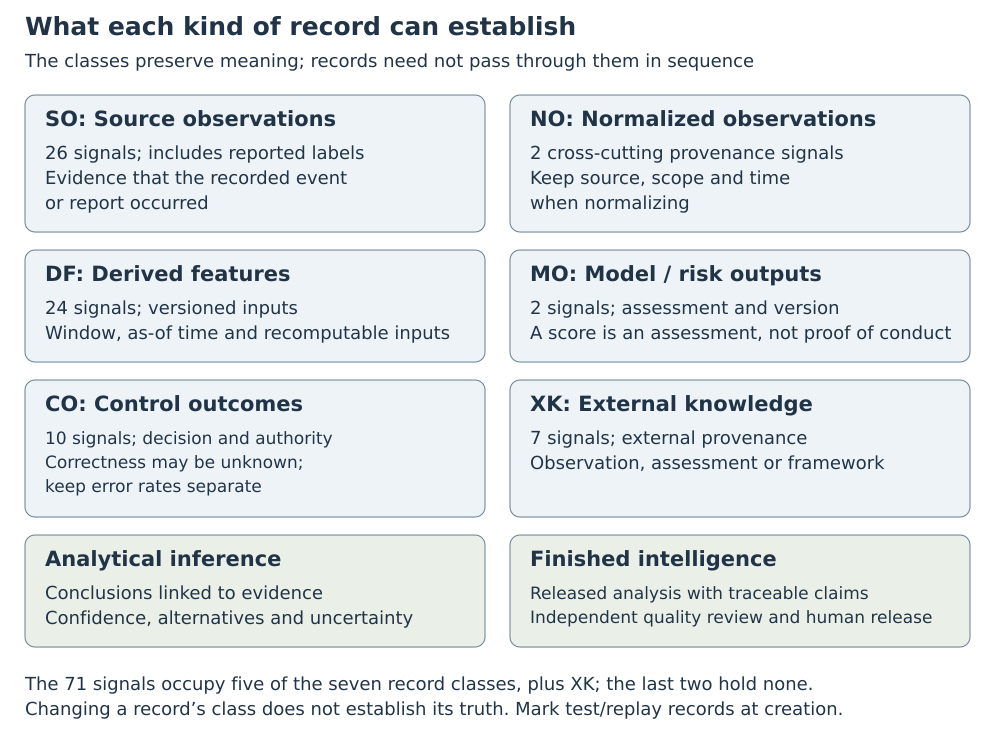
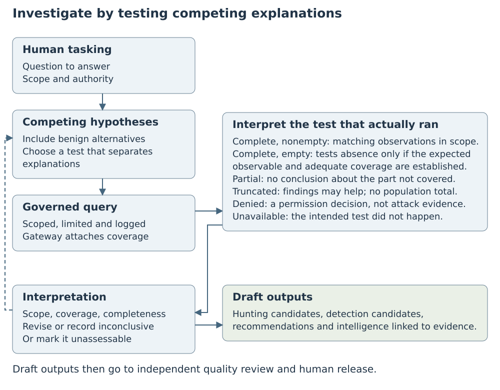

# Supplement: signals, interfaces and worked-example data

Jonathan Matkowsky

10 November 2026 · Accepted working draft for version 1.1 · Not published · Not peer reviewed

This supplement accompanies the [complete manuscript](../MANUSCRIPT.md). S1 and S2 explain the sources and selection. S3 to S5 specify the signals, records and interfaces. S6 supplies the hypothetical investigations and their arithmetic; S7 and S8 give the proposed evaluations. S9 extends the comparison with prior work. The 19 CSV files use UTF-8 encoding and stable mechanism, source and signal identifiers. Citation labels match the package's [BibLaTeX references](../REFERENCES.bib).

## S1. Sources and comparisons

[Source notes](../SUPPLEMENT/S1_CITED_SOURCE_NOTES.csv) identify the version, supporting passages, publication status and supported claim for each of the 122 cited works. The [requirements matrix](../SUPPLEMENT/S1_REQUIREMENTS_MATRIX.csv) compares 50 sources against C1 to C3. It codes two parts of C1 and C2 and three of C3: an outcome linked to its decision, and late, unobservable and false reports kept apart (C1); query coverage and learned time (C2); typed separation of observations, inferences and memory, a human principal before reuse, and links from records an agent output informed back to that output (C3). E means explicit support, P partial or adjacent support, and a dot means the cited material does not establish the requirement. The `payment_setting` column records yes for a payment or payment-fraud setting, P for a setting partly in payments or adjacent to payment fraud, and no otherwise. It marks two cyber threat intelligence sources, STIX 2.1 and Hettema's belief-revision paper, as cyber; other security and threat-intelligence sources are coded no. The source notes provide passage locators, linked to the matrix by citation key. Their inspection dates are in UTC.

[Stage coverage](../SUPPLEMENT/S1_STAGE_COVERAGE.csv) supplies the source-level codes behind Table S1.1. Each family receives the strongest code among its sources, so a family row may combine capabilities from several systems. Source notes record bibliographic and access issues separately from claims about a method.

**Table S1.1. Stages described in the cited research.** E means explicitly described; P means partial coverage or a different scope; a dot means not established by the cited material. Each family receives the strongest source-level code in S1, so one row may combine several systems. L1: signal sources; L2: ingestion and stores; L3: entities, correlation and knowledge; L4: investigation; L5: outputs; L6: feedback; L7: governance; L8: learning and correction.

| Research family and inspected examples | L1 | L2 | L3 | L4 | L5 | L6 | L7 | L8 | Payment domain |
|---|---|---|---|---|---|---|---|---|---|
| Industrial payment and risk systems: TitAnt, GEM | P | E | P | . | P | P | . | P | yes |
| Illustrative platform’s (Stripe’s) engineering publications, 2019 to 2025 | P | E | P | P | P | E | . | P | yes |
| Threat-intelligence and security-operations architectures: reference models, intelligence lifecycle and agent benchmarks | P | P | E | E | E | P | E | E | no |
| Preprints on agents making fraud decisions: SR-Fraud and Sharma’s auditable agent | P | P | P | E | P | E | P | E | yes |

Study populations and denominators constrain the comparisons. Sharma's balanced synthetic sample contains 60 cases drawn from transactions its classifier scored between 0.2 and 0.8: thresholding the classifier at 0.5 decides 43 correctly and the agent 39. Six of the agent's eight overrides replace a correct decision with an error. Fatima's verification rates concern genuine participants under the study's completion and exclusion rules; they do not measure fraud detection. Doerfler's 47.8 percent same-session success rate concerns challenged sign-ins. Its 97.3 percent eventual-access rate counts users, not sign-ins: it is the share of users with access within one week. Doerfler's Section 5.3 and Table 7 caption take users who failed a challenge as the denominator; Doerfler's introduction takes users who saw a challenge. Its abstract treats the complement of the first rate as legitimate users failing to sign in, but its results note that hijacking activity depresses per-session success. Subtracting the first rate from 100 percent therefore does not give a clean legitimate-user failure rate. Neither Fatima's nor Doerfler's aggregate rate establishes whether an individual event was decided correctly.

FTC complaints describe allegations, and the stipulated orders do not establish those allegations on their merits. Vendor publications support attributed descriptions of interfaces or observations, not independent evidence of industry-wide effectiveness.

## S2. Product scope and mechanism selection

[Product scope](../SUPPLEMENT/S2_SURFACE_BASELINE.csv) contains 88 public product and feature entries, read on 27 September 2026: 53 catalog items, twenty items from the Q3 2026 public roadmap (seventeen appear in a cached copy of that roadmap; the other three are confirmed as shipped in Stripe's changelog), ten separately documented capabilities and five careers-page footer items. These entries define the scope for candidate selection, not a complete or current product catalog. Each row lists candidate mechanism IDs, not validated coverage or retained signal mappings; a dot means none is listed. The entries list 85 of the 99 candidates; the other 14 appear only in the allocation table. The allocation table gives each candidate's final disposition, and S3 supplies the retained mappings. Six retained mechanisms are not listed against any product entry: ID-14 (account farming and aged-account preparation for later abuse), PAY-04 (card testing through attacker-controlled merchant or connected accounts), MP-02 (payment-method cashing through a self-controlled merchant or connected account), MP-04 (merchant misrepresentation and transaction laundering behind a front), MP-07 (merchant-side dispute evasion) and BOT-04 (CAPTCHA and challenge defeat). S5 identifies the exact API schemas used for interface comparisons.

**Products and business-reported records (manuscript Section 4.1).** The platform's products may span onboarding, identity verification, payments, subscriptions, payouts, treasury and risk controls. Businesses may also report their customers' registrations, logins and payments. The specification identifies what investigators need from these records without assuming a provider already collects or links them.

A retained mechanism targets a documented capability, serves a plausible adversary goal and has supporting public evidence. Sources include research, incident reports, government and intergovernmental guidance, and platform documentation. Four public job postings for abuse, risk and machine-learning roles helped prioritize topics but do not establish incidents; the manuscript cites two (Section 3), and the allocation keys record the other two. The stated priority basis names a posting topic for 24 candidates. Twenty-three of them are among the 26 candidates allocated Tier 1; all 23 are mapped and carry 65 of the 163 links. The 24th, EC-06, is unmapped. Every mapped mechanism has support beyond postings in the mechanism-to-source links.

[Mechanism allocation](../SUPPLEMENT/S2_MECHANISM_ALLOCATION.csv) records all 99 candidates and their final dispositions. The signal map retains 61 mechanisms: 52 of the 53 dedicated candidates, all eight targeted candidates and the one adjacent-logged candidate, ID-18, insider access abuse by platform or partner staff. Of the other 38, thirteen were judged covered by existing records, four were screened without identified supporting evidence and logged as low-priority gaps, twenty low-priority candidates were not reviewed, and one reviewed candidate, PAY-12, has no signal mapping. It concerns triangulation fraud: filling real customers' orders through another seller using stolen payment credentials. Its review record notes framework evidence only. [Allocation keys](../SUPPLEMENT/S2_ALLOCATION_KEYS.csv) decode the source abbreviations. The `Class` code, also the prefix before each key's colon, gives the source type: a for law-enforcement announcements and vendor or incident reports, including EchoLeak (a:ECHO), which is cited by its arXiv identifier; b for research papers; b* for other arXiv preprints; c for government and intergovernmental publications and the MITRE fraud framework; d for the illustrative platform's documentation, roadmap, blog and public repositories; and e for the illustrative platform's job postings (Stripe careers). All four b keys name a peer-reviewed venue. In the `Verification` column, V marks a key recorded as verified, and S marks a key that rests on a summarizing retrieval whose exact passage was not retained, as the `d:S` row states. The allocation file repeats S as a suffix on its evidence keys, as in `a:SSN (S)`. Priority labels explain selection emphasis; they do not measure evidence quality.

#### Reading the selection records

The allocation file's `disposition` field states the final selection decision. Signal coverage is recorded separately in S3; a reviewed candidate need not have a signal mapping.

| Disposition | Meaning |
|---|---|
| dedicated | Reviewed as a distinct mechanism |
| targeted | Received a focused review of its implications for the design |
| covered | Judged covered by existing records rather than retained as a separate mapped mechanism |
| screened gap | Screened without identified supporting evidence and logged as a low-priority gap |
| unreviewed | Not reviewed; all twenty such candidates have low priority |
| adjacent logged | Recorded as adjacent to the core mechanisms; the one such candidate is retained in the signal map |

`Priority (basis)` and `Impact (basis)` retain the selection judgments and their stated reasons. In a priority basis, `r:` introduces a topic named in a job posting, with the posting's key in parentheses where given, and `p:` introduces platform-documentation keys. A posting key such as `(EM)` is the allocation key `e:EM` without its class prefix; platform-documentation keys keep their `d:` prefix. Impact bases use no prefixes. `Scope` distinguishes core and adjacent mechanisms. `Parent` records a stated relationship to another mechanism; a dot means none is listed. `Evidence keys` resolve to source descriptions in the allocation-keys file. They are identifiers, not evidence grades. `Maturity` is the estimate, before review, of how developed the published research was; `after_review_maturity` pairs it with the later classification where both were supplied. `Evidence` is the confidence label used to allocate effort (verified, provisional or unresolved), not a certification of each source's claims. `Depth` is the initial allocation: Tier 1 for the deeper review, Tier 2 otherwise, or a logged gap when evidence was unresolved. `recorded_status` states each review's outcome. The product-scope file links documented capabilities to candidates; it does not supply a product-availability assessment.

Searches covered nine abuse paths, coded U1 to U9: API-key takeover (U1), identity provenance at onboarding (U2), document integrity, including identity and business documents (U3), account compromise (U4), payout redirection (U5), card testing (U6), abusive merchants (U7), mule and pass-through funds (U8), and attacks on agents or operator assistants (U9). Only the entity-relationship notes cite these codes. Searches followed relevant publications, public guidance and references. This focused selection does not establish exhaustive coverage of abuse or related systems.

### S2.1 Claim types

Research can propose an untested design, while documentation can directly establish an interface. Neither publication status nor the number of sources validates the integrated specification. No claim in either document rests on author experience.

**Table S2.1. How to read the manuscript's claims.** Claim type describes what a statement establishes. Source type and publication status describe where its support comes from.

| Claim type | What it means |
|---|---|
| Fact | A description supported by evidence, including a public specification or an artifact this study produced; source and version are given where they matter |
| Peer-reviewed prior research | A finding reported in a peer-reviewed publication whose publication status was confirmed, applicable only to the setting and conditions it studied |
| Inference | A conclusion motivated by stated premises; the sources do not establish the conclusion directly |
| Design requirement | A property chosen for the proposed platform on the stated evidence and reasoning; it is not claimed as necessary for every platform or as observed in a deployment |
| Hypothesis | A proposition to test for the proposed platform, including every detection candidate in the manuscript |
| Proposed implementation | One possible way to satisfy a requirement |
| Empirically validated result | A measurement, valid for the proposition and setting actually tested; results for individual components do not validate this integrated design |

### S2.2 External coverage check

An external check compares the candidates with MITRE's Fight Fraud Framework (F3), version 1.1 [@MITRE2026F3]. The [F3 crosswalk](../SUPPLEMENT/S2_F3_CROSSWALK.csv) maps each of its 123 techniques and sub-techniques to the candidate mechanisms that cover it, with a reason for each scope decision. Of the 92 within the product scope, a retained mechanism covers 34 fully and 40 in part. Of the other 18, fourteen are covered only by candidates outside the signal map. Five of the fourteen rest only on candidates judged covered by existing records, among them device fingerprint spoofing; six rest only on unreviewed candidates, among them 3-D Secure bypass; and three rest on candidates of both kinds. None rests on a screened gap. Four are covered by no candidate: DLL injection in the browser, abuse of accessibility features, theft from password managers and SEO poisoning. Scope and coverage are one reviewer's judgments, recorded for each row.

## S3. Signals, mappings and lineage

The [signal inventory](../SUPPLEMENT/S3_SIGNALS.csv) defines all 71 signals, with their families, classes, feature inputs, mechanism and source IDs, public counterparts, entities, uses and limits. Its `internal_representation_status` value, DR for every signal, marks a design requirement rather than observed platform instrumentation. [Mechanism-to-signal mappings](../SUPPLEMENT/S3_MECHANISM_SIGNAL_PAIRS.csv) contain 163 links: 154 design mappings motivated by evidence and nine marked as inferential. These links explain why a record is proposed; they do not establish a detector's effectiveness or make its fields uniquely necessary.

The outcome-channel requirements use SIG-70 and SIG-71 to record each payment-level or account-level control decision's effect on each outcome channel, SIG-27 to separate authentication results from reported liability status, and SIG-58 for dispute reasons and payout returns. SIG-70 also keeps manual-review dispositions. Each record retains its source, version and uncertainty.

The inventory contains 26 source observations (SO), two normalized observations (NO), 24 derived features (DF), two model or risk outputs (MO) and ten control outcomes (CO). Seven signals provide external knowledge (XK). The inventory therefore covers five of the seven record classes in manuscript Section 5.1, plus external knowledge. Analytical inferences and finished intelligence are later outputs, not input signals.

**Figure S3.1. What each record class can establish.** Counts refer to the 71 signals. Analytical inferences and finished intelligence are outputs, so neither appears among those input signals. Test, replay and emulation records are marked when created to distinguish them from production activity.

**Table S3.1. The 71 signals by family.** SO: source observation; NO: normalized observation; DF: derived feature; MO: model or risk output; CO: control outcome; XK: external knowledge. The final column counts partial public counterparts, cases where that comparison does not apply, and signals with no counterpart identified in the pinned schemas (manuscript Section 5.4). Token allowances permit another party to spend from a crypto wallet.

| Family | Signals | Classes | Partial / n/a / none identified |
|------------------------------------------|--------|--------------------|-------------------|
| Identity and onboarding | 8 | SO 3, DF 4, CO 1 | 3 / 4 / 1 |
| Authentication, session and operator administration | 10 | SO 5, DF 4, CO 1 | 6 / 4 / 0 |
| Credentials, API keys and request context | 5 | SO 3, DF 1, XK 1 | 2 / 2 / 1 |
| Funds movement and payout destinations | 11 | SO 4, DF 5, CO 2 | 6 / 5 / 0 |
| Payment attempts, authorization and payment controls | 7 | SO 2, DF 4, CO 1 | 3 / 4 / 0 |
| End-customer lifecycle and entitlement | 7 | SO 2, DF 4, CO 1 | 3 / 4 / 0 |
| Merchant storefront and business claims | 2 | DF 1, XK 1 | 0 / 2 / 0 |
| Platform outputs and labels | 4 | SO 1, MO 2, CO 1 | 4 / 0 / 0 |
| Agents, tools and approvals | 8 | SO 5, CO 3 | 4 / 0 / 4 |
| Wallet signing and token allowances | 2 | SO 1, DF 1 | 0 / 1 / 1 |
| External threat knowledge | 5 | XK 5 | 0 / 5 / 0 |
| Provenance classes | 2 | NO 2 | 1 / 1 / 0 |

SIG-44, SIG-45 and SIG-46 apply across mechanisms. They record technique-catalog mappings, minimum observation provenance and the provenance of test records, respectively. The other 68 signals map to specific mechanisms. All 61 mapped mechanisms have at least one mapping motivated by evidence; S2 explains PAY-12's exclusion.

Each input ID for the 24 derived features names another signal in the inventory. No feature depends, directly or indirectly, on itself. For example, SIG-24 uses SIG-27 to enumerate its eligible transaction cohort, including completed payments with no report. The separate chargeback-or-alert-resolution measure also uses SIG-25. Keeping these inputs explicit makes the denominator and the distinction between measures inspectable.

The [source directory](../SUPPLEMENT/S3_SOURCE_DIRECTORY.csv) identifies 61 design sources. Of these, 27 are not among the 122 cited works and have no S1 source note. Each source was read in full in October 2026. For one, a vendor blog post (L112), the cited passages were read verbatim and the other paragraphs only as a close paraphrase. One FTC complaint (L127) was first read in part on 21 October; a complete copy was read on 29 October. The directory records each source's type, the depth and version of the read, with qualifiers such as the version read or pages not read, the access date and the scope. Where only a preprint or an author copy was read, the row says so. [Mechanism/source joins](../SUPPLEMENT/S3_MAPPING_SOURCE_JOINS.csv) supply 126 links, each with its source identifier, recorded depth and scope limit. These records preserve the premises behind the mappings, including limits on transferring evidence from another setting.

The public-counterpart classification asks whether a pinned schema contains an object, field or event that supplies part of the required observation. Of the 71 signals, 32 have partial counterparts, the question does not apply to 32, and none was identified for seven. S5 gives the exact locators and explains the limits of partial counterparts; the inventory records each signal's classification.

Identifier links establish limited relationships. A storefront-to-merchant identifier link does not show that a payment through the merchant account settled. A verified identifier from the same namespace and relevant interval can support a stronger, or *hard*, link. A descriptor or shared IP address may support only a weaker, or *soft*, link. Neither alone establishes common control or malicious intent.

The inventory preserves the manuscript's interpretation rules: onboarding-link histories are a design analogy (S3.1), and error estimates retain their cohorts and denominators (Section 7.2). Each outcome channel retains its decision context (Section 7.1), and each broader outcome measure requires its own evaluation (Sections 8.2 and 9.1).

### S3.1 How abuse mechanisms motivate the records

Manuscript Section 5.2 summarizes these mechanisms and keeps the outcome-label records. The evidence for the others follows.

#### Exposure and misuse require different evidence

Measurements of exposed secrets establish exposure or validity at a particular time, not unauthorized use. Meli and colleagues found a median of about 1,800 unique candidate secrets daily. Of the monitored secrets, 81 percent remained sixteen days after discovery. They did not test credentials against the services [@Meli2019]. Demir and colleagues confirmed 1,748 active credentials for 14 services, with payment services among the largest groups. Traced through nine archived crawl snapshots, the verified credentials had been publicly exposed for 12 months on average [@Demir2026]. That duration does not show continuous credential validity.

The specification therefore records exposure location and time as external knowledge, then compares credential use before and after exposure. Public visibility, validity, attacker possession and misuse remain separate propositions.

Timing can matter at minute scale. In a deliberate cloud-key exposure experiment, an actor used the key within minutes while an automatic quarantine limited its actions. Researchers later removed that restriction to observe further operations [@Gamazo2023]. Microsoft reported attackers launching follow-on payment fraud attempts as little as five minutes after stealing credentials and session cookies through phishing that relayed the victim's login [@Microsoft2022AiTM]. These observations motivate precise timestamps without establishing typical attack speed.

#### Access needs a history

A login challenge is an extra verification step at sign-in. Research examines challenges triggered by unfamiliar devices and networks [@Doerfler2019]. The design records authentication context, session issuance and later use. Applying the same lifecycle to onboarding links, which let businesses complete account setup, is a design analogy.

Changes after access can identify what an intruder attempted. In reported OAuth-application abuse, intruders used compromised accounts to create applications, grant them permissions, add credentials to new and existing applications and create inbox rules that hid messages from the user [@Microsoft2023OAuth]. The design records these changes, with links to source observations. Recording changes to authentication factors and event destinations extends the same approach.

A device or browser fingerprint can help connect activity but cannot alone establish common control. One impersonation market sells stolen user profiles with browser fingerprint data and a browser extension meant to reproduce them. The study did not buy profiles to test that software [@Campobasso2020]. The records retain that uncertainty.

#### Funds movements need destination histories

The FBI's payroll-diversion advisory describes attackers changing where funds are sent [@FBI2018]. Payout destinations therefore have their own identities and histories: creation, changes, first observation, validation and reuse across accounts. Trace A applies this analogy to a hypothetical key permitted to change a payout destination.

Regulatory guidance motivates measures of time between receipt and onward transfer, and concentration at receiving entities [@FinCEN2014]. It does not validate a per-account detector.

#### Business descriptions need corroboration

Storefronts, merchant accounts and statement descriptors, the merchant names cardholders see, need not map one-to-one. ScamMagnifier linked fraudulent storefronts through merchant identifiers, with a provider corroborating some links. Its checkouts stopped before purchase and did not observe settlement [@Bitaab2025].

Studies of abusive merchants describe misdeclared business categories and movement between banks [@McCoy2012; @Tian2018]. FTC complaints allege pooling or spreading transactions across accounts to evade monitoring, and misleading representations [@FTC2020FirstData; @FTC2025Paddle; @FTC2019Allied]. The design consequently links storefronts, descriptors, account histories and verified ownership records. It retains declared business details with their source and time for comparison with activity. These allegations and links motivate investigation; they do not establish intent or ownership in a new case.

#### End customers are not platform accounts

A legitimate business may have abusive customers. One provider's public documentation describes multi-accounting, account sharing, free trial abuse, account farming and deliberate non-payment for accrued usage [@Stripe2026CAE; @Stripe2026Trial; @Stripe2026PAYG; @Stripe2026Farming]. The customer-evaluations page describes its reuse reasons as reuse within one business over the past seven days; the account-farming page does not specify whether its links span businesses.

The specification records end-customer registration and billing histories, reused identifiers, simultaneous use and unpaid usage within a business. Linking an end customer's identity across businesses requires separate authorization, a permitted purpose, privacy oversight and supporting evidence. This restriction does not prohibit authorized fraud-prevention aggregation on instruments, devices or credentials under a stated and logged scope.

## S4. Responsibilities, entities and interfaces

The [functional responsibilities](../SUPPLEMENT/S4_FUNCTIONS.csv) file defines 24 responsibilities without requiring separate processes or databases. Seventeen were derived with payment-specific mechanisms or sources in view. One (23) adapts agent-security research, and six (2, 3, 4, 13, 21 and 22) come from cyber threat intelligence work. These origins describe how the responsibilities were derived, not uniqueness to payments. The file's `class` column marks these three groups DI, AGV and INH.

Responsibilities 16 and 17 cover engineering validation and adaptive testing of detections, controls and models. Responsibility 21 independently reviews all agent outputs, including intelligence drafts, hunting and detection candidates, and recommendations; responsibility 22 provides human release. Permission to investigate grants no authority over accounts, payments or controls. An authorized human may decide urgent containment before quality review (manuscript Section 6.4), without releasing the draft into organizational memory.

Responsibilities 1 to 10 scope and conduct an investigation. They include human tasking, governed tools, the evidence store, hypothesis testing and entity relationships. Responsibilities 11 to 20 represent threat knowledge and turn findings into usable outputs: actor, technique and vulnerability knowledge, the structured threat-knowledge store, hunting for undetected abuse, detection development, threat-model integration, recommendations, finished-intelligence synthesis and evidence lineage. Responsibilities 21 to 24 govern use and reuse: independent quality review, human release, controlled learning and security of the investigation system.

The [entity inventory](../SUPPLEMENT/S4_ENTITIES.csv) and [entity relationships](../SUPPLEMENT/S4_ENTITY_RELATIONS.csv) define the entities and the kinds of links between them. Each link records its source, identifier namespaces and the basis for associating each identifier with its entity. It retains its effective interval, learned time, version, confidence, confounders (other explanations for the link), and permitted purpose and scope. A shared attribute alone does not establish that one person controls both entities. When a decision makes an outcome unobservable, the record describes the channel's status; it does not invent an outcome report. [S4.1](#complete-storage-requirements) gives the complete storage requirements, and [S4.2](#outcome-record-schemas) gives field-level schemas for the outcome records.

**Figure S4.1. Investigation as a sequence of tests.** Each query tests competing explanations within authorized scope. A gateway outside the agent attaches the query's coverage, which determines which interpretations remain supported. Draft outputs follow review and release under manuscript Section 6.4.

The query interface must show what each query actually covered and what its result means:

| Part of the interface | Information or behavior required |
|---|---|
| Request | Task and question; authorized requester; tenant, purpose and data scope; entity namespaces; event interval and as-of cutoff (only data the system had learned by then); schema and query versions; row, time and cost limits; expected observation and required coverage |
| Response | Query/run ID; scope actually evaluated; source and schema versions; event and ingestion watermarks (how far event time and data loading had progressed); known gaps and retention horizon for each source; sampling and access filtering; whether the result is complete, partial, truncated, denied or unavailable, and any scope-limited flag; meaning of any count; returned rows or approved aggregate, with the identifiers of the returned records kept for the run; lineage and coverage limits |
| Interpretation | A positive observation does not establish how many cases exist in the population. An empty result counts against a hypothesis only when the abuse should have produced the queried observation and the records cover where it would appear. A denied or unavailable result does not establish adversary behavior. |
| Failure | Enforce limits outside the agent's language model. Stop or narrow the query after it exceeds a row, time or cost limit, or after an authorization error. Record incomplete tests and any abstention (a decision not to conclude). Do not treat missing or not-assessed data as low risk. |

Some permitted operations also need approval bound to the exact request payload, target, task, tenant, tool and tool-manifest version. The manifest is the declared list of the agent's tools. Each approval has an expiry and a rule governing reuse. At execution, the enforcement gateway (manuscript Section 6.5) checks that the operation matches the approval and remains permitted. The restricted agent-and-approval ledger records both approval and execution.

Control and outcome records distinguish the decision, its inputs and version, what happened next, the observable channels, actual reports and any review of correctness. Population error estimates retain their own cohort, denominator, outcome window, uncertainty and scope; they do not establish correctness for individual events. Late reports, unobservable outcomes and false reports have separate fields because they can coexist. Report presence, channel state and query access also remain separate. Each temporary delay retains its decision and effective interval. A derived fact's learned time is when it became queryable, kept separately from its inputs' latest availability.

A hypothetical timeline illustrates the as-of cutoff. Freeze a prediction on day 0 using only information then known. A day-30 report may evaluate it within a stated outcome window, but a model trained on day 20 cannot use that report. A later training run may use it if the run's cutoff and label rules permit. Likewise, a relationship learned on day 10 cannot enter day-0 features merely because its effective date is earlier.

The [draft schema](../SUPPLEMENT/S4_DRAFT_SCHEMA.csv) supplies the fields that the rule checker, quality reviewers and the releaser use to assess an intelligence draft. S7 explains the evaluation conditions; S7.1 gives hypotheses and criteria for E1 to E9. S8 gives the practitioner review protocol.

**Returned records a draft does not cite (manuscript Section 6.4).** The checker identifies every record that the case's query runs returned within a claim's scope but that the draft neither cites nor lists against it. It attaches those that a fixed rule marks as able to count against the claim, such as reports, reversals and records of the benign explanations the claim must exclude, and summarizes the rest by type and count. Reviewers and the releaser see both beside the claim. Full checks of claims about named entities examine every marked record and a recorded random sample of the rest, whose size is fixed in advance for each claim type, and E8 reports how often that sample contained a record that counted against the claim. If a share $q$ of the unmarked records count against the claim, a random sample of $m$ finds at least one with probability at least $1-(1-q)^m$: 59 records give 95 percent when $q$ is 5 percent.

**Event timing in drafts (manuscript Section 6.4).** Event timing also needs support. A time asserted by a business, customer or external source retains its source and uncertainty. Recent receipt does not establish recent conduct when the event interval is unresolved. Outcome windows instead use each channel's declared clock-start event.

### S4.1 Complete storage requirements {#complete-storage-requirements}

Table S4.1 summarizes this complete storage contract; S3.1 and manuscript Section 5.2 give the motivating evidence. Each block groups requirements by the information it preserves. The stores distinguish record meanings and need not be separate databases.

**Table S4.1. What each analytical store preserves.** The full contract is in S4.1. These are requirements for the proposed platform, not claims about an existing provider. The structured threat-knowledge and organizational-memory stores form their own planes, and the other stores hold evidence-plane records. Clusters in the entity-relation graph remain threat-knowledge items. External-knowledge records support only what their source observed or described, and ledger entries only what happened during the investigation itself.

| Store or shared requirement | Required properties |
|---|---|
| Observation log | Source records and revisions, identifiers, environment, tenant scope and lineage; separate event, source-recording, ingestion and query-availability times; repeated delivery does not duplicate the event |
| Entity-relation graph | Typed identifier links with source, namespace, effective interval, learned time, version, confidence, benign explanations, and permitted purpose and scope; versioned cluster membership; end customers scoped to a business |
| Feature store | Recomputable inputs and versions; decision-time features exclude later information; later labels use the evaluation's outcome window and maturity; features inherit their inputs' agent-output and released-item links |
| Label store | Report source, type and attributed entity; occurrence, report and arrival times; appended value history; typed links to every decision that may have shaped the report; links to separate truth assessments and any informing agent output or released item; report presence, channel state and query access kept apart |
| Assessment store | Model or reviewer identity and version; review selection route and probability; links to any informing agent output or released item; unknown, not-assessed and failed-open states kept distinct from low risk; failed-open means an assessment failed and activity continued |
| Control-outcome store | Decision, authority, reason and version; reproducible available inputs; alternative-decision probabilities where applicable; human assignment and what the decider was shown; links to any informing agent output or released item; effects on each outcome channel, fixed with the decision; for action before review, the urgent route, impact class and later review outcome; correctness reviews with their selection route, separate from population error estimates |
| Structured threat-knowledge store | Revisable relationships and conclusions with confidence, input and rule versions, writer and status; agent proposals marked as unreleased context; links to informing agent outputs and released items |
| Organizational-memory store | Human-released items with approved claims and their stated confidence, version, scope, expiry, reviewer findings, lineage and correction links; exonerating items have independent counterexamples, a re-test date and the evidence and cluster versions whose change expires them early; proposed lessons wait outside it with their counterexample tests, and released lessons keep monitoring and withdrawal records |
| External-knowledge store | Source, type, times observed and published, validity period, retrieval time and license; a link to the released item whose identifier the returning content bears |
| Agent-and-approval ledger | Model, instructions, inputs, tool calls; approver, binding, expiry and reuse rule of each approval; approved and executed payloads, tool-manifest version and hash at approval and at execution, memory writes, outbound-traffic decisions; rule-checker and reviewer findings per draft version; marked untrusted content and exposed agent output; logged agent-output and released-item link removals |
| Query coverage record | Gateway-written entities and intervals, requested and evaluated; as-of cutoff, schema versions, sampling, per-source watermarks, known gaps and retention horizon, access filtering and limits reached; derived result status; not writable by the agent |
| Shared time and graph requirements | Reconstruct what was available at each decision; preserve reporting clocks and delays, retention limits, account histories and report-to-transaction links |

**Observation log**

- Preserve records and revisions without overwriting earlier records. Keep source, event and delivery identifiers, schema version, entities, source lineage, and actor and request identifiers where available. A record delivered more than once takes effect only once.
- Record each observation's environment (production, test, synthetic, replay or emulation), marked when the record is created, and its tenant scope: the business or other boundary within which it may be accessed and used. Keep each record's source trust mark. Mark content that businesses, customers or outside sources supplied as untrusted. Both marks survive normalization and storage.
- For content fetched from a source the subject controls, such as a storefront or business website, record the vantage point of each fetch: network origin, region and client. A subject can serve different content to different visitors, including reviewers.
- Mark every label, assessment, control outcome, draft, proposed lesson and released item that a test, replay or emulation creates, or that derives from such a record or from synthetic data, with the same environment value when it is created. Keep these records out of production labels, intelligence and lessons. Record any authorization for their evaluation use, with who gave it, the evaluation and its scope.
- Keep event or effective time (when something happened or took effect) with its source and uncertainty bound. Record the source system's recorded time and the platform's ingestion time separately.
- For each store, retain when each record and revision became visible to queries.
- A derived record keeps its inputs' latest learned time separately from the time it first became queryable. Its own learned time is the latter and cannot precede any input's learned time.

**Entity-relation graph**

- Label each identifier link by kind and as hard (stronger) or soft (weaker). Retain its source, identifier namespaces, effective interval, learned time, version, confidence and possible benign explanations (confounders).
- Record why each identifier is believed to belong to its entity.
- Keep versions of linked-entity clusters and their membership rules. Record end customers separately for each business. Record each link's permitted purpose and scope. A link across businesses also records its authorization for that identifier type (manuscript Sections 5.2 and 5.5).

**Feature store**

- Keep inputs traceable and values recomputable, with the feature definition version, the entities and the computation window. Decision-time features use only information available at that decision.
- A feature computed over a cluster or other threat-knowledge item records that item's version, writer and status. If an agent proposed the item, or the item links to an agent output or released organizational-memory item that informed it, the feature links to that output or item and counts as dependent on it.
- Join later outcomes as evaluation labels under an explicit outcome window and maturity period. The outcome window is the period after the decision in which an outcome must occur to count.

**Label store**

- **Report history:** retain report type, source, attributed transaction or entity and lag. Keep three times: when the reported outcome occurred, where known, with its uncertainty; when the report was made at its source; and when it arrived at the platform. Preserve each value and its learned time, such as a dispute being filed, answered, then won or lost, and record whether each won or lost status followed adjudication. Append each status change, reversal or correction as a new record that references the earlier one. Never edit an earlier record, so that what the platform believed at each time can be reconstructed.
- **Truth assessment:** link any assessment that the report is mistaken or deliberately false. Keep that assessment in the assessment store with its model or reviewer identity and version, how the report was selected for review and, for a sampled review, its selection probability.
- **Dependencies:** link every decision that may have shaped the report, and any agent output or released organizational-memory item that informed the label. An outcome channel is a route, such as a chargeback, through which an outcome can be reported. A report may link to several decisions, such as a blocked attempt, a retry and the approval of the paid attempt, and one decision, such as an account restriction, may link to many reports. Each link states the decision's role, such as a decision on the reported item, on an earlier related attempt, or on an account or payout that contains it, and the basis for the link. These links do not change how a measure counts reports (Graph semantics). Record the writer's case or session and the agent outputs and released items open in it when the record was written.
- **Channel status:** for each affected transaction, payout or account application, keep report presence, channel state and query access separate at each read time. These statuses may be computed when read from the stored decision, report and channel records. When a draft cites a status, store that status with an identifier and its read time.
- **State history:** a channel is open, temporarily delayed or not yet opened, permanently closed by a recorded decision, reopened or extended by a recorded rule event, or unknown. Keep every transition's effective interval and the decision ID, or the rule event's source and version, that caused it.
- **No report:** an open channel remains pending before its reporting window ends. It matures with no report only if it stayed open throughout the window and the records cover that window. If a recorded decision or rule event changed the channel's meaning, the matured absence carries that decision's ID, or the rule event's source and version, and is read under the changed meaning, not as a negative for the original outcome. A channel with no defined window never supports a negative by maturity alone. A matured absence is provisional: it records the rule version under which it matured and returns to pending if a later rule event reopens the window.
- **Unavailable records:** mark inaccessible records unavailable without overwriting known channel state or earlier reports.
- **Clocks and maturity:** for a temporary delay, keep the expected and actual clock-start events when known. Store the reporting window and clock-start event with the channel, including their source and version. Each channel record also names its rail, the attributes its window depends on, such as whether the debited account is a consumer or business account or the type of claim, and whether the channel adjudicates report truth. Store the maturity used by an evaluation with that evaluation.

**Program status, revised negatives and reopened reports (manuscript Section 5.3).** A decision can change a channel's meaning, as a liability shift after successful authentication does (manuscript Section 7.1). A merchant's network program status can also change that meaning: under one program, a merchant loses the liability shift on domestic authenticated payments until it exits the program [@Stripe2026MonitoringPrograms]. The records keep that status as it stood at decision time, because the guide does not say whether the loss reaches payments authenticated before the merchant entered the program. A later program entry is recorded as a rule event, and the liability status of payments authenticated before it remains unknown. A negative read from a matured absence cites the rule version and read time under which it matured and is revised when a later transition reopens the channel. A report's resolution is not always final either: in rare cases an issuer files a further dispute on the same payment after acquiring new information, or a lost dispute later becomes a late win [@Stripe2026Disputes].

**Bank-debit and other rails (manuscript Section 7.1).** A SEPA Direct Debit dispute within eight weeks of the debit is honored with no questions asked, and such disputes are final, with no process for appeal [@Stripe2026SEPADebit]. After eight weeks and up to 13 months, a customer can dispute only a debit considered unauthorized, and the customer's bank decides; the window that applies therefore depends on the claim, and an absence at eight weeks is not a negative for unauthorized-debit fraud [@Stripe2026SEPADebit]. Inside its window, an ACH return is refunded without question, and the ACH Network has no appeals process of its own [@Stripe2026ACHTerms]. A SEPA dispute honored with no questions asked is not by itself a fraud allegation. For ACH returns, the provider's terms give 60 days for consumer accounts and 2 days for business accounts, counted from the customer's bank statement [@Stripe2026ACHTerms], while the Nacha return deadlines that banks apply run from the settlement date of the original debit [@LeadBank2026ACHReturns]; a channel record therefore names the rule from which it takes its clock start. Banks may also accept late returns outside the window [@Stripe2026ACHTerms]. The product scope also lists instant push payments and stablecoin payments (S2); their reporting channels, if any, follow each rail's own rules and windows, which this paper did not review.

**Assessment store**

- Retain the model or reviewer identity and version. Keep unknown, not-assessed and failed-open states distinct from low risk. Failed-open means the assessment failed and activity continued.
- Record when each assessment was made and frozen (its freeze time) and the as-of time of its inputs. For each model version, record its training and model-selection cutoff and the label rules it used. A label that became available after that cutoff cannot enter that version.
- Never store an assessment as an observation of the conduct it assesses.
- Link each assessment, whether a model, a detection or a reviewer produced it, and each detection or model version, to any agent output or released organizational-memory item that informed it. Record the writer's case or session and the agent outputs and released items open in it when the record was written.
- For each detection or model version, link the validation records of responsibilities 16 and 17, with their version, date and result.

**Control-outcome store**

- **Decision:** retain the decision, who had authority to make it, the rule or model version, and the reason.
- **Inputs and policy:** log the time of the decision and the inputs it used. Keep versions from which every other input available at that time can be reconstructed. Record the score, threshold or rule that produced the decision, and whether the policy was deterministic and, otherwise, the probability of each alternative. Identify any input that a decider, automated or human, used but that was not logged.
- **Human decisions:** retain who decided, how the case was assigned and what the decider was shown.
- **Dependencies:** link any agent output and any released organizational-memory item that informed the decision, so the decision can be revisited when that item expires or is corrected or retracted. Record the writer's case or session and the agent outputs and released items open in it when the record was written.
- **Correctness:** record reviewed correctness when available, with how the case was selected for review (for example an appeal, a complaint, a sampling rule or review of every case) and, for a sampled review, its selection probability; otherwise record unknown.
- **Error estimates:** keep separate links to each estimate, with its control version, cohort, outcome window, denominator, uncertainty and scope. The cohort is the fixed set of decisions the estimate covers.
- **Channel effects:** record the decision's effect on each outcome channel as closed, delayed, changed in meaning, none or unknown. Fix these effects when the decision is recorded. Record later state transitions, including rule events, as separate records that never edit the decision.
- **Restrictions:** distinguish allowing and blocking from restrictions, such as a hold that may later be released.
- **Urgent containment:** for an action decided before quality review (manuscript Section 6.4), record that route, the impact class (none, degraded service or outage), any notification and restoration path, the review deadline and the later review's outcome, including any reversal.

**Structured threat-knowledge store**

- For inferred relationships, clusters, technique mappings and conclusions, retain confidence and the input and rule versions that produced them.
- Record the writer as a correlation engine, agent proposal or person, and status as proposed, accepted or retracted. Record the person or accountable process that accepted or retracted the item, and when.
- Retrieve an agent-proposed item only when it is marked as an unreleased agent inference. It never counts as corroboration.
- Link an item that a person or correlation engine wrote to any agent output or released organizational-memory item that informed it. Record the writer's case or session and the agent outputs and released items open in it when the item was written. The item counts as dependent on those outputs and items.

**Organizational-memory store**

- Keep released items only, with the releaser, version hash, released claims and the confidence stated for each, scope, expiry, reviewer findings and originating draft.
- Retain supersession and retraction links, and lineage from every cited observation to its root record. Record every later status record for a released item, such as a monitoring finding, an early expiry, a retraction or a withdrawal, with who or what wrote it and when.
- For benign or exonerating items, keep a re-test date, a source of counterexamples independent of the writer, and the versions of the cited evidence and of any cluster the item concerns. A revision of that evidence or a change in that cluster's membership expires the item early (manuscript Section 6.5). Record each re-test, with its counterexamples' sources, its result and its date.
- Read each item as context or a hypothesis, never as an observation.
- Proposed lessons remain outside organizational memory until testing, quality review and human release. For each one, record its writer, proposal time, queue state, intended scope and version. Record each test against counterexamples, with the counterexamples' sources and the result. After release, record monitoring findings and any withdrawal, each with its writer and time, and the reason for a withdrawal (manuscript Section 7.3). The requirement for responsibility 23 in the functions file calls a withdrawal rollback; the two terms name the same record.

**External-knowledge store**

- Retain source, type, version, when the source observed and published the fact, validity window, license and retrieval time. The validity window is the period in which the fact holds. For a catalog of abuse techniques, the version is the fixed version that mappings cite.
- Keep external knowledge distinct from platform observations.
- Record the identifier attached to each released item shared outside the platform. When external content returns with that identifier, link it to that item. It counts as dependent on the item and on any agent output behind it, not as independent corroboration.

**Agent-and-approval ledger**

- For each run, record the human assignment or the standing task template and version that authorized it, with its permitted data, entities, period, current period and outputs. The current period bounds claims about current conduct.
- For each tool call, preserve the provenance of inputs that reached the agent's language model.
- For each approval, keep the approver, the target, task, tenant and tool it is bound to, its expiry, its reuse rule and any token issued. Keep hashes of the approved and executed payloads, and the tool-manifest version and hash in force at approval and at execution. The manifest is the declared list of the agent's tools.
- Record memory writes and decisions on outbound traffic.
- Record each agent output, such as an intelligence draft and each of its versions, a hunting or detection candidate or a recommendation, with its identifier, version hash, run and creation time. It is an observation of what the agent did, not evidence of the activity under investigation.
- Retain model identity and version, instruction version and decoding settings.
- Mark content that came from untrusted input as untrusted when it is read back. Distinguish copied untrusted content, agent output exposed to untrusted content and agent output without that exposure; exposure takes precedence.
- Record each rule-checker result and quality-review finding with the draft's version hash, the rule version or reviewer, including the version of the rule that marks uncited returned records, and the draft's resulting status: returned, released or expired. For each quality review, record the materiality tier applied to each claim, the sampling rate, the cited records the reviewer examined and the random sample of unmarked uncited returned records it drew, whose size is fixed in advance for each claim type. Record when each draft version entered the review queue and when it would expire from it. For each review, record its start and end times.
- Record each removal of an agent-output or released-item link from a label, control decision, detection, assessment or threat-knowledge item, with the person who removed it, that person's release authority, the time, the reason and the identifier of the removed output or item.
- Store references to card data, identity documents and other regulated data, not copies (manuscript Section 5.5).

**What makes the agent investigable (manuscript Section 6.5).** Ordinary source observations retain their own trust marks and are not assigned an agent-output category. The ledger makes the agent itself investigable. For each tool call it retains the provenance of inputs reaching the model, approved and executed payload hashes, memory writes and outbound-traffic decisions. It also records model identity, version, instructions and decoding settings, with record classes intact.

**Privacy and operating constraints (manuscript Section 5.5).** A deployment must specify retention and deletion for each record class before collecting it. Append-only logs preserve history but must still permit required deletion of personal payloads, derived data, backups and identifying lineage. Encryption-key destruction is sufficient only if recoverable keys and plaintext copies are also removed. Retained audit structure must not preserve information required to be deleted. Authorized holds record their scope and retention rule.

The agent-and-approval ledger uses references to card data, identity documents and other regulated data rather than copies. Tokens or keyed hashes may be used only where the applicable standard permits. The ledger should not become a new sensitive-data store or widen payment-card security scope.

Use of external model providers depends on their processing terms and permitted processing locations. Drafts concerning suspicious-activity reporting remain subject to the platform's confidentiality and subject-notification rules.

Cross-business linking requires a stated purpose and authorization for each identifier type. Permission to use a payment-instrument link does not automatically authorize linking devices or verified people. These deployment obligations constrain the specification; this paper does not determine which legal basis applies in a particular deployment.

**Query coverage record**

- For each query run, retain its request: the task, run and question, the authorized requester, the tenant, purpose and data scope, the query version, the row, time and cost limits set, the expected observation and the required coverage.
- For each query run, retain the coverage record the gateway attached: requested and evaluated entities with their tenant and identifier namespaces, requested and evaluated event intervals, as-of cutoff, source and schema versions, sampling, each source's event and ingestion watermarks, known gaps and retention horizon, access filtering, and any row, time or cost limit reached.
- Keep the derived result status (complete, partial, truncated, denied or unavailable), the version of the rules that derived it and any scope-limited flag. The agent cannot write these fields.
- For each query run, keep the identifiers of the records it returned, including those behind an approved aggregate, so that the checker can find returned records that a draft neither cites nor lists against a claim, attach those its fixed rule marks and summarize the rest (manuscript Section 6.4). Keep identifiers, not copies, under each record's retention and deletion rules (manuscript Section 5.5).
- Link each tested hypothesis and each claim of absence to the query runs behind it. Record each hypothesis's status, including inconclusive and unassessable, apart from the query results. Record each incomplete test and each abstention, a decision not to conclude.

**Time semantics**

- Use timestamps precise enough to join a key's exposure to its use within minutes, with each timestamp's clock source.
- For each payment, keep authorization, capture and processing times separately, and any service or event date that a channel rule uses as its clock start. Keep the authentication result and the reported liability status separately, each with its source, rule version and learned time. Keep any network program status that removes the liability shift as it stood at decision time. Record a later program entry as a rule event, and leave the liability status of payments authenticated before it unknown. An unknown liability status remains unknown.
- Preserve label delay and what information was available as of each time.
- Retain account age, dormancy and how long funds stay before moving on.
- For each record class, keep each record until the longest applicable reporting window, counted from its channel's clock-start event, or the defined maturity period has ended, whichever ends later, plus the investigative lookback period. Follow the retention and deletion rules in manuscript Section 5.5. Record resulting gaps as coverage limits. Record each authorized hold with its scope and retention rule.

**Graph semantics**

- Link closed accounts to suspected successor accounts, and storefronts to merchants.
- Link each outcome report to the transaction, payout or account application it concerns, with the basis for the link and whether it is verified. Attribute outcomes through that link to the platform account, connected account and end customer, so that a measure counts each affected transaction once. A report's links to the decisions that may have shaped it do not change this count. Keep each transaction's acquiring bank and the static part of its statement descriptor, so that a network's monitored unit can be reconstructed.
- Link each wallet to every party it has allowed to spend its funds.

### S4.2 Field-level schemas for outcome records {#outcome-record-schemas}

The [outcome-record schema](../SUPPLEMENT/S4_OUTCOME_RECORDS/outcome_records.schema.json) defines, in JSON Schema, the fields of the records that the first requirement needs. It covers eight record types:

| Record | What it holds |
|---|---|
| OutcomeChannel | A route for reporting outcomes: its rail, clock-start event, reporting window with source and rule version, the attributes the window depends on, and whether the channel adjudicates report truth |
| ControlAction | A decision's targets, time, authority and version, and its effect on each channel: closed, delayed, changed in meaning, none or unknown |
| ChannelStateTransition | One change in a channel's state for one item, with its effective interval and the decision or rule event that caused it |
| LabelEvent | An outcome report or one revision of it, with its amount, when the outcome occurred, when it was reported at its source, when it arrived and when it became queryable |
| LabelEventDecisionLink | A link from a report to one decision that may have shaped it, with the decision's role, the basis for the link and whether it is verified |
| ChannelStatusReading | Report presence, channel state, query access and no-report status for one item and channel at one read time, stored when a draft cites it |
| ItemAttribution | The accounts an item belongs to, and the acquiring bank and static statement descriptor from which a network's monitored unit can be rebuilt |
| EntityLink | A link between entities, such as a closed account and a suspected successor, with its basis, confidence and other possible explanations |

Every record is append-only: a correction is a new record that references the earlier one. A time that is not known is recorded as unknown, with a reason, and is never left out. The schema checks each record on its own. Fourteen rules check records against each other:

1. OR-01: a record identifier is used once. A record changed in place under its own identifier passes every rule, so the store must prevent edits.
2. OR-02: a correction or revision references an earlier record of the same type and, for a report, of the same report.
3. OR-03: every channel, decision and report that a record cites exists.
4. OR-04: a report's times are in order where they are known: occurred, reported, arrived, learned.
5. OR-05: a won or lost report states whether that result followed adjudication.
6. OR-06: a decision gives one effect per channel. A delay gives its expected clock start, and a change in meaning says what changed.
7. OR-07: a permanent closure cites the decision that caused it, and a reopening or extension cites the rule event. A cited decision must target the item, record the matching effect and precede the transition.
8. OR-08: no report can arrive through a channel while a closure of that channel for that item is in force; a revision counts from its report's first arrival. Such a report means the item link or the closure is wrong.
9. OR-09: a link's role fits the decision: a decision on the reported item, on an earlier related attempt, or on an account or payout that contains the item.
10. OR-10: a reading's channel state is computed only from the transitions the system had learned by the read time.
11. OR-11: a reading's report presence matches the reports learned by the read time. Presence is unavailable only when query access was denied or unavailable, and it does not overwrite channel state.
12. OR-12: a no-report status follows from the channel's state and window. An absence matures only if the window is defined and has ended, the channel was open throughout it and query access was full. A matured absence records the rule version it matured under and cites any decision that changed the channel's meaning.
13. OR-13: each reported item has exactly one live attribution to its accounts, so a measure counts it once.
14. OR-14: a link resting only on a shared attribute is neither verified nor high-confidence, and a suspected-successor link starts from an account with a recorded closure.

The [valid conformance case](../SUPPLEMENT/S4_OUTCOME_RECORDS/conformance_valid.json) builds one synthetic history: a blocked card attempt, an approved retry that draws a fraud chargeback the merchant later wins, a hold on the account that received the payment, and a payment that draws no report. An earlier account with the same principal name was closed; the new account is linked to it as a suspected successor on that name alone, and a storefront is linked to the new account by its checkout identifier. Its 27 records pass. Each of the 22 [invalid cases](../SUPPLEMENT/S4_OUTCOME_RECORDS/conformance_invalid.json) changes that history in one way and must fail exactly one check; together they exercise the schema check and all fourteen rules. `tools/outcome_conformance.py` runs the cases using only the Python standard library, and `CHECK_CANDIDATE.py` runs it as well. The same tool checks any records file in this format.

Channel names, windows and rule versions in the cases are illustrative, not any network's rules. The schema follows the label-store, control-outcome-store and graph-semantics requirements in S4.1 and the relations in the entity-relationships file. A schema and passing synthetic cases do not show that the records improve investigations. The schema for query runs (QueryRun), which the second requirement needs, is not yet specified. Denominators are outside these records: which payments a measure counts, their amounts and their capture or settlement times come from the payment ledger, which this section does not specify. Whether a denominator read was complete is a query-coverage record.

### S4.3 Cost of the outcome records on synthetic data {#outcome-record-cost}

[`tools/outcome_cost.py`](../tools/outcome_cost.py) builds one million synthetic payments from the [valid conformance case](../SUPPLEMENT/S4_OUTCOME_RECORDS/conformance_valid.json), replacing identifiers and shifting times, so each record has its template's fields. Before measuring, it checks a sample of generated records against the schema and OR-01 to OR-14. [The results](../SUPPLEMENT/S4_OUTCOME_RECORDS/cost_results.json) come from one run on the machine below.

Assumptions, illustrative and not any platform's values: payments spread over 90 days; 100 payments per account; two outcome channels per payment, fraud chargeback and early fraud warning; 1 percent of payments blocked; 0.5 percent of allowed payments draw a fraud chargeback with three report events and one decision link; 1 percent of accounts held and 1 percent linked to a suspected predecessor; one cited channel reading per blocked payment.

| Record | Records | Mean size (bytes, JSON) |
|---|---:|---:|
| ChannelStateTransition | 2,000,000 | 411 |
| ControlAction | 1,000,200 | 422 |
| ItemAttribution | 1,000,000 | 397 |
| LabelEvent | 15,372 | 718 |
| ChannelStatusReading | 9,947 | 378 |
| LabelEventDecisionLink | 5,124 | 230 |
| EntityLink | 100 | 558 |
| OutcomeChannel | 2 | 361 |

Each payment needs 4.03 records. Per million payments: 1,656 MB as JSON lines; 79 MB compressed with gzip level 6; 2,559 MB in SQLite 3.53.1, storing each record's JSON with one index on item, channel, record type, learned time and effective time. On a two-core x86-64 virtual machine with Python 3.13.18: 10,000 reads of one payment's fraud-chargeback state and report count, at a cutoff after all records, took a median of 17 microseconds and a 99th percentile of 57; one day's cohort of 11,052 payments took 0.3 seconds. Loading took 125 seconds and indexing 2.7.

Limits: template text repeats, so compression overstates what real records achieve, and field values are longer than coded production values would be. Each added outcome channel adds one channel-state record per payment. The store is one SQLite file on one machine, not a production database. Query runs (C2) and release records (C3) are not included.

## S5. Pinned public schemas

[Schema versions](../SUPPLEMENT/S5_SCHEMA_VERSIONS.csv) records the filenames, hashes, versions and counts at repository commit `18fa2cc768024b47789dc6fa243acd48478acac2`, dated 25 September 2026. All three files come from the public `stripe/openapi` repository. The commit message reads "Update OpenAPI for 2026-09-30.endive": the version strings name the API release the files describe, which postdates the commit. The `private_preview` in file C's name does not indicate access to private systems. Stripe publishes these files under the MIT License. That license governs the schema-derived identifiers and locators in the event-type and signal-locator files; the package's third-party notice reproduces it.

The pinned public schemas supply event identifiers, creation time and mode, but omit learned time and some actor, scope and lineage fields [@StripeOpenAPI2026]. Stripe's canonical-logging account describes one summary record per request in each service, with identifiers and outcomes [@Leach2019]. These are partial precedents; the specification does not require vendor field names.

A partial match can leave much of the required record unspecified. An onramp-session object, for buying crypto, and an event-destination configuration both record current state without a complete matching lifecycle event stream. The crypto documentation describes an onramp webhook, a notification sent to another system, for status changes after creation and none at creation [@Stripe2026CryptoOnramp]. Neither the event types that the pinned schemas declare nor their lists of webhook-endpoint events name a crypto or onramp event [@StripeOpenAPI2026]. A request ID likewise supplies neither full request context nor the history of an onboarding link's use.

File A is `latest/openapi.spec3.sdk.json`; B is `preview/openapi.spec3.sdk.json`; C is `preview/openapi.private_preview.spec3.sdk.json`. Paths are endpoint addresses. Resource schemas are component schemas with an `x-resourceId`; they describe kinds of objects. Some resource schemas in file C share an ID.

| SDK file | Version | Paths | Resource schemas / distinct IDs | Event types |
|---|---|---:|---:|---:|
| A | 2026-09-30.endive | 421 | 175 / 175 | 508 |
| B | 2026-09-30.preview | 574 | 237 / 237 | 618 |
| C | 2026-09-30.preview | 800 | 329 / 327 | 781 |

[Event types](../SUPPLEMENT/S5_EVENT_TYPES.csv) lists the types declared under `x-stripeEvent` in each file. Each count includes 216 thin-event declarations whose names add `v1.` to a snapshot type in the same file. The counts do not also include the older `event.type` list. [Signal locators](../SUPPLEMENT/S5_SIGNAL_LOCATORS.csv) identifies each counterpart's file and location using slash-separated field names and list positions. Slashes within endpoint names and media types, such as `application/json`, remain unchanged, so adjacent slashes can occur, as in `/paths//v1/webhook_endpoints`. The file's `locator` column therefore does not hold standard JSON Pointers, which would write each such slash as `~1`.

The signal-locator file lists only the 32 signals with partial counterparts. For the seven with none identified, the classification rests on a keyword search of all three files, so a counterpart under other terms is not ruled out. That search covered eight signals: SIG-03, SIG-34, SIG-35, SIG-38, SIG-39, SIG-40, SIG-56 and SIG-68. Its terms were `camera`, `emulator`, `inject`, `liveness`, `selfie`, `capture_session`, `device`, `tamper`, `manipulat`, `spoof`, `presentation`, `jailbreak`, `rooted`, `virtual`, `agent`, `tool_call`, `tool`, `mcp`, `llm`, `prompt`, `model_context`, `manifest`, `tool_version`, `hash`, `signature`, `signed_request`, `web_bot`, `bot`, `verified_agent`, `attestation`, `memory`, `skill`, `egress`, `allowlist`, `proxy`, `outbound_request`, `request_log`, `user_agent`, `ip_address`, `tls`, `ja3`, `fingerprint`, `http_status`, `api_error`, `request_id`, `api_request`, `allowance`, `spender`, `permit`, `signing`, `erc20`, `smart_contract`, `token_approval`, `approve` and `unlimited`. It searched event types, schema names, paths, keys, enum values and descriptions. For SIG-03, identity-verification outcomes such as `selfie_manipulated` and the `require_live_capture` setting record no device, camera, emulator or injection context. For SIG-34, the `agent_details` fields name the agent behind a payment or token and file C has MCP keys for claimable sandboxes, but neither records a tool call or its input provenance. For SIG-40, an API key's `ip_allowlist` controls inbound use of the key, not egress. For SIG-56, the event envelope's request ID and idempotency key, an API error's `request_log_url` and aggregate API-error health alerts give no per-request context. For SIG-38, the search found the `agent_details` fields, which the signal-locator file records as its partial counterpart.

Every listed counterpart is partial. An event envelope (the wrapper around an event) supplies only some required provenance. A request ID does not supply request context, and a score does not establish the behavior it scores. Likewise, current state does not supply a complete history. Onramp-session objects (sessions for buying cryptocurrency) and event-destination configurations (settings for event delivery) illustrate this gap. The pinned schemas record part of their state without complete matching event streams. Stripe's crypto documentation describes a webhook for each onramp-session status change after creation, but none on creation. Neither the event types that the three files declare under `x-stripeEvent` nor their lists of webhook-endpoint events name a crypto or onramp event.

## S6. Hypothetical investigations and reproducible arithmetic

**Table S6.1. The two investigations at a glance.** Every observation is hypothetical. S6.1 and S6.2 identify the supporting research and how far its findings transfer to this setting.

| Element | Trace A: exposure and possible payout redirection | Trace B: storefront links and possible dispute evasion |
|---|---|---|
| Trigger | An external observation of an exposed key | A platform risk assessment and a rejected application |
| First questions | Did use change after exposure? What requests and account changes followed? | Which storefronts share templates, descriptors or merchant identifiers? |
| Main analysis | Join events by time; examine the history and reuse of payout destinations | Examine hard and soft links, and outcomes linked to each transaction, across accounts |
| Benign alternatives | Developer testing from a new network or an internal scanner; a business with several legitimate accounts, or an intermediary receiving funds for several clients | A legitimate multi-brand business, shared template vendor or aggregator |
| Evidence limit | Payout redirection is reasoned about by analogy with payroll diversion; timing premises come from Microsoft's report of follow-on business email compromise payment fraud soon after session theft and a deliberate key-exposure experiment | Complaint allegations are not findings; resolving pre-dispute alerts can change chargeback ratios |
| What limited evidence cannot show | A partial baseline cannot show that there was no earlier misuse | Neither soft links nor a hard link from a verified identifier by itself establishes common control, intent or who is behind the activity |
| Proposed outputs | Hunting candidate; detection candidate with an evaluation plan; recommendations to consider rotating or revoking the credential and a payout pause or hold; intelligence draft | Cluster intelligence assessment; recommendation to review the newly onboarded merchant accounts linked to the storefronts; detection candidate built on hard links between storefronts and accounts |
| Who acts | Authorized humans or accountable operational systems decide. The urgent exception covers a reversible payout pause or hold; rotation or revocation follows normal review | Authorized humans or accountable operational systems decide whether to reject or terminate accounts; the agent does not |

Table S6.1 summarizes the two investigations. The [synthetic cohort](../SUPPLEMENT/S6_SYNTHETIC_COHORT.csv) contains 400 completed transactions, 100 in each of four non-overlapping account cohorts. Each cohort fixes one account's transactions using the same definition and outcome window. These synthetic rows make the counting rules reproducible. They contain no report-arrival dates, so the ratios assume that every report on the four cohorts has arrived. They cannot show reporting delay.

### S6.1 Trace A: narrative

A repository scan finds a publicly visible API key. A human asks whether it enabled account compromise and payout redirection. The trace concerns a key not yet revoked, or activity before revocation; existing automatic revocation is outside this workflow.

Exposure alone does not establish that a secret is still usable [@Meli2019]. It also does not show misuse. The agent therefore compares earlier requests with those after publication. A hypothetical repository record supplies publication time, separately from the later scan-detection time. Available earlier requests share a cloud-provider region and stable client fingerprint.

At nineteen minutes after publication, requests arrive through a residential proxy range, using a different fingerprint. They access account-profile and configuration endpoints. Minute-scale investigation is motivated by the deliberate exposure experiment [@Gamazo2023], but developer testing or an internal scanner remains a possible explanation.

The same burst creates a webhook endpoint, changes the payout destination and accelerates the payout schedule. A webhook receives the platform's event notifications. This trace assumes the key permits these changes. If destination changes instead require a dashboard session and additional authentication, the investigation would need evidence of session takeover. The payroll-diversion advisory motivates the destination-change mechanism by analogy [@FBI2018].

The next day, delayed records show that the same verified destination identifier was attached to two other accounts before exposure. The matching namespace and interval support destination reuse, not common ownership or malicious intent. The agent checks account histories and ownership records for alternatives such as a legitimate business with several accounts or an intermediary receiving client funds.

Two limits change the conclusion. First, a requested seven-day baseline contains only two hours of earlier history. The change at nineteen minutes cannot be called the first misuse. Second, a detection already running on the platform froze its compromise assessment thirty minutes after publication, before the destination link was learned the next day. The link can inform the later investigation but cannot enter that earlier assessment.

The investigation prepares four outputs: a search for similar cases, a detection candidate linking exposure to use and destination changes, an intelligence draft, and recommendations for authorized action. A reversible payout pause or hold may follow the urgent path when the accelerated schedule appears. Credential rotation or revocation follows normal review.

Stripe's public risk guide describes pausing, delaying or holding connected-account payouts and extending payout schedules [@Stripe2026Connect]. It does not define a pause-versus-hold distinction, so the specification treats both as reversible restrictions while recording which was applied. A deployment must confirm from its own permission model which credentials can change payout destinations and schedules, and what revocation would interrupt.

The detection candidate needs an appropriate outcome. A payout moves an account's balance to its payout destination, which here may be controlled by an attacker. It is not a card payment that can produce a chargeback. Possible outcomes include victim reports, returned or recalled transfers and confirmed incident findings. A permanent block prevents outcomes requiring completion; a hold may only delay them.

Victim reports and incident findings have no defined reporting window here. Those channels can supply confirmed positives but cannot reach “matured with no report.” Evaluation must either justify a delay model, as conversion research does in its setting [@Chapelle2014Delayed], or leave negatives unconfirmed. The recorded decision and channel states determine which interpretation is available.

### S6.2 Trace B: narrative

A risk assessment and a rejected application identify similar storefronts. A human asks whether newly onboarded merchant accounts form an operation structured to evade dispute monitoring. The assessment selects a lead; the investigation must establish the underlying relationships.

Following the merchant-identifier approach used in storefront research [@Bitaab2025], the hypothetical investigation links eleven storefronts sharing two templates and a descriptor pattern. They settle through four merchant accounts. A principal, a person who owns or controls a business, also appears on a closed account and the rejected application. Research and enforcement allegations motivate examining such returns after closure [@McCoy2012; @FTC2019Allied]. Settlement relationships are stipulated here, not inferred from the cited study's uncompleted checkouts.

The next question is which transactions the outcome reports concern. For disjoint cohorts with the same outcome definition and window, the pooled ratio is a transaction-weighted average of the account ratios (S6 gives the formula). Its nonnegative weights sum to one, so it lies between the lowest and highest account ratios.

The synthetic example gives accounts A to D 100 completed transactions each. After linking reports to transactions, every account has two chargebacked transactions: `2/100 = 2%`. The pooled chargeback ratio is `8/400 = 2%`.

Fourteen transactions also carry pre-dispute alert-resolution flags. Two overlap with the eight chargebacked transactions. A separate chargeback-or-alert-resolution measure therefore counts `8 + 14 − 2 = 20` transactions, or `20/400 = 5%`. Adding flags without deduplication gives the incorrect `22/400 = 5.5%`.

On that broader measure, A and B each have `8/100 = 8%`; C and D each have `2/100 = 2%`. The pooled 5 percent conceals the higher values at A and B. On the chargeback measure, all accounts remain at 2 percent, so pooling hides no higher rate. Neither measure is a fraud rate, and the example assumes no monitoring threshold.

**Attribution changes which account appears affected.** The chargebacks on D001 and D002 are recorded at account-X, outside the four cohorts. Counting where reports were recorded shows D at `0/100`. Verified transaction links restore D to `2/100` without changing the 400-transaction denominator or counting either report twice.

Such a mismatch can be legitimate. In Stripe's Connect documentation, a dispute on a direct charge debits the connected account's balance. A dispute on a destination charge or on separate charges and transfers debits the platform's balance, even when the connected account is the business of record, and the platform can try to recover funds by reversing the transfer [@Stripe2026ConnectCharges]. Merchant-of-record and payment-facilitator arrangements can therefore explain a report appearing elsewhere. A missing transaction link leaves the affected measure incomplete, rather than justifying an assumed attribution. Reports concerning transactions outside the four cohorts are excluded.

**A cohort ratio differs from a network-program ratio.** Network programs compute monthly ratios by the month a report is received, apply minimum counts, and in one program count early fraud warnings and exclude disputes resolved through pre-dispute products [@Stripe2026MonitoringPrograms]; S6 gives the rules as read and where Visa's own overview differs [@Visa2025VAMP].

**Network program rules as read.** Stripe's monitoring guide describes Mastercard's Excessive Chargeback Program as dividing one month's chargebacks by the previous month's captured payments and applying a minimum monthly chargeback count. It describes Visa's Acquirer Monitoring Program differently: each month, Visa divides the previous month's disputes plus early fraud warnings by captured payments in that same month, and it also sets thresholds on the count of those reports and, in one region, on their total value. The guide says both networks assign a report to the month in which they receive it, not the month of the original payment. For that Visa program, a transaction that appears in both the dispute report and the fraud report counts twice, and disputes resolved through pre-dispute products are excluded. Visa identifies a monitored account by the static part of its statement descriptor and its acquiring bank [@Stripe2026MonitoringPrograms]. The guide describes itself as a general guide rather than a comprehensive reference, so E3 applies each program as the network's own documentation states it, such as Visa's program overview [@Visa2025VAMP], and uses the guide only as a secondary summary. That overview defines the ratio over card-not-present VisaNet transactions, with settled transactions as the denominator, while the guide speaks of captured payments; E3 follows the network's definition [@Visa2025VAMP].

Thus resolving alerts can lower the program ratio, and growing volume can lower a period ratio while reports are still arriving. Splitting activity can also keep accounts below a count threshold even when their ratios are identical. Detecting that pattern requires cluster-level counts, not merely a pooled cohort ratio.

**Small cohorts leave substantial uncertainty.** Cohorts of 100 transactions cannot reliably separate 8 percent from 2 percent: S6 gives exact intervals and a test. Repeated customers or a shared operator may correlate transactions, making those intervals and the test overstate precision.

The linked storefronts still require an explanation. Shared templates and descriptors may reflect a legitimate multi-brand business or aggregator. Verified identifiers support specific relationships without establishing intent or common control. The agent may produce a qualified cluster assessment, an inconclusive finding, a proposed account review or a detection candidate. It cannot reject or terminate accounts.

The enforcement sources remain allegations [@FTC2019Allied; @FTC2020FirstData; @FTC2025Paddle], and storefront content remains untrusted input. The synthetic rows contain no report-arrival dates. The ratios therefore assume that every report on the four cohorts has arrived, and the example cannot show reporting delay.

### S6.3 Reproducible arithmetic

Consider non-overlapping cohorts with the same outcome definition and outcome window. Let $T_i > 0$ be account $i$'s transaction count and $D_i$ its count of distinct transactions with chargebacks. Then

$$
r = \frac{\sum_i D_i}{\sum_i T_i} = \sum_i w_i r_i,
\qquad r_i = \frac{D_i}{T_i},
\qquad w_i = \frac{T_i}{\sum_j T_j}.
$$

The weights are nonnegative and sum to one, so the pooled ratio lies between the smallest and largest account ratios.

The two chargebacks recorded at account-X remain in D's cohort and count once; account-X adds no transactions to the denominator. The mismatch needs explanation but does not prove concealment.

Both measures exclude reports on transactions outside the four cohorts. A missing transaction link leaves a measure that depends on it incomplete. Any change to report links or outcome definitions must be stated explicitly. If it applies alike to every cohort, the weighted-average formula still holds. Under independent trials with a common rate, exact 95 percent intervals are 0.24 to 7.04 percent for 2/100, 0 to 3.62 percent for 0/100, and 0.87 to 3.90 percent for 8/400. For 8/100, the interval is 3.52 to 15.16 percent. Fisher's two-sided test comparing 8/100 with 2/100 gives p = 0.10. These are Clopper-Pearson intervals.

[CHECK_CANDIDATE.py](../CHECK_CANDIDATE.py) checks these calculations and excludes the +1-day destination-reuse link from the +30-minute assessment. It also checks identifiers, counts, feature lineage, citation-reference agreement and links between files. [REPRODUCE.md](../REPRODUCE.md) gives build and verification instructions. These are checks of the supplied artifacts and arithmetic, not an evaluation of the proposed system.

Manuscript Table 2 uses eleven signals: SIG-04, SIG-15, SIG-16, SIG-18, SIG-20, SIG-24, SIG-25, SIG-32, SIG-56, SIG-58 and SIG-71. Their complete lineage inputs and the storage requirements are also needed. In particular, the denominator requires the eligible completed-transaction cohort from SIG-27, including transactions without reports.

## S7. Evaluation conditions

These conditions explain the scope and comparisons behind the tests in S7.1. E8's release-gate test appears there alongside the other eight; S8 adds practitioner judgments of availability and usefulness.

**Table S7.1. Requirements for interpreting feedback.** Each response follows from the stated problem and evidence basis.

| \# | Problem | Evidence basis | Required response |
|---|---|---|---|
| 1 | A decision can close or delay an outcome channel, or change its meaning. Effects differ by channel; payout holds do not delay disputes. | Platform documentation that capture gates fraud reporting and that authentication can shift dispute liability; a theoretical payments preprint; established principles for inferring outcomes under a different decision | Record the decision and its effect on named outcome channels; state the assumptions needed to estimate unobserved outcomes |
| 2 | Reports can arrive late; this paper does not establish maturity periods | Theory and deployed-system evidence of delay | Preserve reporting clocks and arrival times. Reconstruct decision inputs as of the decision. Apply the evaluation's separate outcome window and maturity period to later labels. |
| 3 | Some reports or their supporting evidence may be fabricated | Theory and interview research | Keep report type and source with the label; keep any estimate that the report is mistaken or deliberately false as a linked assessment, not a field of the report |
| 4 | Controls can wrongly restrict or block legitimate users | Peer-reviewed evaluations | Keep decisions, reviews of their correctness and population-level error estimates separate; weigh detection gain against the cost to legitimate users |
| 5 | Adversaries can adapt to controls and testing | Platform publication, peer-reviewed measurement and preprint | Test adaptively within responsibilities 16 and 17; keep test traffic hard for adversaries to recognize but identifiable within the system |
| 6 | Decisions a business reports to the platform may carry the business’s errors into platform labels | Platform documentation of business-reported decisions (manuscript Section 7.1); inference that they may carry errors | Keep decisions and outcomes reported by businesses distinct from platform labels |
| 7 | Account structures can hide which transactions and entities a report concerns | Enforcement allegations | Keep the links from each report to its transaction and entities; compute defined metrics for each cluster of related accounts |
| 8 | Resolving a pre-dispute alert may avert a later chargeback | Platform documentation that a refund can prevent a dispute; enforcement allegations for the misuse | Record alert resolutions separately; do not read a lower chargeback ratio, by itself, as less abuse |
| 9 | A risk assessment may return a not-assessed result or fail open (let the activity proceed) | Platform documentation | Keep unknown and failure states distinct; do not convert either into low risk |

**E1. Do coverage and learned-time records reduce unsupported conclusions?** The confirmatory test in S7.1 concerns cases with incomplete history or links learned late, with a stratum of cases with complete history for its non-inferiority measure. A broader timing study would compare minute-level joins with coarser timing across a realistic incident population. It would measure exposure-to-use and session-issuance-to-use intervals, detection or triage gains, collection costs and false alarms from benign changes. Microsoft's report of payment fraud attempts soon after session theft and the deliberate key-exposure experiment motivate precise timing; neither establishes its typical benefit.

**E2. When can missing outcomes be estimated?** Define the outcome channel, population and assumptions before selecting an estimator. Simulation can test behavior under known assumptions, including cases without overlap, where no comparable cases received another decision. It cannot verify those assumptions or recover unknown real outcomes. Later observational comparisons must separate populations with supported overlap from those whose outcomes cannot be estimated. Test sensitivity to late, mistaken and deliberately false reports. Allowing attempts that a policy would otherwise block requires separate ethical, human and operational authorization. The motivating theoretical preprint proposes methods; this paper claims no recovery of missing outcomes on platform data [@Dhama2026Causal].

**Examining assumptions is not validating an estimator (manuscript Section 7.1).** Three target quantities illustrate the distinction:

- **Candidate-policy value:** the average outcome a proposed decline policy would produce on a stated measure. Estimation from another policy's logs needs decision inputs, probabilities and overlap for the decisions the candidate would take.
- **The chargeback rate if all cases were allowed:** this needs comparable cases with some chance of being allowed. A class always blocked supplies no allowed comparison.
- **A control's error rate:** this needs a defined cohort, outcome window and denominator, with correctness reviewed for every case or a random sample with recorded selection probabilities. Appeals alone do not establish a cohort rate.

**Decision records and added assumptions (manuscript Section 7.1).** For each decision, the specification records available inputs, the score, threshold or rule, policy version and alternative-decision probabilities where the policy is not deterministic. Human decisions also record the decider, case assignment and information shown. Comparing human deciders of different leniency additionally requires random case assignment for the cited evaluation approach [@Lakkaraju2017Selective]. For delay, an evaluation specifies a distribution and period of stability. It assumes that, given recorded case attributes and channel, reading time is unrelated to when the report would arrive. For false reports, a noise model specifies error rates by decision, channel and reporter where relevant. Rates come from a random sample reviewed for truth or are stated as bounds.

**E3. Do report linkage and cluster monitoring reveal evasion earlier?** Compare the network's monthly rule, its ratio, its minimum count and any minimum value, applied to each account as reports are recorded, with the same rule applied to each cluster after linking reports to transactions. In S7.1, each mention of the network's ratio for E3 means this complete rule, including its minimum count and any minimum value. A third arm applies the rule to each account after linking, separating linkage from clustering. When every account has captured payments in the denominator period, a pooled ratio cannot exceed the highest account ratio, so a lead from clustering can come only from a condition on totals, such as the minimum count or, where the network sets one, a minimum value. An account with no captured payments in the rule's denominator period has no defined ratio when it receives reports, and the cluster ratio can then exceed every defined account ratio. Report separately any cluster flag that depends on reports received by an account with no captured payments in that period, such as a closed account or, where the denominator is the previous month's captured payments, an account in its first month. Keep the eligible transactions, outcome definition and reporting periods consistent. Apply the account arms to platform and connected accounts and, where a network monitors a different unit, such as Visa's static statement descriptor and acquiring bank, also to that unit. Evaluate broader measures, including chargeback-or-alert-resolution, separately. Apply each program's exclusions as the network's documentation states them, such as VAMP's exclusion of fraud reports that qualify for Compelling Evidence 3.0. State whose report view each arm uses: the programs also count disputes that the provider handles on a business's behalf and that do not appear in that business's data [@Stripe2026MonitoringPrograms]. Report the share of reports linked to transactions, the share whose link is unverified and how duplicate reports were removed. Measure false flags on legitimate multi-brand businesses. Report erroneous links between unrelated accounts sharing IP addresses, such as through a common proxy, as a secondary measure; S7.1's failure criteria do not include it [@Liu2018GEM].

**E4. Can the records measure harm to legitimate users?** The feasibility test in S7.1 asks whether control changes have computable harm rates and intervals. It precedes E1 to E3 and E9. A broader evaluation would compare detection gains with failed attempts and other costs to legitimate users. The identity-verification and login-challenge studies report user outcomes under their own procedures [@Fatima2024; @Doerfler2019]. Their rates cannot determine whether a proposed payment control is worthwhile. Rates from the source studies require justification before transfer to this platform.

**E5. Does the agent improve the investigation?** Compare the governed agent with well-equipped human investigators and suitable decision rules, including simple thresholds where appropriate. Sharma's agent underperformed its underlying classifier's threshold on 60 synthetic cases [@Sharma2026AuditableFraud]. That limited result motivates testing the agent's added value. Give each approach the same information, frozen at an as-of cutoff. Report case base rates and judge outcomes without knowing which approach produced each finding. Set error, abstention and escalation rules in advance. Measure correct findings, errors, abstentions, human review burden, cost and latency, and include adaptive adversaries. The study records reviewer time for investigation, tool or agent operation, checking, release and rework on the same basis in both human arms. The storage contract holds these times only for work recorded in the agent-and-approval ledger.

**E6. Do the agent's safeguards hold under adaptive attack?** Test prompt injection, approval rebinding (reusing approval for an altered operation), memory poisoning, limits on outbound data, planted omissions of retrieved records that count against a claim, and steering the agent away from queries that would return such records. Let adversaries adapt to the defense. Measure security failures and the effect of safeguards on investigations completed. Prior adaptive attacks motivate this test but do not establish that these safeguards work [@Nasr2025]. One proposed defense separates control flow, the steps an agent chooses, from untrusted data [@Debenedetti2025CaMeL]. It is a candidate for evaluation under its stated assumptions. Adopting it would change the single hypothesis loop in Figure S4.1, which currently makes no such separation.

**E7. Can lessons be reused without spreading mistakes?** Measure time to useful reuse, negative transfer (a lesson degrading later investigations) and poisoning. Vary validation strictness, release scope and withdrawal conditions. General-purpose agent research supplies methods and evidence of failures, not payment-platform results [@Dash2026; @Xiong2026MemoryManagement]. Poisoned evidence might suggest a legitimate merchant-of-record arrangement, where one business sells on behalf of others. An honest agent could then propose a lesson steering later investigations away from that infrastructure.

**E9. Do channel states reduce error against a mature holdout reference?** Use decisions the platform already logs, with their disputes, early fraud warnings, returns and other reports. For a fixed cohort, build labels once under the platform's current label rule, including its maturity period and its treatment of blocked or reversed items, and once under the channel-state and maturity rules (manuscript Section 5.3). If the platform has no such rule, use for each rail one maturity period equal to that rail's standard window, with blocked attempts excluded. Compare the resulting labels, an existing control's measured error rates and the ranking of two candidate rules. On decisions with a randomized holdout, compare the absolute error of the same evaluation quantity under both readings against the holdout reference after the longest defined reporting window has closed, with report truth reviewed on a random sample. The target is the selected metric on matured reported outcomes after sampled truth review. Only the reduction in reference error, with joint uncertainty as specified in S7.1, counts toward E9's pass rule. This comparison does not by itself estimate statistical bias or reveal fraud that was never reported. Report, by channel, how often the records determine an affected item's channel state, clock start and window rather than recording them as unknown. Record and report any rule event that reopens a window during follow-up. The motivating theoretical preprint models reporting and maturity for one channel [@Dhama2026Causal]; E9 asks whether recording several channels' states matters on platform data.

Record the provenance of synthetic, replayed and emulated data when created. Agent-driven adversary emulation would also require the authorization and safeguards in manuscript Section 6.5; this paper performs and authorizes none.

### S7.1 Pre-specified hypotheses and criteria

For each question in manuscript Section 9.1, this section proposes a hypothesis, data design, primary measure and result that would count against the specification. E2's interval settings remain deployment-specific choices, to be fixed before any data are examined. Where a question in Section 9.1 is broader, the test below addresses the part that bears on the three record requirements or, for E5, on the agent's added value. Thresholds and sample sizes are proposed defaults. E1's non-inferiority margin, E3's false-flag margin and E8's tolerable and assumed release rates are named parameters that a platform fixes and records before data collection, and E9's negligible reduction in reference error is one that it fixes before any data are examined; this section does not set them. A platform may change them before it starts, if it records the change before examining any data. No data have been collected, and whoever runs the plan can register it with a time stamp.

Four rules apply to all nine. First, each evaluation freezes the information each method may use at an as-of cutoff and separates development from test data. Second, it states how true outcomes are decided, by whom, and blind to which method produced each finding. Its error and abstention rules are set in advance, and it states base rates. Third, where ground truth comes from labels shaped by control decisions, it says how that bias is avoided. Otherwise it reports relative performance among detected cases only. Fourth, records from tests, replays and emulations are marked when created and kept out of production labels and lessons.

Each evaluation is judged separately, without correction for multiple tests, because support requires every confirmatory evaluation to pass. Each confirmatory evaluation targets 93 percent power: the chance of passing its complete rule under stated effect assumptions. If each reaches that target, all four pass with probability at least 72 percent by the union bound, $1-4\times0.07$, or about 75 percent if their results are independent. Sizing must account for every pass criterion and case or reviewer clustering. The minimum counts below are not power calculations; the sizing assumptions must be recorded before main-study data are collected. E1, E3, E8 and E9 are confirmatory and the rest are exploratory. Support in a setting requires every confirmatory evaluation to pass its complete rule. Each criterion has three possible results. Support: its pass rule is met. Evidence against: a bound at the same confidence level, taken from the other side, lies on the failing side of its threshold; for example, E3 shows excess false flags if the lower one-sided 95 percent bound on the increase is at or above the margin. Inconclusive: neither holds, or the target cannot be identified from the data. A failure criterion below means only that support was not established; the interval and the identification limits decide which of the other two results applies. No result by itself shows that the underlying idea is wrong. Investigators cannot be blind to the added records, so the raters, not the investigators, are blind. A lower or upper 95 percent bound is an end of a two-sided 95 percent interval unless it is marked one-sided.

#### E1 (tests the second requirement; confirmatory).

**Hypothesis:** coverage and learned-time records reduce the share of unsupported conclusions on cases with partial history or with links learned late, without reducing the correct, supported conclusions reached per case.

**Data and design:** closed real cases of that kind, each worked by different investigators with and without those records, and rated by two blind raters. Investigators are assigned to the two conditions at random, balanced so that each works cases in both conditions and none works the same case twice. Raters score conclusions as single propositions under a rubric fixed in advance: they split compound conclusions into their propositions and merge restatements of one proposition, so that each distinct proposition is scored once however it is phrased or grouped. A stratum of closed cases with complete history is worked and rated the same way. Who investigates is fixed before the study starts: people, the agent, or both as separate arms, each analyzed on its own. If both arms are run, E1 fails if either arm meets a failure criterion, and the power target applies to both arms together. Conclusions reach the raters in a common format without coverage or learned-time field names. Each rater records which arm they believe produced each conclusion, so that blinding can be checked. A 30-case pilot, excluded from the main study, estimates the level without the records for sizing. The main study will be sized for 93 percent power for its complete pass rule, assuming the share truly falls by half and correct, supported conclusions per case do not fall. Intervals allow for several conclusions per case.

**Primary measures:** the share of conclusions rated unsupported by the evidence then available and, co-primary, the number of correct, supported conclusions per case, rated by the same blind raters against the closed case's resolution. Abstentions per case are reported for each arm and stratum. Because the records can lower the share of unsupported conclusions simply by leading investigators to abstain, E1 also reports supported conclusions and abstentions per case.

**Failure criteria:** Fails if, in the cases with partial history or links learned late, the share falls by less than a third of the level without the records, or the 95 percent interval on the paired difference includes zero. It also fails if, in those cases or in the complete-history stratum, the lower 95 percent bound on the difference in correct, supported conclusions per case (with the records minus without) is at or below minus the non-inferiority margin.

#### E2 (tests the first requirement; exploratory).

**Hypothesis:** the control-decision record is complete enough to estimate outcomes under other decisions (manuscript Section 7.1).

**Data and design:** a simulation with known effects first, then the last quarter of decisions where the platform already randomizes traffic under its own authorization. Record that quarter's start and end dates before examining the data. The target is matured reported outcomes: holdout rates count the reports received once each channel's window has closed, and report truth is reviewed on a random sample. A usable probability is one logged with the feature values and model version that produced it. The deployment chooses the intended coverage defined under the primary measures; it must be at least 95 percent.

**Primary measures:** the share of randomized decisions logged with a usable probability, feature values and model version. Also, the share of overlap populations whose holdout rates fall outside the predicted interval. Each interval predicts the observed outcome rate in a held-out population, including its sampling variation. Before examining any data, specify the estimator, interval construction, intended coverage and overlap populations. Intended coverage is the planned share of repeated holdout rates the intervals contain. These deployment-specific settings are not selected here.

**Failure criteria:** Fails if fewer than 95 percent of randomized decisions carry a usable probability, or more overlap populations fall outside their predicted intervals than the intended coverage plausibly allows: a one-sided binomial test, treating the populations as independent, gives p below 0.05.

#### E3 (tests report linkage, which the first requirement depends on, together with cluster monitoring; confirmatory).

**Hypothesis:** linking each report to its transaction, and computing the network's monthly ratio for each linked cluster, flags evasion earlier than the network's ratio for each account.

**Data and design:** at least 30 linked-account clusters with later confirmed outcomes, channels kept apart, and at least 100 legitimate multi-brand businesses from onboarding. The pass rule is judged only on clusters selected by a confirmation route documented as independent of either monitoring rule; clusters from other routes are reported separately. Adjudicators blind to both rules' outputs fix the onset of evasion for each cluster from case evidence. Each program is applied as the network's own documentation states it, with the provider's guide used only as a secondary summary. Time to flag is analyzed as paired, right-censored time-to-event data: a cluster that a method has not flagged by the end of follow-up is censored there for that method. A third arm computes the network's ratio for each account after linking. It separates the effect of linking from that of pooling accounts into a cluster. The cluster and third arms count only reports with verified links, such as a match on the network's transaction identifier. Flags that need reports linked otherwise, such as by card number and amount alone, are reported separately. The failing result applies to the stated contrast, and the third arm attributes any lead. Estimate the difference in false-flag probabilities using the same legitimate businesses under both rules, preserving business-level pairing and any additional clustering. Prespecify the interval method and size the study for the complete lead-time and false-flag pass rule at the 93 percent power target, given the expected share of verified report links.

**Primary measures:** days from the adjudicated onset of evasion to the flag, counting a flag on or before the onset as day 0, and false flags. The lead time is the difference in restricted mean time to flag, account arm minus cluster arm, up to a horizon fixed before any data are examined.

**Failure criteria:** Fails if the lower bound of the 95 percent interval on the lead time, estimated from the paired censored analysis, is zero or less. It also fails unless the one-sided 95 percent upper confidence bound on the increase in the probability that a legitimate multi-brand business is flagged, cluster arm minus account arm, is below the false-flag margin, proposed as 5 percentage points. The interval preserves business-level pairing and any additional clustering. An interval that crosses the margin is inconclusive about this guardrail; an observed difference below the margin alone does not establish support.

#### E4 (tests the first requirement; exploratory).

**Hypothesis:** for each control change (a new rule, a threshold move or a model version), the records support a rate of harm to legitimate users with a defined denominator.

**Data and design:** a sample of control changes, run before E1 to E3 and E9 as a feasibility check.

**Primary measure:** the share of sampled changes with a computable rate and interval.

**Failure criteria:** Fails if fewer than 80 percent of sampled changes have one.

#### E5 (tests the agent's added value; exploratory).

**Hypothesis:** the agent with human review matches or improves confirmed findings per reviewer hour compared with a person using tools. Case error rates are no more than 2 percentage points higher than either comparator arm's.

**Data and design:** at least 700 frozen cases and three arms: threshold rules, a person with tools, and a person with the agent. Errors are counted per case. Both human arms see the same records. In E5, reviewer time covers human investigation, tool or agent operation, checking, release and rework. Measure these activities on the same basis in both human arms. Include work on cases that produce no correct finding. As a supplementary analysis, set the threshold-rules arm to act on as many cases as the person-with-agent arm, reporting its results by depth of prior history and for fraud bursts defined in advance.

**Primary measures:** correct findings, errors, abstentions, reviewer minutes per correct finding, cost and latency.

**Failure criteria:** Fails if errors in the agent arm exceed those of the human arm or the threshold-rules arm by more than 2 percentage points, or reviewer minutes per correct finding are higher. For minutes, higher means that the 95 percent interval on the agent arm's ratio to the human arm lies wholly above one. Avoiding a failure criterion does not by itself establish equal error rates or improved efficiency.

#### E6 (tests the third requirement; exploratory).

**Hypothesis:** the safeguards prevent attacker-influenced content from gaining unauthorized control over tool calls, outbound traffic, released claims and the evidentiary status of records.

**Data and design:** a red team that adapts to the defenses from the four attacker positions in manuscript Section 6.5, each with its attempts, budget and model access stated. Content is planted in every input the agent reads, and every field the agent can write is checked for it. Planted content includes attempts to make the agent omit retrieved records that count against a claim and attempts to steer it away from queries that would return such records.

**Primary measures, per position:** attempts that cause an unauthorized tool call, transfer or memory write; released material claims that a blind adjudicator judges false; and missing links back to agent outputs.

**Failure criteria:** Fails if any write to released organizational memory occurs without human release or any required link back is missing. It also fails if a false claim about a named entity is released, either clearing it or stating that activity is absent. Success for each position is reported with its budget, without a pass mark.

For these criteria, a write is one that adds or changes a released claim; monitoring, expiry and withdrawal records are status records. Against the insider position, a release or link removal by that insider is an authorized action. E6 reports whether the release record, the logged link removal, expiry and correction detect and limit it, and the failure criteria apply to releases and removals that position did not make.

#### E7 (tests the third requirement; exploratory).

**Hypothesis:** re-testing, scoped release and withdrawal keep a reused lesson from degrading later investigations without delaying useful lessons.

**Data and design:** lessons released under varied strictness, planted poisoned lessons, and an expiry schedule disclosed to the red team.

**Primary measures:** the rate of degraded later investigations, the time to reuse, and the planted lessons released and still active.

**Failure criteria:** Fails if a planted poisoned lesson is released and still active after its expiry or re-test date. It also fails if the median time to reuse exceeds 14 days.

#### E8 (tests the third requirement; confirmatory).

**Hypothesis:** reviewers and releasers catch planted wrong drafts when cited records are checked at the rate and materiality tiers planned for deployment and they do not know which drafts are planted. Claims about named entities are checked in full, and a person releases every draft.

**Data and design:** planted drafts, interleaved with production drafts at realistic volume and at a stated prevalence close to the expected production error rate, spread across reviewers, with intervals that allow for clustering by reviewer. The realistic-prevalence arm must reach the required numbers of planted drafts and planted false exonerations by itself, because both failure criteria apply to it. A higher-prevalence arm may be added only for secondary estimates by error type; it does not count toward the failure criteria, and both arms are reported. Reviewers and releasers are not told which drafts are planted. In a laboratory search task, observers missed 7 percent of targets when targets appeared on half the trials and 30 percent when they appeared on 1 percent [@Wolfe2005Rare]. A test that plants errors often could therefore overstate how many the gate catches, so E8 plants errors at a realistic rate without telling reviewers or releasers which drafts are planted. Planted drafts concern synthetic entities or closed cases whose cited records are test-marked and whose named entities have no account action pending. They carry the test environment mark when created; reviewer-facing views hide it, while the stores enforce their exclusion from production labels, intelligence and lessons. The gateway refuses any control request or urgent-containment routing that originates from a test-marked draft, and it tells the decider that the draft is planted before any action. Released planted drafts are withdrawn after scoring. Planted errors include false exonerations, drafts that wrongly clear a named entity; omissions of retrieved records that count against a claim, including records that the checker's fixed rule marks and records it leaves to the sample (manuscript Section 6.4); and drafts whose only support for a material claim is a released item or a record linked to one. The mix of planted error types is fixed before the study starts. Some planted errors come from the agent's own earlier runs and the rest are written independently. A lower catch rate on the agent's own errors would indicate shared errors, although the two sets may also differ in difficulty. As specified, E6 does not separate errors the reviewer shares with the agent from other misses. The number of planted false exonerations is sized for 93 percent power to show a release rate below the tolerable rate, given an assumed true release rate stated in advance, and the number of planted drafts is sized so that the complete rule, with the catch-rate criterion, reaches that power. The following counts illustrate the false-exoneration endpoint under independent Bernoulli trials with a common release probability and a fixed sample size. They do not account for reviewer or case dependence or the separate catch-rate criterion; the actual study must be sized for its complete rule under the prespecified clustered design. With none released, showing a rate below 1 percent at one-sided 95 percent confidence needs at least 299, the smallest $n$ with $0.99^n<0.05$. If the true rate is 0.1 percent, 93 percent power to show a rate below 1 percent needs 628, the smallest such number. With 628, two or fewer releases show it, because at a true 1 percent rate that many occur with probability 4.98 percent; at 0.1 percent they occur with probability 97.4 percent. If planted false exonerations made up 5 percent of the drafts reaching review, 628 of them would take 12,560 drafts, about 628 days at the 20 drafts a day assumed in manuscript Section 6.4. The plan states the tolerable rate, the assumed rate, the prevalence and the implied duration together.

**Primary measures:** the catch rate, overall and by error type (false exonerations, other wrong claims, omissions of retrieved contrary records, and support resting only on released items or records linked to them); the release rate of planted false exonerations; reviewer minutes per released draft; and how often the recorded random sample of unmarked uncited returned records contained a record that counted against the claim. For the catch rate by reviewers and the releaser, a planted error counts as caught only if one of them identifies it, by naming the wrong claim or the missing record; a draft returned or left to expire without that finding does not count. The checker's catch rate counts planted errors that its fixed rules reject. Catch rates are reported for the checker, reviewers and releaser, for each prevalence arm, and for errors from the agent's own runs and independently written errors.

**Failure criteria:** Fails if the lower 95 percent bound on the catch rate by reviewers and the releaser is below 80 percent, counting planted errors that the rule checker did not reject, or the one-sided 95 percent upper bound on the release rate of planted false exonerations exceeds the tolerable rate stated in advance. Both criteria apply to the realistic-prevalence arm alone.

The release gate has a cost that E8 measures. If a system produced 20 drafts a day and a person needed 30 minutes to read each draft's cited records, review would take 10 hours a day. The gate therefore moves analyst work and may not remove it. At realistic volume the reviewer may need to read a sample of each draft's cited records, tiered by materiality. Claims about named entities are always checked in full, and a person still releases every draft.

#### E9 (tests the first requirement's channel states; confirmatory).

**Hypothesis:** compared with the platform's current label rule, channel-state and maturity records reduce the absolute error of an evaluation quantity against a mature holdout reference for the same prespecified target.

**Data and design:** two parts with one comparator. The comparator is the platform's current label rule, with its existing maturity period and its treatment of blocked or reversed items, recorded before any data are examined. If the platform has no such rule, the comparator uses for each rail one maturity period equal to that rail's standard window, with blocked attempts excluded. (a) Historical reclassification: a fixed cohort of payment attempts, payouts and account decisions, with the decision logs, disputes, early fraud warnings, returns and other reports the platform already holds. Labels are built twice, once under the comparator and once under C1, which reads a missing report as a provisional negative only where its channel matured open under its original meaning. The cohort, channels and read times are recorded before any data are examined. (b) Error against a randomized holdout reference: decisions where the platform already randomizes traffic under its own authorization, as in E2. At operational read times, an evaluation quantity that the platform computes today, such as a detection's precision or a control's false-positive rate, is computed under both readings. Before any data are examined, the plan states how items that either rule leaves unlabeled enter the quantity, whether excluded, bounded or estimated under a stated delay model, and how channels without a defined reporting window enter the holdout comparison. The quantity, its population, denominator and read times, and the method applied to unlabeled items are the same under both readings, so that the comparison tests the records rather than a change of estimator. Each reading is compared with a reference for the same quantity and target population constructed from the holdout after the longest defined reporting window has closed, with report truth reviewed on a random sample. The target is the selected metric on matured reported outcomes after that sampled truth review. Prespecify how the truth-review sample contributes to the reference and its uncertainty. Checking reports does not reveal fraud that was never reported; a target of underlying fraud would require a separate ascertainment and identification design. Prespecify a joint uncertainty procedure for the two readings and the reference that preserves pairing, randomization, truth-review sampling and relevant clustering. Rule events that reopen a window during follow-up are recorded and reported. The main study will be sized for 93 percent power for part (b), which carries the pass rule, under stated effect assumptions.

**Primary measures:** (b) the reduction in absolute error against the holdout reference, with its 95 percent interval. For comparator estimate $q_0$, C1 estimate $q_1$ and holdout reference $r$, the reduction is $D=|q_0-r|-|q_1-r|$; positive values favor C1. The interval includes uncertainty in both readings and in the reference under the prespecified joint procedure. Because $D$ uses absolute values, it is not smooth where $q_1=r$, which is where C1 succeeds. Standard delta-method and bootstrap intervals can miss their stated coverage there, and the observed $|q_1-r|$ tends to overstate C1's error. Name the interval method before any data are examined, for example a paired bootstrap that resamples randomization units within truth-review strata, and size part (b) by simulating that same method. This endpoint measures agreement with that reference. Statistical bias instead concerns an expected estimate minus an identified target over a specified sampling process and is not estimated merely by this realized comparison. Reported but not counted as support: (a) the share of the comparator's negatives that C1 classes as closed, delayed, changed in meaning, immature or without a defined window. Items whose channel state is unknown are excluded from that share and reported separately as a coverage shortfall, with, by channel, the share of affected items whose channel state, clock start and window can be determined rather than recorded as unknown. Also reported: the reports that later arrive on the comparator's negatives, and the change in an existing control's measured error rates and in the ranking of two candidate rules.

**Failure criteria:** Fails if the lower 95 percent bound on the reduction in reference error is at or below the negligible reduction, a named parameter fixed before any data are examined. Measure (a) does not count toward passing, because the share that C1 reclassifies follows partly from its definitions and from the cohort's composition.

## S8. Practitioner review protocol (not yet run)

This proposed protocol assesses whether the specification fits investigative practice. It measures availability and perceived usefulness, not detection performance. Recruit six to ten fraud, abuse, risk, trust-and-safety, data-engineering or privacy practitioners from at least three organizations, with consent and required institutional ethics review.

Give each participant the signal inventory (S3), responsibilities (S4) and traces (S6), with and without the coverage, learned-time, decision-link and release records. For each signal, ask whether it is collected today (yes, partly, no), its typical retention and its freshness (at decision time, in minutes, daily). Also ask about usefulness in recent cases and the cost to an adversary of evading it. For each responsibility, ask whether it exists and which role owns it. For each trace, record the conclusions the participant would draw in each condition.

Participants may also review a small set of planted wrong drafts as a pilot for E8; such a pilot cannot reach E8's realistic volume and does not test its criteria. Publish the protocol with ratings aggregated across organizations and with free-text quotes stripped of identifying detail, identifying signals rated missing, redundant or infeasible. No published rating or quote may show which organization lacks a signal, because that would disclose a control gap. No participant data have been collected.

## S9. Extended comparison with prior work

Manuscript Section 2 develops the closest precedents for C1 to C3. This section places them within research on payment decisions, investigation and agent memory. The comparisons concern the cited designs and findings, not every capability their systems might support. S1 records source versions, publication status and supporting passages. Table S9.1 summarizes the nearest precedents for each requirement and what the specification adds to them; the subsections that follow give the wider context.

**Table S9.1. The three requirements and their nearest precedents.** The middle column states what the inspected sources establish; the right column states what the specification adds for cross-product investigation on a payment platform. The search was not systematic (manuscript Section 9.2).

| Requirement | Nearest precedents and what they establish | What the specification adds |
|---|---|---|
| C1: outcomes linked to decisions | Selective-labels evaluation assumes data in which each case carries the decision taken [@Lakkaraju2017Selective]; learning from logged decisions treats the decision and its probability as required data [@Bottou2013Counterfactual]; decision provenance records the data flows around a decision [@Singh2019DecisionProvenance]. In consumer credit, reject inference faces the same problem for rejected applicants; a review finds the common methods' assumptions mostly implicit and no method uniformly better [@Ehrhardt2021RejectInference]. Dhama's missing-data model carries, for each transaction, the authorization decision, whether fraud was reported and whether that report had arrived by training time, for one reporting channel, and models label corruption separately [@Dhama2026Causal]; a second theoretical preprint by the same author bounds learning under delayed, censored, corrupted and counterfactually missing feedback, treating each as a distinct impairment [@Dhama2026Limits]. Adyen evaluates payment-time interventions offline from transactions logged under the existing policy [@Egg2025AdyenOPE]; a Meta preprint proposes estimators for the false positive rate of blocking, which cannot be monitored directly once a user is blocked, and tests them on simulated blocking policies [@Tocker2022VirtualControl]; a fraud-operations preprint treats automating an action as an authorization decision because its labels are selective and delayed [@Deng2026FCAC]; a decision-event schema records facts learned after a decision, such as when ground truth arrived, as linked records that reference the decision [@Solozobov2026DecisionTrace]; the coverage model in the C2 row also links records to decisions and distinguishes refused execution branches from late reports [@Wu2026EvidenceCoverage]; a 2015 talk abstract describes adding randomness to production fraud scoring so that a blocking model can be evaluated, and new models trained, although blocked transactions' outcomes are not observed [@Manapat2015Counterfactual]. | Several outcome channels per decision, each with its own clock-start event and reporting window; a record of what each decision closed, delayed or changed in each channel, and a status for each channel at each read time; outcome reports as separate appended records with typed links to every decision that may have shaped them; separate fields for delay, unobservability and report truth, so the evaluation states joint assumptions; the recorded policy probability, inputs and case assignment that those assumptions need (manuscript Section 7.1). A platform that already joins decision logs to dispute records can use C1 to specify what the join must preserve. |
| C2: query coverage and learned time | Temporal databases separate valid time from transaction time [@Snodgrass1986Temporal]; completeness of a query answer can be derived from statements about which parts of the data are complete [@Razniewski2011Completeness]; the Dataflow model assumes a system processing unbounded data never knows whether all data have arrived, treats watermarks as heuristic estimates of progress, and revises results when late data arrive [@Akidau2015Dataflow]. Bitemporal agent memories keep both times [@Wang2026TOKI; @Rasmussen2025Zep; @Dan2026Anamnesis], and Quipu gates writes to a knowledge graph while retaining validity and recording times, with some policies requiring human approval bound to the submitted evidence [@Brown2026Quipu]. A preprint audit of sixteen deployed agent frameworks reports none that writes a run record a reader can check without trusting the writer; a language model scored the audit grid, and agreement with human coders fell below the registered threshold. It proposes a log kept outside the agent's harness [@Dai2026Hearsay]. A coverage model separates event time from verifier receipt time, judges whether a verifier's evidence was complete at a stated cutoff, links records to decisions and distinguishes refused execution branches from late reports; it also separates absence from one retrieval from absence in a verifier view whose closure, including retrieval coverage and retention, is justified, and specifies that basis without designing its implementation [@Wu2026EvidenceCoverage]. | The gateway outside the agent attaches a coverage record to every result: the entities and interval requested and evaluated, the as-of cutoff, each source's event and ingestion watermarks and known gaps, the retention horizon, limits reached, access filtering, sampling and schema versions. Fixed rules outside the agent derive whether a result is complete, partial, truncated, denied or unavailable, and a scope-limited flag confines absence claims to the authorized scope (manuscript Section 6.2). Every fact, including a derived record, keeps event time and the time it first became available to queries (S4.1). |
| C3: human release and dependence | Truth-maintenance systems record each belief's justifications and retract conclusions whose support changes [@Doyle1979TMS; @Malheiro1994BeliefRevision]; STIX keeps observed data apart from intelligence assertions and opinions [@OASIS2021STIX], and US intelligence analytic standards ask analytic products to distinguish underlying information from assumptions and judgments [@ODNI2015ICD203]. Anamnesis starts model-derived claims as candidates, and no memory operation can raise their authority without a separately recorded grant; the grantor need not be a human [@Dan2026Anamnesis]. GovMem groups dependent agent traces when estimating support instead of counting them as independent votes, permits automatic promotion and routes unresolved candidates to human review [@Qi2026GovMem]. A data-governance preprint admits only verified records as precedent, without saying who authorizes promotion or what a precedent may establish (S9.4) [@Akhtar2026Contestable]. Albarrak and Jagtap place human approval before intelligence is shared, but do not state that analyses kept in their institutional-memory store pass that gate [@AlbarrakJagtap2026Industry4CTI]. MAP-Graph writes memories without human release (S9.3) [@Wang2026MAPGraph]; Li and coauthors check an authorization state that need not come from a person [@Li2026EvidenceToEffect]. A formal study distinguishes independent observations from reports derived from shared evidence and requires a dependence model as well as ancestry [@Bara2026EpistemicSybil]; a threat-detection design drops its own compiled detections at ingest (S9.4) [@Evron2026AdversaryBrains]; an engineering assurance design binds evidence to the exact artifact, and its governing profile can require human authority [@Koch2026AgileV]. AgenticCyOps provides analyst oversight without a human release decision for every item before organizational reuse [@Mitra2026AgenticCyOps]. TOKI's optional external callback, which may be a human, only chooses between contradicting facts [@Wang2026TOKI]. | The recorded grant is specialized to a human principal for every conclusion entering organizational memory, and released items stay context: a released conclusion is never counted as a new or independent observation, and a claim about current conduct must cite observations of that conduct from the current period, not scores or control decisions alone (manuscript Sections 4.2 and 6.4). Labels, assessments, control decisions, detections and threat-knowledge items carry a link to every agent output and every released organizational-memory item open in the writer's case or session. The labeling, assessment, control, detection and threat-knowledge interfaces, rather than the person, write these links automatically, so they also cover records a person writes with an agent output open in the case. Linked records count as dependent; a missing link does not establish independence (manuscript Section 4.2). Responsibilities 21 and 22, quality review and human release, are inherited from threat-intelligence work (S4). |

### S9.1 Payment decisions and the outcomes they reveal

Payment engineering already connects records, investigation and protective decisions. Stripe describes similarity clustering for investigators [@Tausz2020]. It also describes a retraining cycle for card-testing models: labels are derived partly through manual expert review, and retrained models are evaluated on offline data and compared with the old model in blue-green tests before deployment [@Drapeau2024]. These vendor accounts establish publicly described practices in their stated settings. They do not independently measure the effectiveness of the proposed specification.

Outcome-aware evaluation also predates this work. Consumer credit met the same problem earlier as reject inference: a lender observes repayment only for the applicants it financed and asks whether, and under what assumptions, the outcomes of rejected applicants can be inferred. A review of common reject-inference methods finds their assumptions mostly implicit. Without financing applicants who would otherwise be rejected, the methods cannot be compared by standard model selection, and no method is uniformly better [@Ehrhardt2021RejectInference]. Payment practitioners have described estimating outcomes under decisions that were not taken. A 2015 talk abstract describes adding a small amount of randomness to production fraud scoring so that a blocking model's precision and recall can be estimated from production data [@Manapat2015Counterfactual]. Adyen evaluates a new policy for suggesting payment-time interventions, aimed at authorization rates rather than fraud, from transactions logged under the existing policy [@Egg2025AdyenOPE]. A Meta preprint proposes estimators for blocking's false-positive rate, which cannot be monitored directly after a user is blocked, and tests them on simulated blocking policies [@Tocker2022VirtualControl]. A payment-processing patent application describes adding a treatment result, such as the outcome of an authentication step, to the feedback on a transaction, labeling transactions canceled after the treatment as canceled, and notes that fraud can be reported up to 100 days later [@Erdbrink2023TreatmentPatent]. These approaches motivate retaining the decision and the conditions under which its outcome became observable. They do not make an unreported outcome known.

Two recent proposals connect evaluation evidence to operational authority. Deng treats fraud automation as an authorization decision because its evaluation labels are selective and delayed [@Deng2026FCAC]. Solozobov specifies decision-linked records for facts learned later, including the arrival of ground truth; the schema seals each decision record and types the links between decisions [@Solozobov2026DecisionTrace]. C1 applies that linkage to several outcome channels. It keeps the decision as the unit of record and adds each outcome report as a separate appended record, linked to every decision that may have shaped it with that decision's role. It records what a control closed, delayed or changed in each channel, alongside reports and assessments of their truth. Its contribution is this payment-investigation record contract, not a new estimator of missing outcomes.

### S9.2 Intelligence production and investigation

STIX is a structured language for representing and exchanging cyber threat intelligence [@OASIS2021STIX]. Such representations make analysis reusable. STIX already separates observed data from intelligence assertions and opinions, but it does not address how opinions should be interpreted [@OASIS2021STIX]. C3 supplies a rule for what a reused conclusion can establish in this specification. A threat-intelligence reference model supplies analysis, quality-control and feedback functions for intelligence products, and traces who created and modified each product [@Sakellariou2022CTIReferenceModel]. Threat-intelligence lifecycle research likewise lets an entity that receives intelligence enrich it as a new version or retract it [@Dimitriadis2025].

ExCyTIn-Bench evaluates agents on multi-step questions over security logs [@Wu2026ExCyTIn]. This benchmark establishes relevant investigative tasks and a way to evaluate particular capabilities. The present specification adds requirements for interpreting the inputs to such tasks and preserving the status of their outputs across payment products.

**SR-Fraud's reported comparisons (manuscript Section 2.4).** With one of the three language models it reports, its point estimates also exceed those of static and periodically retrained CatBoost classifiers; with the other two, some fall below the periodically retrained classifier. For that model, against the periodically retrained classifier at that classifier's 5 percent operating point, its recall and dollar-weighted recall gains are significant, but when both block the same number of transactions none of the differences is significant. Its point-estimate gains grow with users' prior history. On the 64 percent of transactions with any prior history, its recall, F1 and dollar-weighted recall gains are significant at that classifier's 5 percent operating point, where SR-Fraud blocks 6.08 percent of all transactions; matched results are not reported by history. At the matched block count, its recall in the week-8 fraud burst is about 24 percentage points higher, without an interval [@Tan2026SRFraud].

PROVSEEK is especially close to the requirement that a claim remain checkable. Its agent cites audit-event identifiers for claims and reports searched-for artifacts it did not find [@Mukherjee2025PROVSEEK]. C2 additionally requires a gateway outside the agent to record query coverage. A missing artifact then has an explicit search scope, rather than relying on the agent's description of what it searched.

### S9.3 Permission to act and authority to reuse

Recent proposals bind authority to particular artifacts or actions. MAP-Graph represents memories, claims and actions in a provenance graph and records each action-gate decision with its supporting memories; the gate can return an AskUser decision for some high-risk actions [@Wang2026MAPGraph]. Li and colleagues relate an execution attempt and its artifact to a downstream-use authorization state, checked at publication [@Li2026EvidenceToEffect]. Agile-V binds evidence to an exact artifact and links effects to authorization records; its governing profile can require human authority [@Koch2026AgileV]. AgenticCyOps provides analyst oversight and an audited memory-write path, without specifying human release for every reused item [@Mitra2026AgenticCyOps]. A threat-intelligence architecture requires human approval before operational action or dissemination, but does not state that analyses kept in its institutional-memory store pass that gate [@AlbarrakJagtap2026Industry4CTI]. These are concrete precedents for authorization records. C3 makes a narrower, stronger choice for organizational memory: a person releases every conclusion, and the released conclusion remains context or hypothesis.

Vendor architectures draw related lines. One keeps an append-only event record, a maintained fact record and a decision record that binds selected evidence and facts to policy, approval, action and outcome, with human or automated approval [@Alten2026DecisionRecords]. Another states that agent-generated summaries are not treated as authoritative business records [@Talamadupula2026AgentMemory]. Neither defines outcome channels, query coverage or a release rule for reusing conclusions.

A survey of persistent agents calls for records tying actions to the state that justified them [@Ding2026AlwaysOn]. EDDOps links versioned evaluation records to the agent changes they prompt [@Xia2024EDDOps]. Both motivate preserving the connection between an output and its later effects. Under C3, labels, assessments, controls, detections and threat-knowledge items link back to every agent output and every released organizational-memory item open in the writer's case or session. Human release does not erase this dependence or turn the output into independent evidence.

### S9.4 Memory, dependence and revision

Agents can learn reusable lessons from experience. ExpeL extracts lessons, which it calls insights, from its successes and failures on training tasks, adds them to the prompt for later tasks and retrieves similar successful trajectories as examples [@Zhao2024ExpeL]. This capability explains the value of reuse, but reuse can propagate an earlier mistake. A-MemGuard checks memory-derived reasoning during use, consulting lessons from stored failures [@Wei2026AMemGuard]. Manuscript Section 7 proposes testing new lessons against counterexamples before reuse, then testing their effects in E7. This proposed control has no measured payment-platform benefit here.

The choice of memory structure depends on purpose. An investigative system needs to know whether a retrieved item is an observation or a conclusion. Studies of memory consolidation show that it can erase a claim's source; external source records restore much of the lost control in their test settings [@Zhan2026AuthMemBench; @Xu2026PPMF]. Those settings used synthetic customer-service histories and benchmark attacks, not payment investigations.

Belief-revision work on threat intelligence asks that intelligence state its source and its chain of modifications [@Hettema2021Rationality]. A recent agent-memory design keeps an immutable raw log beneath its summaries and links each summary to the raw pages that support it [@Zhu2026TierMem]. SSGM separates an append-only observation log from derived memory and checks updates against protected facts [@Lam2026SSGM]. A shared-memory service records writers, derivation links and supersession; its authors evaluate it without a baseline [@Margalit2026GovernedMemory]. PROV-AGENT extends provenance records to prompts, responses and decisions, linking them to downstream outcomes [@Souza2025ProvAgent]. These precedents support typed records and traceable revision. C3 does not claim to invent them.

Source ancestry is necessary but not sufficient to establish independent support. A formal treatment of evidence dependence distinguishes independent observations from reports derived from shared evidence [@Bara2026EpistemicSybil]. C3 follows the same concern: several agents repeating one report do not create several independent observations. A released conclusion can guide the next query, but evidence for that conclusion must remain traceable to the underlying records.

Two recent designs bear directly on C3. A data-governance preprint commits no agent-proposed metadata decision before a steward reviews it. It proposes a promotion gate that admits only verified records as precedent, records each promotion and lets a reviewer demote a record, flagging the decisions that relied on it. It does not say who authorizes promotion or what a retrieved precedent may establish [@Akhtar2026Contestable]. A threat-detection design tags every detection compiled from one of its hypotheses and drops tagged observations at ingest, so its own conclusions cannot re-enter as fresh evidence. It leaves as a residual risk an analyst who writes such an alert into a report that is later ingested, and its reference implementation does not yet exercise the rule [@Evron2026AdversaryBrains]. C3 keeps released conclusions as context rather than evidence, and its interface-written links cover records a person writes with an agent output open in the case.

### S9.5 Time and coverage

Timing matters when it changes which information a decision could use. Dataflow addresses out-of-order streams, where the system cannot assume that all events have arrived [@Akidau2015Dataflow]. Leakage research identifies information about a target that should not legitimately be available to a model [@Kaufman2011Leakage]. C2 uses these concerns to distinguish when a fact held from when it became queryable. A relationship learned tomorrow cannot support a decision frozen today merely because the relationship existed yesterday.

Recent designs combine timing with governance. Quipu controls graph writes while retaining validity and recording times; some policies require human approval bound to the evidence [@Brown2026Quipu]. Wu's coverage model distinguishes event time from verifier receipt time, judges whether a verifier's evidence was complete at a stated cutoff, links records to decisions, and separates refused execution branches from late reports [@Wu2026EvidenceCoverage]. It also separates absence from one retrieval from absence in a verifier view whose closure, including retrieval coverage and retention, is justified, and it specifies that basis without designing its implementation. C2 applies these ideas to a query contract that records scope, coverage and availability outside the investigating agent.

Together, these precedents explain why C1 to C3 are a synthesis. The proposed contribution is their joint application to payment-platform investigation, with explicit channels, record classes, query responses and release rules. The hypothetical traces expose conclusions that fail when specified context is removed. E1 to E9 test parts of that context, including whether the channel states reduce bias relative to a platform's current label rule (E9) and, through planted drafts that rest only on released items, the rule that a released conclusion adds no independent corroboration (E8; manuscript Section 8.3). In S7.1, E5 and E8 measure reviewer time, and no test measures the cost of collecting the records (manuscript Section 9.1). Neither the comparison nor the traces establish that the integrated system works in deployment.
